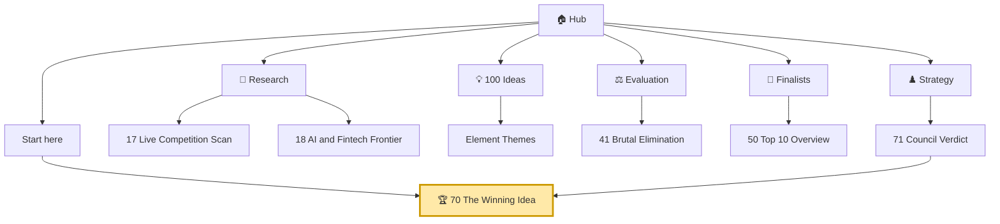
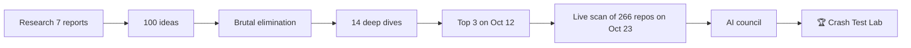

# 🏠 PayPal AI Hackathon 2026: the hub

> [!tldr] In one breath
> We researched the PayPal AI Hackathon, invented 100 ideas, killed most of them, deep dived the 14 best, scanned 266 live competitor repos, and put the finalists through an AI council. **The winner is [[70 The Winning Idea|Crash Test Lab]]: it crash tests PayPal code written by AI coding agents, then makes the agent prove its fix.**

> [!info] The event in 10 seconds
> * **Where:** https://paypalaihackathon.devpost.com/
> * **Deadline:** **Nov 12, 2026 at 12:00pm PT** (3:00pm EST)
> * **Crowd:** 18,754 registered (Oct 23), up from 11,274 on Oct 11
> * **Prizes:** $12k / $8k / $5k, five $5k category prizes, and sponsor prizes from AG Grid, APIMatic, Bryntum, Channel3 and Render
> * **The one rule:** meaningfully use **both** PayPal and AI
> * **Companion vault:** `Agentic-Payments-Hackathon` (unchanged)

## 🗺️ The map (click any box in reading view)

## 🧭 How the decision was made

## 🚀 Start here (read in this order, about 20 minutes)
1. [[70 The Winning Idea]] **The pick, and why it wins.** Read this first.
2. [[71 Council Verdict (Oct 23)]]: how five AI advisors argued it out.
3. [[17 Live Competition Scan (Oct 23)]]: what 266 rival repos are building, and where the empty land is.
4. [[01 Executive Summary (PayPal AI Hackathon)]] and [[02 The Winning Thesis]]: the big picture.
5. [[Jargon Decoder]]: stuck on a word? Every term is explained there with an everyday analogy.

## 🔬 Research (the homework)
| Note | What you learn |
|---|---|
| [[10 Event, Rules & Judging Intelligence]] | Rules, judges, and what each judge likes |
| [[11 PayPal Platform & Sandbox Capabilities]] | What PayPal's APIs and practice sandbox can really do |
| [[12 Agentic Payments Landscape]] | How AI agents are starting to shop and pay |
| [[13 Problem Evidence Base]] | Proof that the problems are real |
| [[14 Prior Winners & Duplicated Archetypes]] | What won before, and what everyone copies |
| [[15 Sponsor Tools]] | AG Grid, APIMatic, Bryntum, Channel3, Render |
| [[16 Developer Pain, Gaps & Hidden Insights]] | Where developers suffer |
| [[17 Live Competition Scan (Oct 23)]] 🆕 | The live crowd map |
| [[18 AI and Fintech Frontier (Oct 2026)]] 🆕 | Harness engineering, Jev, new payment protocols |

## 💡 Ideas and themes
* [[Idea Index]]: all 100 ideas in one table · [[Element Themes Overview]] · [[30 Primitives Legend]] (the building blocks)
* Themes: [[Theme E1 Agent purchase liability & integrity|E1 Agent liability]] · [[Theme E2 Programmable holds|E2 Holds]] · [[Theme E3 Evidence economy|E3 Evidence]] · [[Theme E4 Locked money & cash-flow|E4 Cash flow]] · [[Theme E5 Moment-of-send scams|E5 Scams]] · [[Theme E6 Human delegation|E6 Delegation]] · [[Theme E7 Agent-ready long tail|E7 Agent ready shops]] · [[Theme E8 Failure-path intelligence|E8 Failure paths]] 🏆 · [[Theme E9 Agents as economic actors & B2B ops|E9 Agents at work]] · [[Theme E10 Cross-border, giving & inclusion|E10 Inclusion]] · [[Theme C Control group (obvious ideas)|C Obvious ideas]]

## ⚖️ Evaluation (how ideas were judged and killed)
[[40 Scoring Methodology]] · [[41 Brutal Elimination]] · [[42 100-Idea Score Table]] · [[43 Score Reconciliation]] · [[44 Bench Ideas Not Deep-Dived]]

## 🏁 Finalists (the 14 deep dives)
* [[50 Top 10 Overview]]
* 🏆 [[D056 Integration Chaos Monkey (Deep Dive)|#56 Integration Chaos Monkey]], the spine of the winner
* [[D023 Seller Protection Preflight (Deep Dive)|#23 Seller Protection Preflight]] (old pick, now cloned) · [[D003 Mismatch-to-Replacement (Deep Dive)|#3 Mismatch to Replacement]] · [[D055 Payout Failure Triage (Deep Dive)|#55 Payout Failure Triage]] · [[D028 Early-Pay Discount Optimizer (Deep Dive)|#28 Early Pay Discount]] · [[D009 Rental Deposit Inspector (Deep Dive)|#9 Rental Deposit]] · [[D020 Dispute-to-Listing Fixer (Deep Dive)|#20 Dispute to Listing]] · [[D008 Final-Price Agent (Overcapture) (Deep Dive)|#8 Final Price Agent]] · [[D042 Pre-Checkout Injection Firewall (Deep Dive)|#42 Injection Firewall]] · [[D084 Accessible Voice Checkout (Deep Dive)|#84 Accessible Voice]] · [[D047 WebMCP Storefront Kit (Deep Dive)|#47 WebMCP Kit]] · [[D002 Three-Party Agent Error Settlement (Deep Dive)|#2 Agent Error Settlement]] · [[D001 Intent Black Box (Deep Dive)|#1 Intent Black Box]] · [[D032 F&F Scam Interrupter (Deep Dive)|#32 Scam Interrupter]]
* [[Wrong Box Combined Concept]]

## ♟️ Strategy
* 🏆 [[70 The Winning Idea]] · [[71 Council Verdict (Oct 23)]]
* History: [[60 Final Comparison]] · [[61 Top 3 & Winner Recommendation]] (superseded) · [[62 Council Reports]] ([[Council Judge]], [[Council Skeptic]], [[Council Builder]])
* Doing it: [[63 Day-1 Sandbox Test Plan]] · [[64 Judge Q&A & Scorecard Optimisation]] · [[65 Risk Analysis]] · [[66 Grill Me]]

## 🗂️ Meta
[[_Method & Assumptions]] · [[_Sources & Verification Log]] · [[_TASKS & STATUS]] · [[Jargon Decoder]]

> [!tip] Navigating in Obsidian
> * Open **Graph view** (Ctrl+G). Folders are colour coded: gold is the winner and strategy, blue is research, green is ideas, purple is finalists, orange is evaluation, grey is meta.
> * Every note ends with **Where to next**, so you can walk the vault like a book.
> * Grey "Jargon decoder" boxes fold open with a click.
> * Hover over any link to peek at the note without leaving the page.
