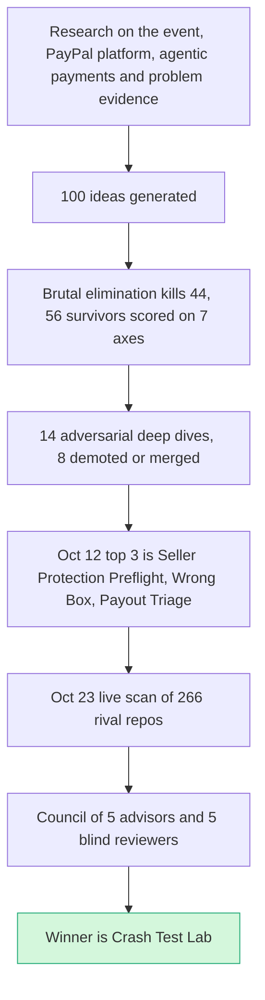

# Executive summary

> [!success] Update Oct 23 2026
> **The pick has changed.** The Oct 12 winner was [[I023 Seller Protection Preflight|#23 Seller Protection Preflight]]. A live repo called `preflight-for-paypal` now does its core job, so it lost its novelty. The new pick is **Crash Test Lab**: [[70 The Winning Idea]].
> **The one line pitch:** "PayPal's doctor checks the happy path. We crash test the unhappy ones and make your coding agent prove the fix."
> **Why it won:**
> * **Empty land.** Out of 266 live hackathon repos, only two touch PayPal developer tooling. The crowded areas are agent spending limits (~30), AI escrow (~28) and shopping bots (~25). See [[17 Live Competition Scan (Oct 23)]].
> * **The judges are the users.** PayPal DevRel said "test the unhappy paths, not just the happy path."
> * **Unanimous council.** All 5 advisors and all 5 peer reviewers picked it. See [[71 Council Verdict (Oct 23)]].
> * **It rides the 2026 wave** of harness engineering. See [[18 AI and Fintech Frontier (Oct 2026)]].
>
> The Oct 12 answer below is kept as history.

> [!tldr] In one breath
> We researched the PayPal AI Hackathon from every side, invented 100 ideas, and cut them down hard. On Oct 12 the top 3 were Seller Protection Preflight, Wrong Box and Payout Failure Triage. On Oct 23 a live scan of rival entries and a second council moved the pick to **Crash Test Lab**.

> [!example] Picture this
> Think of a talent show with 100 acts. A strict first round sends 44 home. The judges score the other 56. The best 14 get a tough audition where people try to make them fail. Three reach the final. Then, the night before the show, you peek backstage and see that someone else is already doing your best act. So you switch to the act nobody else has.

## The goal
**Choose what to build for the PayPal AI Hackathon 2026.** It runs on Devpost, online, with a deadline of Nov 12, 2026 12:00pm PT. To choose, we researched the event, the PayPal platform, the agentic payments landscape and real evidence of problems. Then we generated, scored and stress tested 100 ideas.

## The research journey

## The Oct 12 answer (now history)
1. **[[I023 Seller Protection Preflight|#23 Seller Protection Preflight]]**: a check that runs before a PayPal seller ships. It enforces Seller Protection's own rules, releases holds through tracking, and builds the dispute evidence pack ahead of time. 89/120.
2. **[[Wrong Box Combined Concept|"Wrong Box"]]**: when an AI agent buys the wrong item, a photo decides who is at fault. PayPal fixes it with a replacement offer or a payout. 88/120.
3. **[[I055 Payout Failure Triage|#55 Payout Failure Triage]]**: payouts that can be recovered, with compliance refusals shown openly. 86/120.

The full Top 10 with tiers is in [[50 Top 10 Overview]].

## How the answer was reached
100 ideas, then 44 eliminated on kill criteria, then 56 survivors scored on 7 axes, then 14 put through adversarial deep dives, then 8 demoted or merged on evidence (#1 and #2 folded into Wrong Box), then a three role council agreed on the Top 3. See [[40 Scoring Methodology]].

**On Oct 23** the live scan and a new five advisor council replaced that Top 3 with Crash Test Lab. See [[70 The Winning Idea]] and [[71 Council Verdict (Oct 23)]].

## What to know before trusting it
**The scores are rougher than they look.**
* Deep dives cut finalist scores by an average of 13.9 points. The other 86 ideas have not been through that, so their scores are likely inflated.
* The council is one model family. Confidence was 3/5 in each role.
* Everything ranks on sandbox behaviours not yet tested: [[63 Day-1 Sandbox Test Plan]].
* The element code legend and the kill criteria definitions were rebuilt from how they were used (⚠).

## Key research findings
**The judges, the platform and the crowd all shaped the pick.**
* Judges score five equal criteria, may not run the code, and may use automated AI analysis of the repo ([[10 Event, Rules & Judging Intelligence]]).
* PayPal's own agent toolkit has no tools for authorize, vault, payouts, dispute evidence, idempotency or spending limits. The hosted sandbox MCP has been broken since Oct 8 ([[11 PayPal Platform & Sandbox Capabilities]], [[16 Developer Pain, Gaps & Hidden Insights]]).
* Early Devpost entries cluster heavily in spend gates, AI escrow, shopping agents and "PayPilot" assistants ([[14 Prior Winners & Duplicated Archetypes]]).
* No liability shift exists for "authorized but wrong" agent purchases ([[12 Agentic Payments Landscape]]).

> [!info]- Jargon decoder
> **Devpost**: the website that hosts the hackathon, takes submissions and shows the judging.
> **Agentic payments**: AI agents that shop and pay on your behalf, like a personal assistant holding your card.
> **Seller Protection**: PayPal's promise to cover a seller if a buyer falsely claims an item never arrived, as long as the seller followed the rules. Like insurance that only pays out if you locked the door.
> **Hold**: PayPal keeping a seller's money for a while before releasing it, like a deposit kept until the rental car comes back clean. Adding tracking can release it sooner.
> **Dispute evidence pack**: the bundle of proof (tracking, photos, messages) a seller sends when a buyer complains. Like gathering receipts before a court date.
> **Payout**: PayPal sending money out to many people at once, like a company paying freelancers.
> **Kill criteria**: rules that throw an idea out instantly, like "a rival already built it."
> **Adversarial deep dive**: a long study where the goal is to break the idea, not praise it.
> **Council**: several AI advisors with clashing mindsets who argue a decision, then get reviewed blind.
> **Sandbox**: PayPal's practice playground with fake money, like a flight simulator.
> **MCP**: a standard plug that lets AI tools talk to a service, like a universal power adapter.
> **Authorize / vault**: authorize is like a hotel holding $200 on your card at check in, then charging only what you used at check out. Vault means saving a card safely for later.
> **Idempotency**: a ticket number on each request so that asking twice only does it once. Like a coat check ticket.
> **Liability shift**: a rule that says who pays when something goes wrong. Nobody has written one yet for an agent that buys the wrong thing with your permission.
> **Harness engineering**: building the test track and seatbelts around an AI so you can trust its output.
> Full glossary: [[Jargon Decoder]].

## Where to next
* ⬆️ Up: [[00 PayPal AI Hackathon Hub]]
* ⬅️ Previous: [[00 PayPal AI Hackathon Hub]] · ➡️ Next: [[02 The Winning Thesis]]
* 🏆 The pick: [[70 The Winning Idea]]
* 🔗 Related: [[71 Council Verdict (Oct 23)]], [[17 Live Competition Scan (Oct 23)]], [[50 Top 10 Overview]], [[40 Scoring Methodology]], [[61 Top 3 & Winner Recommendation]]
