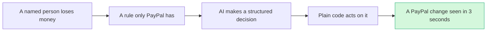

# The winning thesis

> [!success] Update Oct 23 2026
> **The pick has changed.** The thesis below was written for [[I023 Seller Protection Preflight|#23 Seller Protection Preflight]]. A live repo called `preflight-for-paypal` now does its core job, so the pick moved to **Crash Test Lab**: [[70 The Winning Idea]].
> **The one line pitch:** "PayPal's doctor checks the happy path. We crash test the unhappy ones and make your coding agent prove the fix."
> **Why:** only two of 266 live repos touch PayPal developer tooling, PayPal DevRel asked teams to "test the unhappy paths", and the council was unanimous ([[71 Council Verdict (Oct 23)]]). The test of the five claims against Crash Test Lab is further down.

> [!tldr] In one breath
> A winning entry starts from a real loss a named person suffers, enforces a rule only PayPal has, and shows a PayPal change the judge can see in three seconds. Five claims turn that into rules, one per judging criterion. Crash Test Lab passes four cleanly and bends on the first.

> [!example] Picture this
> A cooking contest where every judge is a pastry chef. Making a plain sandwich gets you nowhere, however good it is. Baking something only this kitchen's special oven can make, and pulling it out golden in front of them, wins. The five claims are the rules for picking that dish.

## The thesis in one sentence
> **Start from a loss a named person has, enforce a rule only PayPal has, and show a PayPal state change the judge can see in three seconds.**

## Five claims (each ties to a Devpost criterion)
1. **Use PayPal where PayPal is unusual.** Seller Protection clauses, tracking releases holds, UNCLAIMED→RETURNED, dispute replacement offers. A generic checkout earns a 5 on Tech at best. (Tech)
2. **Make the AI decide something consequential and structured,** with deterministic code moving the money. (Tech, Innovation)
3. **Avoid the four saturated clusters** in the headline: spend gates, escrow, shopping agents, PayPilot assistants. (Innovation)
4. **Make the unhappy path the product,** because the kickoff said to test it. (Tech, Design)
5. **One unmistakable visual per video.** (Presentation)

## Does Crash Test Lab pass the five claims?
**Four clean passes and one honest bend.** Facts below come from [[70 The Winning Idea]] and [[71 Council Verdict (Oct 23)]].

| Claim | Does Crash Test Lab satisfy it? | How |
|---|---|---|
| 1. Use PayPal where PayPal is unusual | ⚠️ Bends | The claim meant unusual PayPal *money features* (Seller Protection, holds, UNCLAIMED→RETURNED). Crash Test Lab uses none of those. It uses unusual PayPal *sandbox features* instead: the `PayPal-Mock-Response` header, signed webhook resends with signature checks, and idempotency through `PayPal-Request-Id`, on Orders v2 and Payments v2. Few teams touch these, but the checkout under test is itself generic. |
| 2. AI decides something consequential and structured | ✅ Yes, with a twist | The AI returns strict JSON: `{scenario, verdict, severity, root_cause, file, line}`. Plain code rules detect and verify; the AI diagnoses and repairs. The twist: no money moves. The deterministic code decides pass or fail, not payments. |
| 3. Avoid the four saturated clusters | ✅ Yes | Only two of 266 live repos touch PayPal developer tooling. The crowds are agent spending limits (~30), AI escrow (~28) and shopping bots (~25). See [[17 Live Competition Scan (Oct 23)]]. |
| 4. Make the unhappy path the product | ✅ Yes, fully | The whole product is the unhappy path: declines, 429s, 500s, capture timeouts, duplicate and forged webhooks. PayPal DevRel said "test the unhappy paths, not just the happy path." |
| 5. One unmistakable visual per video | ✅ Yes | A crash test rating: one star, crash, "two orders, one payment" in big red numbers, fix, five stars. |

**The headline sentence also bends a little.** The "named person" is a shop owner whose AI written checkout ships two orders for one payment, and the PayPal PM upset that coding agents install SDKs "two, three, sometimes even five years old." The "PayPal state change" becomes a crash rating moving from red to green rather than money moving.

## What the research ruled out
**Four kinds of idea were dead before they started.**
* Agent receipt or transcript hash products: Provenant and AgentProof exist in this very hackathon.
* Storefront WebMCP kits: Shopify and Stripe ship them by default.
* Scam interruption at send: PayPal ships its own AI scam alerts.
* Anything that needs gated PayPal APIs (Store Sync, Agent Ready) as its core loop.

Crash Test Lab steers clear of all four. Its core loop runs on the open sandbox.

## Where the thesis could be wrong
**Impact is the weak spot for every finalist.** Impact scores 4 to 7 on every finalist because primary evidence of severity is thin for the specific mechanisms. A judge who weights impact above scarcity will prefer an idea with better evidenced pain (late payment, holds). That is why #28 and the E4 theme remain Tier B.

Crash Test Lab's answer is to measure impact instead of arguing it: crash test the same checkout built by 4 to 5 coding agents and publish the table ([[70 The Winning Idea]]).

> [!info]- Jargon decoder
> **Seller Protection clauses**: the fine print of PayPal's promise to cover a seller, like insurance that pays only if you locked the door.
> **Tracking releases holds**: PayPal keeps a seller's money for a while; adding a tracking number can free it sooner, like getting a deposit back once the rental car is returned.
> **UNCLAIMED→RETURNED**: a payout nobody collected goes back to the sender, like a parcel returned after nobody answered the door.
> **Dispute replacement offer**: in a complaint, the seller offers a new item instead of a refund.
> **Deterministic code**: plain code that gives the same answer every time, like a calculator. The AI suggests, the calculator acts.
> **Saturated cluster**: a type of idea so many teams are building that judges are tired of it.
> **Unhappy path**: everything that goes wrong (card declined, server error) as opposed to the smooth "happy path."
> **Mock response header**: a sandbox switch that tells PayPal "pretend this fails", like a crash test dummy setting.
> **Webhook resend**: PayPal ringing your server's doorbell again with the same message. Good code must not open the door twice.
> **Idempotency / PayPal-Request-Id**: a ticket number on each request so asking twice only does it once. Like a coat check ticket.
> **429 / 500**: "slow down, you are calling too often" and "PayPal's side hiccupped."
> **WebMCP**: a way for a website to expose buttons an AI agent can press directly.
> **Gated API**: a PayPal feature you need special approval to use, like a club with a guest list.
> Full glossary: [[Jargon Decoder]].

## Where to next
* ⬆️ Up: [[00 PayPal AI Hackathon Hub]]
* ⬅️ Previous: [[01 Executive Summary (PayPal AI Hackathon)]] · ➡️ Next: [[10 Event, Rules & Judging Intelligence]]
* 🏆 The pick: [[70 The Winning Idea]]
* 🔗 Related: [[71 Council Verdict (Oct 23)]], [[17 Live Competition Scan (Oct 23)]], [[14 Prior Winners & Duplicated Archetypes]], [[61 Top 3 & Winner Recommendation]]
