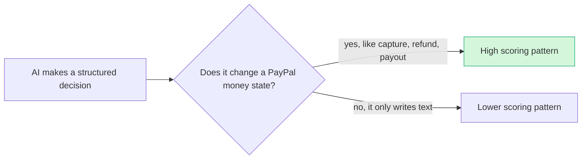

# Primitives legend (P = PayPal, A = AI, S = sponsor)

> [!tldr] In one breath
> Every idea is tagged with short codes for the building blocks it uses: **P** codes are PayPal features, **A** codes are AI skills, **S** codes are sponsor tools. This page says what each code means in plain words, with a small everyday comparison, and how many of the 100 ideas use it.

> [!example] Picture this
> Think of a recipe card that lists "flour, eggs, oven". These codes are the ingredient list for each idea. An idea tagged "P17, P14, A13" tells you at a glance that it adds tracking numbers, answers disputes, and checks photos.

> [!warning] The labels are reconstructed
> The idea records tag each idea with element codes. The original code table was not saved, so these labels are **reconstructed from how each code is used** across the 100 ideas. Treat the exact wording as an inference (⚠). **Usage counts are exact.** There is no P28 in the data.

## PayPal primitives

**The PayPal side: the actual levers the app can pull on PayPal.**

| Code | Meaning | In plain words, with an analogy | Ideas using it |
|---|---|---|---|
| P01 | Orders v2 (create / capture / get) | The basic "make a sale" call. Like writing a ticket at a till, then ringing it up. | 25 |
| P02 | AUTHORIZE intent (hold funds) | Reserve the buyer's money without taking it yet. Like a hotel holding $200 at check in. | 12 |
| P03 | Authorization lifecycle: partial capture, void, reauthorize | What you do with a hold later: take part, cancel it, or renew it. Like checking out of the hotel and paying only for the minibar you used. | 9 |
| P04 | Overcapture (capture above the authorized amount, within 115% / +$75) | Take a bit more than you held. Like a restaurant adding the tip after the card was swiped. | 1 |
| P05 | Orders PATCH (change an order before capture) | Edit the order before charging. Like fixing a typo on a ticket before ringing it up. | 1 |
| P06 | Vault v3 (saved payment tokens, payer-not-present charges) | Save a payment method safely so you can charge later without the buyer clicking. Like a coffee shop keeping your card on file for a monthly tab. | 6 |
| P07 | Subscriptions (revise, suspend, payment-failed events) | Repeating payments, with tools to change, pause, or notice a failed charge. Like a gym membership. | 12 |
| P08 | Invoicing v2 (create, send, partial payment) | Send a bill the customer can pay online, even in parts. Like a plumber's invoice with a "pay now" button. | 17 |
| P09 | Invoicing conditional rules (early-payment discount, auto-cancel) | Rules on a bill, such as "2% off if paid in 10 days" or "cancel if unpaid". Like a coupon with an expiry date. | 2 |
| P10 | Invoicing recurring series / record payment | Bills that repeat, and marking a bill paid when cash came another way. Like monthly rent, or ticking off a cheque in the ledger. | 3 |
| P11 | Payouts (batch) | Send money to many people in one go. Like a teacher handing out prize money to the whole class at once. | 14 |
| P12 | Payouts to Venmo handles | Payouts that land in someone's Venmo using their @name. | 4 |
| P13 | Payouts failure handling and test values (UNCLAIMED, cancel, RETURNED, ERRPYO codes) | What happens when a payout does not land, and fake failure codes for testing. Like a parcel nobody signs for that returns to sender. | 3 |
| P14 | Disputes API (get, messages, make-offer, accept-offer, provide-evidence) | Read and answer a buyer's complaint: chat, offer a fix, or send proof. Like a small claims court run by message. | 18 |
| P15 | Disputes sandbox factory (create, adjudicate) | Make fake disputes in the test playground and fake the ruling. Like a mock trial for practice. | 6 |
| P16 | Refunds (full / partial) | Give money back, all or some. | 11 |
| P17 | Shipment Tracking API (add tracking; releases holds) | Attach a tracking number to a sale. This can release a seller's held money. Like showing a receipt to get your deposit back. | 8 |
| P18 | Transaction Search / Reporting | Search the full history of payments. Like a bank statement you can ask questions of. | 20 |
| P19 | Merchant insights / balances | See the seller's balance and summary numbers. Like checking your wallet and your weekly totals. | 2 |
| P20 | Webhooks (events, retries, verification) | PayPal pings your app when something happens, retries if you miss it, and signs it so you know it is real. Like a doorbell with a caller ID. | 23 |
| P21 | PayPal-Mock-Response header (sandbox fault injection) | A switch that makes the test playground pretend something failed. Like a fire drill. | 3 |
| P22 | Payment Links | A link you can text or post, and anyone who clicks can pay. Like a QR code on a market stall. | 6 |
| P23 | Pay Later messaging | Show "pay in 4" style offers next to the price. | 4 |
| P24 | JS SDK v6 | PayPal's newest set of web page buttons and code for checkout. | 6 |
| P25 | Log in with PayPal | Sign in to a site using your PayPal account, so the site knows who you are. Like showing ID at the door. | 3 |
| P26 | Multiparty / platform (partner-gated) | Tools for marketplaces that pay many sellers. Needs PayPal's approval first. Like a members only door. | 1 |
| P27 | Agent Toolkit / MCP | PayPal's ready made kit for letting AI agents call PayPal. Like a universal remote for PayPal. | 4 |
| P29 | Donate SDK / charity flows | Buttons and flows built for giving to charity. | 3 |
| P30 | Catalog products / billing plans | Define a product and its price plan, mainly for subscriptions. Like the menu board at a gym. | 5 |
| P31 | custom_id / invoice_id metadata binding | Stick your own label on a PayPal payment so you can match it later. Like writing an order number on a parcel. | 6 |
| P32 | Seller Protection policy rules | PayPal's written rules for when a seller is covered in a dispute. Like the fine print on a warranty. | 2 |

## AI primitives

**The AI side: what the model actually does.**

| Code | Meaning | In plain words, with an analogy | Ideas using it |
|---|---|---|---|
| A01 | Document / image extraction (OCR, validation) | Read text and numbers off a photo or file and check them. Like a cashier reading a handwritten cheque. | 22 |
| A02 | Classification with explanation / vision estimation | Put something in a category and say why, or judge from a picture. Like a vet guessing a dog's age from a photo. | 11 |
| A03 | Intent and rationale reasoning (LLM-as-judge) | Work out what someone meant and judge whether an action fits. Like a referee watching a replay. | 12 |
| A04 | Forecasting / pricing suggestion | Predict what comes next or suggest a price. Like a weather forecast for cash. | 11 |
| A05 | Structured decision / classification (most common) | Pick one option from a fixed list, in a form a program can act on. Like a traffic light choosing red, amber or green. | 25 |
| A06 | Entity matching and narrative drafting | Spot that two records are the same thing, and write a short story of what happened. Like matching socks, then writing the laundry report. | 12 |
| A07 | Multi-agent negotiation | Two or more AIs bargain with each other. Like two estate agents haggling for their clients. | 5 |
| A08 | Speech / voice | Understand and speak out loud. | 5 |
| A09 | Browser agents | An AI that clicks around websites like a person. | 3 |
| A10 | Injection classifiers and provenance attribution | Spot hidden instructions meant to trick an AI, and track where each piece of text came from. Like a bouncer checking whose name is really on the guest list. | 1 |
| A11 | Translation / tone | Change language or politeness level. Like a diplomat rewording a blunt message. | 6 |
| A12 | Eligibility reasoning and messaging | Decide if someone qualifies for something and explain it kindly. Like a school office explaining whether you can get a bus pass. | 20 |
| A13 | Vision verification / evidence narrative | Check a photo against what was expected and write up the proof. Like an insurance assessor photographing a dented car. | 9 |
| A14 | Diagnosis / code transformation | Find what is broken and rewrite code to fix it. Like a mechanic who also swaps the part. | 4 |
| A15 | Anomaly detection | Spot the odd one out in a pile of normal data. Like noticing one red sock in a white wash. | 6 |
| A16 | Policy / rule reasoning with cited clauses | Apply a rulebook and quote the exact rule used. Like a referee pointing to the rule number. | 8 |

## Sponsor tooling

**Sponsor tools that can also win side prizes.** See [[15 Sponsor Tools]].

| Code | Meaning | In plain words, with an analogy | Ideas using it |
|---|---|---|---|
| S01 | Sponsor tool: AG Grid / AG Studio (⚠ inferred) | Fancy data tables and dashboards. Like a supercharged spreadsheet in the browser. | 1 |
| S02 | Sponsor tool: APIMatic (⚠ inferred) | Feeds correct PayPal API context to coding agents. Like giving your helper the right manual. | 0 |
| S03 | Sponsor tool: Channel3 (⚠ inferred) | A product catalog that AI shopping agents can search. Like a giant shared shop catalogue. | 2 |
| S04 | Sponsor tool: KERNEL browser infrastructure (⚠ inferred) | Cloud browsers for agents to drive. Like renting a fleet of remote controlled laptops. | 3 |
| S05 | Sponsor tool: Elastic / Render (⚠ inferred) | Search and hosting services. Render is where the app could live online. | 1 |

## What the counts tell us

* **Most used PayPal primitives:** Orders (P01), Webhooks (P20), Transaction Search (P18), Invoicing (P08), Disputes (P14). That is the centre of gravity around checkout, and **it is why the finalists below favour Tracking (P17), Payouts failure handling (P13), Disputes sandbox factory (P15) and conditional invoicing (P09)**: they stand out from the crowd.
* **Least used:** Orders PATCH (P05), Overcapture (P04), Multiparty (P26). The first two are effectively only #8; the last is partner gated.
* **AI is dominated by classification and structured decisions (A05) and document extraction (A01).** The highest scoring ideas pair a *consequential* structured decision with a PayPal money state change, meaning the AI's choice actually moves money.

> [!info]- Jargon decoder
> **Primitive**: a basic building block you combine into bigger things, like a Lego brick.
> **API**: a menu of requests one program can send another. Like ordering from a waiter instead of walking into the kitchen.
> **Sandbox**: PayPal's practice playground with fake money.
> **SDK**: a ready made toolkit of code for using an API.
> **OCR**: optical character recognition, reading text from an image.
> **LLM**: large language model, the kind of AI behind chatbots.
> **Partner gated**: only available after PayPal approves you as a partner.

## Where to next
* ⬆️ Up: [[00 PayPal AI Hackathon Hub]]
* ⬅️ Previous: [[Theme C Control group (obvious ideas)]] · ➡️ Next: [[40 Scoring Methodology]]
* 🔗 Related: [[Element Themes Overview]], [[11 PayPal Platform & Sandbox Capabilities]], [[15 Sponsor Tools]], [[Jargon Decoder]]
