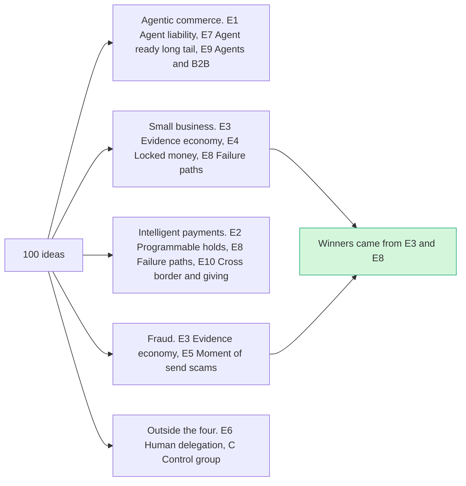

# Element themes: what emerged from the research

> [!tldr] In one breath
> The 100 ideas fell naturally into 10 themes plus one control group of deliberately obvious ideas. This page shows each theme, how many ideas it had, how many survived, and its best scorer. **The winners came from two themes: E3 (evidence economy) and E8 (failure path intelligence).**

> [!example] Picture this
> Think of tipping 100 seashells onto a table and sorting them by shape. You did not decide the shapes first; you saw them once the shells were out. That is why some piles are big (15 ideas) and some are tiny (4). The themes here were found the same way.

## How the themes were made

The ideas were generated from four research reports and then grouped into 10 themes plus a control group. **Themes are outputs of the ideation, not inputs, which is why they have uneven sizes.**

## The map

The brief suggested four example directions. This is how the themes line up with them (some themes sit under two directions).

## Every theme in one table

How to read it: **Ideas** is how many ideas the theme had. **Survivors** passed the kill gates in [[41 Brutal Elimination]]. **Best final** is the top score out of 120 after any deep dive. **Best idea** is the theme's top scorer.

| Theme | Ideas | Survivors | Best final | Best idea | Read |
|---|---|---|---|---|---|
| E1 | 11 | 8 | 87 | [[I003 Mismatch-to-Replacement\|#3 Mismatch-to-Replacement]] | [[Theme E1 Agent purchase liability & integrity\|Agent purchase liability & integrity]] |
| E2 | 9 | 7 | 83 | [[I013 Pricing-Error Shield\|#13 Pricing-Error Shield]] | [[Theme E2 Programmable holds\|Programmable holds]] |
| E3 | 15 | 8 | 91 | [[I016 Dispute EV Triage\|#16 Dispute EV Triage]] | [[Theme E3 Evidence economy\|Evidence economy]] |
| E4 | 8 | 5 | 85 | [[I028 Early-Pay Discount Optimizer\|#28 Early-Pay Discount Optimizer]] | [[Theme E4 Locked money & cash-flow\|Locked money & cash-flow]] |
| E5 | 7 | 4 | 85 | [[I035 Vendor Change Verifier\|#35 Vendor Change Verifier]] | [[Theme E5 Moment-of-send scams\|Moment-of-send scams]] |
| E6 | 4 | 2 | 85 | [[I040 Purpose-Bound Family Support\|#40 Purpose-Bound Family Support]] | [[Theme E6 Human delegation\|Human delegation]] |
| E7 | 7 | 6 | 82 | [[I049 Agent-Buyability Audit\|#49 Agent-Buyability Audit]] | [[Theme E7 Agent-ready long tail\|Agent-ready long tail]] |
| E8 | 11 | 6 | 86 | [[I055 Payout Failure Triage\|#55 Payout Failure Triage]] | [[Theme E8 Failure-path intelligence\|Failure-path intelligence]] |
| E9 | 12 | 5 | 79 | [[I092 Scope-Creep Change-Order Guard\|#92 Scope-Creep Change-Order Guard]] | [[Theme E9 Agents as economic actors & B2B ops\|Agents as economic actors & B2B ops]] |
| E10 | 12 | 5 | 81 | [[I069 Second-Gift Engine\|#69 Second-Gift Engine]] | [[Theme E10 Cross-border, giving & inclusion\|Cross-border, giving & inclusion]] |
| C | 4 | 0 | 60 | [[I097 Control Natural-Language PayPal Assistant\|#97 Control: Natural-Language PayPal Assistant]] | [[Theme C Control group (obvious ideas)\|Control group (obvious ideas)]] |

> [!tip] One surprise in the table
> E3's best idea, #16 Dispute EV Triage, scored 91 but was killed for sitting in a crowded headline (K2). So "best final" is not the same as "best idea still alive".

## Six patterns across the themes (⚠ inference from the data)

1. **PayPal's own rules and states beat generic AI.** The strongest surviving ideas (#23, #55, Wrong Box) hinge on a PayPal specific rule or state machine: a Seller Protection clause, a payout going UNCLAIMED then RETURNED, a dispute replacement offer. Generic ideas (spend gates, receipts, shopping agents) lost on innovation.
2. **Deep dives deflated the agent liability theme (E1) most.** #1 and #2 collapsed into Provenant, AgentProof and Amex coverage. Only the photo check after delivery (#3) survived, as the spine.
3. **Unhappy paths are an explicit judging signal.** E8 (failure path intelligence) matches the kickoff advice and gave two of the final ten.
4. **Platforms are moving into storefront side agent plumbing (E7).** Shopify and Stripe shipped WebMCP tools by default, so #47 was demoted.
5. **Moment of send scams (E5) are already served by PayPal itself and by banks,** so the headline idea #32 fell from 89 to 71.
6. **The four example directions from the brief map as:** agentic commerce to E1, E7 and E9; small business to E3, E4 and E8; intelligent payments to E2, E8 and E10; fraud to E3 and E5. They were treated as guesses to test, and **the winners come from E3 and E8.**

## Theme notes
* [[Theme E1 Agent purchase liability & integrity]]
* [[Theme E2 Programmable holds]]
* [[Theme E3 Evidence economy]]
* [[Theme E4 Locked money & cash-flow]]
* [[Theme E5 Moment-of-send scams]]
* [[Theme E6 Human delegation]]
* [[Theme E7 Agent-ready long tail]]
* [[Theme E8 Failure-path intelligence]]
* [[Theme E9 Agents as economic actors & B2B ops]]
* [[Theme E10 Cross-border, giving & inclusion]]
* [[Theme C Control group (obvious ideas)]]
* [[30 Primitives Legend]]

> [!info]- Jargon decoder
> **Theme**: a pile of ideas that share the same basic problem.
> **Control group**: deliberately obvious ideas used to check the scoring works, like weighing a known 1 kg bag to test a scale.
> **Survivor**: an idea that passed every kill gate.
> **Deep dive**: a second, harsher check where an analyst tried hard to prove the idea was not new, not buildable or not useful.
> **State machine**: a set of fixed stages something moves through, like a parcel going "packed, shipped, delivered".
> **Spend gate**: a rule that blocks an AI agent from spending past a limit.
> **WebMCP**: a way for a web page to show a visiting AI agent which buttons it may press.

## Where to next
* ⬆️ Up: [[00 PayPal AI Hackathon Hub]]
* ➡️ Next: [[Theme E1 Agent purchase liability & integrity]]
* 🔗 Related: [[30 Primitives Legend]], [[40 Scoring Methodology]], [[41 Brutal Elimination]], [[42 100-Idea Score Table]], [[Wrong Box Combined Concept]], [[17 Live Competition Scan (Oct 23)]]
