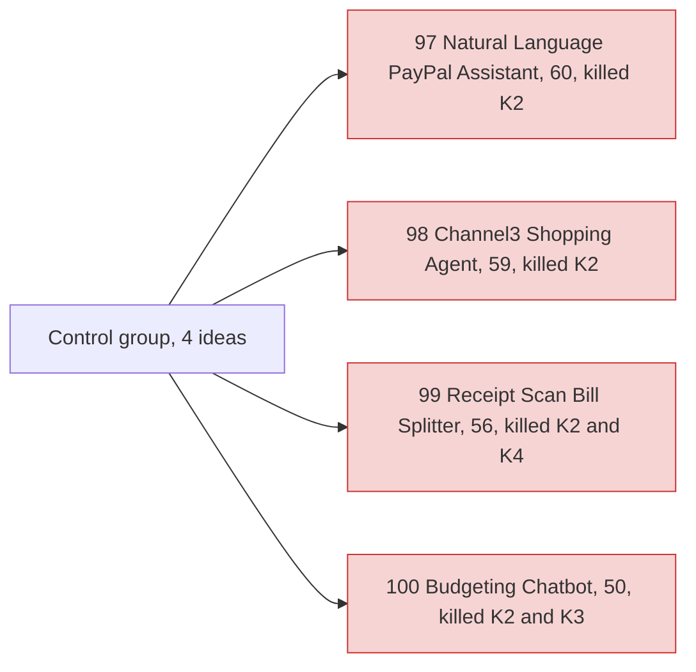

# Theme C: Control group (obvious ideas)

> [!tldr] In one breath
> These four ideas were picked on purpose because they are the first things everyone thinks of: a chat assistant for PayPal, a shopping agent, a receipt splitter and a budget chatbot. **They are here as a test of the scoring system. If the method works, they should score low, and they did (50 to 60 out of 120).**

> [!example] Picture this
> A teacher testing a new exam slips in one question every student will get right. If the "easy" question turns out hard, the exam is broken, not the students. This group is that easy question, used to check the scoring ruler is straight.

> [!warning] Crowd check, Oct 23 2026
> Exactly as expected, this is **packed**. Chat to checkout shopping agents is the third most crowded area (about 25 repos), with **at least 10 repos named "PayPilot"**, plus checkout-agent, errand (Channel3, very close to #98), buyguy, agentic-cart, gofer, sahaya and shopvoice-pay. Group splitting (#99) has caresplit, potluck, purser, sarafupay, WePay and homeward. Budget agents (#100) include budget-guardian, two paypal-budget-agent repos and Monetra. Receipt bill split, shopping agent and budgeting categoriser are all on PayPal's own "Inspiration" list, so convergence is expected. Scan covered 266 repos created Sep 1 to Oct 22, partial coverage, official gallery not public. See [[17 Live Competition Scan (Oct 23)]].

## What this group is for

Deliberately obvious ideas (natural language assistant, shopping agent, receipt splitter, budget chatbot) kept as a **scoring baseline**, so the method can be checked against ideas expected to score low.

Group: **Control group, obvious (4)**.

**4 ideas, 0 survivors, 0 deep dived. Best final score: 60/120.**

## The ideas at a glance

## Every idea in this group

How to read it: **Desk** is the first score out of 120, **Final** is after any deep dive (none here), **Status** shows the kill codes from [[41 Brutal Elimination]]. **Crowding** is from the Oct 12 scan.

| Rank in theme | Idea | Desk | Final | Status | Crowding |
|---|---|---|---|---|---|
| 1 | [[I097 Control Natural-Language PayPal Assistant\|#97 Control: Natural-Language PayPal Assistant]] | 60 | 60 | eliminated K2 | NL-assistant cluster (~8) |
| 2 | [[I098 Control Channel3 Shopping Agent + PayPal Checkout\|#98 Control: Channel3 Shopping Agent + PayPal Checkout]] | 59 | 59 | eliminated K2 | Shopping-agent cluster (~10) |
| 3 | [[I099 Control Receipt-Scan Bill Splitter\|#99 Control: Receipt-Scan Bill Splitter]] | 56 | 56 | eliminated K2,K4 | Group-pay cluster (~6) |
| 4 | [[I100 Control Budgeting Chatbot over PayPal\|#100 Control: Budgeting Chatbot over PayPal]] | 50 | 50 | eliminated K2,K3 | Budgeting cluster |

## Building blocks used most

**Thin PayPal use, which is part of why they score low.** Codes in [[30 Primitives Legend]].

* A03 Intent and rationale reasoning (2)
* P27 Agent Toolkit and MCP (1)
* P01 Orders v2 (1)
* S03 Sponsor tool Channel3 (1)
* P08 Invoicing v2 (1)
* A01 Document and image extraction (1)

> [!info]- Jargon decoder
> **Control group**: a set of "known answers" used to check a test works. Like weighing a 1 kg bag of sugar to check the scale.
> **NL assistant**: natural language assistant, a chatbot you talk to in normal sentences.
> **Baseline**: the starting level you compare everything else against.
> **Channel3**: a sponsor tool, a product catalog that AI shopping agents can search. See [[15 Sponsor Tools]].

## Where to next
* ⬆️ Up: [[Element Themes Overview]]
* ⬅️ Previous: [[Theme E10 Cross-border, giving & inclusion]] · ➡️ Next: [[30 Primitives Legend]]
* 🔗 Related: [[40 Scoring Methodology]], [[41 Brutal Elimination]], [[17 Live Competition Scan (Oct 23)]]
