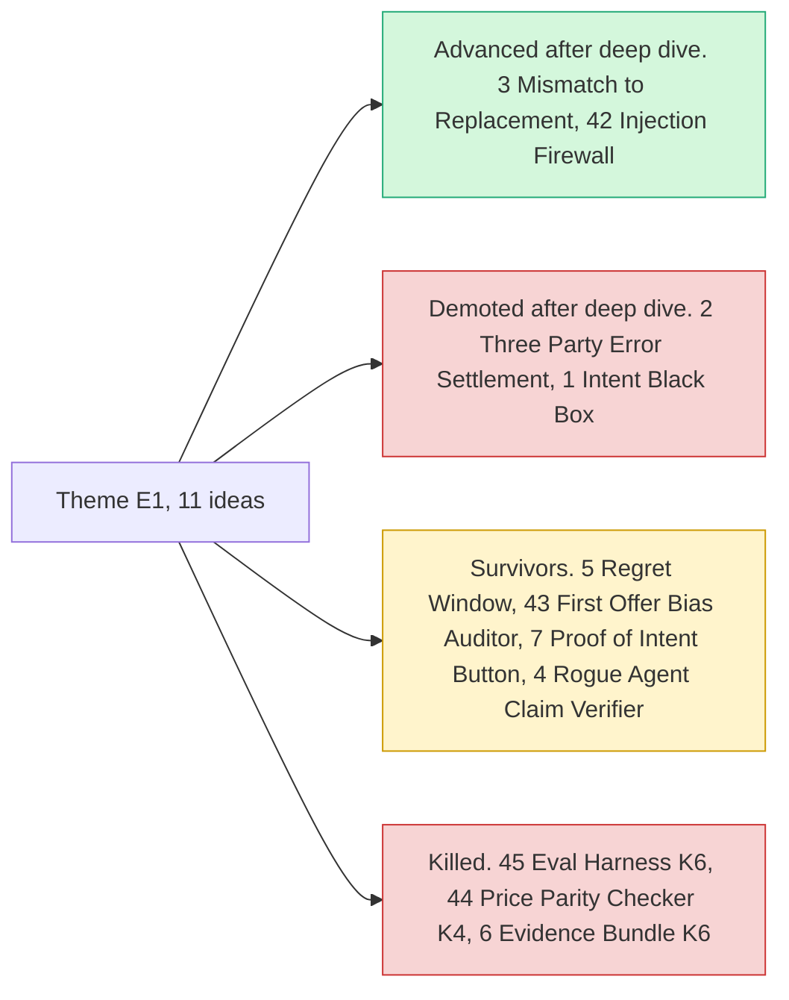

# Theme E1: Agent purchase liability & integrity

> [!tldr] In one breath
> When an AI agent buys something for you and gets it wrong, who pays? And how do you stop someone steering the agent? This is the most crowded corner of the hackathon. **What survives is checking the physical box after it arrives, not keeping receipts or transcripts of the agent's chat.**

> [!example] Picture this
> You tell your AI helper "buy me a blue size 9 running shoe". A box shows up with a red size 11. Was it your vague instruction, the shop's mistake, or the agent's slip? Today nobody has a fair way to decide. This theme is about settling that argument, and about stopping a sneaky web page from whispering new orders to your agent.

> [!warning] Crowd check, Oct 23 2026
> This is the **most saturated area** in the live scan (about 30 public GitHub repos). Agent spending guards and "firewalls" include permit, mandate ("OAuth for AI spending"), Warden, paypal-agent-firewall, four repos named "leash", three named "allowance", two "countersign", three "payguard", mandateguard, aegismandate, SafePayAI and more. That hits #5 Regret Window, #7 Proof of Intent and #42 Injection Firewall hardest. The dispute side (#3, #4) sits next to about 16 dispute copilots such as witness, dispute-defender and rebuttal. Scan covered 266 repos created Sep 1 to Oct 22, so coverage is partial and the official gallery is not public yet. See [[17 Live Competition Scan (Oct 23)]].

## What this theme is about

Who pays when an AI agent buys the wrong thing, and how to stop an agent being steered. It was heavily contested on Devpost already (Provenant, AgentProof, Warden). **The part that survives is the physical fact check after delivery, not the receipt or transcript layer.**

The ideas came in two groups: **Agent purchase liability (7)** and **Agent integrity (4)**.

**11 ideas, 8 survivors, 4 deep dived. Best final score: 87/120.**

## The ideas at a glance

## Every idea in this theme

How to read it: **Desk** is the first score from desk research, out of 120. **Final** is the score after any deep dive. **Status** says whether it survived, was killed (K codes, see [[41 Brutal Elimination]]) or got a deep dive verdict. **Crowding** is what the Oct 12 scan saw.

| Rank in theme | Idea | Desk | Final | Status | Crowding |
|---|---|---|---|---|---|
| 1 | [[I003 Mismatch-to-Replacement\|#3 Mismatch-to-Replacement]] | 93 | 87 | deep: advance-with-changes | Disputes/refunds cluster (~7) adjacent |
| 2 | [[I005 Regret Window\|#5 Regret Window]] | 87 | 87 | survivor | Spend-gate cluster (~13) |
| 3 | [[I043 First-Offer Bias Auditor\|#43 First-Offer Bias Auditor]] | 81 | 81 | survivor | Shopping-agent cluster adjacent |
| 4 | [[I007 Proof-of-Intent Checkout Button\|#7 Proof-of-Intent Checkout Button]] | 78 | 78 | survivor | none |
| 5 | [[I004 Rogue-Agent Claim Verifier\|#4 Rogue-Agent Claim Verifier]] | 76 | 76 | survivor | Disputes cluster |
| 6 | [[I042 Pre-Checkout Injection Firewall\|#42 Pre-Checkout Injection Firewall]] | 91 | 76 | deep: advance-with-changes | Spend-gate cluster adjacent |
| 7 | [[I045 Agent Payment Eval Harness\|#45 Agent Payment Eval Harness]] | 76 | 76 | eliminated K6 | none |
| 8 | [[I002 Three-Party Agent Error Settlement\|#2 Three-Party Agent Error Settlement]] | 95 | 72 | deep: demote | none observed |
| 9 | [[I044 Agent Price-Parity Checker\|#44 Agent Price-Parity Checker]] | 72 | 72 | eliminated K4 | none |
| 10 | [[I001 Intent Black Box\|#1 Intent Black Box]] | 92 | 71 | deep: demote | Adjacent to ~13 spend-gate/receipt entries |
| 11 | [[I006 Agent Evidence Bundle Spec & Validator\|#6 Agent Evidence Bundle Spec & Validator]] | 71 | 71 | eliminated K6 | none |

## Building blocks used most

**The theme leans on disputes and photo checks.** Codes are explained in [[30 Primitives Legend]].

* P14 Disputes API (6)
* A13 Vision verification and evidence story (6)
* P20 Webhooks (4)
* A05 Structured decision (4)
* P01 Orders v2 (4)
* P31 custom_id metadata binding (4)

> [!info]- Jargon decoder
> **AI agent**: a program that acts for you, like a personal shopper who clicks "buy" on your behalf.
> **Liability**: who has to pay when something goes wrong. Like deciding who covers a broken vase: the mover, the shop, or you.
> **Prompt injection**: hidden text on a web page that tries to give your agent new orders. Like a note slipped into a waiter's pocket saying "bring table 4 the expensive wine".
> **Dispute**: a formal complaint a buyer files with PayPal to get money back.
> **Deep dive**: a second, harsher check where an analyst tried hard to prove the idea was not new, not buildable or not useful.

## Where to next
* ⬆️ Up: [[Element Themes Overview]]
* ⬅️ Previous: [[Element Themes Overview]] · ➡️ Next: [[Theme E2 Programmable holds]]
* 🔗 Related: [[30 Primitives Legend]], [[41 Brutal Elimination]], [[Wrong Box Combined Concept]], [[17 Live Competition Scan (Oct 23)]]
