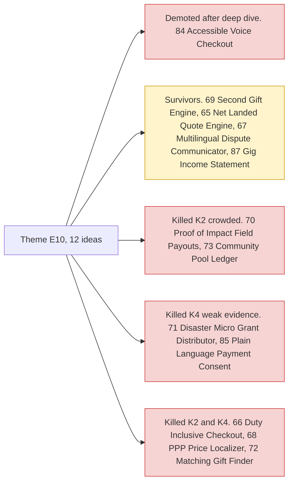

# Theme E10: Cross-border, giving & inclusion

> [!tldr] In one breath
> This theme is about money across borders, money given to good causes, and money for people who are usually left out. Think true landed price quotes, disputes in your own language, keeping donors coming back, and checkout that works for blind users. **The social evidence is strong, but the PayPal specific mechanics are modest.**

> [!example] Picture this
> A shopper in Kenya buys a $40 jacket from a UK store. At the door, the courier asks for $18 more in import duty. She feels tricked. A "net landed" quote would have shown her $58 up front, so the surprise never happens.

> [!success] Crowd check, Oct 23 2026
> This is one of the **emptiest areas** in a 266 repo scan (partial coverage). **Accessibility first payments had zero hits**, even though it is on PayPal's own inspiration list, which matters for #84. Nonprofit and donations was very thin (only amanah and a classroom repo), good news for #69. Microloans, inclusion and the underbanked had none. Cross border FX was thin (homeward, WePay, tradeos), near #65 and #66. Group pooling (#73) has a small cluster: caresplit, potluck, purser, sarafupay, WePay, homeward. Official gallery not public yet. See [[17 Live Competition Scan (Oct 23)]].

## What this theme is about

Net landed cost quotes, multilingual disputes, donor retention and accessible checkout. **Strong societal evidence, but PayPal specific mechanics are modest.**

Groups: **Giving and community (5)**, **Cross border clarity (4)** and **Inclusive money (3)**.

**12 ideas, 5 survivors, 1 deep dived. Best final score: 81/120.**

## The ideas at a glance

## Every idea in this theme

How to read it: **Desk** is the first score out of 120, **Final** is after any deep dive, **Status** shows survivor, killed (K codes in [[41 Brutal Elimination]]) or deep dive verdict. **Crowding** is from the Oct 12 scan.

| Rank in theme | Idea | Desk | Final | Status | Crowding |
|---|---|---|---|---|---|
| 1 | [[I069 Second-Gift Engine\|#69 Second-Gift Engine]] | 81 | 81 | survivor | Donation cluster (sponsor-suggested) |
| 2 | [[I065 Net-Landed Quote Engine\|#65 Net-Landed Quote Engine]] | 79 | 79 | survivor | none |
| 3 | [[I084 Accessible Voice Checkout\|#84 Accessible Voice Checkout]] | 88 | 75 | deep: demote | none |
| 4 | [[I067 Multilingual Dispute Communicator\|#67 Multilingual Dispute Communicator]] | 71 | 71 | survivor | Disputes cluster |
| 5 | [[I070 Proof-of-Impact Field Payouts\|#70 Proof-of-Impact Field Payouts]] | 70 | 70 | eliminated K2 | Escrow cluster |
| 6 | [[I071 Disaster Micro-Grant Distributor\|#71 Disaster Micro-Grant Distributor]] | 69 | 69 | eliminated K4 | none |
| 7 | [[I085 Plain-Language Payment Consent\|#85 Plain-Language Payment Consent]] | 67 | 67 | eliminated K4 | none |
| 8 | [[I087 Gig Income Statement\|#87 Gig Income Statement]] | 67 | 67 | survivor | none |
| 9 | [[I066 Duty-Inclusive Cross-Border Checkout\|#66 Duty-Inclusive Cross-Border Checkout]] | 59 | 59 | eliminated K2,K4 | none |
| 10 | [[I073 Community Pool Ledger\|#73 Community Pool Ledger]] | 59 | 59 | eliminated K2 | Official inspiration |
| 11 | [[I068 PPP Price Localizer\|#68 PPP Price Localizer]] | 56 | 56 | eliminated K2,K4 | none |
| 12 | [[I072 Matching-Gift Finder\|#72 Matching-Gift Finder]] | 56 | 56 | eliminated K2,K4 | none |

## Building blocks used most

**Orders and payouts, with AI translating and explaining.** Codes in [[30 Primitives Legend]].

* P01 Orders v2 (5)
* A12 Eligibility reasoning and messaging (3)
* A11 Translation and tone (3)
* P11 Payouts, batch (3)
* P29 Donate SDK and charity flows (2)
* P07 Subscriptions (2)

> [!info]- Jargon decoder
> **Cross border**: buyer and seller are in different countries.
> **Net landed cost**: the full price once it reaches your door, including shipping, duty and tax. Like a restaurant bill that already includes the service charge.
> **Duty**: a tax a country charges on imported goods.
> **FX**: foreign exchange, swapping one currency for another.
> **PPP**: purchasing power parity. Adjusting a price so it feels fair in each country, like a cinema ticket costing less in a town where wages are lower.
> **Donor retention**: getting a person who gave once to give again.
> **Accessible checkout**: a payment flow that works with screen readers and voice, so blind or low vision users can pay alone.

## Where to next
* ⬆️ Up: [[Element Themes Overview]]
* ⬅️ Previous: [[Theme E9 Agents as economic actors & B2B ops]] · ➡️ Next: [[Theme C Control group (obvious ideas)]]
* 🔗 Related: [[D084 Accessible Voice Checkout (Deep Dive)]], [[30 Primitives Legend]], [[41 Brutal Elimination]], [[17 Live Competition Scan (Oct 23)]]
