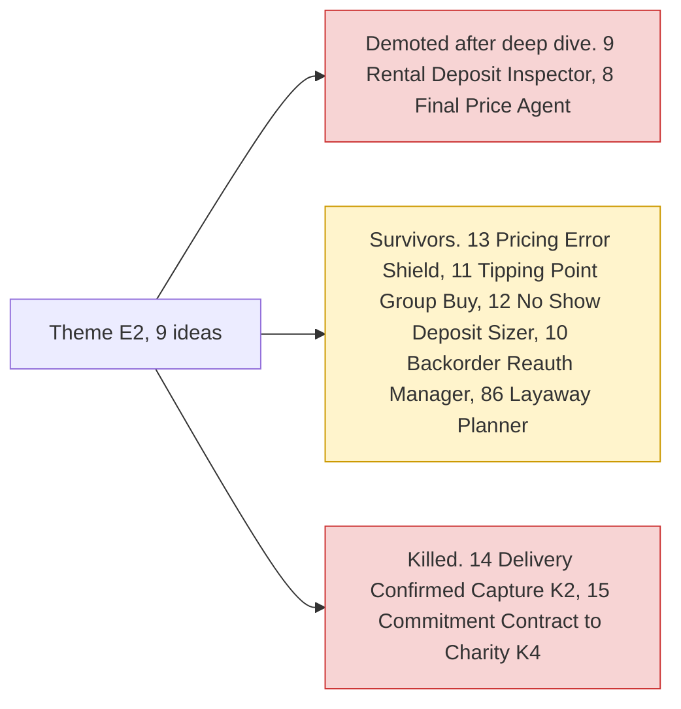

# Theme E2: Programmable holds

> [!tldr] In one breath
> PayPal can freeze money on a buyer's card without taking it yet, then later take part of it, all of it, a bit more, or none. These ideas use that as "money that waits for a condition". **It is crowded when it looks like escrow or a spending gate; it does better when framed as something else.**

> [!example] Picture this
> You rent a camera for the weekend. The shop holds $300 on your card. On Monday an AI compares photos from pickup and return, spots one new scratch, and the shop keeps $40 of the hold. The other $260 is released and never left your account.

> [!warning] Crowd check, Oct 23 2026
> AI judged escrow, where a hold is released or voided after an AI check, is the **second most crowded area** (about 28 repos). Examples: handback (rental deposit photo compare, very close to #9), milestone-ai-escrow, mergepay, three repos named "ProofPay", TrustLock, ArbiterPay, rentabot, PropLock, tidehold, escrowease. Group pooling (#11) has a small cluster: caresplit, potluck, purser, WePay. Scan covered 266 repos created Sep 1 to Oct 22, partial coverage, official gallery not public. See [[17 Live Competition Scan (Oct 23)]].

## What this theme is about

Using AUTHORIZE, partial capture, void and overcapture as a building block for money that waits for a condition. **The interesting mechanics are the 29 day window, the 3 day honor period and the overcapture rule of 115% or +$75.** It is crowded as "escrow" and "spend gate" (about 24 early entries). Framings that are not escrow fare better.

Groups: **Programmable holds (8)** and **Inclusive money (1)**.

**9 ideas, 7 survivors, 2 deep dived. Best final score: 83/120.**

## The ideas at a glance

## Every idea in this theme

How to read it: **Desk** is the first score out of 120, **Final** is after any deep dive, **Status** shows survivor, killed (K codes in [[41 Brutal Elimination]]) or deep dive verdict. **Crowding** is from the Oct 12 scan.

| Rank in theme | Idea | Desk | Final | Status | Crowding |
|---|---|---|---|---|---|
| 1 | [[I013 Pricing-Error Shield\|#13 Pricing-Error Shield]] | 83 | 83 | survivor | none |
| 2 | [[I009 Rental Deposit Inspector\|#9 Rental Deposit Inspector]] | 92 | 81 | deep: demote | Light (sponsor-suggested rental scheduling) |
| 3 | [[I008 Final-Price Agent (Overcapture)\|#8 Final-Price Agent (Overcapture)]] | 90 | 78 | deep: demote | none |
| 4 | [[I011 Tipping-Point Group Buy\|#11 Tipping-Point Group Buy]] | 74 | 74 | survivor | Group-pay cluster (~6) |
| 5 | [[I012 No-Show Deposit Sizer\|#12 No-Show Deposit Sizer]] | 72 | 72 | survivor | Booking cluster (~4) |
| 6 | [[I014 Delivery-Confirmed Capture\|#14 Delivery-Confirmed Capture]] | 72 | 72 | eliminated K2 | Escrow cluster (~11) |
| 7 | [[I015 Commitment Contract to Charity\|#15 Commitment Contract to Charity]] | 71 | 71 | eliminated K4 | none |
| 8 | [[I010 Backorder Reauth Manager\|#10 Backorder Reauth Manager]] | 70 | 70 | survivor | none |
| 9 | [[I086 Layaway Planner\|#86 Layaway Planner]] | 69 | 69 | survivor | none |

## Building blocks used most

**Almost every idea here uses the hold and its lifecycle.** Codes in [[30 Primitives Legend]].

* P02 AUTHORIZE intent, hold funds (8)
* P03 Authorization lifecycle: partial capture, void, reauthorize (8)
* A02 Classification with explanation or vision estimate (3)
* A01 Document and image extraction (3)
* A04 Forecasting or pricing suggestion (3)
* A12 Eligibility reasoning and messaging (2)

> [!info]- Jargon decoder
> **Authorize then capture**: like a hotel holding $200 on your card at check in, then charging only what you actually used at check out.
> **Partial capture**: taking only part of the held money.
> **Void**: cancelling the hold so the buyer pays nothing.
> **Reauthorize**: putting a fresh hold in place when the old one is about to expire. Like renewing a library book.
> **Overcapture**: charging a little more than the hold, here up to 115% or +$75. Like a restaurant adding the tip after your card was already swiped.
> **Honor period**: the first 3 days in which a hold is guaranteed to be good.
> **Escrow**: a trusted middle person keeps the money until both sides are happy.

## Where to next
* ⬆️ Up: [[Element Themes Overview]]
* ⬅️ Previous: [[Theme E1 Agent purchase liability & integrity]] · ➡️ Next: [[Theme E3 Evidence economy]]
* 🔗 Related: [[30 Primitives Legend]], [[41 Brutal Elimination]], [[17 Live Competition Scan (Oct 23)]]
