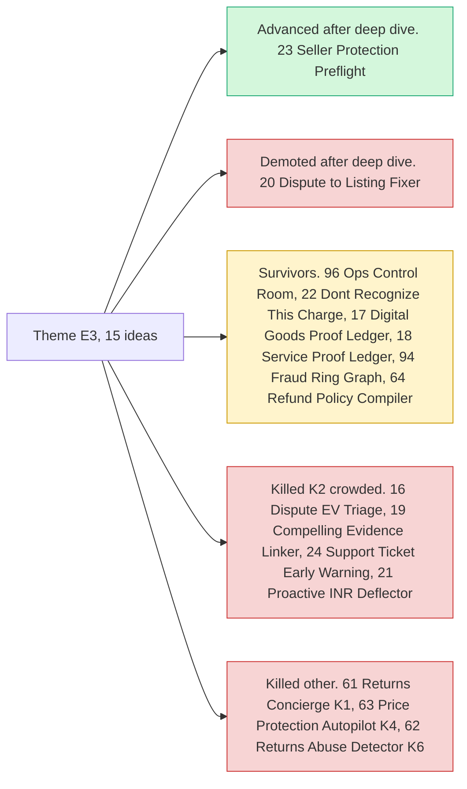

# Theme E3: Evidence economy

> [!tldr] In one breath
> PayPal already stores a lot of facts about every sale: the order, the tracking number, the transaction record, any dispute. These ideas turn those facts into protection before a loss, or proof after one. **PayPal's own policy wording (Seller Protection) was the least contested seam found, and #23 lives here.**

> [!example] Picture this
> A buyer messages a small seller: "please ship it to my cousin's address instead". It sounds friendly. But PayPal's Seller Protection rules say shipping anywhere other than the address on the transaction can void the seller's protection. An AI reads the message, checks the rule, and warns the seller before the parcel leaves.

> [!warning] Crowd check, Oct 23 2026
> Dispute and chargeback copilots are a **busy area (about 16 repos)**: witness, dispute-defender, dispute-copilot (AG Grid), rebuttal, dispute-radar, dispute-autopilot, two "disputedesk", dispute-steward, Docket, two "payguard-ai". **Most important: preflight-for-paypal is a seller protection checker and a near duplicate of #23.** Refund cousins subguard, returngate and clippay (partial refunds) sit near #64. Scan covered 266 repos created Sep 1 to Oct 22, partial coverage, official gallery not public. See [[17 Live Competition Scan (Oct 23)]].

## What this theme is about

Turning PayPal data (orders, tracking, transaction search, disputes) into protection or proof before and after a loss. **PayPal specific policy text (Seller Protection) is the least contested seam found.** #23 sits here.

Groups: **Evidence economy (9)**, **Merchant risk intelligence (2)** and **After the purchase (4)**.

**15 ideas, 8 survivors, 2 deep dived. Best final score: 91/120.**

Note the oddity: the top scorer, #16, was killed. It solved a well proven problem but sat under a crowded headline (K2).

## The ideas at a glance

## Every idea in this theme

How to read it: **Desk** is the first score out of 120, **Final** is after any deep dive, **Status** shows survivor, killed (K codes in [[41 Brutal Elimination]]) or deep dive verdict. **Crowding** is from the Oct 12 scan.

| Rank in theme | Idea | Desk | Final | Status | Crowding |
|---|---|---|---|---|---|
| 1 | [[I016 Dispute EV Triage\|#16 Dispute EV Triage]] | 91 | 91 | eliminated K2 | Disputes cluster (~7) |
| 2 | [[I023 Seller Protection Preflight\|#23 Seller Protection Preflight]] | 97 | 89 | deep: advance-with-changes | none |
| 3 | [[I096 PayPal Ops Control Room\|#96 PayPal Ops Control Room]] | 84 | 84 | survivor | Analytics cluster |
| 4 | [[I022 Don't Recognize This Charge Resolver\|#22 "Don't Recognize This Charge" Resolver]] | 81 | 81 | survivor | Disputes cluster |
| 5 | [[I020 Dispute-to-Listing Fixer\|#20 Dispute-to-Listing Fixer]] | 97 | 80 | deep: demote | Disputes cluster adjacent, but a different mechanism |
| 6 | [[I017 Digital-Goods Proof Ledger\|#17 Digital-Goods Proof Ledger]] | 79 | 79 | survivor | Disputes cluster |
| 7 | [[I018 Service-Proof Ledger\|#18 Service-Proof Ledger]] | 79 | 79 | survivor | Escrow/disputes adjacent |
| 8 | [[I094 Fraud Ring Graph\|#94 Fraud Ring Graph]] | 76 | 76 | survivor | Analytics cluster |
| 9 | [[I019 Compelling Evidence Linker\|#19 Compelling Evidence Linker]] | 73 | 73 | eliminated K2 | Disputes cluster |
| 10 | [[I061 Agent Returns Concierge\|#61 Agent Returns Concierge]] | 72 | 72 | eliminated K1 | none |
| 11 | [[I024 Support-Ticket Dispute Early Warning\|#24 Support-Ticket Dispute Early Warning]] | 71 | 71 | eliminated K2 | none |
| 12 | [[I063 Price-Protection Autopilot\|#63 Price-Protection Autopilot]] | 71 | 71 | eliminated K4 | none |
| 13 | [[I064 Refund Policy Compiler\|#64 Refund Policy Compiler]] | 71 | 71 | survivor | Refund cluster |
| 14 | [[I021 Proactive INR Deflector\|#21 Proactive INR Deflector]] | 67 | 67 | eliminated K2 | none on Devpost; mature market |
| 15 | [[I062 Returns-Abuse Pattern Detector\|#62 Returns-Abuse Pattern Detector]] | 67 | 67 | eliminated K6 | none |

## Building blocks used most

**Disputes, transaction records and refunds dominate.** Codes in [[30 Primitives Legend]].

* P14 Disputes API (9)
* P18 Transaction Search and Reporting (8)
* P16 Refunds (7)
* P20 Webhooks (5)
* P17 Shipment Tracking API (4)
* A05 Structured decision (4)

> [!info]- Jargon decoder
> **Seller Protection**: PayPal's promise to cover a seller's loss in some disputes, as long as the seller followed the rules. Like a phone warranty that only works if you did not open the case yourself.
> **Dispute**: a formal complaint a buyer files with PayPal to get money back.
> **Chargeback**: the buyer goes to their card bank instead, and the bank pulls the money back.
> **EV**: expected value. The average money you would win or lose if you made the same choice many times. Like judging a bet by its odds, not one lucky roll.
> **INR**: "item not received", the most common dispute reason.
> **Transaction Search**: PayPal's searchable history of every payment, like a bank statement you can query.

## Where to next
* ⬆️ Up: [[Element Themes Overview]]
* ⬅️ Previous: [[Theme E2 Programmable holds]] · ➡️ Next: [[Theme E4 Locked money & cash-flow]]
* 🔗 Related: [[D023 Seller Protection Preflight (Deep Dive)]], [[30 Primitives Legend]], [[41 Brutal Elimination]], [[17 Live Competition Scan (Oct 23)]]
