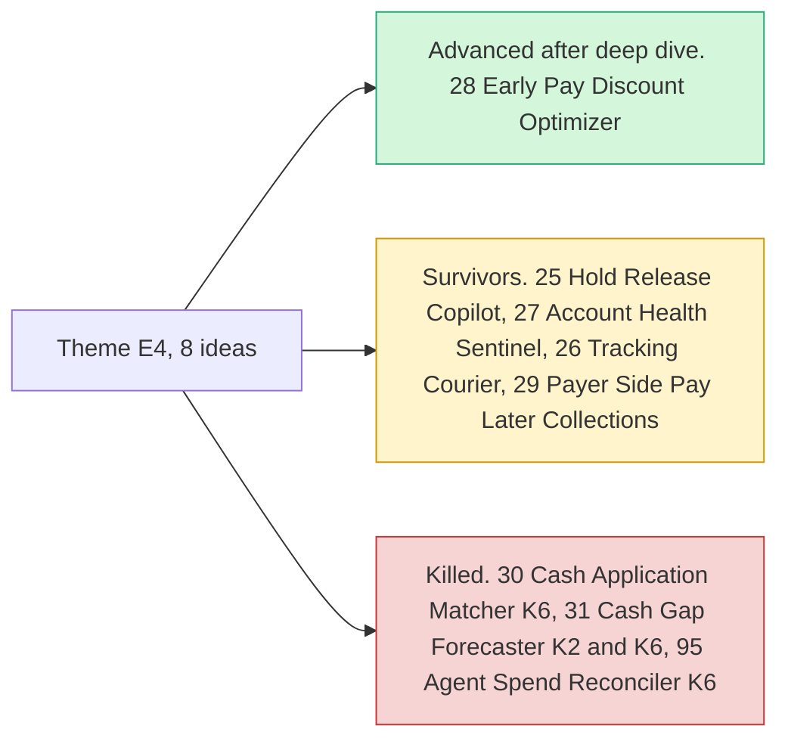

# Theme E4: Locked money & cash-flow

> [!tldr] In one breath
> Sellers often have money they have earned but cannot touch: payment holds, account limitations, frozen balances, invoices paid late. **This is the best evidenced seller pain in the whole research (CFPB, Trustpilot), and PayPal has some real levers for it, such as tracking uploads that release holds and invoice rules.**

> [!example] Picture this
> A baker sells $2,000 of cakes in one week through PayPal. The money shows up, but it is "on hold" and she cannot pay her flour supplier. Meanwhile three cafes owe her for invoices from last month. An AI that knows which button frees which dollar could get her paid by Friday.

> [!warning] Crowd check, Oct 23 2026
> Freelancer and small business invoicing is a **crowded area (about 25 repos)**: ledgerbird, ledgerly, two "invoicepilot", chaser (Agent Toolkit), owed (Bryntum), sorted, docket, paid-tonight, clause-and-pay, paceline and duespilot. Any invoicing build, including #28, will look familiar to judges unless the discount pricing is clearly the star (⚠ inference). Reconciliation is a small cluster (settlesight, settleproof, cleared-settle, creatorsettle) that overlaps #30 and #95. Pay Later as a core idea is thin (triad), which helps #29. Scan covered 266 repos created Sep 1 to Oct 22, partial coverage, official gallery not public. See [[17 Live Competition Scan (Oct 23)]].

## What this theme is about

Holds, limitations, late invoices and frozen balances. **The best evidenced seller pain (CFPB, Trustpilot), with some API surface (tracking releases holds, invoicing rules).**

Groups: **Locked money (7)** and **Merchant risk intelligence (1)**.

**8 ideas, 5 survivors, 1 deep dived. Best final score: 85/120.**

## The ideas at a glance

## Every idea in this theme

How to read it: **Desk** is the first score out of 120, **Final** is after any deep dive, **Status** shows survivor, killed (K codes in [[41 Brutal Elimination]]) or deep dive verdict. **Crowding** is from the Oct 12 scan.

| Rank in theme | Idea | Desk | Final | Status | Crowding |
|---|---|---|---|---|---|
| 1 | [[I028 Early-Pay Discount Optimizer\|#28 Early-Pay Discount Optimizer]] | 93 | 85 | deep: advance-with-changes | Invoice-chasing cluster (~4) adjacent |
| 2 | [[I025 Hold Release Copilot\|#25 Hold Release Copilot]] | 79 | 79 | survivor | HoldWatch on Devpost |
| 3 | [[I027 Account Health Sentinel\|#27 Account Health Sentinel]] | 78 | 78 | survivor | none |
| 4 | [[I026 Tracking Courier\|#26 Tracking Courier]] | 72 | 72 | survivor | none |
| 5 | [[I030 Cash Application Matcher\|#30 Cash Application Matcher]] | 71 | 71 | eliminated K6 | Reconciliation cluster (~6) |
| 6 | [[I029 Payer-Side Pay Later Collections\|#29 Payer-Side Pay Later Collections]] | 69 | 69 | survivor | Invoice cluster |
| 7 | [[I031 Cash-Gap Forecaster\|#31 Cash-Gap Forecaster]] | 67 | 67 | eliminated K2,K6 | Analytics cluster |
| 8 | [[I095 Agent Spend Reconciler\|#95 Agent Spend Reconciler]] | 64 | 64 | eliminated K6 | Reconciliation cluster |

## Building blocks used most

**Transaction records and invoicing do most of the work.** Codes in [[30 Primitives Legend]].

* P18 Transaction Search and Reporting (6)
* P08 Invoicing v2 (4)
* A12 Eligibility reasoning and messaging (4)
* A04 Forecasting or pricing suggestion (3)
* P10 Invoicing recurring series and record payment (2)
* P23 Pay Later messaging (2)

> [!info]- Jargon decoder
> **Hold**: PayPal keeps a seller's money for a while before they can use it. Like a new job paying your first wages a month late.
> **Limitation**: PayPal restricts what an account can do until questions are answered. Like a library card frozen until you return overdue books.
> **Cash flow**: the timing of money coming in and going out. You can be profitable and still broke on Tuesday.
> **Early pay discount**: "pay within 10 days and get 2% off". A small reward for paying fast.
> **Cash application**: matching each incoming payment to the invoice it pays.
> **Reconciliation**: checking that your records and the bank's records agree.
> **CFPB**: the US Consumer Financial Protection Bureau, a government watchdog that collects complaints.

## Where to next
* ⬆️ Up: [[Element Themes Overview]]
* ⬅️ Previous: [[Theme E3 Evidence economy]] · ➡️ Next: [[Theme E5 Moment-of-send scams]]
* 🔗 Related: [[D028 Early-Pay Discount Optimizer (Deep Dive)]], [[30 Primitives Legend]], [[41 Brutal Elimination]], [[17 Live Competition Scan (Oct 23)]]
