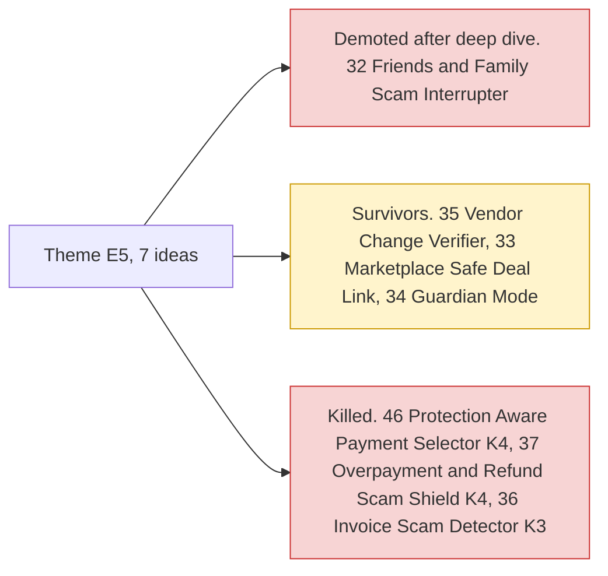

# Theme E5: Moment-of-send scams

> [!tldr] In one breath
> These ideas jump in at the exact second someone is about to pay a scammer or a fake supplier. **It sounds powerful, but PayPal ships its own scam alerts and banks (Starling, Lloyds) have shipped AI scam checks, so the theme is weaker than it first looks.**

> [!example] Picture this
> A small business gets an email: "Hi, we changed banks, please send this month's payment to our new account." It looks exactly like the usual supplier. A checker notices the payee changed, asks the supplier through a channel it already trusts, and pauses the payment until someone confirms.

> [!warning] Crowd check, Oct 23 2026
> Scam and elder fraud protection is a **smaller cluster (about 7 repos)**: scam-shield-paypal, Haven, guardianpay, nonna-mode, safesend, kincart, plus breakpoint (which red teams a shop's AI checkout assistant). Lighter than the agent or escrow areas, but the consumer scam angle (#32, #34) is clearly being built. Business payee change checks (#35) did not show up by name. Scan covered 266 repos created Sep 1 to Oct 22, partial coverage, official gallery not public. See [[17 Live Competition Scan (Oct 23)]].

## What this theme is about

Interrupting a scam or a bad payee at the point of payment. **PayPal ships its own scam alerts, and banks (Starling, Lloyds) have shipped AI scam checks, so this theme is weaker than it first looks.** The headline idea, #32, fell from 89 to 71 after its deep dive.

Groups: **Moment of send scams (6)** and **Agent integrity (1)**.

**7 ideas, 4 survivors, 1 deep dived. Best final score: 85/120.**

## The ideas at a glance

## Every idea in this theme

How to read it: **Desk** is the first score out of 120, **Final** is after any deep dive, **Status** shows survivor, killed (K codes in [[41 Brutal Elimination]]) or deep dive verdict. **Crowding** is from the Oct 12 scan.

| Rank in theme | Idea | Desk | Final | Status | Crowding |
|---|---|---|---|---|---|
| 1 | [[I035 Vendor Change Verifier\|#35 Vendor Change Verifier]] | 85 | 85 | survivor | none |
| 2 | [[I033 Marketplace Safe-Deal Link\|#33 Marketplace Safe-Deal Link]] | 79 | 79 | survivor | Escrow adjacent |
| 3 | [[I034 Guardian Mode\|#34 Guardian Mode]] | 78 | 78 | survivor | none |
| 4 | [[I032 F&F Scam Interrupter\|#32 F&F Scam Interrupter]] | 89 | 71 | deep: demote | High: PayPal native F&F AI alerts; Starling/Lloyds listing-screenshot checks; Devpost scam checkers |
| 5 | [[I046 Protection-Aware Payment Selector\|#46 Protection-Aware Payment Selector]] | 66 | 66 | eliminated K4 | none |
| 6 | [[I037 Overpayment & Refund-Scam Shield\|#37 Overpayment & Refund-Scam Shield]] | 62 | 62 | eliminated K4 | none |
| 7 | [[I036 Invoice-Scam Detector\|#36 Invoice-Scam Detector]] | 60 | 60 | eliminated K3 | none |

## Building blocks used most

**Mostly a structured yes or no decision on top of an order.** Codes in [[30 Primitives Legend]].

* A05 Structured decision (5)
* P01 Orders v2 (4)
* P22 Payment Links (2)
* A11 Translation and tone (2)
* A02 Classification with explanation or vision estimate (2)
* P11 Payouts, batch (1)

> [!info]- Jargon decoder
> **F&F**: PayPal "Friends and Family" payments. Meant for people you know, so there is no buyer protection. Scammers love it for exactly that reason.
> **Payee**: the person or business receiving the money.
> **Vendor change scam**: a fake "we changed our bank details" message. Like someone redirecting your post by filling in a change of address card in your name.
> **Moment of send**: the last second before the money leaves. The best and last chance to stop a mistake.

## Where to next
* ⬆️ Up: [[Element Themes Overview]]
* ⬅️ Previous: [[Theme E4 Locked money & cash-flow]] · ➡️ Next: [[Theme E6 Human delegation]]
* 🔗 Related: [[D032 F&F Scam Interrupter (Deep Dive)]], [[30 Primitives Legend]], [[41 Brutal Elimination]], [[17 Live Competition Scan (Oct 23)]]
