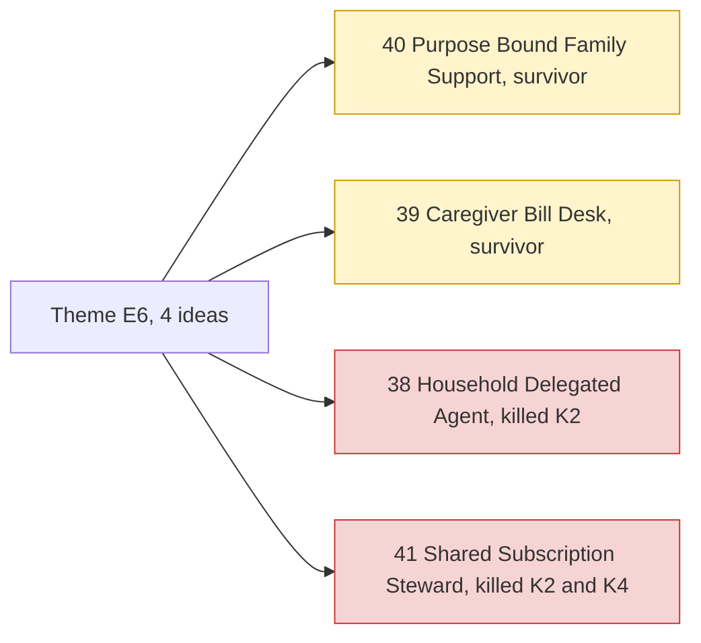

# Theme E6: Human delegation

> [!tldr] In one breath
> Sometimes a person, not an AI, spends money for someone else: a daughter paying her dad's bills, a carer buying groceries, a household sharing subscriptions. These ideas give that helper limits tied to a purpose. **The need is real, but PayPal exposes few delegation tools, so the builds are harder to make PayPal native.**

> [!example] Picture this
> You send your younger brother $100 for school books. You would love that money to work only at the bookshop, not the games store. Purpose bound money is like a gift card that only opens the door you chose.

> [!warning] Crowd check, Oct 23 2026
> Family and elder money helpers do appear: kincart (an elderly relative's shopping with family approval), nonna-mode and guardianpay, all inside a small scam and elder cluster of about 7 repos. Shared spending ideas like #38 sit next to the **most crowded area**, agent spending guards (about 30 repos). Group pooling (#41) has a small cluster: caresplit, potluck, purser, sarafupay, WePay, homeward. Scan covered 266 repos created Sep 1 to Oct 22, partial coverage, official gallery not public. See [[17 Live Competition Scan (Oct 23)]].

## What this theme is about

Family, caregiver and household delegation of money with limits tied to a purpose. **Real need, but PayPal exposes limited delegation tools.**

Group: **Human delegation (4)**.

**4 ideas, 2 survivors, 0 deep dived. Best final score: 85/120.**

## The ideas at a glance

## Every idea in this theme

How to read it: **Desk** is the first score out of 120, **Final** is after any deep dive, **Status** shows survivor or killed (K codes in [[41 Brutal Elimination]]). **Crowding** is from the Oct 12 scan.

| Rank in theme | Idea | Desk | Final | Status | Crowding |
|---|---|---|---|---|---|
| 1 | [[I040 Purpose-Bound Family Support\|#40 Purpose-Bound Family Support]] | 85 | 85 | survivor | none |
| 2 | [[I038 Household Delegated Agent\|#38 Household Delegated Agent]] | 81 | 81 | eliminated K2 | Spend-gate cluster (~13) |
| 3 | [[I039 Caregiver Bill Desk\|#39 Caregiver Bill Desk]] | 73 | 73 | survivor | none |
| 4 | [[I041 Shared Subscription Steward\|#41 Shared Subscription Steward]] | 60 | 60 | eliminated K2,K4 | Group-pay cluster |

## Building blocks used most

**A mix of sending money, reading documents and saved payment methods.** Codes in [[30 Primitives Legend]].

* P11 Payouts, batch (2)
* A01 Document and image extraction (2)
* A05 Structured decision (2)
* P06 Vault v3, saved payment tokens (2)
* P08 Invoicing v2 (1)
* A11 Translation and tone (1)

> [!info]- Jargon decoder
> **Delegation**: letting someone else act for you. Like giving a friend your house key to feed the cat, but not to throw a party.
> **Purpose bound**: money that can only be spent on one kind of thing.
> **Vault**: PayPal's safe box for saved payment details, so a payment can run later without the payer clicking again.
> **Payouts**: PayPal sending money out to many people at once.

## Where to next
* ⬆️ Up: [[Element Themes Overview]]
* ⬅️ Previous: [[Theme E5 Moment-of-send scams]] · ➡️ Next: [[Theme E7 Agent-ready long tail]]
* 🔗 Related: [[30 Primitives Legend]], [[41 Brutal Elimination]], [[44 Bench Ideas Not Deep-Dived]], [[17 Live Competition Scan (Oct 23)]]
