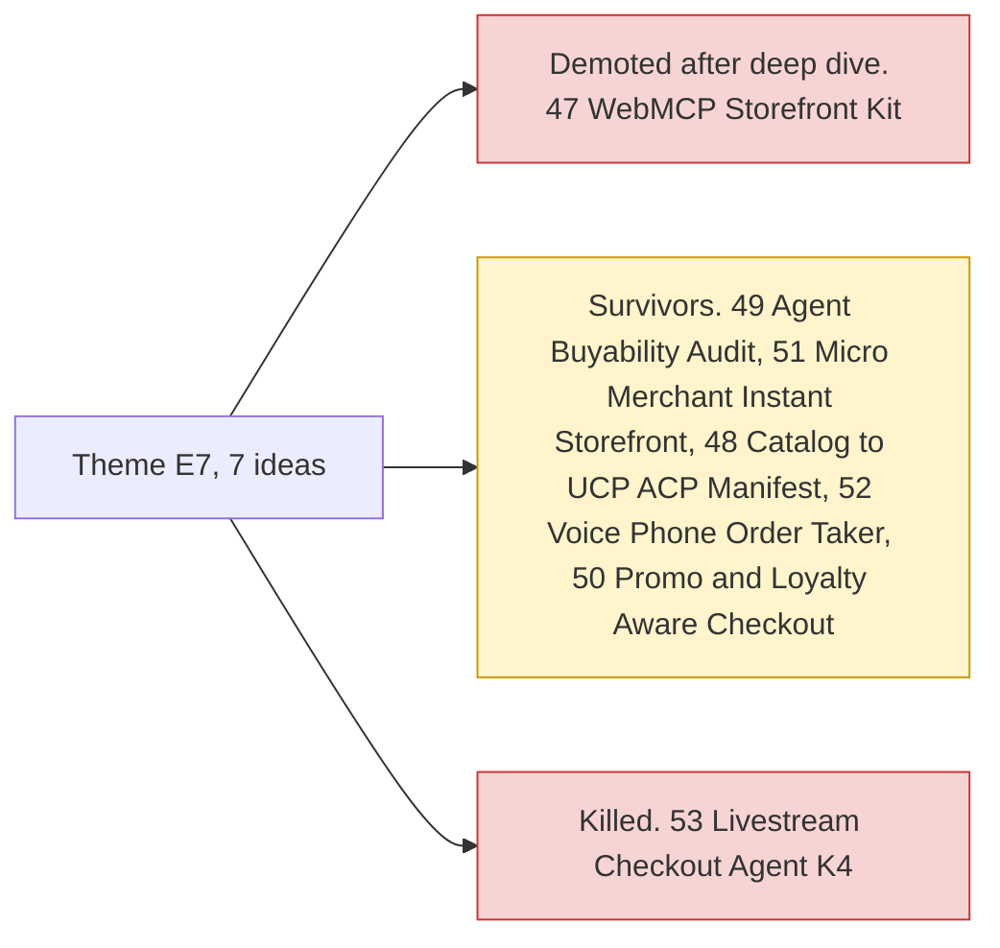

# Theme E7: Agent-ready long tail

> [!tldr] In one breath
> AI shopping agents can only buy from shops they can understand. These ideas help small merchants (the "long tail") get ready, for example with WebMCP tools or a clean product catalog. **Big platforms (Shopify, Stripe) moved first, which leaves less room.**

> [!example] Picture this
> Imagine a robot walking into a village market. The big supermarket has barcodes and a robot friendly checkout. The family run spice stall has handwritten signs. The robot walks past the stall. These ideas give the stall a sign the robot can read and a till it can use.

> [!warning] Crowd check, Oct 23 2026
> Agent ready storefronts, MCP and WebMCP for merchants is a **medium cluster (about 11 repos)**: suede-shelf, paypal-webmcp-shop, leafline-agent-store, shopfront-agent, AgentBaazar, ShopGenie, vendorapay, mrstockd, uamarket, atlas-order-agent, paypal-agent-shop. That is directly on top of #47 and close to #51. Pay per answer on live streams (answertab) is a distant cousin of #53. Scan covered 266 repos created Sep 1 to Oct 22, partial coverage, official gallery not public. See [[17 Live Competition Scan (Oct 23)]].

## What this theme is about

Making small merchants and storefronts legible to agents (WebMCP, catalog readiness). **Platforms (Shopify, Stripe) moved first, which shrinks the room.** Shopify and Stripe shipped WebMCP tools by default, so #47 was demoted from 95 to 72.

Group: **Agent ready long tail (7)**.

**7 ideas, 6 survivors, 1 deep dived. Best final score: 82/120.**

## The ideas at a glance

## Every idea in this theme

How to read it: **Desk** is the first score out of 120, **Final** is after any deep dive, **Status** shows survivor, killed (K codes in [[41 Brutal Elimination]]) or deep dive verdict. **Crowding** is from the Oct 12 scan.

| Rank in theme | Idea | Desk | Final | Status | Crowding |
|---|---|---|---|---|---|
| 1 | [[I049 Agent-Buyability Audit\|#49 Agent-Buyability Audit]] | 82 | 82 | survivor | none |
| 2 | [[I051 Micro-Merchant Instant Storefront\|#51 Micro-Merchant Instant Storefront]] | 75 | 75 | survivor | Photo-to-listing (~2) |
| 3 | [[I053 Livestream Checkout Agent\|#53 Livestream Checkout Agent]] | 74 | 74 | eliminated K4 | none |
| 4 | [[I047 WebMCP Storefront Kit\|#47 WebMCP Storefront Kit]] | 95 | 72 | deep: demote | Shopping-agent cluster is buyer-side; merchant-side tooling is rare |
| 5 | [[I048 Catalog-to-UCPACP Manifest Generator\|#48 Catalog-to-UCP/ACP Manifest Generator]] | 72 | 72 | survivor | Feed-syndication market crowded |
| 6 | [[I052 Voice Phone-Order Taker\|#52 Voice Phone-Order Taker]] | 72 | 72 | survivor | Booking/front-desk (~4) |
| 7 | [[I050 Promo & Loyalty-Aware Agent Checkout\|#50 Promo & Loyalty-Aware Agent Checkout]] | 71 | 71 | survivor | none |

## Building blocks used most

**Links, orders and event messages, plus a little voice.** Codes in [[30 Primitives Legend]].

* P22 Payment Links (3)
* P01 Orders v2 (3)
* P20 Webhooks (3)
* P24 JS SDK v6 (2)
* A08 Speech and voice (2)
* A01 Document and image extraction (2)

> [!info]- Jargon decoder
> **Long tail**: the huge number of small shops, as opposed to the few giant ones.
> **MCP**: Model Context Protocol, a standard way to hand an AI a set of tools. Like a universal plug adapter for AI.
> **WebMCP**: the same idea built into a web page, so a visiting AI agent can see "add to cart" and "checkout" as buttons it is allowed to press.
> **UCP and ACP**: emerging formats for describing a shop's catalog and checkout to AI agents. Like a menu written in a language robots read.
> **Legible to agents**: an AI can read and act on it without guessing.

## Where to next
* ⬆️ Up: [[Element Themes Overview]]
* ⬅️ Previous: [[Theme E6 Human delegation]] · ➡️ Next: [[Theme E8 Failure-path intelligence]]
* 🔗 Related: [[D047 WebMCP Storefront Kit (Deep Dive)]], [[30 Primitives Legend]], [[41 Brutal Elimination]], [[17 Live Competition Scan (Oct 23)]]
