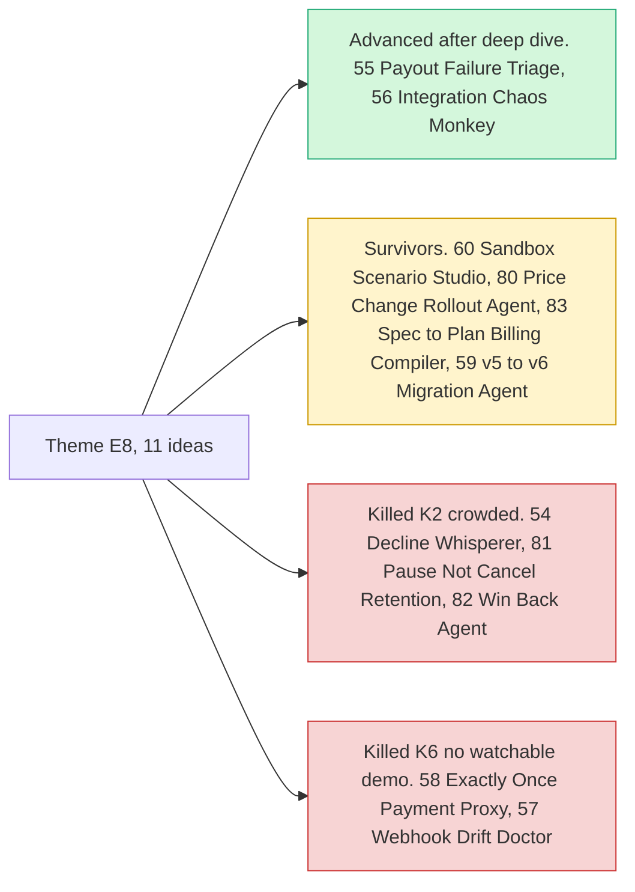

# Theme E8: Failure-path intelligence

> [!tldr] In one breath
> Most demos show the happy path where everything works. These ideas handle the unhappy path: payouts that bounce, cards that decline, event messages that never arrive, subscribers who leave. **The judges told teams at kickoff to "test the unhappy paths", and this theme gave two of the final ten (#55 and #56).**

> [!example] Picture this
> A gig app pays 500 drivers on Friday. Twelve payments come back "unclaimed" because the email was wrong. Most apps just show a red error. A smart helper spots each one, asks the driver for the right contact, cancels the stuck payment, waits for the money to return, and sends it again. The drivers never notice anything went wrong.

> [!warning] Crowd check, Oct 23 2026
> This area is **mostly thin**. Payouts to workers is a small cluster (payday-agent, Burmalda, takken, routewell), which sits near #55. Developer tooling for PayPal integrators is nearly empty, but the two entries found are close cousins: **cutover** (an AI that migrates old NVP, checkout.js and IPN code to Orders v2 and JS SDK v6, checked in sandbox) is very close to #59, and paypal-webhook-simulator brushes #56, #57 and #60. Subscriptions as the core idea is thin (triad, subscription-killer), which touches #81 and #82. Scan covered 266 repos created Sep 1 to Oct 22, partial coverage, official gallery not public. See [[17 Live Competition Scan (Oct 23)]].

## What this theme is about

Handling the unhappy path: failed payouts, declines, webhook failures, subscription churn. **It matches the judges' kickoff advice to "test the unhappy paths".** #55 and #56 sit here.

Groups: **Failure path intelligence (7)** and **Subscription revenue ops (4)**.

**11 ideas, 6 survivors, 2 deep dived. Best final score: 86/120.**

## The ideas at a glance

## Every idea in this theme

How to read it: **Desk** is the first score out of 120, **Final** is after any deep dive, **Status** shows survivor, killed (K codes in [[41 Brutal Elimination]]) or deep dive verdict. **Crowding** is from the Oct 12 scan.

| Rank in theme | Idea | Desk | Final | Status | Crowding |
|---|---|---|---|---|---|
| 1 | [[I055 Payout Failure Triage\|#55 Payout Failure Triage]] | 95 | 86 | deep: advance-with-changes | Payout-on-approval appears in official inspiration |
| 2 | [[I060 Sandbox Scenario Studio\|#60 Sandbox Scenario Studio]] | 82 | 82 | survivor | none |
| 3 | [[I056 Integration Chaos Monkey\|#56 Integration Chaos Monkey]] | 90 | 80 | deep: advance-with-changes | none |
| 4 | [[I054 Decline Whisperer\|#54 Decline Whisperer]] | 79 | 79 | eliminated K2 | none on Devpost; mature market |
| 5 | [[I058 Exactly-Once Agent Payment Proxy\|#58 Exactly-Once Agent Payment Proxy]] | 73 | 73 | eliminated K6 | Policy-proxy cluster adjacent |
| 6 | [[I080 Price-Change Rollout Agent\|#80 Price-Change Rollout Agent]] | 73 | 73 | survivor | none |
| 7 | [[I083 Spec-to-Plan Billing Compiler\|#83 Spec-to-Plan Billing Compiler]] | 71 | 71 | survivor | none |
| 8 | [[I059 v5→v6 Migration & Certification Agent\|#59 v5→v6 Migration & Certification Agent]] | 70 | 70 | survivor | none |
| 9 | [[I057 Webhook Drift Doctor\|#57 Webhook Drift Doctor]] | 67 | 67 | eliminated K6 | none |
| 10 | [[I081 Pause-Not-Cancel Retention\|#81 Pause-Not-Cancel Retention]] | 65 | 65 | eliminated K2 | none |
| 11 | [[I082 Win-Back Agent\|#82 Win-Back Agent]] | 65 | 65 | eliminated K2 | none |

## Building blocks used most

**Event messages and subscriptions, with AI explaining what went wrong.** Codes in [[30 Primitives Legend]].

* P20 Webhooks (6)
* P07 Subscriptions (6)
* A12 Eligibility reasoning and messaging (5)
* A05 Structured decision (3)
* A14 Diagnosis and code transformation (3)
* P13 Payouts failure handling and test values (2)

> [!info]- Jargon decoder
> **Happy path and unhappy path**: the happy path is when everything works. The unhappy path is every way it can break. Like planning a picnic and also packing umbrellas.
> **Webhook**: a message PayPal sends to your app when something happens. Like a doorbell that rings when a parcel arrives.
> **Decline**: a card payment refused by the bank.
> **Churn**: customers cancelling a subscription.
> **UNCLAIMED and RETURNED**: payout states. The money was sent but nobody picked it up, and later it comes back to the sender.
> **Sandbox**: PayPal's practice playground with fake money, so you can test without real losses.
> **Chaos monkey**: a tool that breaks things on purpose to see if your system copes. Like a fire drill.

## Where to next
* ⬆️ Up: [[Element Themes Overview]]
* ⬅️ Previous: [[Theme E7 Agent-ready long tail]] · ➡️ Next: [[Theme E9 Agents as economic actors & B2B ops]]
* 🔗 Related: [[D055 Payout Failure Triage (Deep Dive)]], [[D056 Integration Chaos Monkey (Deep Dive)]], [[30 Primitives Legend]], [[41 Brutal Elimination]], [[17 Live Competition Scan (Oct 23)]]
