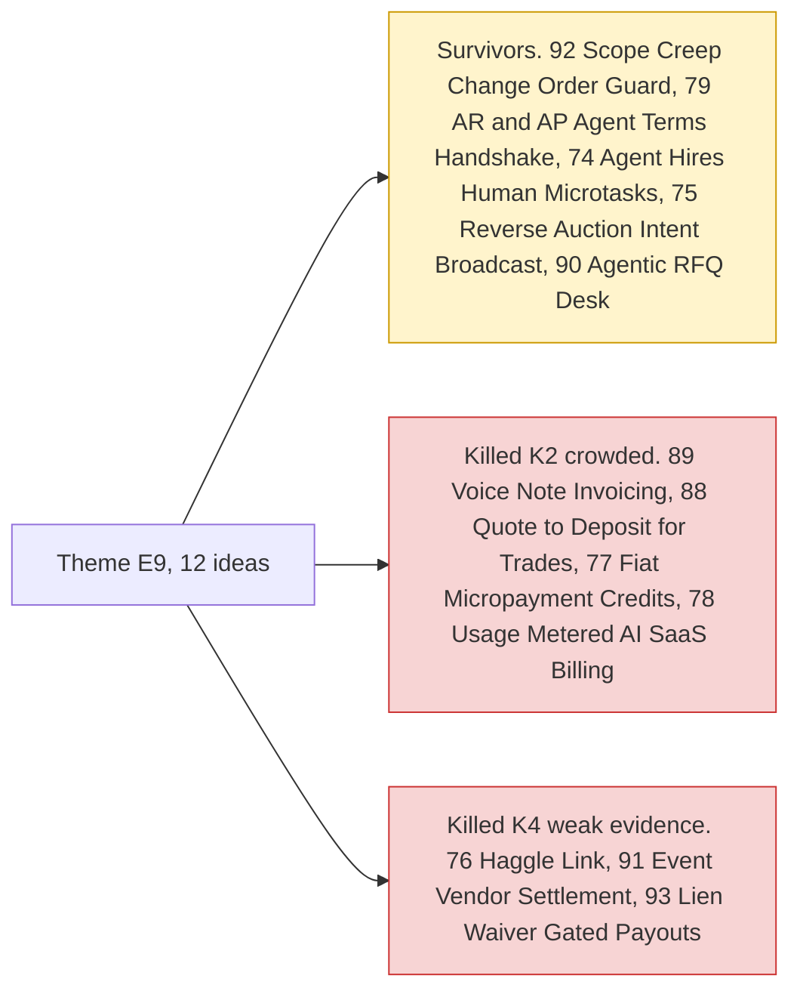

# Theme E9: Agents as economic actors & B2B ops

> [!tldr] In one breath
> What if AI agents did deals themselves: haggling with other agents, hiring humans for small tasks, agreeing payment terms between two companies? This theme also covers business to business (B2B) chores like quotes and change orders. **It is mostly about the future, and PayPal's sandbox barely supports it yet.**

> [!example] Picture this
> A builder quotes $8,000 for a kitchen. Halfway through, the client asks for "just one more cupboard". Then another. By the end the job is worth $11,000 but the invoice still says $8,000. A guard that spots each extra request and turns it into a signed, priced change order saves the builder a very awkward conversation.

> [!warning] Crowd check, Oct 23 2026
> Agent to agent haggling is a **medium cluster (about 8 repos)**: three repos named "haggle", Haggle Court, mandado, negotiator-payments, asterion-commerce and duespilot. **duespilot (an accounts receivable agent that negotiates with the client's accounts payable agent) is very close to #79.** Procurement agents (procure-agent, procurepilot, procura-ai, reliefos) sit near #90. WhatsApp to invoice builds (invoicepilot, panjar, sarafupay) sit near #89. Pay per crawl with HTTP 402 (TollGate, adparity, skuuy) is a cousin of #77, and payouts to workers and bounties (payday-agent, Burmalda, takken, routewell) is a cousin of #74. Events and ticketing (#91) looked untouched. Scan covered 266 repos created Sep 1 to Oct 22, partial coverage, official gallery not public. See [[17 Live Competition Scan (Oct 23)]].

## What this theme is about

Agent to agent negotiation, agents hiring humans, AR and AP terms, and change orders. **Mostly forward looking, with thin sandbox support.** None of these ideas got a deep dive.

Groups: **Trades and B2B ops (6)** and **Agents as economic actors (6)**.

**12 ideas, 5 survivors, 0 deep dived. Best final score: 79/120.**

## The ideas at a glance

## Every idea in this theme

How to read it: **Desk** is the first score out of 120, **Final** is after any deep dive, **Status** shows survivor or killed (K codes in [[41 Brutal Elimination]]). **Crowding** is from the Oct 12 scan.

| Rank in theme | Idea | Desk | Final | Status | Crowding |
|---|---|---|---|---|---|
| 1 | [[I092 Scope-Creep Change-Order Guard\|#92 Scope-Creep Change-Order Guard]] | 79 | 79 | survivor | Invoice cluster |
| 2 | [[I079 AR↔AP Agent Terms Handshake\|#79 AR↔AP Agent Terms Handshake]] | 77 | 77 | survivor | Official inspiration (agent-to-agent) |
| 3 | [[I074 Agent-Hires-Human Microtasks\|#74 Agent-Hires-Human Microtasks]] | 74 | 74 | survivor | Escrow cluster adjacent |
| 4 | [[I076 Haggle Link\|#76 Haggle Link]] | 72 | 72 | eliminated K4 | none |
| 5 | [[I075 Reverse-Auction Intent Broadcast\|#75 Reverse-Auction Intent Broadcast]] | 71 | 71 | survivor | Official inspiration |
| 6 | [[I089 Voice-Note Invoicing\|#89 Voice-Note Invoicing]] | 71 | 71 | eliminated K2 | Invoice cluster |
| 7 | [[I088 Quote-to-Deposit for Trades\|#88 Quote-to-Deposit for Trades]] | 70 | 70 | eliminated K2 | none |
| 8 | [[I090 Agentic RFQ Desk\|#90 Agentic RFQ Desk]] | 69 | 69 | survivor | none |
| 9 | [[I077 Fiat Micropayment Credits for Agents\|#77 Fiat Micropayment Credits for Agents]] | 68 | 68 | eliminated K2 | Micropayments overbuilt |
| 10 | [[I078 Usage-Metered AI SaaS Billing\|#78 Usage-Metered AI SaaS Billing]] | 61 | 61 | eliminated K2 | none |
| 11 | [[I091 Event Vendor Settlement\|#91 Event Vendor Settlement]] | 59 | 59 | eliminated K4 | none |
| 12 | [[I093 Lien-Waiver-Gated Contractor Payouts\|#93 Lien-Waiver-Gated Contractor Payouts]] | 58 | 58 | eliminated K4 | none |

## Building blocks used most

**Invoices and payouts, with agents negotiating on top.** Codes in [[30 Primitives Legend]].

* P08 Invoicing v2 (5)
* P11 Payouts, batch (4)
* A07 Multi agent negotiation (3)
* A03 Intent and rationale reasoning (3)
* P01 Orders v2 (3)
* A01 Document and image extraction (3)

> [!info]- Jargon decoder
> **B2B**: business to business, when one company sells to another.
> **AR and AP**: accounts receivable (money owed to you) and accounts payable (money you owe). Two sides of the same invoice.
> **Change order**: a signed note that changes the scope and price of a job already agreed.
> **Scope creep**: a job slowly growing bigger without the price growing with it.
> **RFQ**: request for quote. "Here is what I need, tell me your price."
> **Reverse auction**: sellers bid the price down to win your order, instead of buyers bidding up.
> **Lien waiver**: a contractor's signed paper saying "I have been paid, I will not claim the property".
> **Micropayment**: a tiny payment, like a few cents per article read.

## Where to next
* ⬆️ Up: [[Element Themes Overview]]
* ⬅️ Previous: [[Theme E8 Failure-path intelligence]] · ➡️ Next: [[Theme E10 Cross-border, giving & inclusion]]
* 🔗 Related: [[30 Primitives Legend]], [[41 Brutal Elimination]], [[17 Live Competition Scan (Oct 23)]]
