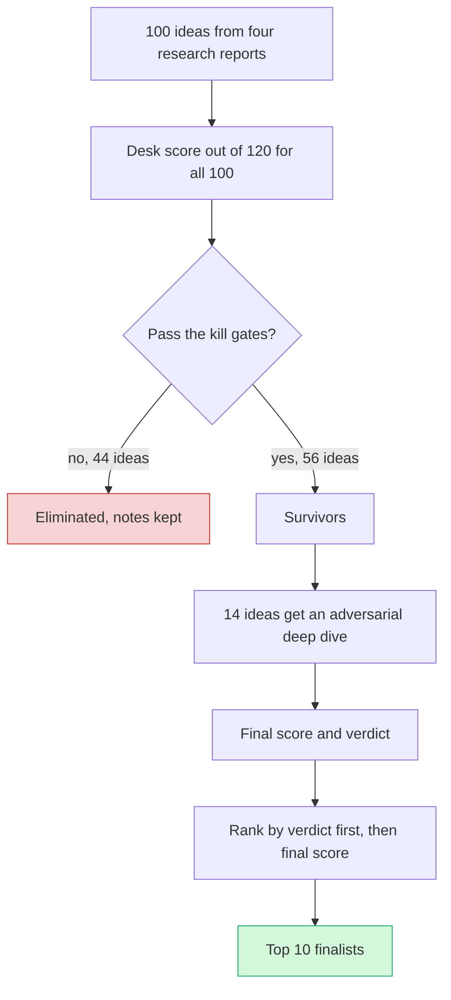

# Scoring methodology

> [!tldr] In one breath
> Each idea gets seven marks out of 10. The five marks that match the real Devpost judging criteria count double, and two safety marks (can we build it, what could block it) count once. **That gives a maximum of 120.** Then 14 ideas got a second, harsher pass that knocked their scores down, mostly on originality.

> [!example] Picture this
> Think of a talent show with five judges who each give marks out of 10. You count each judge twice because they decide the prize. Then you add two backstage checks: "can this act actually perform in the venue?" and "is anything likely to cancel it?" Those count once. The top acts then get a surprise audition where a harsh critic tries to prove they are copying someone.

## Why this scale

The old vault used a frame built for a 7 hour build. This event is online, about 4.5 weeks long, and judged on **five equally weighted Devpost criteria**: Technological Implementation, Design, Potential Impact, Innovation/Idea and Presentation. Technological Implementation is the first tie break. **The 7 axis score keeps those five at double weight and adds feasibility and risk as single weight guards.**

| Axis | Weight | Maps to Devpost criterion | What it asks, in plain words |
|---|---|---|---|
| Tech | ×2 | Technological Implementation | How much real PayPal and real AI is doing the work? |
| Design | ×2 | Design (complete product experience) | Does it feel like a finished product, start to end? |
| Impact | ×2 | Potential Impact | Is the problem big, painful and proven by good data? |
| Innovation | ×2 | Innovation / Idea | Has nobody else built this mechanism? |
| Demo | ×2 | Presentation (≤3-min video) | Can a stranger "get it" in a video under 3 minutes? |
| Feasibility | ×1 | not a criterion, but decides whether the others are real | Can 1 to 3 people build it in time, on APIs that work? |
| Risk⁻¹ | ×1 | 10 = no gating, legal or dependency risk | How safe is it from blockers? Higher is safer. |

**Max = 120. Each axis is 1 to 10.** The maths: five double axes give 5 × 2 × 10 = 100, and two single axes give 2 × 10 = 20.

Why the weights look like this: **the doubled axes are exactly what the judges score, so they carry the result.** Feasibility and risk are not judged, but an idea that cannot be built or gets blocked scores zero on the day, so they act as guard rails.

## What a 10 looks like on each axis

These "anchors" are the reference points used to give marks, like the example answers on a marking scheme.

* **Tech 10:** at least 4 PayPal capabilities beyond checkout in the core loop, plus AI making consequential, structured decisions. **5** = checkout plus one API, with the AI only writing text. **2** = PayPal is on the side.
* **Design 10:** a coherent experience from start to end, with a clear persona and a start and end state you can show in the sandbox.
* **Impact 10:** top tier primary evidence (a regulator, a card network, an independent source) of a severe problem for a named audience. **5** = plausible, but only vendor data. **2** = no data.
* **Innovation 10:** no product, open source project, paper prototype or visible Devpost entry does this mechanism. **Subtract for each close competitor found.**
* **Demo 10:** one unmistakable visual moment showing a PayPal sandbox state change, readable in 3 minutes.
* **Feasibility 10:** all required APIs verified in the sandbox, buildable by 1 to 3 people in 4 weeks.

## The scoring pipeline

## Two scoring passes

1. **Desk score (all 100 ideas).** Scored from the four research reports. Competitor and novelty claims come from landscape scans, not a separate hunt for each idea.
2. **Score after the deep dive (14 ideas).** An adversarial analyst tried to prove each idea was *not* novel, *not* feasible or *not* valuable, using at least 6 differently worded searches. Scores were revised with reasons. See [[43 Score Reconciliation]].

> [!warning] Important bias to know about
> Desk scores for the deep dived ideas **dropped by an average of 13.9 points, almost entirely on Innovation.** The 86 ideas that were not deep dived have not had that treatment, so their desk scores are *probably inflated by a similar margin*. **Compare them to each other, not to the deep dived finalists.**

## Control group

Ideas #97 to #100 are deliberately obvious (natural language assistant, shopping agent, receipt splitter, budget chatbot). **They scored 50 to 60, well below the field, which is a sanity check on the scale.** See [[Theme C Control group (obvious ideas)]].

## Ranking rule for the Top 10

Rank by **deep dive verdict first** (advance and advance with changes come before demote), then by final score. See [[50 Top 10 Overview]].

## Kill criteria

See [[41 Brutal Elimination]].

> [!info]- Jargon decoder
> **Axis**: one thing being marked, like "spelling" on an essay rubric.
> **Weight**: how many times an axis counts. ×2 means its mark is doubled.
> **Tie break**: the rule that decides between two equal scores. Like a penalty shootout.
> **Risk⁻¹**: "inverse risk". The mark goes *up* as risk goes *down*, so 10 means very safe.
> **Desk score**: a first score made from reading research, without testing the idea hard.
> **Deep dive / adversarial**: a second check where the analyst plays the opponent and tries to break the idea. Like a lawyer cross examining a witness.
> **Sandbox**: PayPal's practice playground with fake money.
> **State change**: money visibly moving from one stage to another, like "held" to "captured".
> **Anchor**: a reference example for a mark, so different scorers agree what a 5 or a 10 means.

## Where to next
* ⬆️ Up: [[00 PayPal AI Hackathon Hub]]
* ⬅️ Previous: [[30 Primitives Legend]] · ➡️ Next: [[41 Brutal Elimination]]
* 🔗 Related: [[42 100-Idea Score Table]], [[43 Score Reconciliation]], [[10 Event, Rules & Judging Intelligence]], [[Jargon Decoder]]
