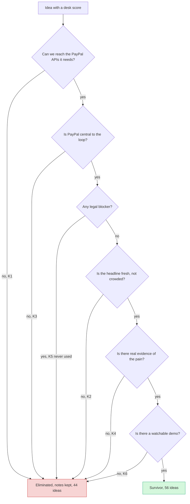

# Brutal elimination

> [!tldr] In one breath
> Before spending time on deep research, every idea had to survive six quick "kill" questions. **44 ideas were eliminated and 56 survived.** Killed ideas keep their notes and scores; they just cannot be finalists.

> [!example] Picture this
> Think of a job fair where the recruiter has a short checklist: "Can you legally work here? Do you have the key skill? Can you start on time?" A brilliant candidate can still be turned away if one box is a firm no. That is what happened to #16 Dispute EV Triage: top score (91), but it sat in a crowded headline, so it was out.

> [!warning] Reconstructed definitions
> The K code definitions are reconstructed from the reasons recorded against each killed idea (⚠ inference). **K5 was never triggered.**

## The six kill questions

| Code | Meaning | The plain question | Tiny example | Ideas killed |
|---|---|---|---|---|
| K1 | Real path depends on gated or unavailable APIs | "Can we actually reach the PayPal features this needs, without special approval?" | #61 Agent Returns Concierge: the real path needs buyer side APIs that are gated. | 1 |
| K2 | Crowded cluster or derivative headline; innovation cannot be defended | "Would a judge say 'I have seen ten of these already'?" | #16 Dispute EV Triage: best evidenced problem, but a crowded headline. | 24 |
| K3 | PayPal is not central to the loop | "If you swapped PayPal for any other payment button, would the idea still work the same?" | #36 Invoice Scam Detector: PayPal not central. | 2 |
| K4 | Weak evidence or low impact | "Is there real proof that many people suffer from this problem?" | #76 Haggle Link: fun, low impact. | 16 |
| K5 | Legal / regulatory blocker (reserved; no idea triggered it) | "Would a law or regulator stop this?" | None. No idea triggered it. | 0 |
| K6 | Infrastructure with no watchable demo | "Can you show something exciting happen on screen in a 3 minute video?" | #45 Agent Payment Eval Harness: valuable, not demo shaped. | 8 |

> [!question] Why do the counts add up to 51, not 44?
> **Seven ideas were killed by two codes at once**: #31 (K2, K6), #41, #66, #68, #72 and #99 (all K2, K4) and #100 (K2, K3). So 1 + 24 + 2 + 16 + 0 + 8 = 51 code hits, spread across 44 ideas.

## The gates as a decision tree

The original notes record which codes killed each idea, not the order they were checked in. **This order is a reconstruction for reading, not a recorded sequence (⚠ inference).**

## Every killed idea and why

**44 ideas eliminated, 56 survive.** Eliminated ideas keep their notes and scores; they just cannot be finalists. Sorted by desk score, highest first.

| # | Idea | Kill | Desk score | Reason recorded |
|---|---|---|---|---|
| 16 | [[I016 Dispute EV Triage\|#16 Dispute EV Triage]] | K2 | 91 | Best-evidenced problem, but a crowded headline. |
| 38 | [[I038 Household Delegated Agent\|#38 Household Delegated Agent]] | K2 | 81 | Interesting framing inside a crowded cluster. |
| 54 | [[I054 Decline Whisperer\|#54 Decline Whisperer]] | K2 | 79 | Market is mature. |
| 45 | [[I045 Agent Payment Eval Harness\|#45 Agent Payment Eval Harness]] | K6 | 76 | Valuable, not demo-shaped. |
| 53 | [[I053 Livestream Checkout Agent\|#53 Livestream Checkout Agent]] | K4 | 74 | Weak evidence. |
| 19 | [[I019 Compelling Evidence Linker\|#19 Compelling Evidence Linker]] | K2 | 73 | Useful, derivative. |
| 58 | [[I058 Exactly-Once Agent Payment Proxy\|#58 Exactly-Once Agent Payment Proxy]] | K6 | 73 | Great PR, thin product. |
| 14 | [[I014 Delivery-Confirmed Capture\|#14 Delivery-Confirmed Capture]] | K2 | 72 | Reads as escrow in a crowded field. |
| 44 | [[I044 Agent Price-Parity Checker\|#44 Agent Price-Parity Checker]] | K4 | 72 | Novel but speculative and thin on PayPal. |
| 61 | [[I061 Agent Returns Concierge\|#61 Agent Returns Concierge]] | K1 | 72 | Real-world path depends on gated buyer-side APIs. |
| 76 | [[I076 Haggle Link\|#76 Haggle Link]] | K4 | 72 | Fun, low impact. |
| 6 | [[I006 Agent Evidence Bundle Spec & Validator\|#6 Agent Evidence Bundle Spec & Validator]] | K6 | 71 | Useful infrastructure, poor video. |
| 15 | [[I015 Commitment Contract to Charity\|#15 Commitment Contract to Charity]] | K4 | 71 | Charming, low impact. |
| 24 | [[I024 Support-Ticket Dispute Early Warning\|#24 Support-Ticket Dispute Early Warning]] | K2 | 71 | Incumbent-adjacent. |
| 30 | [[I030 Cash Application Matcher\|#30 Cash Application Matcher]] | K6 | 71 | Useful, not watchable. |
| 63 | [[I063 Price-Protection Autopilot\|#63 Price-Protection Autopilot]] | K4 | 71 | Weak evidence. |
| 89 | [[I089 Voice-Note Invoicing\|#89 Voice-Note Invoicing]] | K2 | 71 | Obvious. |
| 70 | [[I070 Proof-of-Impact Field Payouts\|#70 Proof-of-Impact Field Payouts]] | K2 | 70 | Escrow-shaped. |
| 88 | [[I088 Quote-to-Deposit for Trades\|#88 Quote-to-Deposit for Trades]] | K2 | 70 | Overlaps 8, incumbents. |
| 71 | [[I071 Disaster Micro-Grant Distributor\|#71 Disaster Micro-Grant Distributor]] | K4 | 69 | Weak evidence. |
| 77 | [[I077 Fiat Micropayment Credits for Agents\|#77 Fiat Micropayment Credits for Agents]] | K2 | 68 | Over-served. |
| 21 | [[I021 Proactive INR Deflector\|#21 Proactive INR Deflector]] | K2 | 67 | Market already solved this. |
| 31 | [[I031 Cash-Gap Forecaster\|#31 Cash-Gap Forecaster]] | K2, K6 | 67 | Crowded and chart-shaped. |
| 57 | [[I057 Webhook Drift Doctor\|#57 Webhook Drift Doctor]] | K6 | 67 | Narrow dev utility. |
| 62 | [[I062 Returns-Abuse Pattern Detector\|#62 Returns-Abuse Pattern Detector]] | K6 | 67 | Incumbent space, table demo. |
| 85 | [[I085 Plain-Language Payment Consent\|#85 Plain-Language Payment Consent]] | K4 | 67 | Thin. |
| 46 | [[I046 Protection-Aware Payment Selector\|#46 Protection-Aware Payment Selector]] | K4 | 66 | Strategy deck, not a product. |
| 81 | [[I081 Pause-Not-Cancel Retention\|#81 Pause-Not-Cancel Retention]] | K2 | 65 | Solved; dark-pattern risk. |
| 82 | [[I082 Win-Back Agent\|#82 Win-Back Agent]] | K2 | 65 | Derivative. |
| 95 | [[I095 Agent Spend Reconciler\|#95 Agent Spend Reconciler]] | K6 | 64 | Speculative, table demo. |
| 37 | [[I037 Overpayment & Refund-Scam Shield\|#37 Overpayment & Refund-Scam Shield]] | K4 | 62 | Weak evidence. |
| 78 | [[I078 Usage-Metered AI SaaS Billing\|#78 Usage-Metered AI SaaS Billing]] | K2 | 61 | Solved. |
| 36 | [[I036 Invoice-Scam Detector\|#36 Invoice-Scam Detector]] | K3 | 60 | PayPal not central. |
| 41 | [[I041 Shared Subscription Steward\|#41 Shared Subscription Steward]] | K2, K4 | 60 | Weak. |
| 97 | [[I097 Control Natural-Language PayPal Assistant\|#97 Control: Natural-Language PayPal Assistant]] | K2 | 60 | Control idea: the most duplicated build. |
| 66 | [[I066 Duty-Inclusive Cross-Border Checkout\|#66 Duty-Inclusive Cross-Border Checkout]] | K2, K4 | 59 | Solved by incumbents. |
| 73 | [[I073 Community Pool Ledger\|#73 Community Pool Ledger]] | K2 | 59 | Obvious. |
| 91 | [[I091 Event Vendor Settlement\|#91 Event Vendor Settlement]] | K4 | 59 | Weak evidence; gated APIs. |
| 98 | [[I098 Control Channel3 Shopping Agent + PayPal Checkout\|#98 Control: Channel3 Shopping Agent + PayPal Checkout]] | K2 | 59 | Control idea. |
| 93 | [[I093 Lien-Waiver-Gated Contractor Payouts\|#93 Lien-Waiver-Gated Contractor Payouts]] | K4 | 58 | Niche. |
| 68 | [[I068 PPP Price Localizer\|#68 PPP Price Localizer]] | K2, K4 | 56 | Solved. |
| 72 | [[I072 Matching-Gift Finder\|#72 Matching-Gift Finder]] | K2, K4 | 56 | Solved. |
| 99 | [[I099 Control Receipt-Scan Bill Splitter\|#99 Control: Receipt-Scan Bill Splitter]] | K2, K4 | 56 | Control idea. |
| 100 | [[I100 Control Budgeting Chatbot over PayPal\|#100 Control: Budgeting Chatbot over PayPal]] | K2, K3 | 50 | Control idea. |

## What to take away

* **A high desk score does not protect an idea.** Several eliminated ideas scored very high (for example #16 Dispute EV Triage, 91) because the *problem* is well evidenced. They were killed for being a crowded headline (K2) in the Devpost disputes cluster, not for being bad ideas. **#16's mechanism lives on inside #20 and #23.**
* **Elimination happened *before* deep dives.** Deep dives then demoted 7 more survivors on evidence. See [[43 Score Reconciliation]].

> [!info]- Jargon decoder
> **Kill criterion**: a rule that removes an idea no matter how good its other marks are. Like a height limit on a roller coaster.
> **Gated API**: a PayPal feature you can only use after PayPal approves you. Like a staff only door.
> **Derivative**: a copy or small twist on something that already exists.
> **Cluster**: a group of similar entries already built by other teams.
> **Infrastructure**: plumbing that other tools run on. Useful, but hard to show in a video.
> **Desk score**: the first score out of 120, made from desk research. See [[40 Scoring Methodology]].

## Where to next
* ⬆️ Up: [[00 PayPal AI Hackathon Hub]]
* ⬅️ Previous: [[40 Scoring Methodology]] · ➡️ Next: [[42 100-Idea Score Table]]
* 🔗 Related: [[Element Themes Overview]], [[43 Score Reconciliation]], [[17 Live Competition Scan (Oct 23)]]
