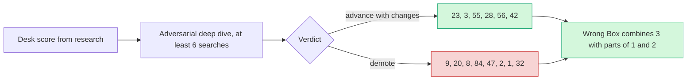

# Score reconciliation: desk vs deep dive

> [!tldr] In one breath
> 14 ideas got a harsh second check where an analyst tried to prove each one was not new, not buildable or not useful. **Every single score went down, by 6 to 23 points, mostly because close competitors turned up.** Six ideas still advanced with changes; the rest were demoted to parts for other builds.

> [!example] Picture this
> You think you invented a brilliant new board game. Then a friend spends an evening searching and finds three shops already selling something close. Your game is not worthless, but you now know which bit is truly yours. That bit is what each "advance with changes" verdict keeps.

## How it worked

## Before and after

> [!info] How to read this table
> The marks in square brackets are in this order: **Tech, Design, Impact, Innovation, Demo, Feasibility, Risk⁻¹**, each out of 10. The first five count double. **Δ** is final minus desk. See [[40 Scoring Methodology]].

The 14 ideas that received an adversarial deep dive, before and after.

| # | Idea | Desk axes | Desk | Deep axes | Final | Δ | Verdict |
|---|---|---|---|---|---|---|---|
| 23 | [[I023 Seller Protection Preflight\|#23 Seller Protection Preflight]] | [8, 8, 8, 8, 8, 9, 8] | 97 | [8, 8, 6, 7, 8, 8, 7] | **89** | -8 | advance-with-changes |
| 3 | [[I003 Mismatch-to-Replacement\|#3 Mismatch-to-Replacement]] | [7, 8, 7, 7, 9, 9, 8] | 93 | [7, 8, 6, 6, 9, 8, 7] | **87** | -6 | advance-with-changes |
| 55 | [[I055 Payout Failure Triage\|#55 Payout Failure Triage]] | [9, 8, 7, 7, 8, 9, 8] | 95 | [8, 8, 6, 6, 7, 9, 7] | **86** | -9 | advance-with-changes |
| 28 | [[I028 Early-Pay Discount Optimizer\|#28 Early-Pay Discount Optimizer]] | [8, 8, 8, 7, 7, 9, 8] | 93 | [7, 8, 7, 6, 7, 8, 7] | **85** | -8 | advance-with-changes |
| 9 | [[I009 Rental Deposit Inspector\|#9 Rental Deposit Inspector]] | [8, 8, 6, 7, 9, 8, 8] | 92 | [8, 8, 6, 4, 8, 7, 6] | **81** | -11 | demote |
| 20 | [[I020 Dispute-to-Listing Fixer\|#20 Dispute-to-Listing Fixer]] | [8, 8, 8, 8, 8, 9, 8] | 97 | [7, 7, 6, 6, 7, 7, 7] | **80** | -17 | demote |
| 56 | [[I056 Integration Chaos Monkey\|#56 Integration Chaos Monkey]] | [8, 7, 6, 8, 8, 8, 8] | 90 | [8, 7, 5, 6, 7, 7, 7] | **80** | -10 | advance-with-changes |
| 8 | [[I008 Final-Price Agent (Overcapture)\|#8 Final-Price Agent (Overcapture)]] | [8, 8, 6, 8, 8, 7, 7] | 90 | [7, 8, 5, 6, 7, 6, 6] | **78** | -12 | demote |
| 42 | [[I042 Pre-Checkout Injection Firewall\|#42 Pre-Checkout Injection Firewall]] | [7, 7, 7, 8, 9, 8, 7] | 91 | [6, 7, 6, 5, 7, 8, 6] | **76** | -15 | advance-with-changes |
| 84 | [[I084 Accessible Voice Checkout\|#84 Accessible Voice Checkout]] | [7, 9, 6, 7, 8, 7, 7] | 88 | [5, 8, 6, 5, 7, 7, 6] | **75** | -13 | demote |
| 47 | [[I047 WebMCP Storefront Kit\|#47 WebMCP Storefront Kit]] | [8, 8, 7, 9, 9, 7, 6] | 95 | [6, 7, 6, 4, 7, 7, 5] | **72** | -23 | demote |
| 2 | [[I002 Three-Party Agent Error Settlement\|#2 Three-Party Agent Error Settlement]] | [9, 7, 7, 9, 8, 8, 7] | 95 | [8, 6, 6, 3, 7, 7, 5] | **72** | -23 | demote |
| 1 | [[I001 Intent Black Box\|#1 Intent Black Box]] | [9, 7, 7, 7, 8, 8, 8] | 92 | [8, 6, 6, 3, 6, 7, 6] | **71** | -21 | demote |
| 32 | [[I032 F&F Scam Interrupter\|#32 F&F Scam Interrupter]] | [7, 8, 9, 6, 8, 7, 6] | 89 | [5, 7, 8, 3, 7, 6, 5] | **71** | -18 | demote |

## Why each score changed

### #23 Seller Protection Preflight: advance with changes

**What checked out.** Verified from primary sources: the US terms (Jan 2026) and UK terms (Jul 2026) require shipping to the Transaction Details address. They void protection if the parcel is redirected, recommend against shipping arranged by the buyer, and exclude SNAD claims. **There is NO signature or value threshold, so drop that claim.**

**APIs confirmed in the OpenAPI spec:** Orders v2 `purchase_units[].shipping`; capture `seller_protection.status` plus `dispute_categories`; Transaction Search `shipping_info`, `protection_eligibility`, `address_status` and `transaction_note`; plus Orders track.

**What went down.** Impact is lower: no quantified scam frequency and no verified user voices. Innovation is slightly lower because the competitor hunt was incomplete (search budget exhausted), and printing a label from the order already enforces the address without saying so. No Devpost overlap was found in ~144 entries.

> [!warning] Crowd check, Oct 23 2026
> The later scan of 266 GitHub repos found **preflight-for-paypal, a seller protection checker that is a near duplicate of #23.** The "no overlap in ~144 entries" line above was true on Oct 12 but is now out of date. See [[17 Live Competition Scan (Oct 23)]].

_One line:_ A PayPal Seller Protection gate before shipping: real API signals plus AI that reads "ship to my cousin" messages and reads labels with OCR. Advance, paired with releasing holds by uploading tracking; drop the signature claim and fill in scam evidence.

Full report: [[D023 Seller Protection Preflight (Deep Dive)]]

### #3 Mismatch-to-Replacement: advance with changes

**Why it survives.** It is the only mechanism in its cluster not found on Devpost: compare the human's instruction, the listing and a photo of what was delivered. That result feeds a PayPal make offer (`REPLACEMENT_WITHOUT_REFUND`) before a claim is filed, or a Payouts reimbursement when the agent made the mistake.

**What went down.**
* Innovation, because of Loop AI Image Recognition and PixelProof photo checks, XReceipt's "did the two match", and Provenant's fault split.
* Impact, because the evidence is an NMI vendor survey, with no data on how many agent disputes happen.
* Feasibility, because vision can be unreliable and creating a dispute in the sandbox needs a test on day 1.

Combined with #1's binding and #2's payout fork, the marks become [8,8,6,6,9,7,7].

_One line:_ Make this the spine. A photo of what arrived versus what the human asked for decides between a merchant replacement (Disputes) and an agent platform payout (Payouts), before any chargeback.

Full report: [[D003 Mismatch-to-Replacement (Deep Dive)]]

### #55 Payout Failure Triage: advance with changes

**What went down.** Sandbox failure branches are mostly canned mock responses. The classification is just a lookup table. There is no primary data on payout failure rates. Payouts are used by at least 10 Devpost entries, and HoldWatch already explains ONHOLD events.

**Why it survives.** It works as a real loop: UNCLAIMED, then contact the person, then cancel, then RETURNED, then issue again, with compliance refusals you can see on screen.

_One line:_ A payout workflow that recovers from failure, with compliance guardrails. Build the hero loop on the real UNCLAIMED state, not on mock codes.

Full report: [[D055 Payout Failure Triage (Deep Dive)]]

### #28 Early-Pay Discount Optimizer: advance with changes

**What checked out.** The conditional rules endpoint is verified in the public Invoicing v2 docs and in agent-toolkit v1.11 (`EARLY_PAYMENT_DISCOUNT` / `AUTO_CANCEL`, `PERCENT` / `AMOUNT`, expiry enums).

**What is uncertain.** An `invoicing/internal` scope is listed, and how it looks to the payer or whether it applies automatically is undocumented. So it needs a sandbox test on day 1.

**What went down.**
* Innovation: Chaser already applies automatic discounts per debtor in its portal, and Zoho, Upflow, C2FO, Taulia and AI discount agents on the payer's side already exist.
* Tech: the core loop uses only Invoicing.
* Evidence that customers take up discounts is vendor or snippet only.

_One line:_ Survives as an early payment discount priced by AI for each client (the maths of what waiting costs), written natively into PayPal invoice conditional rules. It must pass the day 1 test of what the payer sees.

Full report: [[D028 Early-Pay Discount Optimizer (Deep Dive)]]

### #9 Rental Deposit Inspector: demote

**Why it fell.** AI damage detection from before and after rental photos is a crowded category (Texada, CloudRent, switchlabs Verify, Roboflow, Hertz/UVeye). A public repo, RentProof (Claude plus Render), does the AI half almost identically. TWICE, Booqable and ChargeAutomation already do deposits held on the card with partial capture.

**Technical snags.** The Payments v2 reference says a reauthorization is allowed only once (day 4 to 29), which contradicts the guide's "multiple". PayPal partial capture needs the account to be enabled for it. The backlash against Hertz's AI billing adds framing risk.

_One line:_ The PayPal mechanics work for short rentals, but the novelty collapses: AI damage comparison and partial hold capture both exist. Keep it only as a component.

Full report: [[D009 Rental Deposit Inspector (Deep Dive)]]

### #20 Dispute-to-Listing Fixer: demote

**What checked out.** Dispute data is rich enough to cluster. GET dispute returns `reason`, `sub_reasons`, the buyer's `product_details.description`, `purchase_url`, `items[]` and `messages[]`.

**Why it fell.** The PayPal "fix" step is cosmetic. `/v1/catalogs/products` backs Subscriptions, not storefronts, so the real fix goes to Shopify or Woo. ReasonWhy (Shopify, Jun 2026) already ships the loop of cluster, fix the page, compare before and after, on returns. Return Insights AI, Vortex IQ ASIN clusters and Amazon VoC are close by. No primary figure was found for the share of disputes that are SNAD. The competitor search was cut short by the shared search budget.

_One line:_ The data is real, but the PayPal side fix is cosmetic and ReasonWhy already does the same loop on returns. Better as a prevention tab inside a dispute or "ship safe" product.

Full report: [[D020 Dispute-to-Listing Fixer (Deep Dive)]]

### #56 Integration Chaos Monkey: advance with changes

**Why it went down.** PayPal's own AI Toolkit command `/paypal:doctor` already scans code (without running it) for the same failure types (`INSTRUMENT_DECLINED`, webhook verify and idempotency, `PayPal-Request-Id`, retries) and applies fixes automatically. The space is crowded by payfuzz (webhook delivery fuzzing), MockGateway (PayPal mock outcomes), Autonoma (end to end tests for agentic checkout), Stripe audit and fix skills, and PayPal's announced Merchant AI Integration Agent. Evidence of pain is anecdotal. Mock responses do not change PayPal state. Injecting the header into a merchant's SDK calls needs a proxy.

**Why it survives.** Three things together are still novel: dynamic fault injection in the sandbox, replaying real signed webhooks, and a pull request that opens only after a rerun passes.

_One line:_ Position it as the live partner to `/paypal:doctor`. Make PayPal actually fail against the running app (mock codes plus real signed webhook replays), show the broken order, and open a PR only when the rerun goes green.

Full report: [[D056 Integration Chaos Monkey (Deep Dive)]]

### #8 Final-Price Agent (Overcapture): demote

**What checked out.** The overcapture limit is documented (115% / +$75, and "defaults to 115%" in `MAX_CAPTURE_AMOUNT_EXCEEDED`). But there is no published eligibility, and nobody knows how strictly the sandbox enforces it.

**Why it fell.** State laws on auto repair (FL 559.905 disclosure; CA 9884.9) require customer consent before a bill goes over the estimate. So an AI that sets final prices needs a ceiling the customer agreed in advance. Incumbents already cover that workflow: Tekmetric and Shopmonkey digital authorization, and Housecall Pro and Pepper with card on file and preauthorization. The demo moment is just a number in some JSON.

_One line:_ Keep it as a branch inside a build based on holds (a consented +15% buffer; anything over the ceiling becomes an invoice). Not a standalone finalist.

Full report: [[D008 Final-Price Agent (Overcapture) (Deep Dive)]]

### #42 Pre-Checkout Injection Firewall: advance with changes

**Why it went down.** Warden (Devpost, this hackathon, submitted ~Oct 11) already ships a PayPal MCP firewall with provenance taint, quarantine of hidden text, a Gemini intent check, phone holds and an AG Grid ledger. It is merchant side and plans a buyer side version next. AIP-Bench/PCAT (arXiv 2607.21824) is a defense built for commerce. MELON and CaMeL cover the counterfactual and taint mechanisms.

**What survives.** A buyer side audit that asks "would the agent still pick this product without the untrusted text?" (Branded Whisper hijacks the choice, not the payee), plus checking the order again at capture time. The core is deterministic, and the classifier only advises. The PayPal surface is Orders, v6 and webhooks.

_One line:_ Pivot from a generic injection firewall (taken by Warden) to "selection integrity": block the PayPal order when the agent's product pick changes once untrusted text is hidden.

Full report: [[D042 Pre-Checkout Injection Firewall (Deep Dive)]]

### #84 Accessible Voice Checkout: demote

**The hard wall.** The PayPal v6 approval popup or modal is cross origin and owned by PayPal. A third party layer cannot make the approval step accessible, only the handoff around it. The core loop is checkout plus Orders (tech anchor ~5) unless Vault or Refunds are added.

**Close competitors.** PayU accessible checkout with voice navigation (Aug 2026); Be My Eyes x InnoSearch AI accessible shopping portal (May 2025); Kalon on Devpost (2023); a CHI'26 study of voice computer use agents for shopping (payment excluded); agentic browsers as assistive technology (arXiv 2606.24870).

**Evidence.** Strong on how common the problem is: WebAIM 95.9%, the EAA is in force, the FTC fined accessiBe $1M, and ~70% of >5,000 lawsuits in 2025 were against online shops (e-com) [vendor]. But data on harm specific to payments is still missing. Expert accessibility judges (Jo Franchetti; Sylwia Vargas only via AG Grid) raise the bar.

_One line:_ Real need, but the PayPal approval window is a hard boundary, and accessible and AI shopping already exist. Fold "confirmation written as a full statement, an announced PayPal handoff, and a vaulted voice reconfirm" into a shopping or agent finalist as its accessibility pillar.

Full report: [[D084 Accessible Voice Checkout (Deep Dive)]]

### #47 WebMCP Storefront Kit: demote

**Why it fell.** Shopify turned on 10 WebMCP tools (including checkout) by default on all Liquid and Hydrogen stores (Aug 2026). Stripe ships WebMCP tools in its payment UIs. The WebMCP Bridge WordPress plugin (600+ installs) already exposes Woo cart tools. PayPal announced the same concept (gated behind Store Sync). Agent demand is ~zero: no mainstream agent calls `modelContext` tools, and Gemini in Chrome is "soon". The PayPal loop is centred on checkout.

**The narrow survivor.** Open PayPal v6 WebMCP checkout tools for sites that do not use Store Sync.

_One line:_ Merchant side WebMCP is already shipped by Shopify, Stripe and WordPress plugins. Only a thin, ungated sliver remains: "PayPal v6 checkout as WebMCP tools". Demote, and salvage it as a component.

Full report: [[D047 WebMCP Storefront Kit (Deep Dive)]]

### #2 Three-Party Agent Error Settlement: demote

**Why it fell.** The claim "no product settles three ways" is false. Provenant (Devpost, same hackathon judging by its sponsor tags) splits fault between user, merchant and agent using Shapley values, and pays the agent's share via Payouts from a liability pool, plus dispute evidence. Amex Agent Purchase Protection (Apr 2026) covers buyers for mistakes made by AI agents. No card network rule makes agent platforms liable, so demand for the Payouts leg is speculative. The fault matrix is a lookup table, and three personas hurt design and demo.

_One line:_ The mechanism is already on Devpost (Provenant). It survives only as the agent fault Payouts fork, triggered by #3's delivery check.

Full report: [[D002 Three-Party Agent Error Settlement (Deep Dive)]]

### #1 Intent Black Box: demote

**Why it fell.** Provenant (Devpost, same hackathon judging by its `ag-grid` and `render` tags) already binds `custom_id` to a hash of the agent's decision trace, with replay and a dispute evidence pack. AgentProof builds PayPal provide evidence for agent disputes. Amex ACE (Apr 2026) captures intent plus cart context for disputes. Chargebacks911 UDMS records agent consent. Hash binding is invisible on video, and sandbox dispute creation is missing from the public OpenAPI (needs a day 1 test).

_One line:_ The mechanism is already shipped by Provenant and AgentProof. Keep only the normalized instruction record as the evidence spine for #3.

Full report: [[D001 Intent Black Box (Deep Dive)]]

### #32 F&F Scam Interrupter: demote

**Incumbents doing the exact same thing were found.**
* PayPal's own AI scam alerts on Friends and Family sends: live worldwide on PayPal and across the US on Venmo since 2025-07-21, scaled by risk, with high risk sends declined automatically.
* Starling Scam Intelligence (Oct 2025): upload listing or chat images and get a Gemini risk verdict.
* Lloyds Scam Check (Jun 2026): screenshots plus AI at the moment you pay a new payee.
* Also Marketplace scam checker sites, a Chrome extension and Devpost entries (TrustGate, Red Flag).

So **Innovation went from 6 to 3.**

**Technical limits.** PayPal has no P2P or Request Money API, and Invoicing or Payment Links cannot be issued from the seller without partner permissions. So the tech is Orders with `payee.email_address` plus Log in with PayPal (5). A third party payee for non partners is unverified, and onboarding after payment needs an approved partner (feasibility 6, risk 5). The impact evidence stays top tier, but reach is weaker (8).

_One line:_ A real problem, but PayPal, Starling and Lloyds already ship AI scam checks at the moment of send. Only the "seller protection handshake" survives (authorize and capture routed through the payee, where a refusal is the verdict). Salvage it as a module, not a finalist.

Full report: [[D032 F&F Scam Interrupter (Deep Dive)]]

## Combined concept

**"Wrong Box" combines #3 (the spine) with #1 (instruction binding) and #2 (the agent fault Payouts fork).** Combined axes [8,8,6,6,9,7,7] = **88/120**. See [[Wrong Box Combined Concept]].

> [!info]- Jargon decoder
> **Adversarial deep dive**: a check where the analyst plays the opponent and tries to break the idea. Like a lawyer cross examining a witness.
> **Verdict**: "advance with changes" means keep it but fix the weak parts; "demote" means it is no longer a finalist on its own.
> **OpenAPI**: the official machine readable list of an API's requests and fields. Like a parts catalogue.
> **SNAD**: "significantly not as described", the item arrived but was not what was promised.
> **OCR**: reading text from a photo, such as a shipping label.
> **Mock response**: a fake answer the sandbox gives on purpose for testing. Like a fire drill alarm.
> **Idempotency**: sending the same request twice has the same effect as once. Like pressing a lift button again: the lift does not come twice.
> **Webhook replay**: sending a recorded PayPal event message again to see how the app reacts.
> **Overcapture**: charging a bit more than the amount held on the card.
> **Provenance taint**: tagging text by where it came from, so text from untrusted pages is treated with suspicion. Like marking food from an unknown stall.
> **Counterfactual**: "what would have happened if...". Here: would the agent pick the same product with the suspicious text removed?
> **Deterministic**: gives the same answer every time for the same input, unlike an AI that might vary.
> **Shapley values**: a fair way from game theory to split credit or blame among several players.
> **Cross origin**: a window from another website that your page is not allowed to reach into.
> **Store Sync**: a PayPal programme for syncing a merchant's catalogue; entry is gated (⚠ inference on the wording).

## Where to next
* ⬆️ Up: [[00 PayPal AI Hackathon Hub]]
* ⬅️ Previous: [[42 100-Idea Score Table]] · ➡️ Next: [[44 Bench Ideas Not Deep-Dived]]
* 🔗 Related: [[40 Scoring Methodology]], [[50 Top 10 Overview]], [[Wrong Box Combined Concept]], [[17 Live Competition Scan (Oct 23)]]
