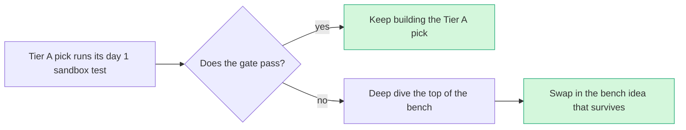

# Bench: high desk scores, no deep dive

> [!tldr] In one breath
> These eight survivors scored well on desk research but were never put through the harsh deep dive. **Their scores are probably inflated, so treat them as substitutes, not stars.** If a Tier A day 1 gate fails, deep dive the top of this list first.

> [!example] Picture this
> A football team has players on the bench who looked great in training but have not played a real match yet. If a starter gets injured, the coach sends on the best of them, knowing their training stats might flatter them.

These survivors scored well on desk research but were not adversarially verified. **Their desk scores are probably inflated** (see [[40 Scoring Methodology]], where deep dived ideas dropped by 13.9 points on average).

> [!warning] Crowd check, Oct 23 2026
> The live scan of 266 repos (partial coverage, gallery not public) changes the picture for some of these:
> * **#5 Regret Window** sits in the **most saturated area**, agent spending guards (about 30 repos: permit, mandate, Warden, four "leash", three "allowance" and more).
> * **#22** sits next to about 16 dispute copilots (witness, dispute-defender, rebuttal and others).
> * **#49** is near the merchant storefront cluster of about 11 repos (paypal-webmcp-shop, shopfront-agent and others).
> * **#96** would likely lean on AG Grid (⚠ inference), the most contested sponsor prize (about 20 repos).
> * **#60** has a cousin in paypal-webhook-simulator; developer tooling is otherwise nearly empty.
> * **#35** and **#13** did not show close matches by name. **#40** is near kincart and nonna-mode in the small elder and family cluster.
>
> See [[17 Live Competition Scan (Oct 23)]].

## The bench

How to read it: **Desk** is the first score out of 120. **Crowding** is from the Oct 12 scan.

| # | Idea | Desk | Crowding | Why it is on the bench |
|---|---|---|---|---|
| 5 | [[I005 Regret Window\|#5 Regret Window]] | 87 | Spend-gate cluster (~13) | Clean, buildable, but lives in the most crowded cluster. |
| 35 | [[I035 Vendor Change Verifier\|#35 Vendor Change Verifier]] | 85 | none | Solid B2B scam angle. |
| 40 | [[I040 Purpose-Bound Family Support\|#40 Purpose-Bound Family Support]] | 85 | none | Social impact with a fresh mechanism. |
| 96 | [[I096 PayPal Ops Control Room\|#96 PayPal Ops Control Room]] | 84 | Analytics cluster | Great sponsor-prize shell for idea 16/20/23. |
| 13 | [[I013 Pricing-Error Shield\|#13 Pricing-Error Shield]] | 83 | none | Fun demo; weak evidence. |
| 49 | [[I049 Agent-Buyability Audit\|#49 Agent-Buyability Audit]] | 82 | none | Fresh, but PayPal is not the core. |
| 60 | [[I060 Sandbox Scenario Studio\|#60 Sandbox Scenario Studio]] | 82 | none | Useful dev tool; modest impact. |
| 22 | [[I022 Don't Recognize This Charge Resolver\|#22 "Don't Recognize This Charge" Resolver]] | 81 | Disputes cluster | Practical, moderate novelty. |

> [!info]- Jargon decoder
> **Bench**: ideas kept in reserve, ready to swap in.
> **Desk score**: a first score from reading research, without a hard test.
> **Adversarially verified / deep dive**: an analyst tried hard to prove the idea was not new, not buildable or not useful.
> **Tier A day 1 gate**: a quick sandbox test on the first build day that the top picks must pass. See [[63 Day-1 Sandbox Test Plan]].
> **Sponsor prize shell**: a dashboard built with a sponsor's tool (here likely AG Grid, ⚠ inference) that can wrap another idea and compete for that sponsor's prize.

## Where to next
* ⬆️ Up: [[00 PayPal AI Hackathon Hub]]
* ⬅️ Previous: [[43 Score Reconciliation]] · ➡️ Next: [[50 Top 10 Overview]]
* 🔗 Related: [[40 Scoring Methodology]], [[42 100-Idea Score Table]], [[63 Day-1 Sandbox Test Plan]], [[17 Live Competition Scan (Oct 23)]]
