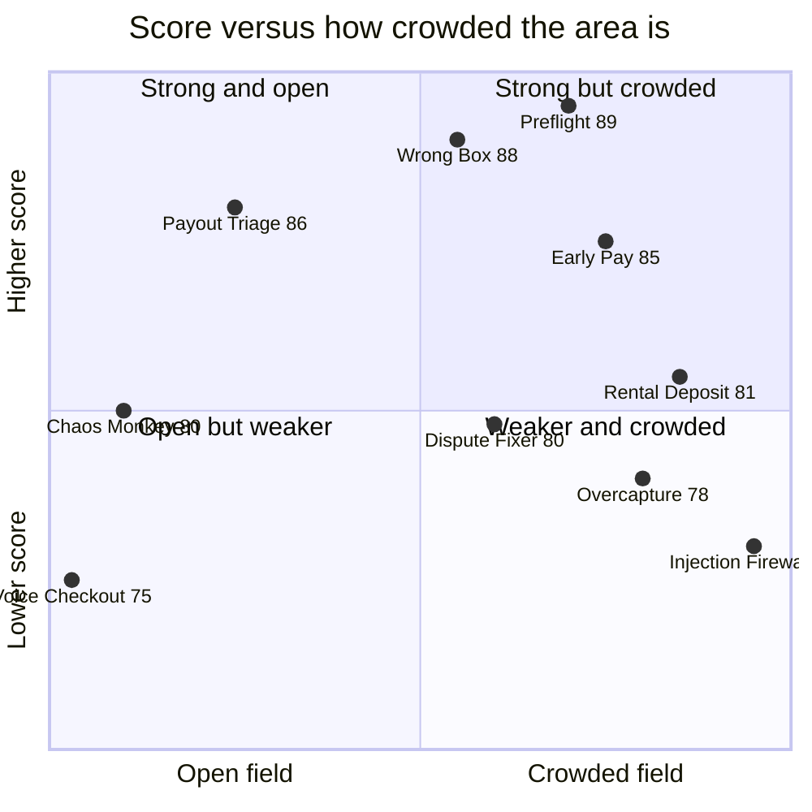
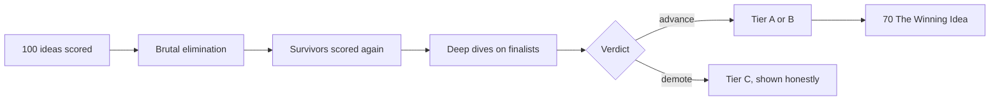

# Top 10 ideas and solutions

> [!tldr] In one breath
> After 100 ideas were scored and the best were researched in depth, these ten are left. Tier A (Seller Protection Preflight, Wrong Box, Payout Failure Triage) are the build candidates. Tier C ideas were demoted by their own deep dives and are shown anyway, so nothing gets quietly hidden.

> [!example] Picture this
> Think of a talent show after the auditions. Ten acts are on the shortlist. Three are ready for the final, three are good understudies, and four were great in rehearsal but the judges spotted a fatal flaw. This page is the shortlist pinned on the noticeboard, flaws included, plus a note on how many other acts are doing the same routine.

**How it was ranked:** the deep dive verdict comes first (advance or advance with changes ahead of demote), then the final score out of 120. Tier A = build candidates (the Top 3). Tier B = viable alternates. Tier C = best of the *demoted*. Each Tier C idea is listed because it scored well on desk research but its own deep dive said not to build it on its own. **Showing them honestly is the point: a Top 10 that hid those verdicts would repeat the score inflation the deep dives were run to remove.**

⚠️ The finalists were picked for deep dives from the high scoring survivor pool. Several more survivors scored 83 to 87 on desk research (e.g. #5, #35, #40, #96, #13) and were not deep dived (see [[44 Bench Ideas Not Deep-Dived]]).

## Scorecard at a glance: the ranking

| Rank | Idea | Tier | Final /120 | Verdict | Prize target | Day 1 gate | Crowd (Oct 23 scan) |
|---|---|---|---|---|---|---|---|
| 1 | [[I023 Seller Protection Preflight\|#23 Seller Protection Preflight]] | Tier A | 89 | advance-with-changes | Grand; fallback Most Impactful / Best Use of PayPal + AI; sponsor AG Grid. | T1 | Packed: near duplicate found (preflight-for-paypal); ~16 dispute copilots nearby |
| 2 | [[Wrong Box Combined Concept\|Wrong Box (#3+#1+#2)]] | Tier A | 88 (spine #3 = 87) | advance-with-changes | HM Best Use of Agentic Commerce / Best Demo Delivery; Grand possible; sponsor AG Grid or Channel3. | T2, T3 | Busy: ~16 dispute copilots, ~28 escrow repos; photo vs instruction angle not seen |
| 3 | [[I055 Payout Failure Triage\|#55 Payout Failure Triage]] | Tier A | 86 | advance-with-changes | HM Best Use of PayPal + AI or Most Impactful; sponsor AG Grid. | T4 | Thin: 3 to 6 payout repos, none seen fixing failures |
| 4 | [[I028 Early-Pay Discount Optimizer\|#28 Early-Pay Discount Optimizer]] | Tier B | 85 | advance-with-changes | Most Impactful (freelancers / SMBs); sponsor AG Grid. | T5 | Busy: ~25 invoicing repos (4th most crowded) |
| 5 | [[I056 Integration Chaos Monkey\|#56 Integration Chaos Monkey]] | Tier B | 80 | advance-with-changes | HM Most Creative / Best Use of PayPal + AI. | T6 | Thin: nearly empty, only cutover and a webhook simulator |
| 6 | [[I042 Pre-Checkout Injection Firewall\|#42 Pre-Checkout Injection Firewall]] | Tier B | 76 | advance-with-changes | HM Best Use of Agentic Commerce. | T7 | Packed: most crowded area, ~30 agent guardrail repos |
| 7 | [[I009 Rental Deposit Inspector\|#9 Rental Deposit Inspector]] | Tier C | 81 | demote | Not recommended as standalone. | T8 | Packed: ~28 escrow repos incl. handback (rental deposit photo compare) |
| 8 | [[I020 Dispute-to-Listing Fixer\|#20 Dispute-to-Listing Fixer]] | Tier C | 80 | demote | Not recommended as standalone. | none | Busy: ~16 dispute copilots |
| 9 | [[I008 Final-Price Agent (Overcapture)\|#8 Final-Price Agent (Overcapture)]] | Tier C | 78 | demote | Branch only. | T8 | Busy: holds and escrow cluster, ~28 repos |
| 10 | [[I084 Accessible Voice Checkout\|#84 Accessible Voice Checkout]] | Tier C | 75 | demote | Better as a design pillar inside another build. | none | Empty: ZERO accessibility first repos |

Day 1 gates are defined in [[63 Day-1 Sandbox Test Plan]].

> [!info] About the crowd column
> The crowd notes come from [[17 Live Competition Scan (Oct 23)]]: 266 public GitHub repos created Sep 1 to Oct 22 2026 that mention the hackathon, sorted by archetype from their descriptions. Coverage is partial (the official gallery is not public yet, and search was rate limited), so read "empty" as "looked empty", not "proven empty". Labels: Empty, Thin, Busy, Packed (very crowded or a near duplicate exists).

## Score vs crowd, at a glance

**The sweet spot is top left: high score, few rivals.** Payout Failure Triage and Chaos Monkey sit closest to it. The Injection Firewall sits in the worst corner for novelty. Crowd positions are a rough reading of the scan, not exact counts.

## How the shortlist was built

## Solution cards

### 1. Seller Protection Preflight (+ tracking release + dispute evidence pack)
**Tier:** Tier A · **Score:** 89/120 · [[D023 Seller Protection Preflight (Deep Dive)|Deep dive]] · [[I023 Seller Protection Preflight|Idea note]]

**Solution.** A check for PayPal sellers before they ship. For each paid order it compares the ship to address with Transaction Details, reads buyer messages for address change and "pay me off PayPal" requests (the "ship it to my cousin" scam), checks what proof of delivery is needed, and quotes the policy clause. Once cleared, it uploads tracking (the documented fastest way to release held funds) and builds the dispute evidence pack in advance.

**Hero demo moment.** Scam message → red "do not ship" with the quoted PayPal clause → corrected label → tracking uploaded → order flips.

**Prize target.** Grand; fallback Most Impactful / Best Use of PayPal + AI; sponsor AG Grid.

**Biggest risk.** AI looks decorative next to a rules table.

**Day 1 gate.** T1

### 2. "Wrong Box" (#3 spine + #1 binding + #2 payout fork)
**Tier:** Tier A · **Score:** 88/120 · [[Wrong Box Combined Concept|Combined concept]]

**Solution.** When an item bought by an agent arrives, snap the box. A vision check compares the photo with the human's instruction and the listing. If the shop erred, a PayPal replacement offer resolves the dispute; if the agent erred, the agent platform's opt in guarantee pays the buyer through Payouts.

**Hero demo moment.** Split screen "Asked navy/M · Listed navy/M · Got royal/L", then the dispute flips to RESOLVED; a second order pays out and the balance rises in frame.

**Prize target.** HM Best Use of Agentic Commerce / Best Demo Delivery; Grand possible; sponsor AG Grid or Channel3.

**Biggest risk.** Provenant (same hackathon) overlaps the liability story.

**Day 1 gate.** T2, T3

### 3. Payout Failure Triage
**Tier:** Tier A · **Score:** 86/120 · [[D055 Payout Failure Triage (Deep Dive)|Deep dive]] · [[I055 Payout Failure Triage|Idea note]]

**Solution.** A way to recover stuck payouts. A payout to an unknown email goes UNCLAIMED; the agent contacts the recipient, gets a corrected handle, cancels (RETURNED) and re-issues. It visibly refuses to reroute around compliance blocks (RISK_DECLINE, REGULATORY_BLOCKED).

**Hero demo moment.** Live ledger cell flash: UNCLAIMED → RETURNED → SUCCESS, then a refusal on a compliance block.

**Prize target.** HM Best Use of PayPal + AI or Most Impactful; sponsor AG Grid.

**Biggest risk.** Failure branches may be mock only; Payouts used by 10+ entries.

**Day 1 gate.** T4

### 4. Early-Pay Discount Optimizer
**Tier:** Tier B · **Score:** 85/120 · [[D028 Early-Pay Discount Optimizer (Deep Dive)|Deep dive]] · [[I028 Early-Pay Discount Optimizer|Idea note]]

**Solution.** Early payment discounts priced per client from "what does waiting cost me" maths, and written into PayPal Invoicing conditional rules.

**Hero demo moment.** An invoice that shows a discount made for that client, and its expiry.

**Prize target.** Most Impactful (freelancers / SMBs); sponsor AG Grid.

**Biggest risk.** One API family; how the payer sees it sits behind an "invoicing/internal" scope; Chaser overlaps.

**Day 1 gate.** T5

### 5. Integration Chaos Monkey
**Tier:** Tier B · **Score:** 80/120 · [[D056 Integration Chaos Monkey (Deep Dive)|Deep dive]] · [[I056 Integration Chaos Monkey|Idea note]]

**Solution.** Live fault injection in the sandbox, with signed webhook replay and a fix PR that is only opened after a green re-run, for developers integrating PayPal.

**Hero demo moment.** A failing checkout turning green after a PR written by AI and gated by tests.

**Prize target.** HM Most Creative / Best Use of PayPal + AI.

**Biggest risk.** Overlaps PayPal's own /paypal:doctor; impact is for developers only.

**Day 1 gate.** T6

### 6. Selection-Integrity Firewall (pivot of Injection Firewall)
**Tier:** Tier B · **Score:** 76/120 · [[D042 Pre-Checkout Injection Firewall (Deep Dive)|Deep dive]] · [[I042 Pre-Checkout Injection Firewall|Idea note]]

**Solution.** On the buyer's side, a "what if" audit of what an agent chose (catching a hijacked choice, not just a hijacked payee), plus checking the order again at capture time. Deterministic core; the classifier only advises.

**Hero demo moment.** Same prompt run with and without injected text: the product choice flips and the capture is blocked.

**Prize target.** HM Best Use of Agentic Commerce.

**Biggest risk.** Warden (same hackathon) already ships an MCP firewall on the merchant side.

**Day 1 gate.** T7

### 7. Rental Deposit Inspector (demoted)
**Tier:** Tier C · **Score:** 81/120 · [[D009 Rental Deposit Inspector (Deep Dive)|Deep dive]] · [[I009 Rental Deposit Inspector|Idea note]]

**Solution.** Hold a deposit, let AI compare before and after photos, capture only the damage. Demoted because RentProof and many rental AI products exist; keep only as a holds branch.

**Hero demo moment.** Partial capture after a photo comparison.

**Prize target.** Not recommended as standalone.

**Biggest risk.** A public repo that is nearly a duplicate.

**Day 1 gate.** T8

### 8. Dispute-to-Listing Fixer (demoted)
**Tier:** Tier C · **Score:** 80/120 · [[D020 Dispute-to-Listing Fixer (Deep Dive)|Deep dive]] · [[I020 Dispute-to-Listing Fixer|Idea note]]

**Solution.** Group "not as described" disputes and fix the listing. The fix on the PayPal side is cosmetic and ReasonWhy already ships the loop.

**Hero demo moment.** Listing copy before and after.

**Prize target.** Not recommended as standalone.

**Biggest risk.** ReasonWhy; weak write back to PayPal.

**Day 1 gate.** none

### 9. Final-Price Agent / Overcapture (demoted)
**Tier:** Tier C · **Score:** 78/120 · [[D008 Final-Price Agent (Overcapture) (Deep Dive)|Deep dive]] · [[I008 Final-Price Agent (Overcapture)|Idea note]]

**Solution.** Capture up to 115% of the authorization when the final job price is higher. Valid as a branch with a buffer the buyer agreed to, inside a holds build.

**Hero demo moment.** A JSON number (weak video).

**Prize target.** Branch only.

**Biggest risk.** Consent laws; unknown whether sandbox enforces it.

**Day 1 gate.** T8

### 10. Accessible Voice Checkout (demoted)
**Tier:** Tier C · **Score:** 75/120 · [[D084 Accessible Voice Checkout (Deep Dive)|Deep dive]] · [[I084 Accessible Voice Checkout|Idea note]]

**Solution.** An accessible checkout led by voice. PayPal's approval popup comes from a different website (cross origin), so the hardest step cannot be made accessible by a third party.

**Hero demo moment.** Voice order through to the approval handoff.

**Prize target.** Better as a design pillar inside another build.

**Biggest risk.** PayU and Be My Eyes already ship similar products.

**Day 1 gate.** none

> [!info]- Jargon decoder
> **Deep dive**: a focused research report on one idea: competitors, evidence, sandbox tests, risks.
> **Verdict (advance, advance with changes, demote)**: go, go but fix something first, or don't build it on its own.
> **Tier A, B, C**: build candidates, backups, and demoted ideas worth remembering.
> **/120 score**: the vault's weighted score across tech, design, impact, innovation, demo, feasibility and risk (see [[40 Scoring Methodology]]).
> **Desk score vs final score**: the desk score was given from quick research; the final score came after the deep dive, usually lower once rivals turned up.
> **Day 1 gate (T1 to T8)**: a sandbox test that must pass on the first build day or the plan changes. Like checking the oven works before baking.
> **HM**: honourable mention style category prizes (e.g. Best Use of Agentic Commerce), separate from the Grand prize.
> **Sandbox**: PayPal's practice playground with fake money.
> **Payouts, disputes, holds, capture**: PayPal money moves. Capture means actually taking money after it was approved, like a hotel card hold being charged at check out.
> **Quadrant chart**: a 2 by 2 grid; here left to right is "how crowded", bottom to top is "how high it scored".
> More in [[Jargon Decoder]].

## Where to next
* ⬆️ Up: [[00 PayPal AI Hackathon Hub]]
* ⬅️ Previous: [[44 Bench Ideas Not Deep-Dived]] · ➡️ Next: [[60 Final Comparison]]
* 🔗 Final pick: [[70 The Winning Idea]]
* 🔗 Deep dives: [[D023 Seller Protection Preflight (Deep Dive)|Preflight]], [[Wrong Box Combined Concept|Wrong Box]], [[D055 Payout Failure Triage (Deep Dive)|Payout Triage]], [[D028 Early-Pay Discount Optimizer (Deep Dive)|Early Pay]], [[D056 Integration Chaos Monkey (Deep Dive)|Chaos Monkey]], [[D042 Pre-Checkout Injection Firewall (Deep Dive)|Injection Firewall]], [[D032 F&F Scam Interrupter (Deep Dive)|Scam Interrupter]], [[D047 WebMCP Storefront Kit (Deep Dive)|WebMCP Kit]], [[D084 Accessible Voice Checkout (Deep Dive)|Voice Checkout]]
* 🔗 Related: [[17 Live Competition Scan (Oct 23)]], [[63 Day-1 Sandbox Test Plan]], [[Jargon Decoder]]
