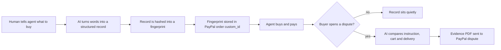

# #1 Intent Black Box: deep dive (2026-10-12)

> [!tldr] In one breath
> The idea: record exactly what a human asked their AI shopping agent to buy, lock that record to the PayPal order, and use it as proof if the purchase goes wrong. The problem is real, but Provenant, an entry in this same hackathon, already does it, and a plain recorder would be judged as the fifth or sixth version of the same entry. **Verdict: demote. Score 71/120 (desk score was 92).** Keep only the "what did the human ask for" record, as the input that makes [[D003 Mismatch-to-Replacement (Deep Dive)|#3]] and [[D002 Three-Party Agent Error Settlement (Deep Dive)|#2]] work.

> [!example] Picture this
> You tell your AI helper "buy me a navy hoodie, size M, under $60". A week later a bright red XL arrives. You complain, and the shop says "your robot ordered it, not us". Who is right? Without a record of what you actually said, nobody can tell. The Intent Black Box is like the black box in an airplane: it quietly records the instructions so that, after a crash, people can see what really happened.

> [!info] Note key
> Idea note: [[I001 Intent Black Box]] · Verdict: **demote** · Final score **71/120** (desk 92).
> Confidence tags: ✅ primary source read directly · ⚠️ secondary, vendor or single source · ❌ unverified. `⚠ inference` marks our own judgment.

> [!warning] Crowd check, Oct 23 2026
> This area is **the most crowded in the whole hackathon**. A scan of 266 public GitHub repos (partial coverage, and the official gallery is not public yet) found about 30 repos that sit between an AI agent and PayPal and keep records or rules. Close cousins: **permit** (spending caps plus hash chained receipts), **mandate** ("OAuth for AI spending"), **sentinel-prooflayer**, **trust-engine-v2**, **Warden** and **paypal-agent-firewall**. Separately, about 16 dispute copilot repos exist (witness, dispute-defender, dispute-copilot, rebuttal and others). On Devpost, Provenant, AgentProof, XReceipt, LexProof and AGENT GATE were already found on Oct 12 (see below). Building this alone would put us in the thickest part of the crowd. See [[17 Live Competition Scan (Oct 23)]].

## How it works, end to end

## 1. Verdict: demote as a standalone entry, keep as the thin evidence spine of the combined product

**The problem is real, but our exact mechanism is already on Devpost in this hackathon.**

No card network or protocol says who pays for "authorized but wrong" agent purchases. AP2 (Google's rulebook for agent payments, think of it as the permission slip format an agent carries) explicitly puts dispute resolution out of scope.

But look at what others already built:

* **Provenant** (tags ag-grid, render, paypal-payouts, paypal-disputes-api) does exactly what we planned: "The PayPal order's `custom_id` is the hash of the decision trace", a hash chained flight recorder, case replay "from recorded inputs", and a "dispute evidence pack".
* **AgentProof** records "what the agent searched for, what it chose, the budget check, and the payment" and builds the PayPal provide evidence request when a dispute arrives.
* **XReceipt**, **LexProof** (a hash chain anchored on Sepolia) and **AGENT GATE** ("auditable evidence") fill out the receipt and audit cluster.
* Off Devpost, **Amex's ACE developer kit** (Apr 14 2026) already captures purchase intent and cart context "to support authentication, authorization, and disputes".
* **Chargebacks911's UDMS** captures consent and permission records for agent initiated transactions.

A recorder whose only job is "bind the transcript to the order and draft the evidence" would be judged as the fifth or sixth version of the same entry.

**What survives is the instruction capture**: a structured, hashed copy of what the human actually asked for, bound to the order. It is worth keeping only as the reference input that makes #3 (did the delivered item match the instruction?) and #2 (who pays?) decidable.

### Scorecard at a glance

| Axis | Old | New | Why it changed |
|---|---|---|---|
| Tech | 9 | 8 | Orders + Disputes + webhooks is solid. The hash binding is trivial, and Provenant already does it. |
| Design | 7 | 6 | It is middleware. The persona (agent builder or merchant) has no satisfying end state unless a dispute happens. |
| Impact | 7 | 6 | Liability evidence is strong (Worldpay, Payments Association), but there is no agent dispute volume data (❌), and Amex is solving the same thing on the card issuer side. |
| Innovation | 7 | **3** | Provenant (same hackathon) uses the same custom_id = trace hash binding plus replay. AgentProof does merchant evidence for agent disputes. Amex ACE does intent + cart context for disputes. |
| Demo | 8 | 6 | A hash in custom_id is invisible on video. Evidence posting is a JSON response. |
| Feasibility | 8 | 7 | Creating a dispute in the sandbox is not in the public OpenAPI spec, and the reference landing page calls it "limited release". The test go live page documents it, so it needs a day 1 test. |
| Risk | 8 | 6 | Direct duplicate risk in judging, plus privacy of recorded page and tool context. |

s_adjusted = [8,6,6,3,6,7,6] → weighted total **71** (was 92).

**Takeaway: Innovation fell from 7 to 3. That single drop is why the idea lost its place.**

## 2. Is the problem real?

**Yes. Experts agree nobody has settled who pays when an agent buys the wrong thing. But no one has counted how often it happens yet.**

| Claim | Number | Source | Conf |
|---|---|---|---|
| No liability shift for non fraud agent disputes (misread instruction, wrong item) | qualitative | [Worldpay, Jul 2026](https://worldpay.com/insights/articles/agentic-commerce-liability-is-still-being-written) | ✅ (via raw/C) |
| UK merchants have no consensus on who pays for an agent purchase | top answer "depends" 24% | [Payments Association, May 14 2026](https://thepaymentsassociation.org/article/agentic-commerce-uk-retail-an-unresolved-liability-question/) | ✅ (raw/D) |
| US adults fear an AI buys the wrong item, size or colour | 58% | [NMI, Aug 26 2026](https://www.nmi.com/about-us/news/nmi-research-consumers-want-ai-to-help-them-shop-not-control-their-spending/) | ✅ vendor |
| AP2 v0.2: "dispute resolution, retention, and retrieval requirements are outside the scope of this specification"; task scope determination also out of scope | n/a | [AP2 spec](https://ap2-protocol.org/ap2/specification/) | ✅ read |
| Mandates do not protect the context before signing (48 threats, 8 High) | 48/8 | [arXiv 2608.23858](https://www.emergentmind.com/papers/2608.23858) | ✅ (raw/C) |
| "No rule makes the agent platform liable: the merchant stays merchant of record." Visa's rules (Apr 2026) address agentic transactions; Mastercard's public rules are silent; EMVCo draft framework (Sep 1 2026) publishes no dispute liability allocation | n/a | [Chargeflow, upd. Oct 7 2026](https://www.chargeflow.io/blog/ai-agent-chargeback-liability) | ⚠️ vendor blog |
| Merchants "cannot prove what the agent was authorized to do" | n/a | [Chargebacks911 via Business Money, May 14 2026](https://www.business-money.com/announcements/ai-agents-are-starting-to-buy-things-but-who-handles-the-dispute-when-they-get-it-wrong/) | ⚠️ vendor |
| Agent dispute volume | **no published data** | raw/D §6 | ❌ |

What people in the industry say (all pages exist; we read them):

* Monica Eaton, Chargebacks911: "In an agentic world, that question doesn't have a clean answer" ([Business Money](https://www.business-money.com/announcements/ai-agents-are-starting-to-buy-things-but-who-handles-the-dispute-when-they-get-it-wrong/)) ✅
* Rivero: "Agentic commerce is already here, but the back-office isn't fully ready", and on fixing that back office gap, "no one has a credible answer" ([Rivero, Mar 6 2026](https://rivero.tech/blog/agentic-commerce-needs-new-dispute-framework)) ✅
* Worldpay: "the murky cases are everything short of outright fraud, such as an agent that misread an instruction" (quoted in [Chargeflow](https://www.chargeflow.io/blog/ai-agent-chargeback-liability)) ⚠️ secondary
* We found no first person consumer complaint about a *wrong agent purchase* being disputed. That gap is itself a signal that the problem is still mostly in the future. ⚠ inference

## 3. Who else is doing this?

**Searches run:** "Catena Labs Agent Commerce Kit ACK receipt verifiable credential dispute"; "AP2 … payment receipt mandate dispute"; "Mastercard Verifiable Intent reference implementation github"; "agentic commerce chargeback reason code Visa Mastercard 2026"; "2026 launch agentic chargeback dispute product Justt/Chargebacks911/Forter/Sift"; "American Express Agent Purchase Protection"; "github flight recorder audit trail AI shopping agent purchase hash"; "Natural agentic payments disputes"; Devpost searches "xreceipt", "velqiris", "lexproof", "\"agent gate\" paypal", "agent dispute paypal" (38 results, both pages read).

| Name | Type | What it does | Overlap | URL | Conf |
|---|---|---|---|---|---|
| **Provenant** | Devpost entry (this hackathon, by tags) | Mandate labelled by lineage, hash chained flight recorder, **custom_id = hash of decision trace**, case ruling by replay, Shapley fault split, refund / void / **Payouts from liability pool** / dispute evidence pack | **High (nearly identical)** | https://devpost.com/software/provenant-safe-checkout-and-recourse-for-ai-agents | ✅ read |
| **AgentProof** | Devpost entry | Records agent search, choice, budget check and payment; on dispute rebuilds facts; AI writes evidence; builds PayPal provide evidence request | High | https://devpost.com/software/agentproof-gwkxv6 | ✅ read |
| XReceipt | Devpost entry | Signed portable receipt per PayPal payment: "what was requested… what was delivered… did the two match?" (x402/PYUSD) | Med to High | https://devpost.com/software/xreceipt | ✅ read |
| LexProof | Devpost entry | Invoices and refunds gated by contract, via agent toolkit; "Every step is a hashed receipt… anchored on Ethereum Sepolia" | Med | https://devpost.com/software/lexproof-contract-governed-agentic-payments-on-paypal | ✅ read |
| VELQIRIS Evidence Gate | Devpost entry | "Cryptographic order verification" gate before execution (Orders + Webhooks); no disputes | Low to Med | https://devpost.com/software/velqiris-paypal-ai-evidence-gate | ✅ read |
| AGENT GATE | Devpost entry | Policy + human approval, "auditable evidence", duplicate charge recovery | Low to Med | https://devpost.com/software/agent-gate-human-controlled-ai-payments | ✅ read (thin page) |
| Squid; AgentVerify; PayLeash | Devpost entries (earlier hackathons) | "trust and liability layer… cryptographic audit trails"; "dispute resolution layer for agent commerce"; signed mandates + dispute replies | Med | devpost.com/software/squid-2fwad5, /agentverify-3zrcgh, /payleash-a-trust-layer-for-paypal-ai-agents | ⚠️ tagline only |
| Amex ACE dev kit + Agent Purchase Protection | Platform feature (Apr 14 2026) | Captures purchase intent + cart context for disputes; protects card members from "charges related to AI agent error" (registered agents) | High (card issuer side) | [press release](https://www.eagletribune.com/region/american-express-debuts-agentic-commerce-experiences-ace-developer-kit-and-announces-industry-first-protection-for/article_0aed4835-c886-5dee-867d-976a006c806a.html) | ✅ read |
| Chargebacks911 UDMS | Product | Captures consent and permission records for agent initiated transactions | Med | [Business Money](https://www.business-money.com/announcements/ai-agents-are-starting-to-buy-things-but-who-handles-the-dispute-when-they-get-it-wrong/) | ⚠️ |
| Chargeflow Automation | Product | Same chargeback workflow for agent disputes, "different evidence attached" | Med | [Chargeflow](https://www.chargeflow.io/blog/ai-agent-chargeback-liability) | ⚠️ |
| Rivero Amiko | Product (issuer) | Agentic dispute management; argues for intent, agent behaviour and presentation logs | Med | [Rivero](https://rivero.tech/blog/agentic-commerce-needs-new-dispute-framework) | ✅ |
| ATXP | Product | "transaction-level receipts for every agent action", agent ID tagging for dispute evidence | Med | [ATXP blog, Mar 31 2026](https://atxp.ai/blog/agent-payment-dispute-resolution) | ⚠️ |
| AP2 v0.2 | Protocol | Signed Payment Receipt must match hash of closed Payment Mandate; mandates give evidence of "what the user, and each role saw"; disputes out of scope | Med | https://ap2-protocol.org/ap2/specification/ | ✅ |
| Mastercard Verifiable Intent | Protocol + reference implementation | Intent record with selective disclosure "for fraud mitigation or dispute resolution" | Med | [Mastercard](https://www.mastercard.com/au/en/news-and-trends/stories/2026/verifiable-intent.html) | ✅ (raw/C) |
| Catena ACK | Open source kit | Identity, payments, receipts (W3C VC) | Med | [catena.com ACK v2](https://catena.com/blog/ack-v2-smaller-identity-core-x402-payment-profile) | ⚠️ |
| Skyfire KYAPay / Kite Agent Passport / Prove Verified Agent | Identity | Agent identity + principal binding; no adjudication | Low | raw/C §2 | ✅/⚠️ |
| LangSmith / Langfuse | Observability | Store full agent traces, but not bound to a payment and not shaped for disputes | Low to Med (the *capture* part is commodity) | ⚠ inference | ⚠️ |
| airblackbox/gateway, flightbox, "Agent Flight Recorder" HF space | Open source | Generic agent flight recorders / audit gateways | Low to Med | pkg.go.dev/github.com/airblackbox/gateway; pypi.org/project/flightbox | ⚠️ search snippet |

## 4. What is actually new?

**Almost nothing in #1 alone. The one open gap belongs to #3.**

* **Not new:** hashing the agent trace into the order (Provenant), merchant evidence for agent disputes (AgentProof, Chargeflow, C911), signed receipts (XReceipt, AP2, ACK, ATXP), and intent capture for disputes (Amex ACE, Verifiable Intent). The capture SDK itself is commodity observability.
* **Thin but still open:** a *normalized instruction record* (structured attributes such as colour, size, model, budget and substitutes allowed) that is later checked against **physical delivery evidence**. That is what #3 needs, and no competitor found combines it with vision checks after delivery.
* **Sharpest surviving differentiator:** "We don't just prove what the agent was allowed to buy. We check what actually arrived against what the human asked for." That sentence belongs to #3, not #1.

## 5. Can we build it in the PayPal sandbox?

**Yes for the order binding. Sandbox dispute creation is the shaky part and needs a day 1 test.**

Verified facts:

* `purchase_units[].custom_id` is **1 to 255 chars** (not 127) and is not shown to the payer. `invoice_id` is **1 to 127**, shown to the payer, and unique per merchant by default ([purchase_unit_request](https://developer.paypal.com/api/orders/v2/definitions/purchase_unit_request) ✅). A SHA-256 hex string (64 chars) plus a prefix such as `ibb:v1:` fits in custom_id.
* The dispute object exposes `disputed_transactions[].custom` (≤2000) and `invoice_number` (≤127, pattern `^[A-Za-z0-9:\-|]+$`) (PayPal REST OpenAPI `customer_disputes_v1.json` ✅). So the binding can be read straight back from a dispute.
* Evidence files must be .jpg/.jpeg/.gif/.png/.pdf, **under 10 MB per file and ≤50 MB per call** ([supported file types](https://developer.paypal.com/platforms/disputes/reference/supported-file-types-sizes.md) ✅). Notes are ≤2000 chars and evidence_list holds ≤100 items. **JSON transcripts must be rendered to PDF.**
* Evidence types include `ORDER_DETAILS`, `ITEM_DETAILS`, `LISTING_URL`, `PHOTOS_OF_SHIPPED_ITEM`, `PROOF_OF_EMPTY_PACKAGE_OR_DIFFERENT_ITEM`, `DECLARATION` and `OTHER` (spec ✅). There is no type made for agents.
* Sandbox dispute creation: `POST /v1/customer/disputes`, multipart field `input`, header `PayPal-Auth-Assertion` (buyer JWT), body `disputed_transactions[].buyer_transaction_id`, `reason`, `dispute_amount`. The docs say a personal account must first send money to the business account. Duplicate disputes on a transaction are never allowed, and actions appear "a few minutes" after creation ([test-go-live](https://developer.paypal.com/disputes/test-go-live.md) ✅). **This endpoint is missing from the public OpenAPI**, and the reference landing page says create is "limited release".

Day 1 tests:

1. Create an order with `custom_id="ibb:v1:<sha256>"`, capture it as the sandbox buyer, then `POST /v1/customer/disputes` with an unsigned JWT assertion (`{"alg":"none"}`, `iss=<client_id>`, `payer_id=<buyer payer id>`). Find out whether a capture ID or the buyer side transaction ID is required. **Fallback:** open the dispute in the sandbox buyer UI (sandbox.paypal.com Resolution Center), recorded in advance.
2. `GET /v1/customer/disputes/{id}`: confirm `disputed_transactions[0].custom` echoes the custom_id.
3. `provide-evidence` with a 1 page PDF: confirm the multipart part naming avoids `INVALID_EVIDENCE_FILE` ([SO 78902643](https://stackoverflow.com/questions/78902643/paypal-disputes-api-returns-invalid-evidence-file-when-posting-file) ⚠️).

## 6. What the AI actually does

**The AI acts as a judge. Plain code moves the money.**

An LLM acts as a judge (like a referee reading the rulebook) and compares the normalized instruction against the cart and against delivery evidence. It must answer in a strict JSON schema (a fill in the blanks form it cannot wander off): `{fault: merchant|agent|buyer_ambiguity|friendly_fraud|undetermined, rule_id, confidence, cited_evidence[]}`. Deterministic code (same input, same output, every time) does the hashing, the money movement and the threshold rules. A human confirms anything below the confidence threshold. Model: a multimodal frontier model (Gemini 2.5/3 class, which matches the team's Gemini experience) at temperature 0 (no creative randomness) with output constrained to the schema.

## 7. Smallest useful version (only as a module of the combined product)

* **Must:** an instruction normalizer (plain words → attributes JSON), order creation with custom_id hash binding, a stored record, and a viewer that shows instruction vs cart vs delivered.
* **Should:** an evidence PDF generator for the provide evidence call.
* **Could:** an export of the intent record shaped like AP2 or VI.
* Effort: about 1 week of the 4.5.

## 8. Demo storyboard (standalone, for completeness; not recommended)

0:00 agent buys → 0:40 show custom_id hash in PayPal order → 1:20 buyer disputes → 2:00 AI classifies and posts evidence → 2:40 dispute shows evidence.

**The weakness: the "wow" is a hash and a JSON response. Judges cannot see either.**

## 9. Risks and fixes

| Risk | Fix |
|---|---|
| **Duplicate of Provenant / AgentProof** | Do not ship #1 standalone. Fold it into #3 as the instruction reference. |
| **Privacy** | Store only the normalized instruction plus hashes of page snippets, not raw pages. |
| **Sandbox dispute creation access** | Day 1 test, with the UI fallback above. |

## 10. Sources

See the links inline. Local: raw/A §3.6, raw/C §1 to 3, raw/D §6, PayPal REST OpenAPI `customer_disputes_v1.json` (scratchpad clone of paypal-rest-api-specifications).

> [!info]- Jargon decoder
> **AI shopping agent**: a bot that browses and buys for you, like sending a friend to the shop with a list.
> **Hash / SHA-256**: a fingerprint for data. Change one letter of the input and the fingerprint changes completely, so it proves nothing was edited.
> **Hash chained**: each record includes the fingerprint of the one before, like a chain where you cannot swap a link without breaking it.
> **custom_id**: a hidden note field on a PayPal order, up to 255 characters, that the buyer never sees. We put the fingerprint there.
> **Dispute / chargeback**: a dispute is the buyer complaining through PayPal; a chargeback is the bank forcibly taking the money back. Both cost the merchant.
> **Liability shift**: a rule that says who eats the loss. With fraud there are rules; with "the robot misunderstood" there are none yet.
> **AP2 / mandate**: Google's format for an agent's permission slip, signed by the human, saying what the agent may buy.
> **Verifiable Intent**: Mastercard's tamper proof log linking the shopper, the agent's instructions and the result.
> **Sandbox**: PayPal's practice playground with fake money, where you can test without risk.
> **OpenAPI spec**: the official machine readable menu of every API call PayPal offers.
> **JWT / auth assertion**: a signed digital ID badge that says "I am acting as this buyer".
> **Webhook**: PayPal calling your server to say "something just happened", like a doorbell instead of you checking the door every minute.
> **LLM as judge**: using a language model as a referee that reads evidence and gives a ruling in a fixed format.
> **Deterministic**: code that always gives the same answer for the same input, unlike an AI that might vary.
> **Observability (LangSmith, Langfuse)**: tools that log everything an AI app does, like a dashcam for software.
> **Issuer**: the bank or company that gave you your card (here, Amex).

## Where to next
* ⬆️ Up: [[50 Top 10 Overview]]
* 🔗 Idea note: [[I001 Intent Black Box]]
* ⬅️ Previous: none, this is the first deep dive · ➡️ Next: [[D002 Three-Party Agent Error Settlement (Deep Dive)]]
* 🔗 Final pick: [[70 The Winning Idea]]
* 🔗 Related: [[Wrong Box Combined Concept]], [[D003 Mismatch-to-Replacement (Deep Dive)]], [[17 Live Competition Scan (Oct 23)]], [[Jargon Decoder]]
