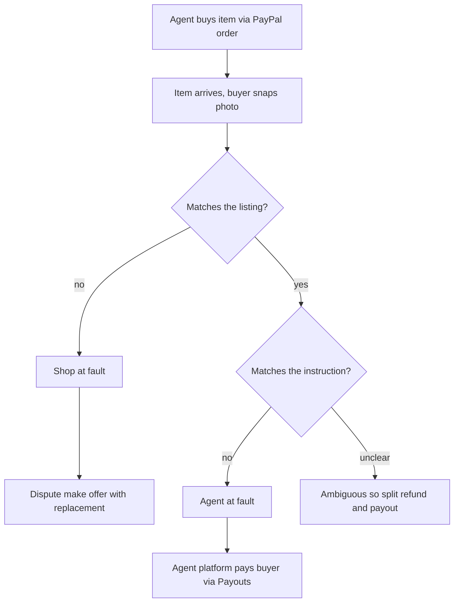

# #2 Three-Party Agent Error Settlement: deep dive (2026-10-12)

> [!tldr] In one breath
> The idea: when an AI agent buys the wrong thing, decide whether the buyer, the shop or the agent company is at fault, and move money to match. It scored highest in its cluster (95) on the claim "no product settles three way", **but that claim is now false**: Provenant, in this same hackathon, does it. **Verdict: demote. Score 72/120.** Keep one leg: the agent platform repaying the buyer through PayPal Payouts, triggered by #3's photo check.

> [!example] Picture this
> Three friends share a pizza order. The wrong pizza turns up. Was it the pizzeria (they made the wrong one), the friend who phoned it in (he said the wrong name), or the person who wrote the note (it was vague)? Someone has to decide who pays for a new one. This idea is a referee for that argument, except the friend on the phone is an AI agent and the money moves on PayPal.

> [!info] Note key
> Idea note: [[I002 Three-Party Agent Error Settlement]] · Verdict: **demote** · Final score **72/120** (desk 95).
> Confidence tags: ✅ primary source read directly · ⚠️ secondary, vendor or single source · ❌ unverified. `⚠ inference` marks our own judgment.

> [!warning] Crowd check, Oct 23 2026
> Busy area. A scan of 266 public GitHub repos (partial coverage; the official gallery is not public yet) found about 16 dispute and chargeback copilots (witness, dispute-defender, dispute-copilot, rebuttal, dispute-radar, dispute-autopilot, two "disputedesk", dispute-steward, Docket, two "payguard-ai") and about 28 "AI judge decides who gets the money" escrow repos, including **ArbiterPay**, **judgepay** and **fairshake**. The mandate and guardrail cluster (about 30 repos, the most crowded) sits right next door. None found in the scan names a three way agent fault split, but Provenant on Devpost already does (see below). See [[17 Live Competition Scan (Oct 23)]].

## How it works, end to end

## 1. Verdict: demote as a standalone entry, keep one leg (agent platform repays via Payouts) as a module

**The headline claim "no product settles three way" is now false.**

**Provenant** is a Devpost entry whose tags (ag-grid, render, paypal-payouts, paypal-disputes-api) match this hackathon's sponsors. Its pitch: "when they buy wrong, nobody knows who pays". It "splits refunds by who actually caused the mistake" using "Exact Shapley values" (a maths method from game theory for sharing credit or blame fairly) over user, merchant and agent, with confidence intervals. Its remedies are a void, a merchant refund within signed policy, "a payout of the agent's share from a liability pool", or a dispute evidence pack. That is our mechanism, including Payouts as the agent platform's payment rail, built with more statistical polish than we planned.

Off Devpost, **Amex Agent Purchase Protection** (Apr 14 2026) already commits a card issuer to cover "charges related to AI agent error" for registered agents. That does not settle three ways, but it takes the "someone guarantees the buyer" story.

**What survives: a simpler two fork rule driven by a physical fact**, not by counterfactual replay (rerunning the purchase in imagination to see who changed the outcome).

* Item matches the listing but not the instruction → agent fault → the agent platform pays via Payouts and the merchant is kept out of the dispute.
* Item does not match the listing → merchant fault → replacement through Disputes make offer.

This is credible only when #3's delivery check triggers it. As a separate product, it is a weaker Provenant.

### Scorecard at a glance

| Axis | Old | New | Why it changed |
|---|---|---|---|
| Tech | 9 | 8 | Disputes (make offer / accept offer) + Payouts + Refunds + webhooks is still deep. Docked because the "liability matrix" is a lookup table and Provenant already shows the same API set. |
| Design | 7 | 6 | Three personas and three dashboards is hard to make coherent in 3 minutes. Agent platforms paying is an assumption, not an observed behaviour. |
| Impact | 7 | 6 | Payments Association (24% top answer) and NMI (62% would blame the AI provider) are good. Still no agent dispute volume (❌), and "No rule makes the agent platform liable" ([Chargeflow](https://www.chargeflow.io/blog/ai-agent-chargeback-liability) ⚠️) means no one is obliged to pay this leg. |
| Innovation | 9 | **3** | Provenant does three party fault split + Payouts liability pool + disputes in the same hackathon. Amex covers agent error for buyers. |
| Demo | 8 | 7 | Three different money movements from three scenarios is visual, but slower than one fork. |
| Feasibility | 8 | 7 | Needs 3 sandbox accounts with 2 REST apps. Creating a dispute in the sandbox needs a day 1 test (see #1 §5). |
| Risk | 7 | 5 | Legal framing ("proposed rulebook"); head on comparison with Provenant by the same judges. |

s_adjusted = [8,6,6,3,7,7,5] → weighted total **72** (was 95).

**Takeaway: Innovation dropped from 9 to 3 because the exact mechanism already exists in the same contest.**

## 2. Is the problem real?

**Yes, nobody agrees who pays. But nobody is asking for a three way settlement product either.**

| Claim | Number | Source | Conf |
|---|---|---|---|
| UK merchants: who pays for an agent purchase made when the agent was only asked to research | "Depends" 24%; shared 21%; AI vendor 18%; PSP 15%; consumer 13%; merchant 9% | [Payments Association, May 14 2026](https://thepaymentsassociation.org/article/agentic-commerce-uk-retail-an-unresolved-liability-question/) | ✅ (raw/D) |
| Who consumers would blame for a premature AI purchase | AI provider 62%, retailer 34%, payments provider 24% | [NMI, Aug 2026](https://www.nmi.com/about-us/news/nmi-research-consumers-want-ai-to-help-them-shop-not-control-their-spending/) | ✅ vendor |
| By default the merchant carries the loss unless it wins; "No rule makes the agent platform liable" | n/a | [Chargeflow, upd. Oct 7 2026](https://www.chargeflow.io/blog/ai-agent-chargeback-liability) | ⚠️ |
| Card scheme view: "the cardholder is responsible for what their agent did on their behalf"; Mastercard "reportedly planning … scheme-carried liability for certified agents" | n/a | [Rivero, Mar 6 2026](https://rivero.tech/blog/agentic-commerce-needs-new-dispute-framework) | ⚠️ "reportedly" |
| Amex commits to protect eligible card members from charges from AI agent error (registered agents, authenticated intent) | n/a | [Amex press release, Apr 14 2026](https://www.eagletribune.com/region/american-express-debuts-agentic-commerce-experiences-ace-developer-kit-and-announces-industry-first-protection-for/article_0aed4835-c886-5dee-867d-976a006c806a.html) | ✅ |
| Network rule for agent dispute reason codes | **None found.** Visa's rules (Apr 2026) "expressly address agentic transactions" (identity/token requirements) but reuse 10.4 / 13.3; MC rules silent (4837 / 4853); EMVCo Agentic Payments draft (Sep 1 2026) has no liability allocation | [Chargeflow](https://www.chargeflow.io/blog/ai-agent-chargeback-liability) citing FBT Gibbons | ⚠️ secondary |
| Agent disputes count toward Visa VAMP (1.5% excessive) and MC ECM (the networks' "too many disputes" watch lists) | n/a | same | ⚠️ |

Voices:

* Monica Eaton (Chargebacks911): "The ones who haven't will lose the revenue, pay the fee, and have no way to fight it." ([Business Money](https://www.business-money.com/announcements/ai-agents-are-starting-to-buy-things-but-who-handles-the-dispute-when-they-get-it-wrong/) ✅)
* The Rivero line on scheme liability above ✅.
* We found no buyer or agent platform voice asking for a three way settlement product (⚠ inference: demand is speculative).

## 3. Who else is doing this?

**Searches run:** as in #1, plus "insurance for AI agent errors purchases 2026 AIUC Armilla", "Natural agentic payments disputes", "ATXP agent payment dispute resolution", and Devpost "agent dispute paypal" (pp. 1 to 2).

| Name | Type | What it does | Overlap | URL | Conf |
|---|---|---|---|---|---|
| **Provenant** | Devpost entry (this hackathon by tags) | Shapley fault split user/merchant/agent; void, refund, **Payouts from liability pool**, dispute evidence; custom_id = trace hash; AG Grid; Render | **High (same mechanism + same APIs)** | https://devpost.com/software/provenant-safe-checkout-and-recourse-for-ai-agents | ✅ read |
| Amex Agent Purchase Protection | Network/issuer feature | Covers card members for charges from AI agent error (registered agents) | Med to High (buyer guarantee story) | press release above | ✅ |
| Armilla / AI error insurance (Lloyd's market) | Insurance | Covers companies' losses from AI chatbot/agent errors | Med (the "agent platform pays" leg could be insured, not settled) | [Armilla](https://www.armilla.ai/resources/insurers-launch-cover-for-losses-caused-by-ai-chatbot-errors) | ⚠️ snippet |
| Fairplay; Rebuttal; Dispute Copilot; Dispute Defender ×2; SubGuard; Refund Desk | Devpost entries | Two party dispute mediation / defence on PayPal | Low to Med (two party) | devpost.com/software/fairplay-gx6ipj etc. | ⚠️ tagline |
| AgentVerify; Squid | Devpost entries (earlier) | "dispute resolution layer for agent commerce"; "trust and liability layer" | Med | devpost.com/software/agentverify-3zrcgh, /squid-2fwad5 | ⚠️ tagline |
| Chargeflow / Justt / Chargebacks911 | Products | Two party merchant chargeback fighting; C911 UDMS adds agent consent records | Low to Med | as #1 | ⚠️ |
| Rye; Natural; ATXP | Agent payment rails | No fault allocation or reimbursement feature found. ATXP: "doesn't say who bears losses" | Low | [ATXP](https://atxp.ai/blog/agent-payment-dispute-resolution) | ⚠️ |

## 4. What is actually new?

**Only a small slice: a fault rule simple enough for a judge to follow in five seconds, driven by a photo.**

* **Not new:** three party fault split, Payouts as the rail for the agent's share, dispute evidence from the same engine (all in Provenant), and buyer guarantees for agent error (Amex).
* **Still different (small):**
  * (a) **Fault decided by a physical fact, via vision.** The delivered item is compared with the listing *and* the instruction, so the split is a two question decision tree a judge can follow, not a Shapley distribution.
  * (b) **Resolution before any dispute.** The merchant leg is a make offer replacement in the INQUIRY stage, and the agent leg pays the buyer before any claim or chargeback hits the merchant's ratio.
* **Sharpest differentiator sentence:** "Same photo, two different payers: if the shop shipped what it listed, the agent platform makes it right, and the merchant never sees a dispute."

## 5. Can we build it in the PayPal sandbox?

**Probably. It needs three sandbox accounts, and Payouts plus dispute creation must pass day 1 tests.**

Accounts: **merchant** (business, REST app A), **agent platform** (business, REST app B, funds the reimbursement pool), and **buyer** (personal).

API sequence (verified shapes, from the PayPal REST OpenAPI specs ✅):

1. Orders v2 create/capture (merchant app), with custom_id carrying the instruction hash (≤255 chars).
2. **Merchant fault leg:** the buyer opens a dispute (sandbox `POST /v1/customer/disputes`, reason `MERCHANDISE_OR_SERVICE_NOT_AS_DESCRIBED`). The merchant calls `POST /v1/customer/disputes/{id}/make-offer` with `offer_type` ∈ {REFUND, REFUND_WITH_RETURN, **REFUND_WITH_REPLACEMENT, REPLACEMENT_WITHOUT_REFUND**} (note ≤2000). The buyer accepts via sandbox `accept-offer`. Webhook `CUSTOMER.DISPUTE.RESOLVED`. Or, with no dispute: partial refund via `POST /v2/payments/captures/{id}/refund` plus a replacement tracker via `/v2/shipping/trackers`.
3. **Agent fault leg:** `POST /v1/payments/payouts` from app B, `recipient_type: EMAIL` (sandbox buyer email) or `VENMO_HANDLE`, `sender_batch_id` = case ID (safe against duplicates for 30 days ✅ spec). Poll `GET /v1/payments/payouts/{batch}` or use the webhook `PAYMENT.PAYOUTSBATCH.SUCCESS`.
4. **Ambiguous instruction leg:** a split. Partial merchant refund plus a partial payout.

Unknowns and day 1 tests:

* Payouts enabled for sandbox app B. Live access "requires approval via the PayPal Developer Dashboard" (raw/A §3.5 ✅). Test: a $5 payout to the buyer email, then check the buyer's sandbox balance.
* Is `make-offer` with `REPLACEMENT_WITHOUT_REFUND` listed in `allowed_response_options` for a NOT_AS_DESCRIBED inquiry? Test via GET dispute after the "few minutes" delay.
* Dispute creation assertion details (#1 §5).

## 6. What the AI actually does

**Vision answers two yes/no questions. A fixed table decides the money. The AI never picks amounts.**

Fault attribution is a structured decision. Vision answers two booleans (true/false answers) with confidence: `matches_listing` and `matches_instruction`, per attribute (colour, size, model, quantity). An LLM maps instruction ambiguity ("a blue hoodie" with navy delivered and both listed as "blue") to `buyer_ambiguity`. A **deterministic matrix** (a fixed lookup table, same input always gives the same result) turns those outputs into settlement legs. The LLM never chooses amounts. Every party gets a plain language explanation that cites rule IDs. Below the confidence threshold, the case goes to human review.

## 7. Smallest useful version (as a module)

* **Must:** the two fork matrix (merchant vs agent) and the Payouts leg from the agent platform account.
* **Should:** the split leg and a settlement ledger.
* **Could:** a published "Agent Error Rulebook v0" page.
* About 1 week.

## 8. Demo storyboard (standalone; not recommended)

Three scripted cases, each producing a different PayPal money movement. **It is too slow for 3 minutes.** Use one fork in the combined demo instead.

## 9. Risks and fixes

| Risk | Fix |
|---|---|
| **Head on duplicate of Provenant** | Reframe as driven by the delivery fact, resolved before any dispute, and buyer first. Do not claim "first three party settlement". |
| **Agent platforms may refuse liability** | Pitch it as an opt in "make it right guarantee" that the platform funds as a growth or trust feature (the Amex precedent shows guarantees are a competitive lever). |
| **Legal** | Label it "proposed rulebook, not legal advice". |

## 10. Sources

Inline. Local: raw/A §3.5 to 3.6, raw/C §3.1, raw/D §6; OpenAPI `customer_disputes_v1.json`, `payments_payouts_batch_v1.json`.

> [!info]- Jargon decoder
> **Three party settlement**: deciding which of three sides (buyer, shop, agent company) pays to fix a mistake, then moving the money.
> **Shapley values**: a fair share formula from game theory, like working out how much each teammate contributed to a group project grade.
> **Counterfactual replay**: rerunning a decision with one thing changed to see if the outcome flips, like asking "would we have lost if Sam had not dropped the ball?"
> **Payouts**: PayPal's API for sending money out to many people at once, like a payroll button.
> **Disputes make offer / accept offer**: inside a PayPal complaint, the shop proposes a fix (refund, replacement) and the buyer clicks yes.
> **REPLACEMENT_WITHOUT_REFUND**: a PayPal offer type where the shop sends the right item and keeps the sale.
> **INQUIRY stage**: the early, friendly phase of a PayPal dispute before it escalates to a formal claim.
> **Chargeback**: the bank forcibly pulls money back from the merchant. Too many and the merchant gets flagged.
> **VAMP / ECM**: Visa's and Mastercard's "too many disputes" watch lists. Visa flags merchants above 1.5%.
> **Reason codes (10.4, 13.3, 4837, 4853)**: the labels card networks stamp on a chargeback to say why it happened.
> **Liability pool**: a pot of money set aside to pay for mistakes, like a team's breakage fund.
> **Webhook**: PayPal calling your server to say "something just happened", like a doorbell.
> **sender_batch_id**: your own ID on a payout batch. Reuse it and PayPal refuses to pay twice.
> **Deterministic matrix**: a fixed rules table. Same facts in, same answer out, every time.
> **Issuer**: the bank or company that gave the buyer their card.

## Where to next
* ⬆️ Up: [[50 Top 10 Overview]]
* 🔗 Idea note: [[I002 Three-Party Agent Error Settlement]]
* ⬅️ Previous: [[D001 Intent Black Box (Deep Dive)]] · ➡️ Next: [[D003 Mismatch-to-Replacement (Deep Dive)]]
* 🔗 Final pick: [[70 The Winning Idea]]
* 🔗 Related: [[Wrong Box Combined Concept]], [[17 Live Competition Scan (Oct 23)]], [[Jargon Decoder]]
