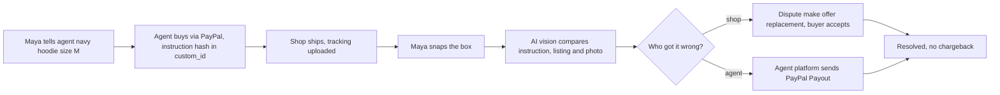

# #3 Mismatch-to-Replacement: deep dive (2026-10-12)

> [!tldr] In one breath
> When an AI agent's purchase arrives, the buyer snaps the box. AI vision compares the photo with **what the human asked for** and **what the shop listed**, works out whether the shop or the agent got it wrong, and fixes it on PayPal (a replacement offer or a payout) before anyone files a chargeback (the bank forcibly pulling the money back from the shop). **Verdict: advance with changes. Score 87/120 (88 as the spine of the combined [[Wrong Box Combined Concept|Wrong Box]] product).** It was the only idea in its cluster whose core mechanism we could not find already built.

> [!example] Picture this
> Maya tells her agent "navy hoodie, size M, under $60". The box arrives with a royal blue L inside. She takes one photo. The screen splits in three: *asked* navy M, *listed* navy M, *got* royal blue L. Verdict: the shop shipped the wrong item. One click later the shop has offered a free replacement through PayPal and Maya has accepted. No angry emails, no bank chargeback, and the shop keeps the sale.

> [!info] Note key
> Idea note: [[I003 Mismatch-to-Replacement]] · Verdict: **advance with changes** · Final score **87/120** (desk 93).
> Confidence tags: ✅ primary source read directly · ⚠️ secondary, vendor or single source · ❌ unverified. `⚠ inference` marks our own judgment.

> [!warning] Crowd check, Oct 23 2026
> The general area (disputes and refunds) is busy, but **our exact angle looked open**. A scan of 266 public GitHub repos (partial coverage; the official gallery is not public yet) found about 16 dispute and chargeback copilots (witness, dispute-defender, dispute-copilot, rebuttal, dispute-radar, dispute-autopilot, two "disputedesk", dispute-steward, Docket, two "payguard-ai"). Close cousins: **returngate** and **clippay** (partial refunds). The **handback** repo compares rental photos for deposits, a similar "photo decides the money" move. We saw no repo in the scan that compares a delivery photo against both the agent's instruction and the listing. Lead with the photo and the buyer so judges do not file this under "another dispute bot". See [[17 Live Competition Scan (Oct 23)]].

## How it works, end to end

## 1. Verdict: advance with changes and become the spine of the combined product

**This is the only idea in the cluster whose core mechanism we did not find on Devpost or in a shipping product.**

The mechanism: **after delivery, check the physical item against the human's original instruction (not just the listing), then resolve through PayPal's dispute tools before a chargeback.**

* Returns platforms (Loop's AI Image Recognition, PixelProof, Switch Labs Verify) classify return photos for damage or "correct product" against *store data*. None of them reasons about an agent's instruction or touches PayPal Disputes.
* XReceipt asks "did the two match?" but only at the receipt level.
* Provenant has "provable facts first: a wrong item shipped", but nothing on its page says it uses vision on delivered goods.

Changes needed:

* Add #1's normalized instruction record as the reference, bound to the order via custom_id.
* Add #2's agent fault fork (Payouts from the agent platform). One photo then yields two different payers and two different PayPal APIs. That lifts Tech from 7 to 8 and gives the "Agentic Commerce" honourable mention hook.
* Impact stays in the future tense: NMI 58% is a vendor survey, and there is no agent dispute volume.

### Scorecard at a glance

| Axis | Old | New | Why it changed |
|---|---|---|---|
| Tech | 7 | 7 (8 combined) | Standalone: Disputes make offer / accept offer + Refunds + Tracking + webhooks. Combined with the Payouts fork and the order binding: 5 capabilities beyond checkout. |
| Design | 8 | 8 | Clear persona (buyer whose agent bought the wrong hoodie), clear start (package arrives) and end state (replacement accepted / payout received) in sandbox. |
| Impact | 7 | 6 | 58% fear the wrong item (NMI, vendor). Mastercard/Datos: chargebacks 261M→324M by 2028. No agent specific volume (❌). Primary evidence is thin. |
| Innovation | 7 | 6 | Loop / PixelProof / Switch Labs do photo based return checks. XReceipt does a "did it match" receipt. Provenant does a fault split. The combination (keyed to the instruction, before any dispute, native to PayPal) is new. |
| Demo | 9 | 9 | Photo upload → side by side "asked: navy M / got: royal blue L" → the PayPal dispute shows offer REPLACEMENT_WITHOUT_REFUND accepted. Unmistakable. |
| Feasibility | 9 | 8 | Vision reliability on colour shades and size labels; sandbox dispute creation needs a day 1 test. |
| Risk | 8 | 7 | Vision false positives; needs merchant cooperation in the real world. |

s_adjusted (standalone) = [7,8,6,6,9,8,7] → weighted total **87** (was 93). As the spine of the combined product: [8,8,6,6,9,7,7] = **88**.

**Takeaway: the Demo score of 9 is the star. A judge understands the split screen in two seconds.**

## 2. Is the problem real?

**People clearly fear it (58%), and the dispute tools exist. Hard numbers on agent wrong item disputes do not exist yet.**

| Claim | Number | Source | Conf |
|---|---|---|---|
| US adults worry an AI buys the wrong item, size or colour | 58% | [NMI, Aug 26 2026](https://www.nmi.com/about-us/news/nmi-research-consumers-want-ai-to-help-them-shop-not-control-their-spending/) | ✅ vendor |
| Top consumer concern includes purchase accuracy | 42% | [Visa Earning Trust report](https://corporate.visa.com/en/products/intelligent-commerce/earning-trust-report.html) | ✅ (raw/D) |
| Global chargebacks 261M → 324M by 2028 (excludes agentic impact) | +24% | [Mastercard/Datos 2025](https://www.mastercard.com/us/en/news-and-trends/Insights/2025/2025-global-chargebacks-outlook.html) | ✅ |
| Worldpay names "not what I wanted" chargebacks and disputes with no audit trail as patterns of the agent era | qualitative | [Worldpay](https://worldpay.com/en/insights/articles/agentic-commerce-liability-is-still-being-written) | ✅ (raw/D) |
| Agent disputes count toward VAMP 1.5% / ECM thresholds, so deflection protects merchant standing | n/a | [Chargeflow](https://www.chargeflow.io/blog/ai-agent-chargeback-liability) | ⚠️ |
| PayPal make offer supports replacement without refund (merchant keeps the sale) | enum | PayPal OpenAPI `offer_type` | ✅ |
| Agent wrong item dispute volume | none published | raw/D | ❌ |

Voices:

* Chargebacks911's Monica Eaton on merchants being unable to prove agent authority ([Business Money](https://www.business-money.com/announcements/ai-agents-are-starting-to-buy-things-but-who-handles-the-dispute-when-they-get-it-wrong/) ✅).
* Rivero asks "whether the agent omitted information that would have changed the decision" ([Rivero](https://rivero.tech/blog/agentic-commerce-needs-new-dispute-framework) ✅).
* No verified first person consumer post about an agent shipping the wrong item. Mark the persona as illustrative (⚠ inference).

## 3. Who else is doing this?

**Searches run:** "AI photo verification returns wrong item claim vision model auto-approve replacement Shopify app 2026"; Devpost "wrong item photo paypal" (3 unrelated results), "not as described photo refund paypal" (1 unrelated: Dukkan), "agent dispute paypal" (38 results, reviewed); plus the #1/#2 searches.

| Name | Type | What it does | Overlap | URL | Conf |
|---|---|---|---|---|---|
| Loop Returns, AI Image Recognition | Product feature | Labels return photos: damage, condition, "correct product" estimate, using Shopify product data; merchant can override; no auto approval mentioned | Med (vision on returns, not keyed to an instruction, not PayPal) | https://help.loopreturns.com/en/articles/9565825 | ✅ read |
| PixelProof, Fraud Prevention | Shopify app | Photo evidence for return/complaint claims | Med | https://apps.shopify.com/reklamation | ⚠️ snippet |
| Switch Labs Verify | Product | "AI Retail Returns Photo Verification" | Med | https://verify.switchlabs.dev/use-cases/retail-returns-photo-proof | ⚠️ snippet |
| Narvar / AfterShip Returns / Corso | Products | Returns and exchange workflows | Low to Med | corso.com post purchase resource | ⚠️ |
| XReceipt | Devpost entry | Signed receipt: "what was bought, what was delivered, and did the two match?" | Med | https://devpost.com/software/xreceipt | ✅ read |
| Provenant | Devpost entry | Fault split + remedies; "Provable facts come first: a wrong item shipped"; no vision mentioned | Med | https://devpost.com/software/provenant-safe-checkout-and-recourse-for-ai-agents | ✅ read |
| Fairplay; Refund Desk; Rebuttal | Devpost entries | AI evaluates complaints → PayPal refunds / dispute replies | Low to Med (no instruction, no vision) | devpost.com/software/fairplay-gx6ipj etc. | ⚠️ tagline |
| Amex ACE "cart context" | Platform | Cart details for dispute investigations | Low | press release (see #1) | ✅ |

## 4. What is actually new?

**The three way comparison. Everyone else compares two things; we compare three.**

* **Not new:** photo based return checks (Loop, PixelProof); AI complaint → refund (Fairplay, Refund Desk); the "did it match" notion (XReceipt).
* **New:** the **three way comparison: instruction × listing × delivered photo**. It tells *agent* error (listing matched, instruction did not) apart from *merchant* error (listing did not match). It maps directly onto PayPal's `REPLACEMENT_WITHOUT_REFUND` / `REFUND_WITH_REPLACEMENT` offers, or onto a Payouts reimbursement, before a claim escalates.
* **Sharpest sentence:** "Your agent bought the wrong thing. Snap the box, and we work out whether the shop or the agent got it wrong and fix it on PayPal before anyone files a chargeback."

## 5. Can we build it in the PayPal sandbox?

**Yes, with five day 1 tests. Every API shape below comes from the PayPal REST OpenAPI ✅ unless marked.**

1. **Purchase:** the shopping agent (OpenAI Agents SDK or Vercel AI SDK + `@paypal/agent-toolkit` `create_order`) creates the order. Our wrapper sets `purchase_units[0].custom_id = "mtr:v1:<sha256(instruction_json)>"` (≤255). The agent toolkit hardcodes intent CAPTURE, so call Orders directly or patch it.
2. **Fulfilment:** `POST /v2/shipping/trackers` (tracking feeds delivery confirmation and later evidence).
3. **Check in:** the buyer uploads a photo. Vision returns verdicts per attribute against the instruction and the listing.
4. **Merchant fault path (before any dispute):** the merchant console proposes a replacement. Execute either a partial refund (`POST /v2/payments/captures/{id}/refund`) or a replacement shipment tracker.
5. **Escalation path (sandbox):** buyer `POST /v1/customer/disputes` (reason `MERCHANDISE_OR_SERVICE_NOT_AS_DESCRIBED`, `extensions.merchandize_dispute_properties.issue_type: PRODUCT`), then merchant `make-offer` `REPLACEMENT_WITHOUT_REFUND`, then buyer `accept-offer` (sandbox only) → `CUSTOMER.DISPUTE.RESOLVED`. If the merchant refuses: `provide-evidence` with `PHOTOS_OF_SHIPPED_ITEM` / `ITEM_DETAILS` as PDF/PNG (under 10 MB per file, ≤50 MB per call ✅), then `adjudicate` (sandbox).
6. **Agent fault path:** a Payouts reimbursement from the agent platform account (see #2 §5).

Day 1 tests (do all five on day 1):

* (a) Dispute creation via API, including how to get `buyer_transaction_id` for an Orders capture. Fallback: the sandbox buyer UI.
* (b) Whether `REPLACEMENT_WITHOUT_REFUND` appears in `allowed_response_options.make_offer` for a NOT_AS_DESCRIBED inquiry.
* (c) `accept-offer` closes the case.
* (d) Payouts from a second sandbox business app to the buyer email.
* (e) `disputed_transactions[].custom` echoes custom_id.

Sponsor fit:

* **AG Grid** for the merchant and agent platform case queue (Provenant also uses AG Grid, so look visibly different).
* **Render** for hosting.
* **Channel3** URL/lookup for the canonical product spec as the "listing" reference (genuinely useful, since it reduces reliance on scraped listings).

## 6. What the AI actually does

**Four AI jobs, all boxed in. Code, not the AI, sets amounts and offer types.**

* **Instruction normalizer** (text → `{category, colour, size, model, qty, max_price, substitutes_ok}`), confirmed at purchase time.
* **Vision verifier:** per attribute `{expected_from_instruction, expected_from_listing, observed, match: bool, confidence, crop_bbox}`. It reads size labels by OCR (reading printed text from a photo) and compares colours against the listing's reference image.
* **Fault classifier** (deterministic over the vision booleans, with an LLM only to judge whether the instruction was ambiguous).
* **Negotiation drafter:** the make offer note (≤2000 chars) and the buyer explanation.

Guardrails: the amount and offer type come from code, never the LLM. Confidence below 0.8 goes to human review. Show the crop evidence. Model: Gemini 2.5/3 Pro class multimodal with JSON schema output, plus a fallback model as a backup.

## 7. Smallest useful version: 4.5 weeks

* **Must:** instruction capture + custom_id binding; a buyer check in page with photo upload; the vision verdict with crops; the merchant fault replacement path via the sandbox dispute + make offer + accept offer; the agent fault Payouts path; webhooks; a case timeline.
* **Should:** the evidence PDF + provide evidence when the merchant refuses; the AG Grid case queue; Channel3 listing lookup.
* **Could:** the ambiguous instruction split; Venmo payout; a mock merchant plugin in the style of Shopify.

| Week | Work |
|---|---|
| 1 | Sandbox accounts and apps, all five day 1 tests, the agent purchase with binding. |
| 2 | Vision verifier + test set (20 photo pairs: colour, size, model, quantity). |
| 3 | Dispute and payout legs + webhooks + UI. |
| 4 | Polish, unhappy paths (merchant declines, low confidence → human, payout DENIED via `ERRPYO` test values), and the README with machine legible "PayPal integration" headings. |
| 4.5 | Video. |

## 8. Three minute demo storyboard

| Time | What the judge sees |
|---|---|
| 0:00 to 0:20 | Hook: "58% of Americans fear their AI will buy the wrong thing. When it does, nobody knows who pays, and the merchant eats a chargeback." Show the Worldpay "no liability shift" line. |
| 0:20 to 0:50 | Maya tells her agent "navy hoodie, size M, under $60". The agent buys via PayPal (sandbox order; custom_id hash shown in a small inset). |
| 0:50 to 1:30 | **Wow #1:** the package arrives and Maya snaps it. Split screen: *asked* navy/M · *listing* navy/M · *got* royal blue/L, with crops. Verdict: **merchant shipped the wrong item**. |
| 1:30 to 2:05 | The merchant console (AG Grid) shows the case. One click → PayPal dispute `make-offer: REPLACEMENT_WITHOUT_REFUND` → buyer accepts → the PayPal dispute status flips to RESOLVED (live sandbox JSON / Resolution Center screenshot). "No chargeback, sale kept." |
| 2:05 to 2:40 | **Wow #2:** a second order where the listing *was* royal blue and the agent picked it anyway. Verdict: **agent error**. The agent platform's guarantee fires a PayPal **Payout** to Maya, and her sandbox balance rises. The merchant never sees a dispute. |
| 2:40 to 3:00 | The architecture strip (Orders, Tracking, Disputes, Payouts, Webhooks), the unhappy paths handled, and the closing line. |

## 9. Risks and fixes

| Risk | Fix |
|---|---|
| **Vision errors on shades and sizes** | Stick to attributes with labels OCR can read (size tag, model number) plus a colour check against the reference image; show confidence; human fallback. |
| **Merchant cooperation** | In production this sits in the agent platform or a merchant plugin. For the demo, both consoles are ours. Say so honestly. |
| **Looks like a duplicate of Provenant** | Lead with the photo and the buyer, never with "liability engine". Do not mention Shapley style splits. |
| **Sandbox dispute creation blocked** | Use a buyer UI dispute recorded in advance and drive everything after it by API. |
| **Friendly fraud (buyer photographs a different item)** | Require the photo to include the shipping label or order QR (matching the tracker), and flag reuse via image hash. |

## 10. Sources

Inline. Local: raw/A §3.5 to 3.6, raw/B §4.2, raw/D §1, §6; OpenAPI `customer_disputes_v1.json`, `payments_payouts_batch_v1.json`, `checkout_orders_v2.json`.

> [!info]- Jargon decoder
> **AI vision**: an AI that looks at a photo and describes it, like a friend squinting at the label to read the size.
> **OCR**: reading printed text out of a photo, such as "M" on a size tag.
> **Instruction normalizer**: turns "navy hoodie, size M, under $60" into a tidy checklist the computer can compare.
> **custom_id / hash**: a hidden note on the PayPal order holding a fingerprint of the instruction, so nobody can quietly change what was asked.
> **Dispute make offer / accept offer**: inside a PayPal complaint, the shop proposes a fix and the buyer clicks yes.
> **REPLACEMENT_WITHOUT_REFUND**: the shop sends the right item and keeps the money. Everyone is happy.
> **Chargeback**: the bank forcibly pulls the money back from the shop, and adds a fee and a black mark.
> **VAMP / ECM**: Visa's and Mastercard's "too many disputes" watch lists.
> **Payouts**: PayPal's API for sending money to people, like a payroll button.
> **Tracking / trackers API**: telling PayPal the shipment's tracking number so it knows the parcel is moving.
> **Webhook**: PayPal pinging your server when something happens, like a doorbell.
> **Friendly fraud**: a buyer who got the right item but claims otherwise.
> **Confidence threshold**: the "how sure are you" line. Below 0.8, a human checks.
> **Sandbox**: PayPal's practice playground with fake money.

## Where to next
* ⬆️ Up: [[50 Top 10 Overview]]
* 🔗 Idea note: [[I003 Mismatch-to-Replacement]]
* ⬅️ Previous: [[D002 Three-Party Agent Error Settlement (Deep Dive)]] · ➡️ Next: [[D008 Final-Price Agent (Overcapture) (Deep Dive)]]
* 🔗 Final pick: [[70 The Winning Idea]]
* 🔗 Related: [[Wrong Box Combined Concept]], [[D001 Intent Black Box (Deep Dive)]], [[17 Live Competition Scan (Oct 23)]], [[Jargon Decoder]]
