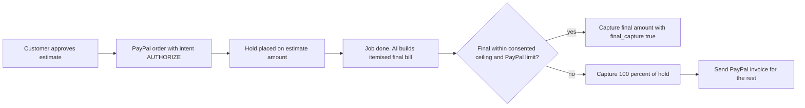

# #8 Final-Price Agent (Overcapture): reserve deep dive (short)

> [!tldr] In one breath
> The idea: hold the estimate on the customer's PayPal, then let AI work out the true final bill and charge up to 115% of the hold. PayPal really does allow this, but repair shop laws say you cannot go over an estimate without the customer's OK, and shop software already handles those approvals. **Verdict: demote to reserve. Score 78/120 (desk 90).** Keep it only as one branch (an estimate plus a consented 15% buffer) inside a holds build.

> [!example] Picture this
> Your car goes in for a $1,000 repair. The shop holds $1,000 on your PayPal, like a hotel holding money on your card at check in. The mechanic finds a worn belt and the bill becomes $1,075. PayPal would let the shop take that extra $75 straight from the hold. But in Florida the shop must first ask you, in writing or out loud. So the clever part only works if you said "up to 15% more is fine" before the work started.

> [!info] Note key
> Idea note: [[I008 Final-Price Agent (Overcapture)]] · Verdict: **demote** · Final score **78/120** (desk 90).
> Confidence tags: ✅ primary source read directly · ⚠️ secondary, vendor or single source · ❌ unverified. `⚠ inference` marks our own judgment.

> [!warning] Crowd check, Oct 23 2026
> The "hold money, then capture or release it" family is **the second most crowded area** in the hackathon. A scan of 266 public GitHub repos (partial coverage; the official gallery is not public yet) found about 28 escrow and milestone repos built on authorize then capture or void, including **holdfast**, **trustrail-hold**, **tidehold**, **TrustLock**, **handback** (rental deposits) and three named "ProofPay". None in the scan was described as overcapture for final job prices, but the core mechanic is everywhere. See [[17 Live Competition Scan (Oct 23)]].

## How it works, end to end

## 1. Verdict

**Demote to reserve. PayPal allows it, but the law and existing tools leave little room.**

PayPal overcapture is documented: "up to 115% or $75 USD more than the original authorized amount, whichever is less" ✅. The Payments v2 error `MAX_CAPTURE_AMOUNT_EXCEEDED` reads "exceeds the overage limit, which defaults to 115% of the order amount across all captures" ✅. The word "defaults" suggests the limit is set per account or can be configured, and **no eligibility rules (region, account type, funding source) are published** in any of the three authorize and capture pages we read. Whether the sandbox enforces the limit is unknown.

**The law cuts against the pitch.** The flagship vertical, auto repair, has laws about consent to estimates:

* **Florida:** the required disclosure reads "THE SHOP MAY NOT EXCEED THIS AMOUNT WITHOUT MY WRITTEN OR ORAL APPROVAL" (§559.905) ✅. The allowed overrun is in §559.909(1), which we did not read (commonly cited as 10% or $10, max $50) ❌.
* **California:** B&P §9884.9 requires consent for any charge above the written estimate ⚠️ (secondary sources only).

So "AI decides the final price and captures more" is a legal non starter for auto repair unless the customer agrees to a ceiling in advance. That turns the product into "estimate + consented buffer". Tekmetric and Shopmonkey already digitise that with approvals by text message, and Housecall Pro and Pepper cover it with automatic charges to a saved card and pre authorized payments.

### Scorecard at a glance

Adjusted [tech, design, impact, innovation, demo, feasibility, risk] = **[7, 8, 5, 6, 7, 6, 6]** (was [8,8,6,8,8,7,7]).

| Axis | Old | New | Change | Why it changed |
|---|---|---|---|---|
| Tech | 8 | 7 | −1 | Authorize + capture (plus over) + invoice fallback is fewer distinct capabilities than #9 |
| Design | 8 | 8 | = | No change |
| Impact | 6 | 5 | −1 | Only indirect evidence (late payment). Consent laws show regulators treat overruns as a consumer harm. |
| Innovation | 8 | 6 | −2 | Estimate approval flows (Tekmetric, Shopmonkey), automatic charges to a saved card (Housecall Pro, Pepper), restaurant tip adjust. Stripe also offers card overcapture for some industries (❌ not verified this run). |
| Demo | 8 | 7 | −1 | A capture of $1,075 on a $1,000 authorization is a JSON number, not a visual moment |
| Feasibility | 7 | 6 | −1 | Overcapture eligibility and sandbox enforcement unknown; partial capture must be switched on |
| Risk | 7 | 6 | −1 | Legal consent rules, account eligibility |

**Takeaway: the demo moment is a number in a JSON reply. Judges will not remember it.**

## 2. Evidence and competitors

| Item | Finding | URL | Conf |
|---|---|---|---|
| PayPal auth honor | 29 day authorization, 3 day honor period, reauthorization gives a new ID and restarts the honor period; up to 115%/+$75; partial captures; partial capture must be enabled for PayPal authorizations | [auth-honor.md](https://developer.paypal.com/payment-methods/auth-honor.md) | ✅ |
| Authorize and capture guide (platforms) | Same 115%/$75; "multiple re-authorizations"; nothing on eligibility | [auth-capture.md](https://developer.paypal.com/platforms/checkout/standard/customize/auth-capture.md) | ✅ |
| Commerce platform v3 (limited release) | Same limit, "whichever is less"; no eligibility | [authorize-capture.md](https://developer.paypal.com/limited-release/commerce-platform/v3/payment/authorize-capture.md) | ✅ |
| Payments v2 errors | MAX_CAPTURE_AMOUNT_EXCEEDED (defaults to 115%), MAX_CAPTURE_COUNT_EXCEEDED, AUTHORIZATION_ALREADY_CAPTURED (after final_capture), REAUTHORIZATION_TOO_SOON ("only once", day 4 to 29) | [payments v2](https://developer.paypal.com/docs/api/payments/v2/) | ✅ |
| FL §559.905 | Disclosure: shop "may not exceed this amount without my written or oral approval" | [flsenate.gov](https://flsenate.gov/Laws/Statutes/2015/0559.905) | ✅ |
| FL §559.909 | Overrun limits (not read) | [flsenate.gov](https://flsenate.gov/Laws/Statutes/2015/559.909) | ❌ |
| CA B&P §9884.9 | Consent required to exceed the estimate | [terms.law](https://terms.law/Demand-Letters/Automotive/california-auto-repair-overcharge-demand.html) | ⚠️ |
| Tekmetric | Digital signature authorization of estimates and additional work | [support.tekmetric.com](https://support.tekmetric.com/hc/en-us/articles/4421125978391-Digital-Signature-Authorization-Process) | ⚠️ |
| Shopmonkey | "Request Customer Authorization" for services | [support.shopmonkey.io](https://support.shopmonkey.io/hc/en-us/articles/38743372579988-Request-Customer-Authorization) | ⚠️ |
| Housecall Pro | Card on file, automatic charge on invoice | [help.housecallpro.com](https://help.housecallpro.com/en/articles/9944421-auto-charge-card-on-file-feature) | ⚠️ |
| Pepper | "Pre-authorized payments" | [help.usepepper.com](https://help.usepepper.com/en/articles/14501631-pre-authorized-payments) | ⚠️ title only |
| ServiceTitan | Financing; card on file features | [help.servicetitan.com](https://help.servicetitan.com/residential-s-r/docs/offer-financing-to-close-bigger-jobs-1) | ⚠️ |
| Jobber, Toast tip adjust, Square tip adjust | Deposits / tip adjustment on card authorizations | not verified this run | ❌ |

**Searches run:** "PayPal capture more than authorized 115% $75 eligibility"; "auto repair estimate exceed 10 percent consent Florida 559.905 California 9884.9"; "Housecall Pro OR Jobber OR ServiceTitan card on file authorization hold"; "Tekmetric OR Shopmonkey digital estimate approval". Square, Toast and Jobber were not searched separately because of the budget.

## 3. What is actually new?

**A narrow slice: the consented ceiling.**

An AI turns job notes and photos into an itemised final bill, checks it against a *ceiling the customer agreed to in advance*, and captures within PayPal's overage limit. Anything over the ceiling goes to an invoice. The "consented ceiling" maps neatly onto Florida style tolerance rules, which is the one interesting angle. Everything else is workflow the big players already have.

## 4. Can we build it, and the day 1 tests

Sequence:

1. `POST /v2/checkout/orders` with `intent:AUTHORIZE` for the estimate.
2. `/authorize`.
3. When the job is done: `POST /v2/payments/authorizations/{id}/capture {amount: final, final_capture:true}` where final ≤ min(1.15×, +$75).
4. If over: capture 100%, then `POST /v2/invoicing/invoices` + `/send` for the remainder.

Day 1 tests:

* T1: capture 110% of a $100 sandbox authorization.
* T2: capture 120% (expect MAX_CAPTURE_AMOUNT_EXCEEDED).
* T3: capture $1,080 on a $1,000 authorization (tests whether the $75 cap is enforced).
* T4: is a partial capture or overcapture refused with a permission error on a default sandbox business account?

**If T1 fails, the idea is dead.**

## 5. Recommendation

**Do not build it standalone.** If #9 or a "programmable holds" idea is built, include overcapture as one branch: an estimate with a consented +15% buffer. Its unhappy path (over the ceiling → invoice) is a good "we tested the unhappy paths" moment.

> [!info]- Jargon decoder
> **Authorize then capture**: like a hotel holding $200 on your card at check in, then charging only what you actually used at check out.
> **Overcapture**: charging a bit more than the hold. PayPal allows up to 115% or $75 extra, whichever is less.
> **Honor period**: the first 3 days of a hold, when PayPal promises the money is really there. After that it may not be.
> **Authorization period**: the full 29 days a hold can live before it expires.
> **Reauthorization**: renewing a hold to get a fresh honor period. It gets a new ID.
> **final_capture**: a flag that says "this is the last charge, release whatever is left".
> **Partial capture**: charging only part of the hold. It must be switched on for the merchant's PayPal account.
> **Card on file / auto charge**: the shop saves your card and charges it when the invoice is ready.
> **Tip adjust**: how restaurants hold your card for the meal, then add the tip you wrote on the slip.
> **Estimate consent law**: a rule that a repair shop must ask you before charging more than the estimate.
> **Sandbox**: PayPal's practice playground with fake money.

## Where to next
* ⬆️ Up: [[50 Top 10 Overview]]
* 🔗 Idea note: [[I008 Final-Price Agent (Overcapture)]]
* ⬅️ Previous: [[D003 Mismatch-to-Replacement (Deep Dive)]] · ➡️ Next: [[D009 Rental Deposit Inspector (Deep Dive)]]
* 🔗 Final pick: [[70 The Winning Idea]]
* 🔗 Related: [[D009 Rental Deposit Inspector (Deep Dive)]] (the holds sibling), [[17 Live Competition Scan (Oct 23)]], [[Jargon Decoder]]
