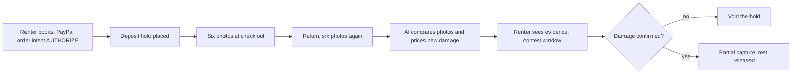

# #9 Rental Deposit Inspector: deep dive

> [!tldr] In one breath
> Hold a deposit on the renter's PayPal, let AI compare photos taken before and after the rental, and charge only for new damage, releasing the rest. **The PayPal mechanics work** (authorize, partial capture, void). But AI damage spotting is a crowded product category, a near duplicate public repo exists, and Hertz's AI scanners caused public outrage for exactly this kind of auto billing. **Verdict: demote (keep as a component, not a finalist). Score 81/120 (desk 92).**

> [!example] Picture this
> You rent a camera for the weekend. The shop holds $300 on your PayPal and snaps six photos. On Monday you bring it back, and the AI spots a new scratch on the lens. Before PayPal takes a cent, you see the before and after photos side by side and can say "that was already there". You agree, so $85 is charged and $215 is released. If the AI had been wrong and you had no chance to object, you would be the next angry Hertz customer on the news.

> [!info] Note key
> Idea note: [[I009 Rental Deposit Inspector]] · Verdict: **demote** · Final score **81/120** (desk 92). Analyst run 2026-10-12, sharing a research budget with #28 and #8.
> Confidence tags: ✅ primary source read directly · ⚠️ secondary, vendor or single source · ❌ unverified. `⚠ inference` marks our own judgment.

> [!warning] Crowd check, Oct 23 2026
> **Crowded, with a direct look alike in this hackathon.** A scan of 266 public GitHub repos (partial coverage; the official gallery is not public yet) found **handback** (ZNLong2203/handback), described as rental deposit photo comparison and filed in the "authorize then capture or void" escrow group. That is this idea. It sits inside the second most crowded cluster: about 28 "AI checks the evidence, then the held money is released or captured" escrow repos, including **rentabot**, **PropLock**, **holdfast**, **TrustLock**, **tidehold** and three named "ProofPay". Add RentProof (found Oct 12, below) and the AI half is well covered. See [[17 Live Competition Scan (Oct 23)]].

## How it works, end to end

## 1. Verdict

**Demote: keep as a component, not a finalist.** The PayPal mechanics work for short rentals: authorize, partial capture, void ✅. **The weak points are novelty and risk.**

AI damage detection on rental returns is now a crowded product category:

* Texada (software for equipment rental) ships "AI Damage Detection" in its mobile app.
* CloudRent markets AI damage detection.
* switchlabs "Verify" sells AI condition verification for equipment rental and car rental.
* Roboflow has a template for inspecting rental equipment damage.
* Hertz/UVeye scanners produce damage bills automatically.
* **RentProof**, a public GitHub repo (fork of BorisKonov/rentproof), does almost exactly this card's AI half: six fixed angle photos at check out and return, a vision diff, and damage converted into invoice lines with photo proof, built on Claude and deployed on Render. Render is a hackathon sponsor, so this could be a competing hackathon entry. ⚠ inference
* Rental platforms already partially capture deposit holds by hand: TWICE ("Charge part or all of an authorized hold") and Booqable (pre authorization holds).

The only unoccupied slice is "AI evidence → PayPal partial capture with a contest window", which is a thin difference.

Risk is also worse than first scored:

* Hertz's AI scanners drew public backlash for automatically charging questionable damage. Judges will ask "isn't this the Hertz problem?"
* Holds are only reliable for 3 days (the honor period).
* The Payments v2 reference says reauthorization is allowed "only once, from day 4 to day 29", which contradicts the guide's "multiple re-authorizations".
* Partial capture of PayPal wallet authorizations must be enabled on the merchant account.

### Scorecard at a glance

Adjusted [tech, design, impact, innovation, demo, feasibility, risk] = **[8, 8, 6, 4, 8, 7, 6]** (was [8,8,6,7,9,8,8]).

| Axis | Old | New | Change | Why |
|---|---|---|---|---|
| Tech | 8 | 8 | = | Authorize, partial capture with `final_capture`, void, reauthorize, disputes and webhooks make a real loop across several APIs. None of it is in the agent toolkit (`create_order` hardcodes CAPTURE), so it needs raw REST. |
| Design | 8 | 8 | = | Clear persona and clear start and end states. |
| Impact | 6 | 6 | = | The pain is plausible, but there is no primary data on rental deposit disputes. Hertz shows the reverse harm (consumers over charged by AI). |
| Innovation | 7 | **4** | −3 | Texada, CloudRent, switchlabs, Roboflow, UVeye/Hertz, RentProof (nearly identical), and TWICE/Booqable partial holds. |
| Demo | 9 | 8 | −1 | Still visual, but a nearly identical public demo exists (rentproof-three.vercel.app). |
| Feasibility | 8 | 7 | −1 | Partial capture needs account enablement. Reauthorization limits are contradictory. Holds longer than 3 days are not guaranteed. |
| Risk | 8 | 6 | −2 | Hertz backlash framing, possible crowding from a duplicate entry, and buyer disputes of damage captures. |

**Takeaway: Innovation fell from 7 to 4. The AI half already exists in at least five products and one public repo.**

**If revived**, reframe it as a *fairness product for the renter*: the renter gets the AI diff and a 48 hour contest window before any capture, with mandatory human review for anything above $X. Or fold the hold mechanics into a broader "programmable holds" idea.

## 2. Is the problem real?

**The pain is plausible, but there is no hard data on deposit disputes. Impact stays at 6.**

| Claim | Number | Source | Conf |
|---|---|---|---|
| Hertz AI scanners catch more damage and bill customers automatically; customer outrage | Reported 5× more damage caught | [The Autopian](https://www.theautopian.com/customers-outraged-with-hertz-ai-scanners-they-say-automatically-charge-for-questionable-damages/), [CO/AI](https://getcoai.com/news/hertzs-ai-scanners-catch-5x-more-car-damage-surprising-customers-with-bills/), [Fox 26](https://www.fox26houston.com/news/rental-cars-using-ai-damage-hertz-billing), [Forbes/Elliott](https://www.forbes.com/sites/christopherelliott/2025/11/01/ai-vs-the-iphone-the-battle-for-your-rental-car-damage-bill/) | ⚠️ (snippets; consistent across 4 outlets) |
| Small rental businesses want holds instead of charge and refund | qualitative | [HivePress community](https://community.hivepress.io/t/hold-security-deposits-instead-of-charging-refunding/2481), [Shopify community "authorization hold"](https://community.shopify.com/t/option-to-do-a-credit-card-authorization-hold/18703) | ⚠️ titles/snippets |
| Shopify rental merchants struggle to charge damage/late fees | qualitative | [Shopify community](https://community.shopify.com/t/charging-late-damage-non-returns-fee-for-rental-business/85197) | ⚠️ snippet |
| Stripe uncaptured holds last about 7 days, so rental tools auto expire them | ~7 days | [TWICE docs](https://www.twicecommerce.com/docs/concepts/orders/deposits.md) | ✅ |

No regulator or network data counts deposit disputes for small equipment rental businesses.

## 3. Who else is doing this?

**Searches run:** "PayPal security deposit policy merchant authorization hold rental"; "Hertz UVeye AI damage scanner automatic charge"; "Booqable security deposit authorization hold Stripe partial capture"; "AI before after photo damage detection equipment rental return app deposit automatic deduction" (extended); "CloudRent AI damage detection rental deposit"; "devpost PayPal rental deposit damage AI authorization capture". Plus raw/B, where Bryntum suggests "equipment rental locked on payment".

| Name | Type | What it does | Overlap | URL | Conf |
|---|---|---|---|---|---|
| RentProof (maistor1, fork of BorisKonov) | Open source / likely hackathon project | Photos from six angles at check out and return, vision diff lists new damage, confirmed damage becomes invoice lines with photo proof. Next.js + Claude, Render/Vercel demo. No payment capture. | **High** | [github.com/maistor1/rentproof](https://github.com/maistor1/rentproof) | ✅ |
| Texada Service & Rental Mobile: AI Damage Detection | product | AI damage detection at check in and check out for equipment rental yards | High (AI half) | [help.texadasoftware.com](https://help.texadasoftware.com/en/knowledge/3276/service-rental-mobile-ai-damage-detection), [blog](https://texadasoftware.com/blog/ai-damage-detection/) | ⚠️ |
| CloudRent AI Damage Detection | product | AI damage detection for rental | High (AI half) | [cloudrent.me](https://www.cloudrent.me/ai-damage-detection/) | ⚠️ |
| switchlabs Verify | product | AI condition verification for equipment rental and car rental returns | High (AI half) | [verify.switchlabs.dev](https://verify.switchlabs.dev/use-cases/equipment-rental-condition) | ⚠️ |
| Roboflow rental damage inspection | platform template | Computer vision model template for rental equipment damage | Med | [roboflow.com](https://roboflow.com/ai/rental-equipment-damage-inspection) | ⚠️ |
| Hertz × UVeye (also ProovStation, Ravin, Tchek, DeGould) | product | Drive through AI scans that trigger damage bills | High (AI → charge) | see §2 | ⚠️ |
| Levy Electric fleets | product | Car sharing condition reports and damage claims | Med | [levyelectric](https://fleets.levyelectric.com/help/car-sharing/damage-claims) | ⚠️ |
| TWICE | product | Card deposit as an authorization hold. Partial charge with reason, release the remainder. Stripe/Adyen only, **not PayPal**. Manual decision. | High (payment half) | [twicecommerce.com](https://www.twicecommerce.com/docs/concepts/orders/deposits.md) | ✅ |
| Booqable | product | Credit card pre authorization holds for rental deposits | High (payment half) | [booqable.com](https://booqable.com/blog/authorize-credit-card-holds/) | ⚠️ |
| ChargeAutomation | product | Security/damage deposit holds and capture for short term rentals | Med to High | [help.chargeautomation.com](https://help.chargeautomation.com/en/articles/3443570-how-to-capture-security-damage-deposits) | ⚠️ |
| Rentle, Checkfront, Goodshuffle, Fat Llama | product | Rental booking with deposits / damage protection | Med | not individually verified | ❌ |
| Airbnb AirCover, Turo damage claims | platform feature | Damage claims with photo evidence inside the platform | Med | not fetched | ❌ |
| Bryntum sponsor idea "equipment rental locked on payment" | sponsor prompt | Rental scheduling with a payment lock | Med (crowding) | raw/B | ✅ |

**Does anyone tie AI damage assessment to a partial capture?** Hertz/UVeye effectively ties AI to a charge, though not to a hold placed in advance. Nobody we found (as of Oct 12) ties it to a *PayPal* authorization partial capture. That is the only gap, and it is a narrow one. The Oct 23 scan's **handback** repo may now fill it (classified from its description only; see the crowd check above).

## 4. What is actually new?

* **Not new:** AI before and after diffing (at least 5 products plus RentProof), deposits held as authorizations with partial capture (TWICE, Booqable, ChargeAutomation).
* **New:** joining the two on PayPal rails, plus a contest window for the renter before capture.
* **Sharpest differentiator (weak):** "The AI drafts the deduction; the renter sees the evidence and can contest before PayPal captures a cent."

## 5. Can we build it in the PayPal sandbox?

**Yes for short rentals. Long rentals hit hold expiry limits, and the docs contradict each other on reauthorization.**

**Verified mechanics**

* 29 day authorization period with a 3 day honor period ✅ ([auth-honor](https://developer.paypal.com/payment-methods/auth-honor.md)).
* "Each reauthorization generates a new authorization ID and restarts the honor period" ✅.
* "Partial captures are supported during a single authorization period." "For PayPal payment authorizations, you must enable partial capture on your PayPal account." ✅
* Capture body: `amount`, `final_capture` (default false: "Indicates whether you can make additional captures"), `invoice_id`, `note_to_payer`, `soft_descriptor` ✅ ([Payments v2 ref](https://developer.paypal.com/docs/api/payments/v2/)).
* Void: `POST /v2/payments/authorizations/{id}/void`, no body ✅. `CANNOT_BE_VOIDED`: a reauthorization cannot be voided; void the parent instead ✅.

> [!danger] Contradiction in PayPal's own docs
> The guide says "multiple re-authorizations" within 29 days, but the API error `REAUTHORIZATION_TOO_SOON` says "Reauthorization is allowed only once, from day 4 to day 29", and `REAUTHORIZATION_NOT_SUPPORTED` says you cannot reauthorize a reauthorization ✅ (both from docs). **Assume one reauthorization.** That caps a reliable hold at about day 4 + 3 days of honor, with a 29 day hard limit.

**Buyer view:** the PayPal help article (Pay in 4 context) says an authorization "will show as a pending authorization within your PayPal Account Activity and also at your financial institution" ✅ ([help465](https://www.paypal.com/us/cshelp/article/help465)). For standard wallet authorizations this is ⚠ inference; verify in the sandbox buyer account.

**PayPal policy on security deposits:** we found no explicit PayPal policy. The User Agreement's sections on holds and reserves cover holds on the seller side, not merchant deposits ❌. Day 1: check the AUP. Also note that a captured damage charge can be disputed by the buyer, and Seller Protection covers unauthorized and item not received claims, not "I didn't damage it".

**API sequence**

1. `POST /v2/checkout/orders` with `intent:AUTHORIZE`.
2. Buyer approves.
3. `POST /v2/checkout/orders/{id}/authorize` returns the `authorization_id`.
4. On return: AI diff, then a contest window for the renter.
5. Then one of:
   * (a) clean: `POST /v2/payments/authorizations/{id}/void`
   * (b) damage: `POST …/capture {amount: X, final_capture: true, note_to_payer, invoice_id}`
   * (c) rental over 3 days: `POST …/reauthorize` on day 4 or later
6. Webhooks: `PAYMENT.AUTHORIZATION.VOIDED`, `PAYMENT.CAPTURE.COMPLETED`.

**Day 1 tests**

* T1: does partial capture work on a fresh sandbox business account, or does it return a permission error until enabled?
* T2: reauthorize on day 0 (expect REAUTHORIZATION_TOO_SOON). The sandbox may not let you skip ahead in time, so a long rental demo is narrated only.
* T3: a second reauthorization (expect REAUTHORIZATION_NOT_SUPPORTED).
* T4: capture with `final_capture:true`, then void the remainder (expect AUTHORIZATION_ALREADY_CAPTURED or an automatic release).
* T5: does the buyer's sandbox activity show "pending"?

## 6. What the AI actually does

A vision model compares paired photos and outputs `[{region, damage_type, severity, new_vs_preexisting, confidence, bbox}]`. A price table maps these to costs (deterministic, so the same damage always costs the same). The LLM writes an evidence page. **Guardrails:** a confidence threshold, human approval, and a cap of capture ≤ authorized amount (no overcapture for damage).

## 7. Smallest useful version (if revived)

Two scripted rentals (clean → void; scratched lens → partial capture), a contest page for the renter, and an evidence PDF linked in `note_to_payer`. Weeks 1 to 4 as in the original card.

## 8. Demo storyboard (if revived)

| Time | What the judge sees |
|---|---|
| 0:00 to 0:20 | Hertz headline: "AI damage bills are making renters furious." |
| 0:20 to 1:00 | Check out photos, then a $300 PayPal hold appears. |
| 1:00 to 1:40 | Return. The AI diff highlights a lens scratch. The renter sees the evidence and accepts. |
| 1:40 to 2:10 | **Wow moment:** the PayPal sandbox shows a $300 authorization, $85 captured, the remainder released. |
| 2:10 to 2:40 | Clean return, then void. |
| 2:40 to 3:00 | Close. |

## 9. Risks and fixes

| Risk | Fix |
|---|---|
| Backlash framing in the style of Hertz | Contest window for the renter first, human approval |
| Duplicate (RentProof, Bryntum prompt; now also handback, Oct 23) | Differentiate on payment + fairness, or demote |
| Holds expire for rentals lasting several days | One reauthorization only; restrict to rentals under about 7 days; otherwise use a vaulted payment method |
| Partial capture not enabled | Day 1 T1 |

## 10. Sources

Linked inline. Primary: PayPal auth-honor, auth-capture guide, Payments v2 reference, help465, TWICE docs, RentProof GitHub page ✅. Others ⚠️.

> [!info]- Jargon decoder
> **Authorize then capture**: like a hotel holding $200 on your card at check in, then charging only what you actually used at check out.
> **Partial capture**: charging only part of the hold, such as $85 of a $300 deposit.
> **Void**: cancelling the hold completely, so the renter is charged nothing.
> **Honor period**: the first 3 days of a hold, when PayPal promises the money is really there.
> **Reauthorization**: renewing a hold to get a fresh honor period. PayPal's docs disagree on how often you can do it.
> **final_capture**: a flag that says "this is the last charge, release whatever is left".
> **Vision diff**: an AI spots the difference between two photos, like a "spot the difference" puzzle.
> **bbox (bounding box)**: the rectangle the AI draws around the damage it found.
> **Contest window**: a set time (here 48 hours) when the renter can object before any money moves.
> **Vaulted payment method**: a card or PayPal account saved securely so you can charge it later without a hold.
> **Seller Protection**: PayPal's cover for sellers against some buyer claims. It does not cover "I didn't damage it".
> **AUP**: PayPal's Acceptable Use Policy, the list of what you may and may not sell or do.
> **Sandbox**: PayPal's practice playground with fake money.

## Where to next
* ⬆️ Up: [[50 Top 10 Overview]]
* 🔗 Idea note: [[I009 Rental Deposit Inspector]]
* ⬅️ Previous: [[D008 Final-Price Agent (Overcapture) (Deep Dive)]] · ➡️ Next: [[D020 Dispute-to-Listing Fixer (Deep Dive)]]
* 🔗 Final pick: [[70 The Winning Idea]]
* 🔗 Related: [[D008 Final-Price Agent (Overcapture) (Deep Dive)]] (the holds sibling), [[17 Live Competition Scan (Oct 23)]], [[Jargon Decoder]]
