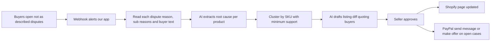

# #20 Dispute-to-Listing Fixer: deep dive

> [!tldr] In one breath
> The idea: read every "item not as described" PayPal dispute, spot patterns per product ("7 people say the linen shirt runs small"), and rewrite the product page so the next buyer is not disappointed. **The dispute data is genuinely rich.** But the PayPal "fix" step changes an object no shopper ever sees, and a Shopify app called ReasonWhy already runs the same loop on returns. **Verdict: demote, or fold into another product as a "prevention" tab. Score 80/120 (desk 97).**

> [!example] Picture this
> You sell shirts online. Seven buyers in a month open PayPal complaints saying "this is not what I ordered, it is way too small". Each one costs you the refund *and* a fee, and PayPal's Seller Protection does not cover these. Instead of fighting each complaint, a tool reads all seven, notices the same phrase, and suggests: "add a size chart and say it runs small". It is like a teacher noticing half the class got question 4 wrong and rewriting the question rather than marking everyone down.

> [!info] Note key
> Idea note: [[I020 Dispute-to-Listing Fixer]] · Verdict: **demote** · Final score **80/120** (desk 97). Analyst run: 2026-10-11.
> Confidence tags: ✅ primary source read directly · ⚠️ secondary, vendor or single source · ❌ unverified. `⚠ inference` marks our own judgment.

> [!warning] Research limitation
> The shared WebSearch budget for this run ran out after 3 searches for this idea. To stay within the rules, the analyst did not use other search engines to get around the limit. Competitor coverage below comes from 3 searches, direct reads of the pages those searches surfaced, PayPal's OpenAPI schemas, and Devpost gallery pages 1 to 6. It is **not** the six or more phrasings per idea the brief asks for. **Treat the novelty section as a floor: there may be more competitors, not fewer.**

> [!warning] Crowd check, Oct 23 2026
> **Disputes are the fifth most crowded area in this hackathon.** A scan of 266 public GitHub repos (partial coverage; the official gallery is not public yet) found about 16 dispute and chargeback copilots: **witness**, **dispute-defender**, **dispute-copilot** (AG Grid), **rebuttal**, **dispute-radar** (LightGBM), **dispute-autopilot**, two "disputedesk", **dispute-steward**, **Docket** and two "payguard-ai". Close cousins: **preflight-for-paypal**, **subguard**, **returngate** and **clippay**. Judging by their names, most of these defend against disputes rather than prevent them (⚠ inference), but judges will see "PayPal disputes + AI" and lump this in. See [[17 Live Competition Scan (Oct 23)]].

## How it works, end to end

## 1. Verdict

**Demote, or fold into another product as a "prevention" tab.**

**The data side is better than expected.** A PayPal dispute exposes `reason`, product `sub_reasons` (DAMAGED / DIFFERENT / MISSING_PARTS / OTHER), the buyer's `product_details.description`, `purchase_url`, item name and description, and a `messages[]` thread. Clustering is technically real.

Two findings hurt the idea:

1. **The "fix" step is not really PayPal.** `/v1/catalogs/products` is the product object used by Subscriptions and billing plans, not a storefront. PATCH changes only description, category, image_url and home_url, and no shopper ever sees it. A real listing fix has to go to Shopify, Woo or eBay, or to a demo store we build ourselves. The only real listing surface on the PayPal side is Store Sync, and access to it is gated.
2. **The mechanism already exists on returns data.** ReasonWhy (Shopify app, launched Jun 2026) "ranks products by return impact and explains likely cause… evidence-backed page fixes for sizing, fit, imagery, and copy" and has "before/after impact tracking". Return Insights AI (Shopify, May 2026) and Vortex IQ's "Return reason clusters by ASIN" sit close by. Amazon VoC/NCX already gives a health score per listing.

What is left is "the same idea, fed by PayPal disputes instead of returns." That is a narrower data source: disputes are a small fraction of complaints compared with returns (⚠ inference). It also has no primary evidence on SNAD ("significantly not as described", the buyer says the item is not what the listing promised) volume.

### Scorecard at a glance

| Axis | Old | New | Why it changed |
|---|---|---|---|
| Tech | 8 | 7 | Disputes list/get, webhooks and Transaction Search are real. The catalog "fix" is cosmetic, so the core loop has about 3 real PayPal capabilities |
| Design | 8 | 7 | Clear persona. The end state ("dispute rate fell") can only be projected, not shown |
| Impact | 8 | 6 | The SNAD exclusion from Seller Protection is primary. No primary figure found for the SNAD share of PayPal disputes |
| Innovation | 8 | 6 | ReasonWhy, Return Insights AI, Vortex IQ and Amazon VoC do the same thing on returns. Only the PayPal dispute input is new |
| Demo | 8 | 7 | A listing diff is visual, but the PayPal state that changes is a catalog object nobody sees |
| Feasibility | 9 | 7 | Seeding about 20 disputes needs about 20 captured transactions, buyer JWTs, one dispute per transaction, and a few minutes' wait before actions. Whether free text can be set through the API is unverified |
| Risk | 8 | 7 | Judges may call the PayPal fix step decorative ("PayPal button on an unrelated app") |

**Takeaway: the drop from 97 to 80 comes from every axis losing a point or two. No single killer, many small cuts.**

## 2. Is the problem real?

**The pain is real and uninsured (SNAD is excluded from Seller Protection). How big it is on PayPal is unknown.**

| Claim | Number | Source | Conf |
|---|---|---|---|
| SNAD claims are excluded from US Seller Protection | "Items where the buyer claims… that the item you sent isn't what was ordered (SNAD)" are ineligible | [PayPal US Seller Protection, updated Jan 26 2026](https://www.paypal.com/us/legalhub/paypal/seller-protection) | ✅ |
| Same exclusion in the UK | Same clause | [PayPal UK Seller Protection, 15 Jul 2026](https://www.paypal.com/uk/legalhub/paypal/seller-protection) | ✅ |
| Chargebacks are growing | 261M → 324M by 2028 | Mastercard 2025 outlook (sources.yaml `mc-chargebacks`) | ✅ (via prior research) |
| Merchants win few disputes | 8.1% of US disputes | chargeback.io (`cbio-stats`) | ⚠️ |
| Repeated SNAD signals a listing gap | Qualitative: "a gap between the purchase promise and the product… delivered" | [Chargeflow KB, Feb 2026](https://www.chargeflow.io/knowledge-base-articles/why-do-i-get-so-many-item-not-as-described-disputes) | ⚠️ vendor |
| SNAD share of PayPal disputes | **Not found** (the Chargeflow KB gives no figure, and the search budget ran out) | n/a | ❌ |

**User voices:** none verified in this run because of the search budget. The idea's demand signal rests on vendor prose. ❌

## 3. Who else is doing this?

**Searches run:** (1) "Amazon Voice of the Customer dashboard NCX listing return reasons not as described fix listing"; (2) "Loop Returns return reason analytics AI product insights fix product page description"; (3) "Chargeflow Insights chargeback root cause product prevention analytics not as described". Three more searches were attempted and blocked by the budget: "AI tool analyzes returns and reviews to rewrite product descriptions"; "Shopify app PayPal disputes analytics by product"; "SNAD share of PayPal disputes". The analyst also browsed Devpost built-with/paypal pages 1 to 6 (about 144 of 400 entries).

| Name | Type | What it does | Overlap | URL | Conf |
|---|---|---|---|---|---|
| ReasonWhy | Product (Shopify app, Jun 15 2026, $49 to 199/mo, 0 reviews) | AI groups return reasons, ranks products by impact, explains causes such as a misleading product page, gives page fixes, tracks before/after | **High** (same loop; returns instead of disputes; no automatic edit) | https://apps.shopify.com/reasonwhy | ✅ |
| Return Insights AI | Product (Shopify, May 2026, free / $19) | AI analysis of return patterns "to improve product pages"; no listing edits | Med | https://apps.shopify.com/ai-return-analyzer | ✅ |
| Vortex IQ "Return reason clusters by ASIN" | Product feature | "Reason-coded returns clustered by ASIN, sizing / quality / listing-mismatch signals"; manual fix steps | Med | https://docs.vortexiq.ai/nerve-centre/kpi-cards/amazon-seller/return-reason-clusters-by-asin | ✅ |
| Amazon Voice of the Customer (NCX) | Platform feature | Negative experience rate and health per ASIN, combining returns, refunds and complaints | Med (diagnosis only, Amazon only) | https://www.sellerlabs.com/?p=18942 | ⚠️ |
| Seller Labs AI return reason workflow | Guide / pattern | Classify return comments with AI into a taxonomy, then fix listings (dimension line, scale reference) | Med (a do it yourself version of the same idea) | https://www.sellerlabs.com/?p=18942 | ⚠️ |
| Chargeflow Insights / Prevent | Product | Dispute dashboards, fraud segments, policy recommendations; nothing at product or listing level was found | Low | https://www.fintechfutures.com/press-releases/chargeflow-unveils-free-ai-powered-product-to-transform-chargebacks-into-profits | ⚠️ |
| Loop Intelligence | Product | Return analytics and image review; no page fix feature shown | Low | https://www.loopreturns.com/insights | ⚠️ |
| SubGuard, Rebuttal, Dispute Copilot, Exhibit, Fairplay, PayGuard AI | Devpost entries | Dispute *defense*, mediation and evidence; none do prevention or listing feedback | Low to Med (same cluster, so judges will lump them together) | https://devpost.com/software/built-with/paypal | ✅ |
| Second Look | Devpost entry | Reviews seller evidence and listings *before checkout* (buyer side) | Low | same | ✅ |

## 4. What is actually new?

* **New:** using PayPal's dispute objects (`sub_reasons`, buyer `product_details.description`, `messages[]`, `purchase_url`) as the input signal, and closing the loop with a PayPal `send-message` / `make-offer` on open cases. No Devpost entry does prevention.
* **Not new:** clustering complaints by product, finding the root cause, recommending page fixes, and tracking before and after. ReasonWhy ships exactly this loop on returns.
* **Sharpest differentiator:** "The only complaint channel that costs you the money *and* the fee, with no Seller Protection: we mine PayPal SNAD disputes, not returns, and fix the listing before the next one." **This is honest but narrow.**

## 5. Can we build it in the PayPal sandbox?

**Reading disputes: yes. Seeding realistic test disputes: harder. The PayPal "fix": cosmetic.**

**Fields a clusterer gets from `GET /v1/customer/disputes/{id}`** (✅ read from the [Disputes v1 OpenAPI schema](https://developer.paypal.com/api/customer-disputes/v1/schema.json)):

* `reason` (enum incl. `MERCHANDISE_OR_SERVICE_NOT_AS_DESCRIBED`), `dispute_life_cycle_stage`, `status`, `dispute_amount`, `external_reason_code`
* `disputed_transactions[].items[]`: `item_id`, `item_name`, `item_description`, `item_quantity`, `notes`, `reason`, `product_details`
* `extensions.merchandize_dispute_properties.product_details`: `description` (written by the buyer), `sub_reasons[]` ∈ {DAMAGED, DIFFERENT, MISSING_PARTS, OTHER}, `product_received`, `purchase_url`, `return_details`
* `messages[]`: `posted_by` (BUYER / SELLER / ARBITER), `time_posted`, `content`, `documents`
* `supporting_info[]` (`notes`, `source` = SUBMITTED_BY_BUYER…), `evidences[].notes`
* Caution: the buyer's notes on accept offer and deny offer are "visible to PayPal but not the merchant" ✅ ([test-go-live](https://developer.paypal.com/disputes/test-go-live.md))

**Can disputes created in the sandbox carry buyer free text?**

* Buyer messages: yes. `send-message` is documented as usable by "merchants and customers" during `INQUIRY`, and the test guide says a buyer message triggers `CUSTOMER.DISPUTE.UPDATED`, after which "message details are available in the messages array" ✅. The guide's documented route is the sandbox personal account UI. Calling `send-message` as the buyer through the API with `PayPal-Auth-Assertion` is **unverified**.
* `POST /v1/customer/disputes`: the documented body has `disputed_transactions`, `reason`, `dispute_amount`, `extensions` (incl. `merchandize_dispute_properties.issue_type`) and `evidences[].notes`. Passing `product_details.description` / `sub_reasons` in `extensions` is **unverified** (it uses the same schema object, so it is plausible). The API reference also labels create as "limited release" while the sandbox guide documents it. ✅ / ⚠ conflict.
* `change-reason` takes a `note` ("Product is not as advertised") ✅.

**Is the "fix" step real?** `/v1/catalogs/products` products are "goods and services" used to build billing plans (agent toolkit `create_product`/`update_product`; the Subscriptions flow is product → plan → subscription) ✅. They do not drive any storefront. **Verdict: cosmetic.** Real options:

* (a) Shopify Admin `productUpdate` (a Shopify MCP exists in this environment). The link on the PayPal side is then `purchase_url` / `item_name` → Shopify handle.
* (b) Build our own demo store whose PDP reads from PayPal Catalog. This is consistent but judges may see through it.
* (c) Write corrected `items[].description` into new Orders v2 orders. Weak.

**Sequence:** create N orders with `items[]` (name, sku, description) → capture → for each, buyer JWT `POST /v1/customer/disputes` (SNAD) → buyer `send-message` → wait a few minutes → `GET /v1/customer/disputes?dispute_state=…` → GET each → cluster → merchant `send-message` / `make-offer` on open cases → listing fix on Shopify → Transaction Search for the denominator (dispute rate = disputes ÷ sales per SKU).

**Day 1 tests**

1. `POST /v1/customer/disputes` with `extensions.merchandize_dispute_properties.product_details:{description:"runs two sizes small", sub_reasons:["DIFFERENT"], purchase_url:"…"}`, then GET and check it round trips.
2. `POST /v1/customer/disputes/{id}/send-message` with the buyer `PayPal-Auth-Assertion`, then GET and check `messages[0].posted_by == "BUYER"`.
3. Check that `disputed_transactions[].items[]` is populated when the order had `items[]`.
4. Throughput: how many disputes per hour before rate limits or delays.

## 6. What the AI actually does

* Extract a structured root cause per dispute: `{sku, attribute: size|color|material|dimension|photo|missing_part, claim_quote, confidence}`.
* Cluster per SKU, with a minimum support threshold so a single angry buyer does not trigger a rewrite.
* Write a listing diff that must quote the dispute text behind each change.
* Optional vision check: compare the listing photo against the claim, e.g. "photo shows navy; buyers say black".
* **Guardrails:** a deterministic support threshold, human approval before publishing, and no automatic acceptance of claims.

## 7. Smallest useful version (if pursued anyway)

* **Must:** dispute seeding script (20 disputes over 4 SKUs), dispute ingest, clustering, listing diff with approval, publish to a Shopify dev store, dispute rate panel per SKU.
* **Should:** merchant `send-message` to buyers with open cases, with an offer.
* **Could:** vision check; PayPal Catalog mirror.

| Week | Work |
|---|---|
| W1 | Seeding and the day 1 tests |
| W2 | Extraction and clustering |
| W3 | Rewrite, Shopify publish and UI |
| W4 | Video and polish |

## 8. Demo storyboard (3 min)

| Time | What the judge sees |
|---|---|
| 0:00 to 0:20 | The problem: SNAD = refund + fee + no Seller Protection. |
| 0:20 to 1:00 | 20 SNAD disputes land via webhook, and the cluster map lights up "Linen shirt: 7 disputes, 'runs small'". |
| 1:00 to 1:50 | Claims are quoted, root cause found, size chart added, the photo flagged. |
| 1:50 to 2:30 | Approve, the Shopify PDP updates, and the buyers with open cases get a PayPal `send-message` with an exchange offer. |
| 2:30 to 3:00 | A *projected* drop in dispute rate. |

**Wow moment:** the diff with quotes. **PayPal state that changes:** dispute messages and offers only.

## 9. Risks and fixes

| Risk | Fix |
|---|---|
| **Cosmetic PayPal fix** | Make the PayPal touch the resolution of open disputes (offer or message), not the catalog. |
| **Overlap with ReasonWhy** | Pitch it as a PayPal dispute source plus returns, not a new mechanism. |
| **Impact cannot be proven inside the hackathon** | Be explicit that the numbers are projections. |
| **Crowded disputes cluster on Devpost (≥6 entries; about 16 GitHub repos as of Oct 23)** | Judges may lump it in with them. |

## 10. Sources

* https://developer.paypal.com/api/customer-disputes/v1/schema.json ✅
* https://developer.paypal.com/disputes/test-go-live.md ✅
* https://developer.paypal.com/api/catalog-products/v1 ✅
* https://www.paypal.com/us/legalhub/paypal/seller-protection ✅
* https://www.paypal.com/uk/legalhub/paypal/seller-protection ✅
* https://apps.shopify.com/reasonwhy ✅
* https://apps.shopify.com/ai-return-analyzer ✅
* https://docs.vortexiq.ai/nerve-centre/kpi-cards/amazon-seller/return-reason-clusters-by-asin ✅
* https://www.sellerlabs.com/?p=18942 ⚠️
* https://www.chargeflow.io/knowledge-base-articles/why-do-i-get-so-many-item-not-as-described-disputes ⚠️
* https://www.fintechfutures.com/press-releases/chargeflow-unveils-free-ai-powered-product-to-transform-chargebacks-into-profits ⚠️
* https://www.loopreturns.com/insights ⚠️
* https://devpost.com/software/built-with/paypal (pages 1 to 6) ✅
* /home/claude/research/repos/agent-toolkit/typescript/src/shared/functions.ts (catalog endpoints) ✅

> [!info]- Jargon decoder
> **SNAD**: "significantly not as described". The buyer says the item is not what the listing promised. PayPal's Seller Protection does not cover it, so the seller usually loses.
> **Dispute vs chargeback**: a dispute is a complaint through PayPal; a chargeback is the bank pulling the money back. Both cost the seller the sale plus a fee.
> **Seller Protection**: PayPal's insurance style cover for sellers against some buyer claims, such as unauthorized payments.
> **sub_reasons**: PayPal's tick boxes for why the item was wrong: DAMAGED, DIFFERENT, MISSING_PARTS, OTHER.
> **Clustering**: grouping similar complaints together, like sorting a pile of letters by topic.
> **Minimum support threshold**: the rule that a pattern must appear several times before we act, so one grumpy buyer cannot rewrite your shop.
> **SKU / ASIN**: a product's stock code. ASIN is Amazon's version.
> **PDP**: product detail page, the web page for a single item.
> **Listing diff**: a before and after view of the product page, with changes highlighted.
> **Catalog Products API**: PayPal's product records for subscriptions. Shoppers never see them, which is why the fix there is cosmetic.
> **Store Sync**: PayPal's feature that publishes a shop's catalog to AI shopping channels. Access is gated.
> **Webhook**: PayPal pinging your server when something happens, like a doorbell.
> **JWT / PayPal-Auth-Assertion**: a signed ID badge that lets our app act as the sandbox buyer.
> **Transaction Search**: PayPal's API for listing past sales, used here to work out dispute rate per product.
> **INQUIRY**: the early, friendly stage of a PayPal dispute, before it escalates.

## Where to next
* ⬆️ Up: [[50 Top 10 Overview]]
* 🔗 Idea note: [[I020 Dispute-to-Listing Fixer]]
* ⬅️ Previous: [[D009 Rental Deposit Inspector (Deep Dive)]] · ➡️ Next: [[D023 Seller Protection Preflight (Deep Dive)]]
* 🔗 Final pick: [[70 The Winning Idea]]
* 🔗 Related: [[D023 Seller Protection Preflight (Deep Dive)]] (also a seller dispute idea), [[17 Live Competition Scan (Oct 23)]], [[Jargon Decoder]]
