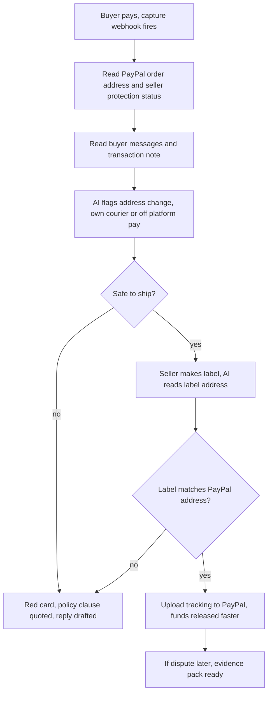

# #23 Seller Protection Preflight: deep dive

> [!tldr] In one breath
> Before a small seller ships a paid order, this tool checks the one PayPal rule that decides whether they are protected: **ship to the address on the PayPal transaction, and never let it be redirected**. AI reads the buyer's messages for "send it to my cousin" style scams, reads the shipping label, explains the verdict with the exact policy clause, then uploads tracking (the fastest way to free held funds). **Verdict: advance with changes. Score 89/120 (desk 97), the top score in the Top 10.** Big caveat: on Oct 23 a near duplicate public repo turned up.

> [!example] Picture this
> Sam sells a $480 camera lens. The buyer pays through PayPal, then messages: "can you send it to my cousin in Miami instead? I'll pay extra." Sam, being nice, does it. A week later the buyer says "never arrived". Because Sam shipped to an address that was not on the PayPal transaction, Seller Protection is void and Sam loses the lens *and* the money. Preflight is the friend looking over Sam's shoulder who says "stop, that one message just cancelled your insurance".

> [!info] Note key
> Idea note: [[I023 Seller Protection Preflight]] · Verdict: **advance with changes** · Final score **89/120** (desk 97). Analyst run: 2026-10-11.
> Confidence tags: ✅ primary source read directly · ⚠️ secondary, vendor or single source · ❌ unverified. `⚠ inference` marks our own judgment.

> [!warning] Crowd check, Oct 23 2026
> **Near duplicate found.**
> A scan of 266 public GitHub repos (partial coverage; the official gallery is not public yet) found **preflight-for-paypal**, described as a **seller protection checker** and flagged as a **near duplicate of this idea**. It sits next to about 16 dispute and chargeback copilots (witness, dispute-defender, dispute-copilot with AG Grid, rebuttal, dispute-radar, dispute-autopilot, two "disputedesk", dispute-steward, Docket, two "payguard-ai") plus subguard, returngate and clippay.
> **The 89 score and the verdict were set on Oct 12, before the Oct 23 scan found this repo.** They are unchanged here. The addendum below already named a downside case (Innovation 6, total 87) if a competitor appeared. See [[17 Live Competition Scan (Oct 23)]] and [[70 The Winning Idea]].

> [!warning] Research limitation
> The shared WebSearch budget for this run was used up before any search for this idea could run. To stay within the rules, the analyst did not use other search engines (Reddit JSON, firecrawl search) to get around it. The policy and API facts below are primary (✅): PayPal legal pages and OpenAPI schemas were read directly. **Scam user voices and the competitor hunt are incomplete (❌).** They must be filled in a follow up before final ranking. (A partial follow up is in the addendum at the end.)

## How it works, end to end

## 1. Verdict

**Advance with changes.** The core premise holds, and it is the most native to PayPal of any check we found. **The rule is primary, current and identical in the US and UK: ship to the address on Transaction Details, and any redirect voids protection.** The API already exposes everything a preflight needs:

* `purchase_units[].shipping` (Orders v2)
* `seller_protection.status` + `dispute_categories` on the capture
* `shipping_info.address`, `protection_eligibility`, `payer_info.address_status` and `transaction_note` ("Might contain special customer requests, such as shipping instructions") in Transaction Search
* Tracking via `/v2/checkout/orders/{id}/track`

No Devpost entry among about 144 browsed touches shipping address, Seller Protection or address change scams (as of Oct 11).

**Changes needed:**

1. **The signature/value rule no longer exists.** The current US (Jan 26, 2026) and UK (Jul 15, 2026) terms have no signature confirmation rule or $750 threshold. Drop that from the pitch; quoting it would be a factual error in front of PayPal judges.
2. **Buyer messages mostly live outside PayPal** (eBay, FB Marketplace, Etsy, email, SMS). The only native buyer text is `transaction_note`, so the "message scanner" needs a paste or forward inbox.
3. **AI risks looking thin next to a rules engine.** Lean on things only a model can do: fuzzy address matching, reading scam intent in many languages, label OCR, and plain English explanations that cite the policy clause.
4. **Widen the impact story.** Pair it with *tracking upload to release holds*: "Trouble accessing funds" is the #1 PayPal complaint category at the CFPB, the US consumer finance watchdog (1,276 complaints), and PayPal calls tracking upload the fastest route to funds on hold.

### Scorecard at a glance

| Axis | Old | New | Why |
|---|---|---|---|
| Tech | 8 | 8 | Orders GET, capture seller_protection, Transaction Search, Tracking, webhooks: ≥4 capabilities beyond checkout. The AI layer must be made consequential |
| Design | 8 | 8 | Clean persona (small seller of physical goods) and clear start and end states |
| Impact | 8 | 6 | The rule is primary ✅, but no quantified loss or scam frequency data and no verified user voices (search budget). Could rise to 7 to 8 if a follow up finds them |
| Innovation | 8 | 7 | No competitor found, but the hunt was incomplete. PayPal/eBay label printing from the order already enforces the address implicitly (⚠ inference). Downside case 6 (see addendum and crowd check) |
| Demo | 8 | 8 | A red banner on the "ship to my cousin" message, then green once tracking lands on the PayPal order. Very legible |
| Feasibility | 9 | 8 | All endpoints are in public schemas. Unverified: sandbox values of `seller_protection` (may always be ELIGIBLE) and Transaction Search lag (up to 3 h) |
| Risk | 8 | 7 | Must not imply a guarantee ("PayPal determines… in its sole discretion"). Rules vary by region |

**Takeaway: the demo is the most legible in the Top 10. The weak spots are Impact (no hard loss numbers) and now Innovation (a near duplicate exists).**

## 2. Is the problem real?

**The rule is crystal clear and primary. How often sellers get burned by it has not been measured.**

| Claim | Number / quote | Source | Conf |
|---|---|---|---|
| Ship to rule | "You must ship the item to the shipping address on the Transaction Details page" | [US Seller Protection, updated Jan 26 2026](https://www.paypal.com/us/legalhub/paypal/seller-protection) | ✅ |
| Redirect voids protection | "If you originally ship… but the item is later redirected to a different address, you will not be eligible… We therefore recommend not using a shipping service that is arranged by the buyer" | same | ✅ |
| Proof of delivery (INR, "item not received" claims) | Online verifiable tracking + delivery date + 'delivered' status + recipient address matching Transaction Details, at least city/state or ZIP | same | ✅ |
| Ship within timeframe | Pre order / made to order: ship within the listed timeframe; otherwise "recommended… within 7 days" | same | ✅ |
| SNAD not covered | SNAD ("significantly not as described") claims (with PayPal or card issuer) are ineligible | same | ✅ |
| Unauthorized claims | Must be marked eligible/partially eligible on Transaction Details, and proof of shipment no later than 2 days after notice | same | ✅ |
| Integration requirements | Business sellers must use the current Checkout product version and pass session information | same | ✅ |
| Guest checkout carve out | Guest/card payments are ineligible for sellers registered in SG, CN, HK, AU, IT, FR, NL, ES, IE, PL, SE and others | same | ✅ |
| Signature / value threshold | **None in the current US or UK terms** | US + [UK (15 Jul 2026)](https://www.paypal.com/uk/legalhub/paypal/seller-protection) | ✅ (absence checked by reading the full text) |
| UK extra rule | "You must accept a single payment from one PayPal account (partial payment and/or payment in instalments are excluded)" | UK page | ✅ |
| Holds pain | PayPal 2025 CFPB complaints 7,464; #1 "trouble accessing funds" 1,276 | sources.yaml `cfpb-db` | ✅ (prior research) |
| Tracking releases holds | "fastest way to access on-hold funds" | [Tracking integrate](https://developer.paypal.com/api/tracking/track-orders/integrate.md) (`pp-tracking`) | ✅ (prior research) |
| Purchase scam scale (context) | UK 175,809 purchase scam cases / £118.1M (2025); US $15.9B reported fraud | UK Finance 2026; FTC 2026 | ✅ (prior research; not specific to address change scams) |
| Frequency of address change / buyer courier scams | **Not found** | n/a | ❌ |

**User voices:** none verified this run; Reddit and PayPal Community could not be searched. Follow up searches to run: `"ship to a different address" paypal seller protection site:reddit.com`, `r/Flipping "uber" OR "courier" paypal scam`, `PayPal community "address not on transaction"`, `eBay "buyer asked to change address" scam`. ❌

## 3. Who else is doing this?

**Searches run:** none (budget exhausted before this idea). Pages fetched directly:

* Devpost gallery pages 1 to 6
* PayPal common scams page (covers phishing only)
* PayPal BRC Seller Protection article
* ShipStation, Shippo and PayPal Shipping pages (all failed to fetch)

| Name | Type | What it does | Overlap | URL | Conf |
|---|---|---|---|---|---|
| PayPal / eBay "print label from the order" | Platform feature | A label generated from the transaction uses the transaction address, which implicitly meets the ship to rule | Med (implicit, no scam or message reasoning) | (fetch failed) | ❌ inference |
| ShipStation / Shippo PayPal integrations | Product | Import PayPal orders and addresses, validate deliverability, push tracking | Low to Med (deliverability, not protection eligibility) | (fetch failed) | ❌ from original record |
| PayPal Transaction Details "eligible" badge | Platform feature | Shows eligibility; no preflight, no message reading, no redirect warning | Med (the data we surface) | https://www.paypal.com/us/brc/article/seller-protection | ✅ |
| PayPal common scams page | Platform content | Phishing only; no guidance for sellers on address changes | Low | https://www.paypal.com/us/security/common-scams | ✅ |
| Devpost PayPal entries (≈144 of 400 read) | Devpost | None about shipping address, Seller Protection, address change scams or shipment tracking. Closest: CarryPay AI (shipping options), Second Look (listing review before checkout) | Low | https://devpost.com/software/built-with/paypal | ✅ |
| Dispute defense entries (Rebuttal, Exhibit, Dispute Copilot, SubGuard) | Devpost | Defense after the fact; Preflight acts before shipping | Low | same | ✅ |
| preflight-for-paypal (added Oct 23) | GitHub repo, this hackathon | Seller protection checker; flagged in the scan as a near duplicate of this idea | **High** | GitHub search, see [[17 Live Competition Scan (Oct 23)]] | ⚠️ classified from repo description |

## 4. What is actually new?

* **New (as far as we checked on Oct 11 to 12):** a gate before shipping that reads PayPal's own eligibility signals (`seller_protection.status`, `protection_eligibility`, `address_status`, ship to address) and the buyer's messages, then blocks or annotates the label. ⚠️ The Oct 23 repo preflight-for-paypal appears to occupy this slot.
* **Not new:** address validation and tracking push (shipping tools), and the eligibility badge (PayPal UI).
* **Sharpest differentiator:** "ShipStation checks whether the address is *deliverable*; Preflight checks whether shipping there keeps your *PayPal protection*, and catches the buyer who just asked you to break it."

## 5. Can we build it in the PayPal sandbox?

**Yes. Every field below is in a public schema. The open question is whether the sandbox ever says "not eligible".**

Verified fields (✅ [Orders v2 OpenAPI](https://developer.paypal.com/api/orders/v2/schema.json), [Transaction Search OpenAPI](https://developer.paypal.com/api/transaction-search/v1/schema.json)):

* **Orders v2 `GET /v2/checkout/orders/{id}`**
  * `purchase_units[].shipping`: `name`, `address`, `type` ∈ {SHIPPING, PICKUP_IN_PERSON, PICKUP_IN_STORE, PICKUP_FROM_PERSON}, `email_address`, `phone_number`
  * `purchase_units[].payments.captures[].seller_protection`: `status` ∈ {ELIGIBLE, PARTIALLY_ELIGIBLE, NOT_ELIGIBLE}, `dispute_categories` (the sample shows `["ITEM_NOT_RECEIVED","UNAUTHORIZED_TRANSACTION"]`), read only
* **`PATCH /v2/checkout/orders/{id}`** can `replace` `/purchase_units/@reference_id=='…'/shipping/address`, but only before capture (⚠ inference from the order lifecycle). After capture, the safe path is refund and repurchase at the new address.
* **`POST /v2/checkout/orders/{id}/track`** and `PATCH …/trackers/{tracker_id}`; also `/v1/shipping/trackers-batch`.
* **Transaction Search `GET /v1/reporting/transactions?fields=all`**
  * `shipping_info` {name, method, address, secondary_shipping_address}
  * `transaction_info.protection_eligibility` (01 eligible / 02 not / 03 partial) and `transaction_info.transaction_note` (buyer note at checkout)
  * `payer_info.address_status` (Y/N), `payer_info.address`
  * `cart_info.item_details`
  * Lag up to 3 h, so use Orders GET for real time.
* **Webhooks:** `PAYMENT.CAPTURE.COMPLETED` triggers the preflight; `CUSTOMER.DISPUTE.CREATED` closes the loop with an evidence pack.

**Flow:** capture webhook → Orders GET (address, seller_protection) → (optional) Transaction Search enrichment → ingest buyer messages (paste/forward, plus `transaction_note`) → rules + AI verdict → seller creates a label (ShipStation/Shippo or Shippo test API, or upload a label image for OCR) → compare label address with the PayPal address → `POST /track` → on dispute, assemble `PROOF_OF_FULFILLMENT`.

**Day 1 tests**

1. Capture a sandbox order with a shipping address and confirm `seller_protection` is present. Then check whether any input yields NOT_ELIGIBLE or PARTIALLY_ELIGIBLE (e.g. no shipping / digital goods `shipping_preference: NO_SHIPPING`, guest card checkout).
2. `GET /v1/reporting/transactions?transaction_id=…&fields=all`: check `shipping_info`, `protection_eligibility`, `transaction_note` and the lag.
3. `POST /v2/checkout/orders/{id}/track` with carrier USPS and a test tracking number; confirm it appears in the PayPal sandbox UI.
4. Can the buyer leave a note at sandbox checkout that shows up in `transaction_note`?

**Sponsor help:** Shippo/EasyPost test mode labels are not sponsors. The APIMatic SDK (APIMatic prize) is plausible; AG Grid for the order queue (sponsor prize). ⚠ inference

## 6. What the AI actually does

**Four jobs a plain rules table cannot do. The eligibility decision itself stays in code.**

* **Message intent classifier** with structured output `{address_change_request, buyer_arranged_courier, off_platform_payment, urgency, overpayment, quoted_span, lang}`. It must quote the exact words that triggered it.
* **Address matching:** "Apt 4B" vs "#4B" counts as a match; a different ZIP or a freight forwarder or reshipper address counts as a mismatch. This combines an LLM with deterministic normalization (fixed cleanup rules, like making "Street" and "St." the same).
* **Label OCR** with a vision model, compared against the PayPal ship to address.
* **Verdict explainer** that cites the exact policy clause, plus a buyer reply draft ("I can only ship to the address on your PayPal payment; please cancel and repurchase").
* **Guardrails:** eligibility logic is deterministic (a rules table built from the policy); the AI only supplies facts and wording; there is a "not a guarantee; PayPal decides" disclaimer; and the rules are versioned per region (US/UK).
* **Model:** a small, fast model for intent; a vision model for OCR.

## 7. Smallest useful version (4.5 weeks)

* **Must:** capture webhook → preflight card; Orders GET; rules table (US + UK); message paste box with intent detection; label image OCR and compare; tracking upload; demo with three orders (clean / cousin address scam / buyer courier request).
* **Should:** Transaction Search enrichment (`protection_eligibility`, `address_status`, `transaction_note`); hold release view; dispute evidence pack on `CUSTOMER.DISPUTE.CREATED`.
* **Could:** Gmail forward ingestion; Chrome extension on eBay/FB messages; extra regions.

| Week | Work |
|---|---|
| W1 | Day 1 tests + rules table |
| W2 | AI intent, address match and OCR |
| W3 | UI + tracking + webhooks |
| W4 | Dispute pack, video, unhappy paths (NOT_ELIGIBLE, digital goods, pickup) |

## 8. Three minute demo storyboard

| Time | What the judge sees |
|---|---|
| 0:00 to 0:20 | A seller loses $480: shipped to "my cousin's address", buyer filed INR, protection void. The clause is shown. |
| 0:20 to 0:50 | Order A is captured (sandbox webhook) and turns green. The card shows the PayPal address and `seller_protection: ELIGIBLE`. |
| 0:50 to 1:40 | Order B: the buyer message "can you send it to my cousin in Miami, I'll pay extra" is flagged red, with the quote highlighted, the clause cited and a reply drafted. **Wow moment.** |
| 1:40 to 2:20 | Order C: the buyer says "my courier will pick it up". Flagged (shipping arranged by the buyer), with a suggestion to use your own carrier. |
| 2:20 to 2:45 | Upload the label for A. OCR matches the address, `POST /track` runs, and the PayPal sandbox order now shows tracking. **PayPal state changes.** |
| 2:45 to 3:00 | A dispute arrives later and the evidence pack is already built. |

## 9. Risks and fixes

| Risk | Fix |
|---|---|
| **Sandbox `seller_protection` may never change** | Show the real field and flag it; drive NOT_ELIGIBLE through policy rules. |
| **Messages live outside PayPal** | The paste box is honest; mention a Gmail/extension roadmap. |
| **Legal** | The product says "not a guarantee", cites clause text, links the live policy, and stores the version date. |
| **"The AI is thin" critique** | Make the AI do fuzzy matching, OCR and intent reading in many languages, with quoted evidence. |
| **Rules vary by region** | Ship US + UK tables; mark others unsupported. |
| **Incomplete novelty hunt** | A follow up search is required. Likely risks are a Chrome extension or eBay feature that already warns about address changes. (Oct 23: preflight-for-paypal found, see crowd check.) |

## 10. Sources

* https://www.paypal.com/us/legalhub/paypal/seller-protection ✅
* https://www.paypal.com/uk/legalhub/paypal/seller-protection ✅
* https://www.paypal.com/us/legalhub/paypal/useragreement-full (Sep 14 2026; links Seller Protection terms) ✅
* https://developer.paypal.com/api/orders/v2/schema.json ✅
* https://developer.paypal.com/api/transaction-search/v1/schema.json ✅
* https://www.paypal.com/us/brc/article/seller-protection ✅
* https://www.paypal.com/us/security/common-scams ✅
* https://devpost.com/software/built-with/paypal (pages 1 to 6) ✅
* Prior research: `/home/claude/research/data/sources.yaml` (pp-tracking, cfpb-db, ukfinance-2026, ftc) ✅

## Addendum (2026-10-12): follow up competitor hunt for the preflight

The skeptic and the judge both said the original novelty hunt for this idea was incomplete. Three more searches were run (extended mode for two).

| Finding | Type | Overlap | Source | Conf |
|---|---|---|---|---|
| **DisputeDesk**: open source AI copilot for PayPal sellers built for *this* hackathon. Triage of disputes and chargebacks, evidence drafts, accept / fight / message recommendations, AG Grid dispute table, webhook handling, autopilot policies. Reads Shipment Tracking and Transaction Search. The README does not describe checks before shipping, ship to address verification or tracking upload, and mentions Seller Protection only as one prior in its rules baseline | Devpost / GitHub entry | **High on the evidence pack and AG Grid queue modules; low on the preflight before shipping** | [github.com/ttimesai-star/disputedesk](https://github.com/ttimesai-star/disputedesk) | ✅ README read |
| ShipStation address verification (integrated with PayPal) | product | Low: checks deliverability, not Seller Protection eligibility | [help.paypal.shipstation.com](https://help.paypal.shipstation.com/hc/en-us/articles/360061609211-Address-Verification) | ⚠️ search result title only |
| PayPal Community and eBay Community threads on shipping to unconfirmed or different addresses | user voices | Evidence of demand, not a competitor | [PayPal Community](https://www.paypal-community.com/t5/Holds-reversals-reserves/Where-is-the-Seller-protection-when-shipping-to-unconfirmed/td-p/263470), [eBay Community](https://community.ebay.com/t5/Selling/Shipping-to-a-different-address/m-p/29413117) | ⚠️ titles only, not yet read |
| Chrome extension or app that warns sellers about address change requests | searched | None found in the results (the Chrome / app query returned only forum threads) | n/a | ⚠️ absence in one search |
| PayPal "Seller Protection for AI-Powered Commerce" page | platform | Page returned as a search hit, but the fetched content did not cover agentic seller protection | [paypal.com](https://www.paypal.com/us/brc/article/seller-protection-agentic-commerce) | ✅ fetched, ⚠️ content thin |

**Consequence (⚠ inference).** The preflight itself was still unmatched in what was found on Oct 12, but DisputeDesk shows another team in this hackathon is already building seller side PayPal dispute evidence with an AG Grid queue. Therefore:

1. Make the **gate before shipping** the headline and keep the dispute evidence pack a thin module, not a feature to pitch.
2. Make the grid different: it should show *how ready each paid order is to ship and its protection status*, not disputes.
3. Innovation stays at 7 only if no further competitor appears; treat 6 as the downside case (final score 87). (Oct 23 note: preflight-for-paypal looks like exactly such a competitor (judged from its repo description); see the crowd check at the top.)

> [!info]- Jargon decoder
> **Seller Protection**: PayPal's cover for sellers. If a buyer falsely says "never arrived" or "I didn't pay for this", PayPal refunds the seller, as long as the seller followed the rules.
> **Transaction Details address**: the shipping address PayPal recorded with the payment. Ship anywhere else and the cover is gone.
> **Redirect**: changing where a parcel goes after it is sent, for example a buyer arranged courier collecting it.
> **INR**: "item not received", the buyer says the parcel never came.
> **SNAD**: "significantly not as described", the buyer says the item is wrong. Not covered by Seller Protection.
> **Preflight**: a checklist before take off, like pilots run. Here: before the parcel leaves.
> **Capture / capture webhook**: the moment PayPal actually takes the buyer's money, and the doorbell ring PayPal sends your server when it happens.
> **Transaction Search**: PayPal's API for looking up past payments, with extra fields like the buyer's note. It can lag up to 3 hours.
> **protection_eligibility / seller_protection.status**: PayPal's own flag on each payment saying eligible, partially eligible or not eligible.
> **address_status**: whether the buyer's address is confirmed (Y) or not (N).
> **Tracking upload**: telling PayPal the carrier and tracking number. PayPal says this is the fastest way to release held funds.
> **Held funds**: money PayPal has received for you but will not let you use yet, often for new sellers.
> **OCR**: reading printed text from a photo, here the address on the shipping label.
> **Intent classifier**: an AI that reads a message and tags what the writer is trying to do, like "asking to change address".
> **CFPB**: the US Consumer Financial Protection Bureau, which publishes complaints about financial companies.
> **Freight forwarder / reshipper**: a company that receives parcels and sends them on, often abroad. A favourite trick of scammers.
> **Sandbox**: PayPal's practice playground with fake money.

## Where to next
* ⬆️ Up: [[50 Top 10 Overview]]
* 🔗 Idea note: [[I023 Seller Protection Preflight]]
* ⬅️ Previous: [[D020 Dispute-to-Listing Fixer (Deep Dive)]] · ➡️ Next: [[D028 Early-Pay Discount Optimizer (Deep Dive)]]
* 🔗 Final pick: [[70 The Winning Idea]]
* 🔗 Related: [[17 Live Competition Scan (Oct 23)]], [[D020 Dispute-to-Listing Fixer (Deep Dive)]], [[Jargon Decoder]]
