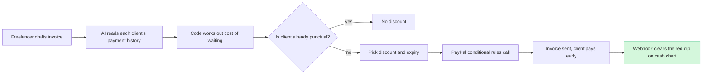

# #28 Early-Pay Discount Optimizer: deep dive

> [!tldr] In one breath
> Freelancers wait weeks to get paid. This tool looks at how fast each client usually pays and what waiting costs you, then picks the right "pay early, save 2%" offer per client and writes it into the PayPal invoice itself. **Verdict: advance with changes. Final score 85/120 (desk 93).**

> [!example] Picture this
> Maya is a designer with three clients. Alice always pays on day 2. Bob always pays on day 45. Carla is a coin flip. Maya's rent is due Nov 28 and her bank charges her for overdrafts. The tool says: no discount for Alice (she already pays fast), 3% for 7 days for Bob, 1.5% plus an auto cancel date for Carla. Each choice comes with one plain sentence explaining why it is cheaper than the overdraft.

> [!info] How to read the marks
> Idea note: [[I028 Early-Pay Discount Optimizer]]. ✅ means a primary source was read directly. ⚠️ means secondary, vendor or single source. ❌ means unverified. `⚠ inference` marks a judgment call.

> [!warning] Crowd check, Oct 23 2026
> Invoicing and receivables chasing is the **4th most crowded area** in the live scan: about 25 repos, including ledgerbird, ledgerly, two "invoicepilot", chaser (built on Agent Toolkit), owed (Bryntum), sorted, docket, brigpay, paid-tonight, clause-and-pay, paceline, duespilot (an AR agent that negotiates with the client's AP agent), kioku, guardian-ai and docpilot. The scan's notes don't mention any of them pricing a discount per client (`⚠ inference` from repo names and short descriptions). **Your edge has to be the discount maths, not "reminders".** Source: [[17 Live Competition Scan (Oct 23)]].

Analyst run 2026-10-12. Budget note: about 32 web searches and 18 fetches shared across #28, #9 and #8. developer.paypal.com is blocked for curl through the proxy (403 CONNECT), so the docs were read through WebFetch.

## How it works



## 1. Verdict

**Advance with changes. The PayPal building block is real and documented.** `POST /v2/invoicing/invoices/{id}/conditional-rules` accepts `EARLY_PAYMENT_DISCOUNT` and `AUTO_CANCEL` rules. It is in the public Invoicing v2 reference ✅, and agent-toolkit v1.11 implements it in both TS and Python ✅.

Three things weaken the original idea card:

* **The mechanism is not new.** Chaser already applies early pay discounts "by schedule, debtor, or invoice" and shows them in its payment portal. Zoho Books has early payment terms per customer. Upflow documents "reward early payers with a discount". C2FO and Taulia do dynamic discounting, and Vic.ai, HighRadius and V7 run AI discount agents on the AP side (the side that pays bills).
* **It sits on an untested surface.** The API reference lists an `invoicing/internal` scope next to readwrite. It does not say how the discount appears on the payer's invoice page, or whether the discount is applied automatically at payment (`payment_term...early_payment_discount.is_applied` exists in the schema). None of this is tested in sandbox.
* **It uses one API family.** The core loop is Invoicing only: create → conditional rules → send → webhook.

**What survives:** no small business receivables tool found *computes* a discount per client from that client's predicted days to pay and the merchant's cost of waiting. The pricing logic is AI assisted but deterministic, and the result is pushed natively into PayPal invoices, where (unlike Zoho) the discount can apply to the online payment itself. The academic finding that "discounts for early payment tend to be offered to riskier buyers" (Klapper, Laeven & Rajan, NBER w17146) ✅ gives useful framing: a discount per client is economically rational, not a gimmick.

## Scorecard at a glance

Adjusted scores [tech, design, impact, innovation, demo, feasibility, risk] = **[7, 8, 7, 6, 7, 8, 7]** (was [8,8,8,7,7,9,8]). **Final 85/120, desk 93.**

| Axis | Change | Reason |
|---|---|---|
| Tech 8→7 | −1 | The core loop is Invoicing only (create, rules, send, remind, search, webhook). The AI decision matters (a %, an expiry and an AUTO_CANCEL date), but no other PayPal capability is used unless Pay Later on invoice or Payouts are added. |
| Design 8 | = | Clear persona (freelancer or agency on net 30), clear start and end state. |
| Impact 8→7 | −1 | The late payment pain is primary ✅ (QuickBooks 2026). The claim that a discount *speeds up payment* has only vendor or snippet level evidence. |
| Innovation 7→6 | −1 | Chaser (per debtor, automatic, shown in portal), Zoho, Upflow, C2FO, plus AI discount agents on the AP side. The new part is the AI priced discount per client on PayPal rails. |
| Demo 7 | = | Depends on the payer view showing the discount (Day 1 test). |
| Feasibility 9→8 | −1 | Documented and implemented in the toolkit, but the `internal` scope and sandbox behaviour are untested. |
| Risk 8→7 | −1 | Possible gating, an unknown payer screen, and crowding from invoice chasers (AG Grid suggests a nudge bot; about 4 invoicing entries on Devpost). |

## 2. Is the problem real?

**Yes. Late payment hurts small businesses, and the numbers are primary.** Whether discounts change behaviour is the weaker part.

| Claim | Number | Source | Conf |
|---|---|---|---|
| US SMBs with invoices 30+ days overdue | 59% (2026), up from 47% | [QuickBooks 2026 Late Payments Report](https://quickbooks.intuit.com/r/small-business-data/small-business-late-payments-report-2026/) via raw/D | ✅ |
| Average owed to those SMBs | $17.7K | same | ✅ |
| Net 30 vs immediate terms businesses with overdue invoices | 55% vs 26% | same | ✅ |
| Owners who delayed their own salary because of processing delays | 26%; 19% took on debt | same | ✅ |
| Early pay discounts go to riskier buyers (screening logic) | ~30,000 contracts studied | [Klapper, Laeven, Rajan, NBER w17146](https://www.nber.org/papers/w17146) | ✅ (abstract) |
| 2/10 net 30 implied annual rate | ~37% APR | [beancount.io](https://beancount.io/blog/2026/07/08/2-10-net-30-early-payment-discount) | ⚠️ (simple arithmetic) |
| Two thirds of businesses willing to accept an invoice discount for faster payment | ~67% | [SDCExec / SAP Taulia](https://www.sdcexec.com/sourcing-procurement/financial-management-software/news/22962025/sap-taulia-inc-twothirds-of-businesses-willing-to-accept-discount-on-invoices-for-faster-payment) | ⚠️ snippet only, vendor |
| Average SMB early pay discount offered | 4.1% | [PYMNTS](https://www.pymnts.com/?p=1241464) | ⚠️ snippet only |
| More than half of SaaS firms *decline* early pay discounts | >50% | [PYMNTS 2022](https://www.pymnts.com/accounts-payable/2022/why-more-than-half-of-saas-firms-say-no-to-early-payment-discounts/) | ⚠️ snippet only. Counter evidence: discounts are not attractive to everyone, which argues *for* pricing per client. |

There is no primary data on how often early pay discounts get used. Beancount says "a large share of eligible discounts go unclaimed" but gives no figure ⚠️.

**What users say**

* QuickBooks Online feature request "Early Payment Discount on Invoices" (Mar 17, 2020, 6 votes): "Add the ability to setup terms with early payment option like Quickbooks Desktop." [link](https://feedback.qbo.intuit.com/forums/591862-quickbooks-invoice-payments-portal/suggestions/39955537-early-payment-discount-on-invoices) ✅. Demand is real but modest.
* QuickBooks community threads "applying early payment discount to invoices" and "recurring invoice prompt payment discount" ([1](https://quickbooks.intuit.com/community/payments-3/applying-early-payment-discount-to-invoices-18590), [2](https://quickbooks.intuit.com/community/getting-paid-42/recurring-invoice-prompt-payment-discount-300438)) ⚠️ titles only, not read.
* Zoho Books docs: "Early payment discounts cannot be applied to online payments made through payment gateways" ([Zoho](https://www.zoho.com/books/help/invoice/early-payment-discount.html)) ✅. This is a product gap, not a user voice.

## 3. Who else does this?

Queries run: "PayPal invoicing v2 conditional-rules early payment discount API"; "PayPal invoice early payment discount business help"; "PayPal invoicing conditional rules release notes 2026"; "early payment discount take-up rate 2/10 net 30 study"; "AI dynamic early payment discount small business invoices per customer optimize" (extended); "Klapper Laeven Rajan Trade Credit Contracts"; "QuickBooks invoice early payment discount feature 2026"; "Upflow OR Chaser OR Invoiced early payment discount"; "C2FO small business early payment marketplace"; "accounts receivable AI recommends early payment discount per customer predicted days to pay" (extended); "FreshBooks OR Xero OR Zoho Invoice early payment discount"; "BILL or Melio AR early payment discount"; "devpost early payment discount invoice AI"; "survey percentage businesses offering early payment discounts".

**Chaser is the closest rival. Everyone else is either enterprise or on the bill paying side.**

| Name | Type | What it does | Overlap | URL | Conf |
|---|---|---|---|---|---|
| Chaser | product | Automatic fixed or % early pay discounts by schedule, debtor or invoice. Shown in its payment portal (discounted total, or both amounts). Can pause "when cash is tight". No AI pricing. | **High** | [chaserhq.com](https://www.chaserhq.com/features/early-payment-discounts) | ✅ |
| Upflow | product | "Reward early payers with a discount" in its online payments | Medium to high | [docs.upflow.io](https://docs.upflow.io/en-us/payments/collect-online-payments/reward-early-payers-with-a-discount) | ⚠️ (fetch returned an unrelated page; title only) |
| Zoho Books | product | Early pay discount at org, customer term and invoice level. *Not* applied to gateway payments. | Medium | [zoho.com](https://www.zoho.com/books/help/invoice/early-payment-discount.html) | ✅ |
| QuickBooks Desktop / Online | product | Desktop has early pay terms. QBO users request it; workarounds exist. | Low to medium | [QBO feedback](https://feedback.qbo.intuit.com/forums/591862-quickbooks-invoice-payments-portal/suggestions/39955537-early-payment-discount-on-invoices) | ✅ / ⚠️ |
| C2FO | product | Supplier side marketplace: suppliers bid a discount or APR to get paid early on approved invoices from big buyers | Medium (enterprise, buyer funded) | [c2fo.com](https://www.c2fo.com/amer/us/en-us/resource-center/article/04272021/how-stuff-works-the-difference-between-an-early-payment-discount-and-rate) | ⚠️ |
| Taulia (SAP) | product | Dynamic discounting and early pay for enterprise AP | Low to medium | [taulia.com](https://taulia.com/glossary/what-is-an-early-payment-discount/) | ⚠️ |
| Vic.ai | product | AP: captures early pay discounts on its own (buyer side) | Low (opposite side) | [CPA Practice Advisor](https://www.cpapracticeadvisor.com/2024/02/29/vic-ai-adds-early-payment-discounts-and-zero-u-s-transaction-fees/102150/) | ⚠️ |
| HighRadius dynamic discounting | product | Enterprise AP dynamic discounting with AI | Low | [highradius.com](https://www.highradius.com/product/ap-automation/dynamic-discounting-solution/) | ⚠️ |
| V7 "Early Payment Discount Agent" | product | AI agent that captures available discounts (AP) | Low | [v7labs.com](https://www.v7labs.com/agents/early-payment-discount-agent) | ⚠️ |
| Centime | product | AI agents for AP and AR, B2B payment optimisation | Medium (claims AR) | [centime.com](https://www.centime.com/articles/agentic-finance-b2b-payment-optimization) | ⚠️ snippet only |
| Melio | product / blog | AP payments; blogs on capturing discounts | Low | [melio.com](https://melio.com/blog/early-payment-discounts/) | ⚠️ |
| BILL / Tesorio | product | AR automation and cash forecasting. No early pay discount pricing per client found. | Low to medium | not verified | ❌ |
| FreshBooks | product | No native early pay discount found in search | Low | not found | ❌ |
| Devpost PayPal entries | Devpost | About 4 invoicing entries and about 6 reconciliation entries, incl. one named "Chaser". None found using conditional rules. | Medium (cluster) | raw/B | ⚠️ |

## 4. What is actually new

* **Not new:** offering early pay discounts, discounts per debtor (Chaser), pausing discounts when cash is fine, dynamic discounting (C2FO, Taulia), AI discount agents (AP side).
* **New, as far as found:** an engine on the AR side (the side that sends bills) that *prices* the discount per client from (a) that client's payment history spread and (b) the merchant's explicit cost of waiting (cash gap date, overdraft, factoring or the 1.5% instant transfer cost). It writes the result as native PayPal invoice conditional rules (discount plus AUTO_CANCEL) and explains each choice in one line. It refuses to discount clients who already pay early (no subsidy to the punctual).
* **Sharpest one liner:** "Chaser lets you set a discount; this tells you which client deserves which discount, and why it's cheaper than your overdraft."

## 5. Can it be built in the PayPal sandbox?

**On paper, yes. Six Day 1 tests decide whether the "native" claim holds.**

**Verified from docs and code**

* `POST /v2/invoicing/invoices/{id}/conditional-rules` ([ref](https://developer.paypal.com/api/invoicing/v2/create-conditional-rules)) ✅. There are also Get conditional rules and `update-conditional-rule` endpoints ✅. Responses are 200/201. The toolkit treats a 204 as success.
* Rule object ([def](https://developer.paypal.com/api/invoicing/v2/definitions/conditional_rule)) ✅:
  * `conditional_rule_type`: EARLY_PAYMENT_DISCOUNT or AUTO_CANCEL
  * `conditional_rule_value_type`: PERCENT or AMOUNT
  * `conditional_rule_value`: string
  * `rule_expiry_terms.rule_expiry_condition`: THREE / SEVEN / FIFTEEN / THIRTY_DAYS_AFTER_ISSUE_DATE; ONE / SEVEN / FIFTEEN / THIRTY_DAYS_AFTER_DUE_DATE; SPECIFIC_DATE
  * `condition_rule_end_date`: YYYY-MM-DD, required
  * Read only `conditional_rule_id` (`CR-…`), `discount_id` (`DISC-…`), `discount_name`
  * The docs mention "late payment surcharges", but no surcharge type exists in the enum.
* `payment_term_conditional_rules` (schema) has `early_payment_discount {discount_end_date, percent, amount, is_applied}` and `auto_cancellation {cancel_by_date, is_applied}` ✅. This suggests the invoice records whether the discount was applied at payment.
* Scopes listed: `invoicing/invoices/readwrite` **and** `invoicing/internal` ✅ (meaning unclear).
* Agent toolkit payload (TS `functions.ts:768`, Py `tool_handlers.py:319`). The body is `{rules:[...]}`. The toolkit only exposes the issue date and SPECIFIC_DATE expiry enums, not the due date ones. The model's prompt is a single line ("Create conditional rules for an invoice on PayPal."), so a hand written structured call is better:

```json
POST /v2/invoicing/invoices/INV2-XXXX-XXXX-XXXX-XXXX/conditional-rules
{"rules":[
 {"conditional_rule_type":"EARLY_PAYMENT_DISCOUNT","conditional_rule_value_type":"PERCENT","conditional_rule_value":"2.5",
  "rule_expiry_terms":{"rule_expiry_condition":"SEVEN_DAYS_AFTER_ISSUE_DATE","condition_rule_end_date":"2026-10-19"}},
 {"conditional_rule_type":"AUTO_CANCEL",
  "rule_expiry_terms":{"rule_expiry_condition":"THIRTY_DAYS_AFTER_DUE_DATE","condition_rule_end_date":"2026-12-11"}}]}
```

**API sequence**

1. `POST /v2/invoicing/invoices` (draft).
2. AI computes the rule set.
3. `POST …/conditional-rules`.
4. `POST …/send`.
5. `POST /v2/invoicing/setup-reminders` (auto reminders).
6. Buyer pays on the sandbox invoice page with a personal sandbox account.
7. Webhook `INVOICING.INVOICE.PAID` updates the cash gap chart.
8. `GET /v2/invoicing/invoices/{id}` reads `payments` and the applied discount.
9. Optional: `record_payment` for payments made outside PayPal; `search-invoices` builds client history for the forecaster.

**Day 1 tests (blocking)**

* T1: create a draft, then conditional rules with the payload above. Expect 2xx with a `CR-` id, not 403 (`internal` scope gating).
* T2: does it work after `/send`, or only on drafts?
* T3: open the payer link in sandbox as a buyer. Is the discounted amount shown? Is it charged?
* T4: pay inside the window. Check `amount_paid` and `is_applied=true`. Pay after the window and confirm the full amount is charged.
* T5: does AUTO_CANCEL fire on its own in sandbox (time based, can't be time travelled)? If not, demo it with SPECIFIC_DATE = tomorrow, or by narration.
* T6: `GET …/conditional-rules` and `PUT update-conditional-rule` (changing a discount mid flight when cash needs change).

**Fallback** if T1 or T3 fail: put the discount in invoice `amount.breakdown.discount` with a terms note, and use AUTO_CANCEL plus cancel_sent_invoice by hand. The demo loses its "native" claim.

**Sponsor tools:** AG Grid for the client and invoice grid with discount and expected value columns (a genuine fit; AG Grid has prizes). Render for hosting.

## 6. What the AI does

**The maths runs in code. The language model only explains and writes messages.**

* **Forecaster:** a spread of days to pay per client, built from invoice history. Use a simple empirical or Bayesian model; the LLM is not the predictor. ⚠ inference: judges will value deterministic maths plus an LLM explanation more than an LLM guessing.
* **Optimiser (deterministic):** maximise E[value] = P(pay early | d) × A(1−d) + (1−P) × (A − cost_of_delay(days late)) subject to a merchant floor (max %, never discount punctual clients). The LLM picks among candidate rules only when there are soft constraints (relationship notes, e.g. "new client, don't discount").
* **LLM outputs (structured JSON):** `{client_id, discount_pct, expiry_condition, auto_cancel, rationale_short, message_to_client}`. A schema validator mirrors the toolkit's zod rules (1 to 100 for PERCENT, dates in YYYY-MM-DD).
* **Guardrails:** hard cap on discount %, merchant approval before send, and an idempotency key (`PayPal-Request-Id`) on create and rules calls.
* **Model:** a Claude Sonnet class model for rationale and messaging. The maths runs in code.

## 7. MVP scope (4.5 weeks)

* **Must:** seeded sandbox history for 3 clients (early payer, chronic 45 day payer, erratic payer), forecaster, optimiser, conditional rules push, send, payer pays, webhook, cash gap chart.
* **Should:** AUTO_CANCEL, message per client, a "why not discount Alice" explanation, AG Grid table.
* **Could:** Pay Later messaging on the invoice, update-conditional-rule when the cash forecast changes, an MCP tool wrapper.
* **Week 1:** Day 1 tests T1 to T6, seed data. **Week 2:** forecaster, optimiser and rules. **Week 3:** UI, webhooks and chart. **Week 4:** unhappy paths (rule rejected, paid late, cancelled). **Week 4.5:** video.

## 8. The 3 minute demo

* 0:00 to 0:20 Hook: "26% of owners skipped their own salary last year waiting on invoices." Show the cash gap chart with a red dip on Nov 28.
* 0:20 to 0:50 Three clients, three histories. The AI proposes 0% / 3% for 7 days / 1.5% + auto cancel, each with a one line rationale and expected cash.
* 0:50 to 1:30 Approve. Show the PayPal sandbox invoice JSON containing the `CR-` rule ids. Switch to the buyer view, where the discounted total is shown (if T3 passes).
* 1:30 to 2:10 **Wow moment:** the buyer pays. The webhook fires, the invoice turns PAID with the discount applied, and the red dip on the cash gap chart disappears.
* 2:10 to 2:40 Unhappy path: the punctual client gets no discount ("you'd be paying Alice to do what she already does"). The erratic client misses the window and pays full price.
* 2:40 to 3:00 Architecture and the PayPal APIs used.

## 9. Risks and fixes

| Risk | Mitigation |
|---|---|
| Endpoint gated (`internal` scope) or payer screen ignores the rule | Day 1 T1/T3. Fallback is a breakdown discount plus a terms note. |
| Looks like an ordinary invoice chaser | Lead with pricing maths and the "cost of waiting", never "reminders". |
| Discount cost exceeds benefit | The optimiser shows the break even point explicitly versus the 1.5% instant transfer fee or overdraft APR. |
| Thin evidence that discounts change behaviour | Cite Klapper et al. and frame it as an experiment ("measure uplift per client"). |
| Time based features are hard to demo | Use SPECIFIC_DATE windows set to "tomorrow". Pre record. |

## 10. Sources

* PayPal create-conditional-rules: https://developer.paypal.com/api/invoicing/v2/create-conditional-rules ✅
* Conditional rule definition: https://developer.paypal.com/api/invoicing/v2/definitions/conditional_rule ✅
* payment_term_conditional_rules: https://developer.paypal.com/api/invoicing/v2/definitions/payment_term_conditional_rules ✅
* Agent toolkit local: /home/claude/research/repos/agent-toolkit (typescript/src/shared/functions.ts:768, parameters.ts:374; python/.../invoices/parameters.py:557, tool_handlers.py:319; commit 9d62faf, v1.11.0) ✅
* QuickBooks 2026 report (via raw/D) ✅. NBER w17146 ✅. Chaser ✅. Zoho ✅. QBO feedback ✅.
* Upflow, C2FO, Taulia, Vic.ai, HighRadius, V7, Centime, SDCExec and PYMNTS as linked above ⚠️.

> [!info]- Jargon decoder
> **Early payment discount (2/10 net 30)**: "pay within 10 days and take 2% off, otherwise the full bill is due in 30". Like a pizza place knocking a dollar off if you pick up right now.
> **Net 30**: the client has 30 days to pay. A polite "pay me next month".
> **AR and AP**: accounts receivable is money owed *to* you (bills you sent). Accounts payable is money *you* owe (bills you got). Two ends of the same invoice.
> **Conditional rules**: little "if this, then that" stickers PayPal lets you put on an invoice, such as "2.5% off until Oct 19" or "cancel this invoice on Dec 11".
> **AUTO_CANCEL**: the invoice voids itself after a date, like a coupon that expires.
> **Scope (`invoicing/internal`)**: a permission label on an API key. Like a staff badge that may or may not open a certain door. Nobody knows yet if this door is staff only.
> **Sandbox**: PayPal's practice playground with fake money, where you can test without real payments.
> **Webhook**: PayPal calling your app the moment something happens ("invoice paid!"), like a doorbell instead of checking the porch every minute.
> **Idempotency key (`PayPal-Request-Id`)**: a unique tag on each request so that pressing "send" twice does not create two invoices. Like a ticket number at the deli.
> **Deterministic**: same inputs, same answer, every time. A calculator, not a fortune teller.
> **Dynamic discounting**: big companies offering suppliers a sliding discount for paying sooner. The enterprise cousin of this idea.
> **Factoring**: selling your unpaid invoices to a company for cash now, minus a cut.
> **Expected value E[value]**: the average money you would get if you replayed the situation many times, weighting each outcome by how likely it is.
> **Zod / schema validator**: a bouncer that checks the AI's answer has the right shape (a number from 1 to 100, a real date) before it reaches PayPal.
> More in [[Jargon Decoder]].

## Where to next
* ⬆️ Up: [[50 Top 10 Overview]]
* 🔗 Idea note: [[I028 Early-Pay Discount Optimizer]]
* ⬅️ Previous: [[D023 Seller Protection Preflight (Deep Dive)]] · ➡️ Next: [[D032 F&F Scam Interrupter (Deep Dive)]]
* 🔗 Final pick: [[70 The Winning Idea]]
* 🔗 Related: [[17 Live Competition Scan (Oct 23)]], [[63 Day-1 Sandbox Test Plan]], [[Jargon Decoder]]
