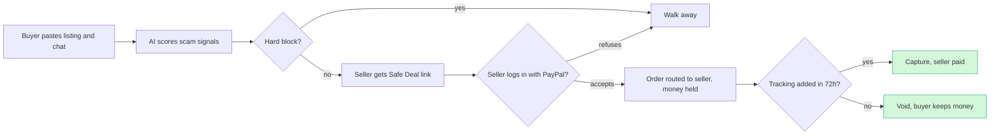

# #32 F&F Scam Interrupter: deep dive (round 2)

> [!tldr] In one breath
> Shoppers on Facebook Marketplace get told "pay me by Friends and Family", lose the money, and get nothing back. This tool scores the deal for scam signs and makes the seller accept a protected PayPal payment; a seller who refuses is the red flag. **Verdict: demote. Final score 71/120 (desk 89)**, because PayPal, Starling and Lloyds already do the detection part.

> [!example] Picture this
> Jake sees a PS5 for $180, "F&F only, shipping only". Before paying he pastes the chat into the tool. It lights up red. He sends the seller a "Safe Deal" link anyway. A real seller would log in with PayPal and accept a protected payment in a minute. This one replies "just send it F&F bro". That refusal is the answer: walk away.

> [!info] How to read the marks
> Idea note: [[I032 F&F Scam Interrupter]]. ✅ means a primary source was read directly. ⚠️ means secondary, vendor or single source. ❌ means unverified. `⚠ inference` marks a judgment call.

> [!warning] Crowd check, Oct 23 2026
> Scam and elder fraud protection has **about 7 live repos**: scam-shield-paypal, Haven, guardianpay, nonna-mode, safesend and kincart, plus breakpoint (which red teams a shop's AI checkout assistant). That is a small cluster, but it sits next to the much bigger AI escrow cluster (about 28 repos) that this idea's "hold the money" step resembles. **Not empty, not packed. The incumbents outside the hackathon are the bigger problem.** Source: [[17 Live Competition Scan (Oct 23)]].

## How it works

## 1. Verdict

**Demote. The problem is real and well evidenced, but the core mechanism already ships.** Three incumbents cover it:

* **PayPal's own AI scam alerts.** They run on Friends & Family (F&F) sends worldwide and on Venmo across the US. Friction grows with risk and high risk payments are declined automatically (live since 21 Jul 2025).
* **Starling's Scam Intelligence.** Customers upload Marketplace listing images and seller chats; Gemini plus Starling's own systems return a risk verdict (Oct 2025).
* **Lloyds' Scam Check.** It sits inside the payment journey to a new payee for an online purchase. The customer answers questions and uploads screenshots, and the AI flags a low price, a new seller, a deposit request or urgency (announced Jun 2026, rolling out).

Below those sit several consumer checkers built for Marketplace listings, plus Devpost "verify before you pay" entries (TrustGate, Red Flag, Brand Guard).

**Only one thing survives.** The tool can turn a scored deal into a **protected PayPal payment routed to the seller**, using Orders v2 with `payee.email_address` (the "pay another account" feature), behind a seller handshake via Log in with PayPal. A seller who refuses the handshake gives the strongest scam signal there is. That is a thin, testable differentiator, not a winning concept. The pitch also tells PayPal judges "your alerts aren't enough" for a flow PayPal already owns, and the tool only sees what the buyer pastes, which is less than PayPal's risk engine sees.

## Scorecard at a glance

**Adjusted scores [tech, design, impact, innovation, demo, feasibility, risk]: 7,8,9,6,8,7,6 → 5,7,8,3,7,6,5.** The weighted total falls from 89 to **71**.

| Axis | Old → new | Reason |
|---|---|---|
| Tech | 7 → 5 | The core loop is Orders (payee routing) + Log in with PayPal + optional authorize/capture + tracking. PayPal has no API for P2P, Request Money or reading seller reputation. Most of the AI is text and vision classification of pasted content. |
| Design | 8 → 7 | The handshake adds a step for the seller. The buyer has to remember to use the tool at the very moment they are least suspicious. ⚠ inference |
| Impact | 9 → 8 | The evidence is top tier (FTC, UK Finance). The reach story is less believable because PayPal, Starling and Lloyds already step in at the point of payment. |
| Innovation | 6 → 3 | Competitors with the exact mechanism: Starling, Lloyds, PayPal's native alerts, Marketplace checkers, Devpost entries. |
| Demo | 8 → 7 | Still easy to follow ("scam listing → red → seller refuses handshake; genuine → protected order captured"). The PayPal state change is an ordinary checkout capture. |
| Feasibility | 7 → 6 | Unverified whether a non partner app may set `payee.email_address`. The "onboard after payment" variant needs an approved partner. |
| Risk | 5 (was 6) | Stage 1 "meaningful PayPal use" risk. The pitch overlaps PayPal's own product. Payee routing for consumer P2P goods may breach live account rules (sandbox is fine). |

## 2. Is the problem real?

**Yes, and the numbers come from the FTC and UK Finance.**

| Claim | Number | Source | Conf |
|---|---|---|---|
| US reported fraud losses, 2025 | $15.9B from 3M reports (2024: $12.5B) | [FTC JEC testimony / press release, Mar 2026](https://www.ftc.gov/news-events/news/press-releases/2026/03/ftc-testifies-joint-economic-committee-agencys-efforts-combat-fraud) | ✅ (via D) |
| Losses from scams that started on social media, 2025 | $2.1B. Shopping scams were the most reported type; >40% of losers said it started by ordering from an ad; Facebook had the most losses; "Most people said they paid for things that simply never arrived" | [FTC Data Spotlight, Apr 2026](https://search.ftc.gov/system/files/ftc_gov/pdf/social-media-spotlight.pdf) | ✅ |
| US online shopping fraud, 2024 | 383,441 reports; $432M lost; median loss $130 | [FTC Data Book 2024](https://www.ftc.gov/system/files/ftc_gov/pdf/csn-annual-data-book-2024.pdf) | ✅ (via D) |
| UK purchase scams, 2025 | 175,809 cases; £118.1M; 78% reimbursed | [UK Finance Annual Fraud Report 2026](https://www.ukfinance.org.uk/system/files/2026-06/UK%20Finance%20Fraud%20Report%202026.pdf) | ✅ (via D) |
| UK APP fraud starting online | 66% | UK Finance 2026 | ✅ (via D) |
| Lloyds fraud reports that are shopping scams, mostly from Meta platforms | 68% | [FinTech Global, Jun 2026](https://fintech.global/?p=245430); [Malwarebytes](https://www.malwarebytes.com/blog/scams/2026/06/scammers-love-meta-according-to-lloyds-bank) | ⚠️ |
| UK APP mandatory reimbursement: the bank absorbs the loss | Reimbursement 54% → 65% after year 1 | C_landscape (PSR evaluation) | ✅ (via C) |

**What this means (⚠ inference).** In the UK, banks already pay back most purchase scam losses, so the unprotected victim is mainly in the **US** (Zelle, Venmo or PayPal F&F, with no rule forcing a refund). Aim the pitch at US Marketplace buyers.

**What users say** (search snippets only, not opened):
* "It's a scam. They will do a chargeback and you will have no protections." [r/paypal](https://www.reddit.com/r/paypal/comments/1idkc20/im_selling_inperson_and_the_buyer_offered_to_do_a/) (snippet)
* Thread title: "Seller says they need the money paid by friends and family not goods and [services]." [r/FacebookMarketplace](https://www.reddit.com/r/FacebookMarketplace/comments/1dr1tzp/seller_says_they_need_the_money_paid_by_friends/) (snippet)
* "*Beware* Facebook Marketplace Groupset Scam" [road.cc forum](https://road.cc/forums/topic/beware-facebook-marketplace-groupset-scam-293015) (title only)
* PayPal Community thread "Fraud by Brendan [removed]…" [PayPal Community](https://ppl.i.lithium.com/t5/Security-and-Fraud/Fraud-by-Brendan-removed-and-Nikki-removed/td-p/3149466) (title only)

## 3. Who else does this?

Queries run:
* "PayPal scam warning friends and family payment AI alert 2025 2026" (extended)
* "Starling Bank Scam Intelligence image analysis marketplace listing tool"
* "Venmo purchase protection scam warning stranger payment goods and services 2025"
* "PayPal newsroom scam alerts F&F tiered warnings Venmo"
* "Starling Scam Intelligence results 2026"
* "Lloyds Monzo marketplace scam check feature purchase scam warning Facebook Marketplace 2026"
* "Devpost scam detection PayPal hackathon marketplace F&F AI project" (extended)
* "AI marketplace listing scam checker paste listing … safe payment link" (extended)
* "Trustap Facebook Marketplace protected payment link escrow"
* Devpost search "scam paypal" and "trustgate"

**The judges' own company is the top competitor here. That is the main reason for the demotion.**

| Name | Type | What it does | Overlap | URL | Conf |
|---|---|---|---|---|---|
| PayPal AI-Powered Scam Alerts (F&F) | Platform feature | AI risk alerts at the point of an F&F send on PayPal (worldwide) and Venmo (US). Friction grows with risk and high risk is declined automatically. It targets scams that push F&F, including ones that start on social media | **High** (same moment, same payment type, and run by the judge's own company) | [PayPal newsroom 2025-07-21](https://newsroom.paypal-corp.com/2025-7-21-Introducing-AI-Powered-Scam-Alerts-for-Friends-and-Family-Payments) | ✅ |
| Starling Scam Intelligence | Bank product | Upload listing images and seller messages; Gemini plus Starling's own systems give a risk assessment. Examples: a Facebook Marketplace bike (price too low, fake looking image, bank details don't match the seller); an eBay seller refusing secure payment. Extended to romance and investment scams in Jun 2026 | **High** (exact detection mechanism) | [UKTN Oct 2025](https://www.uktech.news/ai/starling-bank-launches-ai-tool-to-combat-scams-20251028); [Starling press Jun 2026](https://www.starlingbank.com/news/new-ai-feature-detects-romance-scammers/) | ⚠️ |
| Lloyds Scam Check | Bank product (rolling out) | Inside the payment journey to a new payee for an online purchase: questions plus screenshots, AI flags a low price, new seller account, deposit request or urgency | **High** (detection at the moment of send) | [FinTech Global Jun 2026](https://fintech.global/?p=245430) | ⚠️ |
| Monzo purchase scam work | Bank product | Community post on purchase scam prevention (not opened) | Medium | [Monzo community](https://community.monzo.com/t/an-update-on-our-work-to-prevent-purchase-scams/166103) | ❌ |
| Bitdefender Scamio, Norton Genie, F-Secure | Consumer AI checkers | Paste or screenshot a message, link or listing and get a scam verdict | Medium (generic, no payment step) | (known products, not fetched again) | ⚠️ |
| Facebook Marketplace Scam Detector | Chrome extension | Flags risky Marketplace listings | Medium to high | [Chrome Web Store](https://chromewebstore.google.com/detail/facebook-marketplace-scam/epbclffcfdndcppdcglpkalcolfkbbel) | ⚠️ (search result) |
| DealFlip / ScamNova "Facebook Marketplace Scam Checker" | Web tools | Paste a listing and get a scam score | High (detection) | [dealflip.ai](https://dealflip.ai/facebook-marketplace-scam-checker), [scamnova.com](https://www.scamnova.com/facebook-marketplace-scam-checker) | ⚠️ (search result) |
| Trustap | Product (escrow) | Protected transaction link that buyer and seller both accept, held until delivery; partners with Preloved and others | Medium (covers the protected payment half) | [Sharetribe overview](https://www.sharetribe.com/academy/marketplace-payments/trustap-overview/) | ⚠️ |
| Venmo Purchase Protection | Platform feature | Purchases from business profiles or eligible personal "goods and services" payments are protected; the seller pays a fee | Medium (the G&S path already exists natively) | [Venmo help](https://help.venmo.com/hc/en-us/articles/1500010381401-Buying-and-Selling-on-Venmo-FAQ) | ⚠️ (search result) |
| TrustGate: Verify Before You Pay | Devpost entry (no PayPal tag) | Screens messages, payment requests and links before money moves; rules + ML + LLM explanations | High (detection) | [Devpost search](https://devpost.com/software/search?query=trustgate) | ✅ |
| Red Flag; Brand Guard | Devpost entries | Scam checkers for pasted or screenshotted links and receipts | Medium | [Devpost search](https://devpost.com/software/search?query=scam%20paypal) | ✅ (listing) |
| Kept | Devpost entry | Freelance milestone PayPal payments with dispute evidence | Low | same | ✅ (listing) |

## 4. What is actually new

* **Not new:**
  * AI scoring of a pasted listing, chat or screenshots for purchase scam signals (Starling, Lloyds, Marketplace checkers, Devpost).
  * F&F warnings at the moment of sending (PayPal itself).
  * Protected deal links that both sides accept (Trustap; PayPal and Venmo G&S).
* **Sort of new:** using **a protection handshake as the scam test**. The buyer's tool sends the seller a "Safe Deal" link. A real seller logs in with PayPal (identity tied to the listing) and accepts a protected order routed to their own account. A scammer drops out or pushes back to F&F, and that refusal is scored as a decisive signal.
* **Sharpest one liner:** "Banks tell you a listing looks risky; this one makes the seller prove it isn't, by accepting a PayPal-protected payment, and treats refusal as the verdict." Still weak: Starling's eBay example already uses "seller refuses secure payment" as a signal.

## 5. Can it be built in the PayPal sandbox?

**Constraint. PayPal has no public API to send P2P, Request Money, or mark a payment as F&F or G&S.** Invoicing and Payment Links create requests *from the account that owns the API credentials*, so a buyer's tool cannot make an invoice *from* the seller unless the seller grants third party permission, which needs partner status. ✅ A_paypal_platform §3.4, §3.9

**A believable flow with both sides:**
1. Buyer pastes the listing, chat and images, and the AI returns a structured risk report.
2. If the deal isn't hard blocked, the app creates a `deal` record and a seller link.
3. The seller opens the link and logs in with PayPal (OAuth `openid email https://uri.paypal.com/services/paypalattributes`). The app reads `payer_id`, `email` and `verified_account` ⚠️ (attribute availability: check on Day 1). The seller confirms the price and the item photo hash.
4. The buyer pays via JS SDK, `POST /v2/checkout/orders` with `intent: AUTHORIZE` (or CAPTURE), `purchase_units[0].payee.email_address = <seller's verified email>`, and the item description built from the listing. "Pay another account" lets the payee be set by `email_address` or `merchant_id` ✅ [docs](https://developer.paypal.com/v5/checkout/pay-another-account.md). This is a merchant (G&S type) payment, so Purchase Protection eligibility applies ⚠ inference. Confirm in the policy text.
5. Optional hold: authorize now; the seller adds tracking (`POST /v2/checkout/orders/{id}/track`) or the buyer confirms an in person handover, then `POST /v2/payments/authorizations/{id}/capture`. If neither happens, void.
6. Webhooks: `CHECKOUT.ORDER.APPROVED`, `PAYMENT.AUTHORIZATION.CREATED`, `PAYMENT.CAPTURE.COMPLETED`, `PAYMENT.AUTHORIZATION.VOIDED`.
7. Fallback: a dispute guide (buyers file disputes in the PayPal UI; the Disputes API is for merchants only).

**Partner only alternative:** "Onboard sellers after payment". Set `payee.email_address` to a seller who has not onboarded; the funds stay pending until the seller onboards and are returned after 30 days. It needs an approved partner, the "Onboard After Payment" REST app setting, and onboarding webhooks; otherwise it returns 422. Personal accounts are not supported. ✅ [docs](https://developer.paypal.com/platforms/seller-onboarding/after-payment)

**Day 1 tests:**
* (a) With a standard sandbox app, `POST /v2/checkout/orders` with `payee.email_address` = a second sandbox **personal** account, then approve and capture. Does it succeed, and where do the funds land? Repeat with a **business** payee.
* (b) The same with `intent: AUTHORIZE`, then capture: is a third party payee allowed on authorize?
* (c) Log in with PayPal in sandbox: does userinfo return `verified_account`?
* (d) `/track` on an order whose payee is not the API caller.

## 6. What the AI does

**The AI never moves money. It reads, scores and explains.**

* **Structured output:** `{risk: 0–100, tier: block|handshake|ok, signals: [{type: price_anomaly|fnf_request|off_platform|urgency|reused_image|deposit_request|shipping_only|payment_detail_mismatch, evidence_span, weight}], price_estimate: {low, high, source}, buyer_message, seller_handshake_required: bool}`
* **Inputs:**
  * A multimodal LLM reads screenshots and chat.
  * Reverse image search or a perceptual hash spots reused photos. This is a stub in the demo; Channel3 image search could supply price comparison, which links to a sponsor prize.
  * Deterministic rules catch hard signals (F&F requested for goods; refuses G&S; price below 40% of market).
* **Guardrails:** payment happens only through the buyer's approval in PayPal, and the LLM's verdict is combined with deterministic rules.
* **Model:** Gemini or Claude with vision; temperature 0; JSON schema.

## 7. MVP scope (4.5 weeks)

* **Must:**
  * Paste → risk report.
  * Seller handshake link with Log in with PayPal.
  * Order routed to the payee (authorize → capture on tracking or confirmation; void on timeout).
  * Webhook timeline.
  * Three canned cases: scam, refusal, genuine.
* **Should:** tracking upload by the seller; a reused image check; a price band via Channel3.
* **Could:** Chrome extension on Marketplace; Venmo button (sandbox Venmo is limited).

**Plan:**
* Week 1: Day 1 tests, schema, rules.
* Week 2: handshake + Orders.
* Week 3: AI + UI.
* Week 4: unhappy paths (decline, void, refusal).
* Week 4.5: video.

## 8. The 3 minute demo

* **0:00 to 0:20** FTC $2.1B social media scams stat; a "PS5, $180, F&F only, shipping only" listing.
* **0:20 to 0:55** Paste: red tier with highlighted spans. The buyer sends the handshake link anyway.
* **0:55 to 1:20** The "seller" refuses and asks for F&F: the verdict locks to *walk away*.
* **1:20 to 2:20** Genuine listing: amber → the seller logs in with PayPal → the buyer approves the order. The sandbox dashboard shows an authorization **to the seller's account**, then the seller adds tracking → capture fires.
* **2:20 to 2:50** Unhappy path: no tracking within 72h → void, and the buyer's funds are released.
* **2:50 to 3:00** Close.

**Wow moment:** the seller's refusal *becomes* the verdict.

## 9. Risks and fixes

| Risk | Mitigation |
|---|---|
| PayPal already does F&F scam alerts (the judges' own product) | Frame the project as a *complement* that reaches the conversation before the send and converts the payment to G&S. Cite the PayPal launch openly. |
| Detection is a commodity (Starling, Lloyds, checkers) | Lead with the handshake and payee routed protection, not the classifier. |
| Third party payee may be blocked for non partners | Day 1 test (a). Fallback: sandbox partner app with onboard after payment, or a "merchant of record" demo framing. |
| Low reach: buyers won't open a tool when they aren't suspicious | Share sheet or extension entry point. Honest framing as a concept for PayPal or Marketplace to embed. |
| Overlaps the escrow cluster (~11 Devpost entries) | Avoid the word "escrow"; use a native authorization hold. |

## 10. Sources

* https://newsroom.paypal-corp.com/2025-7-21-Introducing-AI-Powered-Scam-Alerts-for-Friends-and-Family-Payments ✅
* https://www.pymnts.com/fraud-prevention/2025/paypal-adds-scam-detection-to-friends-and-family-payments/ ⚠️
* https://www.uktech.news/ai/starling-bank-launches-ai-tool-to-combat-scams-20251028 ⚠️
* https://www.starlingbank.com/news/new-ai-feature-detects-romance-scammers/ ⚠️ (search result)
* https://fintech.global/?p=245430 ⚠️
* https://search.ftc.gov/system/files/ftc_gov/pdf/social-media-spotlight.pdf ✅
* https://developer.paypal.com/v5/checkout/pay-another-account.md ✅
* https://developer.paypal.com/platforms/seller-onboarding/after-payment ✅
* https://devpost.com/software/search?query=scam%20paypal ✅; https://devpost.com/software/search?query=trustgate ✅
* https://www.sharetribe.com/academy/marketplace-payments/trustap-overview/ ⚠️
* https://help.venmo.com/hc/en-us/articles/1500010381401-Buying-and-Selling-on-Venmo-FAQ ⚠️
* https://dealflip.ai/facebook-marketplace-scam-checker, https://www.scamnova.com/facebook-marketplace-scam-checker ⚠️
* /home/claude/research/raw/D_problem_evidence.md §3.1 (FTC, UK Finance figures)

> [!info]- Jargon decoder
> **F&F (Friends and Family)**: a PayPal payment meant for sending money to people you know. No buyer protection, so once it is gone it is gone. Like handing someone cash.
> **G&S (Goods and Services)**: the protected kind of PayPal payment for buying things. If the item never arrives, you can claim. Like paying with a receipt and a guarantee.
> **APP fraud**: "authorised push payment" fraud. You press send yourself because a scammer tricked you, so the bank sees a normal payment.
> **P2P**: person to person payments, like Venmo between friends.
> **Payee routing (`payee.email_address`)**: telling PayPal "this checkout pays *that* account", like writing someone else's name on the cheque.
> **Log in with PayPal / OAuth**: the seller proves who they are by signing in with their PayPal account, like showing ID at the door without handing over the house keys.
> **Authorize then capture, void**: like a hotel holding $200 on your card at check in, then charging only at check out. Void means letting the hold go without charging.
> **Webhook**: PayPal pinging your app the moment something happens, like a doorbell.
> **Multimodal LLM**: an AI that reads both text and pictures.
> **Perceptual hash**: a fingerprint of an image that stays the same even if the photo is resized, so reused stock photos get caught.
> **Temperature 0 and JSON schema**: settings that make the AI answer the same way each time, in a fixed form, like filling in boxes on a form instead of writing an essay.
> **Partner (PayPal platform partner)**: a company PayPal has approved to act on behalf of other sellers. Ordinary apps don't get these powers.
> More in [[Jargon Decoder]].

## Where to next
* ⬆️ Up: [[50 Top 10 Overview]]
* 🔗 Idea note: [[I032 F&F Scam Interrupter]]
* ⬅️ Previous: [[D028 Early-Pay Discount Optimizer (Deep Dive)]] · ➡️ Next: [[D042 Pre-Checkout Injection Firewall (Deep Dive)]]
* 🔗 Final pick: [[70 The Winning Idea]]
* 🔗 Related: [[17 Live Competition Scan (Oct 23)]], [[Jargon Decoder]]
