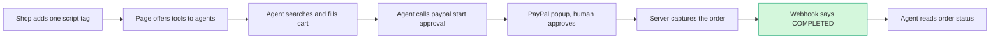

# #47 WebMCP Storefront Kit: deep dive (2026-10-12)

> [!tldr] In one breath
> WebMCP is a new browser standard that lets a website hand AI agents a menu of buttons they can press directly ("search", "add to cart", "check out"). The idea was to give any shop that menu with PayPal checkout built in. **Verdict: demote as a standalone. Final score 72/120 (desk 95).** Shopify, Stripe and a WordPress plugin already ship this, and PayPal announced its own (gated) version. Only a narrow "PayPal checkout tools for WebMCP" component survives.

> [!example] Picture this
> Today an AI agent shops like a tourist reading a menu in a foreign language: it squints at the page, guesses which button is "buy", and clicks around 30 times. WebMCP is the restaurant handing it a clear order form instead: "search here, add here, pay here". PayPal's own test showed 3 tool calls instead of 30+ screen steps. The catch: Stripe's and Shopify's checkouts already hand out that order form, and PayPal's only does so for Store Sync merchants.

> [!info] How to read the marks
> Idea note: [[I047 WebMCP Storefront Kit]]. ✅ means a primary source was read directly. ⚠️ means secondary, vendor or single source. ❌ means unverified. `⚠ inference` marks a judgment call.

> [!warning] Crowd check, Oct 23 2026
> Agent ready storefronts, MCP and WebMCP for merchants is a **medium crowd: about 11 live repos**. They are suede-shelf, **paypal-webmcp-shop**, leafline-agent-store, shopfront-agent, AgentBaazar, ShopGenie, vendorapay, mrstockd, uamarket, atlas-order-agent and paypal-agent-shop. One of them has "webmcp" right in its name. **Add the platform incumbents and this space is now busy.** Source: [[17 Live Competition Scan (Oct 23)]].

## How it works

## 1. Verdict: demote as a standalone (salvage as a narrow "PayPal checkout tools for WebMCP" component)

**The idea assumed merchant side WebMCP tooling was rare. That is no longer true.** Since August 2026, **Shopify turns on 10 WebMCP tools by default on every Liquid storefront and on Hydrogen**. They cover search, cart, `proceed_to_checkout` and, on eligible checkouts, Checkout WebMCP tools that can place the order ✅. **Stripe ships WebMCP tools inside its own payment UIs** (Checkout full page, embedded, Elements, hosted invoice) ✅. **WebMCP Bridge** is a WordPress plugin with 600+ active installs that already registers `woo_search_products`, `woo_add_to_cart`, `woo_apply_coupon` and `woo_get_checkout_fields` ✅. A paid WebMCP WooCommerce plugin with a `checkout` tool is on a waitlist ✅. PayPal itself announced WebMCP via the JS SDK on 2026-09-16, gated to Store Sync merchants ✅.

**What survives is narrow.** Nobody ships open **PayPal** checkout tools for WebMCP: a v6 component that does for PayPal what Stripe does for its payment UIs, usable on any site without Store Sync. PayPal judges could read that as "you rebuilt our gated roadmap item." That is a believable preview, but it is not a new idea. Demand is also not there yet. Spronta's crawls find registered tools "round to zero outside demos" ⚠️. Gemini in Chrome "will soon" use WebMCP, and no mainstream agent calls the tools today ⚠️. The PayPal core loop is checkout plus Orders, which scores about 5 to 6 on the tech anchor.

## Scorecard at a glance

**42 of 70 on the seven axes (was 54). Final 72/120, desk 95.**

| Axis | Old | New | Reason |
|---|---|---|---|
| Tech | 8 | **6** | PayPal use is JS SDK v6 + Orders v2 + webhooks: mostly checkout. The AI part is catalog clean up and tool descriptions, which carry little weight. |
| Design | 8 | **7** | Two personas (merchant installs, agent buys) blur one clear end state. |
| Impact | 7 | **6** | The <1% LLM ready figure is Mirakl vendor data ⚠️. Demand from agents is about zero today ⚠️. PayPal's absence from WooCommerce's agentic path (Stripe only) is a real but small sample gap ✅. |
| Innovation | 9 | **4** | Shopify (on by default), Stripe (payment UI tools), WebMCP Bridge (600+ installs, Woo cart tools), web-mcp.net (planned checkout), MCP-B/WebMCP-org SDKs, and PayPal's own announcement. |
| Demo | 9 | **7** | It needs Chrome 149+ with the origin trial or `chrome://flags/#enable-webmcp-testing`, plus an agent that actually calls tools. Gemini in Chrome support isn't confirmed, so you'd demo through your own harness or the MCP-B relay. |
| Feasibility | 7 | **7** | Technically easy, but the API location keeps moving (`navigator.modelContext` was deprecated in Chrome 150 in favour of `document.modelContext`) ⚠️. |
| Risk | 6 | **5** | Spec churn. WebKit opposes WebMCP ⚠️. Judges may see "copy of PayPal/Shopify/Stripe". |
| **Sum** | 54 | **42** | |

## 2. Is the problem real?

**Barely, today.** Product pages are messy for AI, but almost no agent uses WebMCP yet.

| Claim | Number | Source | Conf |
|---|---|---|---|
| Product pages ready for LLMs | <1% of 500 pages scored ≥80% | [Beet.TV / Mirakl](https://www.beet.tv/2026/08/fewer-than-1-of-product-pages-are-llm-ready-mirakls-meadon.html) | ⚠️ vendor |
| WebMCP tool adoption in the wild | "registered tools round to zero outside demos" | [Spronta, Jul 2026](https://www.spronta.com/blog/state-of-webmcp-july-2026/) | ⚠️ |
| Agents that call WebMCP tools | "no mainstream agent client calls modelContext tools" (May audit). Gemini in Chrome "will soon support WebMCP APIs" (I/O 2026) | [Spronta](https://www.spronta.com/blog/state-of-webmcp-july-2026/), [dev.to](https://dev.to/r0bertini/gemini-in-chrome-is-about-to-call-webmcp-the-no-agent-uses-it-yet-excuse-just-got-an-expiry-date-51be) | ⚠️ |
| PayPal WebMCP benchmark | ~4.6× less inference, ~2× faster, 3 tool calls vs 30+ UI steps (sandbox gift card test merchant, "directional") | [PayPal blog 2026-09-16](https://developer.paypal.com/community/blog/WebMCP_PayPal_Agent_Ready) | ✅ |
| WooCommerce's agentic path | ACP via **Stripe** Agentic Commerce Suite ("coming soon"); MCP live in WP 6.9/Woo 10.3; PayPal not mentioned | [woocommerce.com/agentic-commerce](https://woocommerce.com/agentic-commerce/), [LetsDataScience Dec 2025](https://letsdatascience.com/news/woocommerce-enables-agentic-shopping-for-merchants-afc4e03c) | ✅ / ⚠️ |
| Gap outside Shopify | Shopify's WebMCP covers no WordPress, Webflow or custom sites and gives no usage visibility | [dev.to, Aug 2026](https://dev.to/r0bertini/shopify-just-gave-millions-of-stores-webmcp-tools-for-free-heres-what-it-does-and-what-it-1cln) | ⚠️ |

**What users say:** no merchant asking for WebMCP specifically was found. Every voice is a builder or an analyst (Spronta, dev.to authors, ucpchecker.com "Is my store WebMCP and UCP ready?" [link](https://ucpchecker.com/blog/is-my-store-webmcp-ucp-ready), snippet only). That itself is evidence that demand is speculative. `⚠ inference`

## 3. Who else does this?

**Three big platforms and a popular plugin already cover the core.**

| Name | Type | What it does | Overlap | URL | Conf |
|---|---|---|---|---|---|
| **Shopify WebMCP (Liquid + Hydrogen)** | Platform feature, on by default | `search_catalog`, `browse_store`, `get_product`, `show_variant`, `get_cart`, `update_cart`, `cancel_cart`, `proceed_to_checkout`, `manage_orders`, `search_shop_policies_and_faqs`. On eligible checkouts it switches to Checkout WebMCP tools (read and update checkout, place order). "Nothing to install or configure." Chromium only. | **High** (exact mechanism, for Shopify merchants) | [shopify.dev/docs/api/web-mcp](https://shopify.dev/docs/api/web-mcp), [changelog](https://shopify.dev/changelog/webmcp-liquid-hydrogen) | ✅ |
| **Stripe WebMCP in payment UIs** | Platform feature (experimental) | Tools in Checkout, Elements and hosted invoice pages to read checkout context, select payment method, fill fields and submit. Tools are discovered at runtime. | **High** for the payment half. This is the Stripe version of what the kit would do for PayPal. | [docs.stripe.com/agentic-commerce/for-agents/webmcp](https://docs.stripe.com/agentic-commerce/for-agents/webmcp) | ✅ |
| **PayPal WebMCP via JS SDK** | Platform feature (gated) | Discovery, availability, cart, start and complete checkout; buyer approves in PayPal. "Limited to Store Sync customers today." No tool names or code published. Chrome, Edge and ChatGPT desktop browser named. | **High** (it's the same idea, gated) | [PayPal blog](https://developer.paypal.com/community/blog/WebMCP_PayPal_Agent_Ready) | ✅ |
| **WebMCP Bridge** (Mescio) | WP plugin, 600+ installs, v1.9.3 | WP + Woo tools: `woo_search_products`, `woo_get_product`, `woo_add_to_cart`, `woo_get_cart`, `woo_remove_from_cart`, `woo_apply_coupon`, `woo_get_checkout_fields`. Also a remote MCP endpoint for Claude. No payment step. | **High** (Woo long tail, minus PayPal checkout) | [wordpress.org/plugins/webmcp-bridge](https://wordpress.org/plugins/webmcp-bridge/) | ✅ |
| QuangNhatDev AI Agent Tools for WebMCP | WP plugin, <10 installs | Read only Woo product search and detail via `document.modelContext` | Medium | [wordpress.org](https://wordpress.org/plugins/?p=361569) | ✅ |
| web-mcp.net WordPress plugin | Commercial, waitlist | Planned Woo `search_products`, `add_to_cart`, `apply_coupon`, `checkout` (with `requestUserInteraction()`), $23/mo Pro | High (planned) | [web-mcp.net/platforms/wordpress](https://web-mcp.net/platforms/wordpress) | ✅ (planned status) |
| MCP-B / WebMCP-org SDKs | OSS | `@mcp-b/webmcp-polyfill`, `@mcp-b/global`, `usewebmcp`, `@mcp-b/webmcp-local-relay` (bridges page tools to desktop MCP clients) | Medium (infrastructure you'd build on) | [docs.mcp-b.ai](https://docs.mcp-b.ai) | ✅ |
| Vercel Shop template | OSS template | Commerce template with a WebMCP "anatomy" docs section | Medium | [shop-docs.labs.vercel.dev/docs/anatomy/webmcp](https://shop-docs.labs.vercel.dev/docs/anatomy/webmcp) | ⚠️ snippet only |
| WooCommerce agentic (Stripe ACS) | Platform | ACP via Stripe for 4M+ stores; UCP coming | Medium (different protocol, same merchants, no PayPal) | [woocommerce.com/agentic-commerce](https://woocommerce.com/agentic-commerce/) | ✅ |
| Stripe Agentic Commerce Suite (platform preview) | Product | Catalog syndication + SPT checkout for platforms | Medium | [Stripe Sessions 2026](https://stripe.com/au/blog/everything-we-announced-at-sessions-2026) | ✅ (from raw/C) |
| Firmly ("firmly Connect") | Startup | Agentic checkout network across merchants | Medium | [Stellagent](https://stellagent.ai/insights/firmly-connect-agentic-commerce-platform), [BGV](https://benhamouglobalventures.com/firmly-launches-firmly-connect/) | ⚠️ snippet |
| Rye | Startup | Universal checkout API for agents (Shopify + Amazon), agent skills | Medium | [docs.rye.com](https://docs.rye.com), [skills.sh](https://www.skills.sh/rye-com/agent-skills/rye-overview) | ⚠️ snippet |
| Microsoft NLWeb | OSS protocol | Plain language `/ask` + MCP endpoint per site; adoption research exists | Low to medium | [presenc.ai](https://presenc.ai/research/nlweb-adoption-2026) | ⚠️ snippet |
| Shopify Agentic Storefronts / Catalog | Platform | Syndication to ChatGPT, Copilot, Gemini | Medium | raw/C §2.1 | ✅ |

Queries run (12): "WebMCP Chrome origin trial navigator.modelContext 2026"; "developer.chrome.com WebMCP origin trial blog Gemini in Chrome"; "WebMCP WooCommerce plugin OR Shopify app WebMCP ecommerce add_to_cart"; "WordPress plugin WebMCP WooCommerce released wordpress.org"; "WooCommerce official agentic commerce plugin UCP ACP Stripe Agentic Commerce Suite"; "github webmcp paypal checkout demo store modelContext paypal"; "Firmly.ai agentic commerce merchants checkout API 2026"; "Rye universal checkout API agents"; "Microsoft NLWeb ecommerce store MCP endpoint"; "devpost WebMCP PayPal hackathon project storefront agent"; "Vercel Shop template WebMCP"; "WebMCP Stripe OR Klarna OR Adyen checkout payment tool". The GitHub search found no open source PayPal checkout WebMCP tools; it only found PayPal MCP *servers*, which are a different thing.

## 4. What is actually new

* **Not new:** storefront WebMCP tools (Shopify, WebMCP Bridge), WebMCP tools in payment UIs (Stripe), polyfill and relay (MCP-B), the concept "PayPal + WebMCP + human approval" (PayPal's own blog).
* **Still new (narrow):** an open, ungated **PayPal JS SDK v6 WebMCP layer**, i.e. `paypal_get_checkout_context`, `paypal_select_funding` (PayPal/Venmo/Pay Later), `paypal_start_approval` (→ `requestUserInteraction` + v6 session) and `paypal_get_order_status`, that you can drop onto WooCommerce or any site, so the PayPal button is callable by agents the way Stripe's Checkout already is.
* **Sharpest one liner:** "Stripe's checkout is already agent-callable through WebMCP, and Shopify's storefronts are too. PayPal's is gated to Store Sync. This makes PayPal's v6 checkout agent-callable on any site today, while the human still approves in PayPal."
* **Honest caveat:** the gap exists only because of PayPal's rollout timing. If PayPal ungates before judging (unlikely by Nov 2026, ❌ unverified), it disappears.

## 5. Can it be built in the PayPal sandbox?

**Yes, easily. The hard part is finding an agent that actually calls the tools.**

Sequence (all ✅ available in sandbox per raw/A §3.12):
1. Server: `POST /v1/oauth2/token` → `POST /v1/identity/generate-token` (client token for v6).
2. Page: load `https://www.sandbox.paypal.com/web-sdk/v6/core` → `createInstance({clientToken, components:["paypal-payments","venmo-payments","paypal-messages"]})`.
3. Register tools with `(document.modelContext ?? navigator.modelContext).registerTool({name, description, inputSchema, execute})`, falling back to `@mcp-b/webmcp-polyfill`.
4. `start_checkout` → server `POST /v2/checkout/orders` (intent CAPTURE, items from the agent cart) → v6 `createPayPalOneTimePaymentSession({onApprove,...}).start({presentationMode:"popup"}, orderPromise)`. Approval must be human.
5. `onApprove` → server `POST /v2/checkout/orders/{id}/capture` → webhook `PAYMENT.CAPTURE.COMPLETED` → tool `get_order_status` returns captured.

**Day 1 tests:**
* (a) Can v6 `session.start()` be called from inside a WebMCP `execute` callback without a user gesture? Popups usually need user activation. The likely answer is to use `requestUserInteraction()` (spec issue #165, name ❌ unverified across sources; one source says `requiresUserApproval: true`) or a modal redirect presentation mode.
* (b) Origin trial token on a Render or Vercel domain with Chrome 149 to 156.
* (c) Which agent calls the tools: Model Context Tool Inspector extension, the MCP-B local relay to Claude Desktop, or your own Gemini/Claude harness that runs `getTools()`/`executeTool()`.
* (d) The v6 popup inside a tab driven by an agent.

**Sponsor tools:** Render (hosting) helps a little. Channel3 could supply a catalog for a demo store. No other sponsor fits.

## 6. What the AI does

**Not much that matters, and that is part of the problem.**

* The LLM cleans up a messy catalog (HTML, JSON-LD, CSV) into a typed product schema and writes tool descriptions within Chrome's character budgets (500 description / 150 param per [OpenHermit](https://www.openhermit.com/blog/webmcp-chrome-149-origin-trial-production-2026) ⚠️).
* The agent in the browser picks items. This is weak "AI making consequential structured decisions". Judges will see buyer agent AI they've already seen in about 10 shopping entries.

## 7. MVP scope (if salvaged as a component)

* **Must:** a `paypal-webmcp.js` drop in (4 PayPal tools) + WooCommerce demo site + a harness agent + sandbox capture.
* **Should:** a WebMCP Bridge interop demo (Woo cart tools from Bridge + PayPal checkout tools from you), an agent vs click benchmark replicating PayPal's 3 vs 30 claim.
* **Could:** an "agent readiness" score in the style of Lighthouse.
* W1 v6 + Orders + OT token; W2 tools + harness; W3 Woo plugin wrapper + benchmark; W4 video and polish.

## 8. The 3 minute demo

* 0:00 Hook: "Stripe and Shopify checkouts are agent-callable. PayPal's isn't, unless you're on Store Sync."
* 0:20 Plain Woo store, one script tag.
* 0:40 Agent lists tools in the inspector.
* 1:00 Agent searches, adds to cart, calls `paypal_start_approval`.
* 1:30 PayPal sandbox popup, human approves.
* 1:50 The sandbox order flips to COMPLETED (dashboard + webhook log).
* 2:10 Side by side benchmark: 4 tool calls vs 34 clicks, tokens and time.
* 2:40 Close.

**The wow moment is the benchmark split screen.** It is good but borrows from PayPal's own published benchmark.

## 9. Risks and fixes

* **Spec churn** (`navigator` → `document.modelContext`): use the polyfill and a `??` fallback.
* **No real agent uses the tools:** ship your own harness and say so.
* **"Copy of PayPal roadmap / Shopify / Stripe":** frame it as an open reference implementation and contribute it to paypal/AI-Toolkit.
* **Crowded agentic prize:** this is merchant side, which helps, but its novelty is low.

## 10. Sources

* PayPal WebMCP blog ✅ https://developer.paypal.com/community/blog/WebMCP_PayPal_Agent_Ready
* Chrome WebMCP origin trial (Chrome 149) ✅ https://developer.chrome.com/blog/ai-webmcp-origin-trial
* WebMCP explainer and spec repo ✅ https://github.com/webmachinelearning/webmcp (uses `document.modelContext`, `registerTool`, `getTools`, `executeTool`; authors from Microsoft + Google; credits MCP-B)
* Spronta, State of WebMCP July 2026 ⚠️ https://www.spronta.com/blog/state-of-webmcp-july-2026/ (OT Chrome 149 to 156; Edge 147 flag; `navigator.modelContext` deprecated in 150; adoption ≈ 0)
* OpenHermit Chrome 149 OT ⚠️ https://www.openhermit.com/blog/webmcp-chrome-149-origin-trial-production-2026 (flag `chrome://flags/#enable-webmcp-testing`, char budgets)
* dev.to, Gemini in Chrome "will soon" ⚠️ https://dev.to/r0bertini/gemini-in-chrome-is-about-to-call-webmcp-the-no-agent-uses-it-yet-excuse-just-got-an-expiry-date-51be
* Shopify WebMCP docs ✅ https://shopify.dev/docs/api/web-mcp ; changelog https://shopify.dev/changelog/webmcp-liquid-hydrogen
* Stripe WebMCP docs ✅ https://docs.stripe.com/agentic-commerce/for-agents/webmcp
* WebMCP Bridge plugin ✅ https://wordpress.org/plugins/webmcp-bridge/
* web-mcp.net WP plugin (planned) ✅ https://web-mcp.net/platforms/wordpress
* MCP-B docs ✅ https://docs.mcp-b.ai
* WooCommerce agentic commerce ✅ https://woocommerce.com/agentic-commerce/
* Mirakl / Beet.TV ⚠️ https://www.beet.tv/2026/08/fewer-than-1-of-product-pages-are-llm-ready-mirakls-meadon.html

## Addendum: how to win "Best Use of Agentic Commerce" (vs about 10 shopping agent entries)

* Be on the merchant side; the crowd is on the buyer side. But Shopify and Stripe now own the "storefront tools" story, so the only defensible angle is: "the PayPal button becomes agent-callable on non-Shopify sites, with a measured 3-vs-30 benchmark and a human-approval guarantee."
* **Better use of this research:** fold "PayPal v6 WebMCP checkout tools" into a stronger idea as a feature (e.g., #42's firewall exposes its verified checkout as WebMCP tools), rather than ship it standalone.

> [!info]- Jargon decoder
> **WebMCP**: a proposed browser standard from Google and Microsoft where a web page lists actions an AI agent can call directly (name, description, inputs). Like a restaurant giving the agent an order form instead of making it read the menu board.
> **MCP (Model Context Protocol)**: the general plug standard that lets AI agents use outside tools. WebMCP is its cousin that lives inside a web page.
> **`document.modelContext` / `registerTool`**: the spot in the page's code where the tools get listed. It moved from `navigator` to `document`, which is the "spec churn" worry.
> **Origin trial**: Chrome letting chosen websites test an unfinished feature with a special token, like a beta pass.
> **Polyfill**: a bit of code that fakes a missing browser feature so your site works anyway.
> **JS SDK v6**: PayPal's newest JavaScript kit for putting PayPal buttons and popups on a site.
> **Client token**: a short lived pass the server gives the page so it can talk to PayPal safely.
> **Capture**: actually taking the money after the buyer approved.
> **Webhook**: PayPal pinging your server the moment something happens, like a doorbell.
> **Store Sync**: PayPal's service that makes a merchant's catalog visible to AI channels. PayPal's own WebMCP support is limited to these merchants.
> **Liquid and Hydrogen**: the two ways Shopify stores are built (classic themes and a newer custom framework).
> **ACP and UCP**: two rival "agent checkout" protocols, from OpenAI with Stripe and from Google.
> **User gesture / user activation**: browsers only allow popups right after a real human click, to stop spam popups. An agent is not a human click, hence Day 1 test (a).
> More in [[Jargon Decoder]].

## Where to next
* ⬆️ Up: [[50 Top 10 Overview]]
* 🔗 Idea note: [[I047 WebMCP Storefront Kit]]
* ⬅️ Previous: [[D042 Pre-Checkout Injection Firewall (Deep Dive)]] · ➡️ Next: [[D055 Payout Failure Triage (Deep Dive)]]
* 🔗 Final pick: [[70 The Winning Idea]]
* 🔗 Related: [[17 Live Competition Scan (Oct 23)]], [[18 AI and Fintech Frontier (Oct 2026)]], [[Jargon Decoder]]
