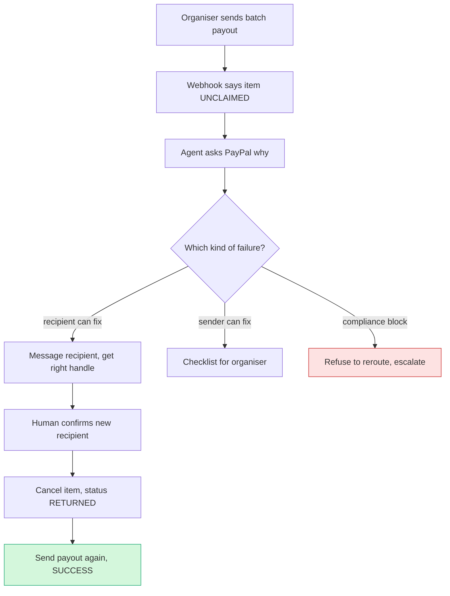

# #55 Payout Failure Triage: deep dive (2026-10-11)

> [!tldr] In one breath
> When a platform pays 10 people through PayPal Payouts, some payments get stuck: a typo in an email, an account that doesn't exist, a compliance freeze. This agent finds out why, messages the person, gets the right handle, cancels and re-sends, and flatly **refuses** to route around a compliance block. **Verdict: advance with changes. Final score 86/120 (desk 95). Tier A, rank 3.**

> [!example] Picture this
> You run a hackathon and send $4,500 to 10 winners. Eight get paid. Two payments just sit there as "UNCLAIMED", and PayPal's notification doesn't say why. In 30 days the money bounces back and two winners are angry. Here, the agent checks the reason, texts Maya, she replies "pay my Venmo @maya-r", you confirm, and the payment is cancelled and re-sent. Then the organiser asks it to send a *blocked* payment to "her other email". It says no, and explains why.

> [!info] How to read the marks
> Idea note: [[I055 Payout Failure Triage]]. ✅ means a primary source was read directly. ⚠️ means secondary, vendor or single source. ❌ means unverified. `⚠ inference` marks a judgment call.

> [!warning] Crowd check, Oct 23 2026
> Payouts to workers and bounties is a **small cluster of 3 to 6 live repos**: payday-agent, Burmalda, takken and routewell, plus mergepay (GitHub bounties paid via Payouts). "Payouts at scale" as a whole got only 1 to 2 hits. The scan's notes don't mention any of them fixing failed payouts (`⚠ inference` from repo names and short descriptions). **Fairly thin, but Payouts as an API is busy on Devpost (10+ entries), so lead with the rescue and the refusal.** Source: [[17 Live Competition Scan (Oct 23)]].

> [!warning]- Research limits for this report
> The PayPal Payouts test values page, the Payouts API reference, the Payouts use overview page and the webhook event names were read directly. So were PayPal's public OpenAPI spec (cloned from `github.com/paypal/paypal-rest-api-specifications`, last commit 2026-04-07), Stripe's Connect payout docs and Devpost "Built with PayPal" pages 1 to 8 plus three project pages.
>
> Then the session's shared **WebSearch budget (200 per turn) ran out, and WebFetch hit a session limit**. So vendor pages (Tipalti, Trolley, Dots, Payoneer, Wise, Routable, Hyperwallet) could **not** be verified, and no creator or gig complaint threads or payout failure statistics were gathered. Where those vendors are described from prior knowledge, the claim is tagged ❌ (unverified this session). A follow up turn should run the searches listed in §3.

## How it works

## 1. Verdict

**Advance with changes. The core still holds after a hard look: a payout that failed or went unclaimed becomes a recoverable workflow per recipient, with guardrails that respect compliance.** No Devpost entry found does the fixing. The closest, **HoldWatch** (same hackathon), only *explains* ONHOLD events and doesn't call the Payouts API at all.

Three findings weaken the original record:

1. **Most "failure branches" in sandbox are canned mock responses, not real state.** You get them by putting magic values in `items[0].note` (create) or in the *path* (`GET /v1/payments/payouts-item/ERRPYO047` → RECEIVER_UNREGISTERED). You can't make a real batch where item 3 fails with RISK_DECLINE. A demo built only on test values shows simulated JSON, not a real sandbox state change.
2. **Classifying a cause is a lookup table** (~60 named error codes), so "AI classifies the failure" is weak AI. The AI has to earn its place in conversations with recipients (working out who they are, reading their replies) and in choosing the next best action under policy.
3. **Problem evidence is thin.** No measured payout *failure* rate was found. The Worldpay figure measures *speed*.

**Required changes:**
* (a) Build the hero loop on the **real** sandbox path: payout to an email with no account → `UNCLAIMED` → AI contacts the recipient and gets a corrected email or Venmo handle → `POST …/payouts-item/{id}/cancel` → `RETURNED` → re-issue → `SUCCESS`. Use test values for the long tail, clearly labelled "simulated branch".
* (b) Make the compliance guardrail visible. The agent **refuses** to reroute around RISK_DECLINE, REGULATORY_BLOCKED, travel rule or closed market failures.
* (c) Use the hackathon or bounty organiser persona, which judges instantly understand.

## Scorecard at a glance

**Adjusted scores** `[tech, design, impact, innovation, demo, feasibility, risk]` = **[8, 8, 6, 6, 7, 9, 7]** (was [9, 8, 7, 7, 8, 9, 8]). **Final 86/120, desk 95.**

| Axis | Change | Reason |
|---|---|---|
| Tech | 9→8 | The PayPal surface is mainly Payouts (create, get batch, get item, cancel), webhooks and optionally Transaction Search. That is deep, but it's one product family, and the classification is deterministic. |
| Design | 8 (same) | Unchanged. |
| Impact | 7→6 | No primary data on failure or unclaimed rates (searches blocked; see §2). |
| Innovation | 7→6 | Payouts are now a crowded Devpost theme (≥10 entries use Payouts), and HoldWatch occupies "payout trouble explained". |
| Demo | 8→7 | Failure branches are mocks; only the UNCLAIMED→cancel→re-issue loop is a genuine state change (still to be confirmed on Day 1). |
| Feasibility | 9 (same) | Unchanged. |
| Risk | 8→7 | Whether VENMO wallet payouts work in sandbox is unverified. PR #107 (Payouts tools) may merge and make it easier for rival teams. |

## 2. Is the problem real?

**The mechanism is well documented. How often it happens is not.**

| Claim | Number | Source | Conf |
|---|---|---|---|
| Gig workers reporting slow or late payments | >50% | Worldpay, 9 Dec 2025, https://www.worldpay.com/en/insights/articles/gig-workers-payments-imperative (via raw/D §2.4; sample not disclosed) | ✅ (vendor) |
| Would prioritise a platform with instant payouts / would pay a fee | 81% / 67% | Same | ✅ (vendor) |
| US adults doing gig work in the prior month | 20% | Federal Reserve SHED 2024 (May 2025) https://www.federalreserve.gov/publications/files/2024-report-economic-well-being-us-households-202505.pdf | ✅ |
| PayPal returns unclaimed payouts after 30 days; recipients without accounts get a sign up link | mechanism | PayPal Payouts OpenAPI spec, `transaction_status.UNCLAIMED`; cancel item description | ✅ |
| When a Stripe Connect payout fails, the external account is **disabled** until the platform updates details. The platform, not Stripe, owns the fix ("contact the platform") | mechanism | https://docs.stripe.com/connect/payouts-connected-accounts | ✅ |
| PayPal webhook resources "don't contain error objects", so the platform must GET the item to learn why it failed | mechanism | https://developer.paypal.com/api/payouts/test-go-live.md | ✅ |
| A real builder hit "A frozen payout arrives as ONHOLD and nobody says why" | anecdote | HoldWatch, Devpost https://devpost.com/software/holdwatch-paypal-payout-holds-explained | ✅ (builder voice, not an end user) |
| Payout failure or unclaimed rate on creator or gig platforms | **not found** | searches blocked | ❌ |
| Cost of a payout related support ticket | **not found** | searches blocked | ❌ |

**What users say.** These could not be collected this session. The only verified voice is the builder quote above. **Gap to close in a follow up:** search r/youtubers, r/Twitch, r/beermoney, r/mturk, r/bugbounty, HackerOne and Bugcrowd community threads, and Devpost forum posts on "prize payment delayed". Also look at PayPal Community threads on "payout unclaimed" and "RECEIVER_UNREGISTERED".

`⚠ inference`: the evidence for the mechanism is solid: PayPal and Stripe docs both push failure resolution onto the platform. How common it is, is what's missing. Judges score impact on a believable, specific case, so open with the 30 day return clock and the "you must GET the item" gap. That is concrete and checkable even without a rate.

## 3. Who else does this?

Queries run: Devpost listing pages 1 to 8 read directly, with project pages checked for payout handling. Queries planned but **blocked by the search budget**: "payout failure AI", "failed payout remediation", "RECEIVER_UNREGISTERED handling", "unclaimed PayPal payouts automation", "mass payouts returned payments workflow", "creator payout support tickets", "Trolley returned payments", "Tipalti payee portal error", GitHub topic `paypal-payouts`, and HN Algolia "payouts failed".

**Lots of teams send payouts. Nobody found fixes the ones that fail.**

| Name | Type | What it does | Overlap | URL | Conf |
|---|---|---|---|---|---|
| HoldWatch | Devpost entry (this hackathon, started 2 Oct 2026) | Verifies webhook signatures and explains holds in four states (confirmed / cause unknown / awaiting / unresolvable). It does not retry, reroute or contact anyone, and doesn't name the Payouts API. Gemini phrases the explanations. Hosted on Render | **Medium** (problem framing) | https://devpost.com/software/holdwatch-paypal-payout-holds-explained | ✅ |
| Nightcall Pays | Devpost entry | Pays a fixer through sandbox Payouts once tests pass. No handling of failure statuses | Low | https://devpost.com/software/nightcall-pays-paypal-sandbox-payout-agent | ✅ |
| Pocket CFO | Devpost entry | Uses Payouts to split income into pots | Low | https://devpost.com/software/pocket-cfo | ✅ |
| PayGuard, Secure PayPal Payout Agent, Warden, Flow pay, AI PAY, AgentEscrow, PayPilot Resolve, MergePay (bounties) | Devpost entries | Payout execution, gating or limits; happy path only, according to listing taglines | Low to medium (same API, crowding) | https://devpost.com/software/built-with/paypal (pp. 1 to 6) | ✅ (taglines only) |
| Stripe Connect | Platform feature | `payout.failed` plus `failure_code`, and disables the external account automatically. The platform must fix it; there is no outreach to the recipient | Low (infra) | https://docs.stripe.com/connect/payouts-connected-accounts | ✅ |
| Hyperwallet (PayPal Enterprise Payouts) | Product (owned by PayPal) | Enterprise payouts: 240+ countries, prepaid cards, 1099, payee drop in UI | Medium (payee self service). It's a PayPal family product, so treat it as positioning | https://developer.paypal.com/payouts/overview.md | ✅ (feature table) |
| Tipalti | Product | AP and mass payouts with a supplier portal that validates payee details | Medium (prevention, not repair) | https://tipalti.com | ❌ |
| Trolley | Product | Creator and marketplace payouts; recipient portal and tax forms | Medium | https://www.trolley.com | ❌ |
| Dots (usedots.com) | Product | Payout API and onboarding flows; pays out via PayPal, Venmo and ACH | Medium to high (closest commercial match on rerouting methods) | https://usedots.com | ❌ |
| Payoneer Mass Payouts, Wise Business batch, Routable | Products | Batch payouts with payee onboarding | Low to medium | none | ❌ |
| AI payout ops agents | none | None found. The searches that would test this were blocked | ? | none | ❌ |

## 4. What is actually new

* **Not new:** sending batch payouts, payee onboarding portals, failure webhooks, or explaining holds (HoldWatch).
* **Probably new on Devpost and in the open source PayPal world:** closing the loop. PayPal's own failure state becomes a conversation with the recipient, then a cancel and re-issue to a corrected recipient or wallet, with an auditable ledger and a policy engine that separates *recipient fixable*, *sender fixable*, *transient* and *must not route around* failures.
* **Commercial novelty is unverified.** Dots and Trolley may already offer "recipient updates details → automatic resend".
* **Sharpest one liner:** *"HoldWatch tells you why money is stuck; we get it unstuck, and refuse to when unsticking it would be evasion."*

## 5. Can it be built in the PayPal sandbox?

**Access ✅.** The Payouts use overview page says you can "set up and test your integration in your sandbox accounts" while the live access request is pending (https://developer.paypal.com/payouts/use-payouts/overview.md). The API reference says sandbox does **not** support the `PHONE` recipient type.

**Failure codes, sorted into kinds** (names from the test values page and API reference ✅; the class column is the analyst's own reading of the docs, `⚠ inference`). **The bottom row is the star of the demo: the agent must never dodge these.**

| Class | Codes | Agent action |
|---|---|---|
| **Recipient can fix** | RECEIVER_UNREGISTERED (sign up link sent; returned after 30 days), RECEIVER_UNCONFIRMED (stays Unclaimed until the recipient confirms), INVALID_EMAIL, RECEIVER_ACCOUNT_LOCKED, RECEIVER_ACCOUNT_LIMITATION, RECEIVER_ACCOUNT_UNVERIFIED, UNVERIFIED_RECIPIENT_NOT_SUPPORTED, RECEIVING_LIMIT_EXCEEDED, RECEIVER_YOUTH_ACCOUNT, RECEIVER_REFUSED, CURRENCY_NOT_SUPPORTED_FOR_RECEIVER, PENDING_RECIPIENT_NON_HOLDING_CURRENCY_PAYMENT_PREFERENCE, PHONE_NUMBER_INVALID, PHONE_NUMBER_SMS_OPTOUT | Message the recipient with exact steps; offer a corrected email or a Venmo handle; cancel the unclaimed item and re-issue |
| **Sender can fix** | INSUFFICIENT_FUNDS, NEGATIVE_BALANCE, NON_HOLDING_CURRENCY, SENDER_EMAIL_UNCONFIRMED, SENDER_RESTRICTED, SENDER_LOCKED / SENDER_ACCOUNT_LOCKED, SENDER_ACCOUNT_UNVERIFIED, AUTHORIZATION_ERROR, REQUIRED_SCOPE_MISSING, SPENDING_LIMIT_EXCEEDED, POS_LIMIT_EXCEEDED, CIP_NOT_VERIFIED (most likely sender KYC: ambiguous, test it), APPROVER_DENIED | Alert the operator with a checklist; hold the batch; never ping recipients |
| **Request / bug** | VALIDATION_ERROR, ZERO_AMOUNT, DUPLICATE_ITEM, USER_BUSINESS_ERROR (retry with a new `sender_batch_id`), SELF_PAY_NOT_ALLOWED, SYNC_MODE_NOT_APPLICABLE, ERRPYO013 Venmo note missing | Fix the payload deterministically and resubmit with the same `sender_item_id` |
| **Transient** | INTERNAL_ERROR, UNDEFINED, REQUEST_TIMEOUT_EXCEEDED, PREVIOUS_REQUEST_IN_PROGRESS, RATE_LIMIT_VALIDATION, BATCH_NOT_COMPLETED, ITEM_CANCELLATION_FAILED | Back off and retry (idempotent) |
| **Wait** | REGULATORY_PENDING, ONHOLD status, batch PENDING / PROCESSING | Wait for the webhook, then GET; tell the recipient "frozen, not lost" |
| **Terminal: must NOT route around** | RISK_DECLINE, REGULATORY_BLOCKED, CLOSED_MARKET, RECEIVER_COUNTRY_NOT_ALLOWED, RECEIVER_STATE_RESTRICTED, SENDER_STATE_RESTRICTED, TRANSACTION_DECLINED_BY_TRAVEL_RULE, CURRENCY_COMPLIANCE, TRANSACTION_LIMIT_EXCEEDED, GAMER_FAILED_*, GAMING_INVALID_PAYMENT_FLOW, USER_COUNTRY_NOT_ALLOWED | Escalate to a human; **block** rerouting to Venmo or another email. This guardrail is a judge talking point |

**Statuses ✅** (OpenAPI spec):
* Item `transaction_status`: SUCCESS, FAILED, PENDING, UNCLAIMED, RETURNED, ONHOLD, BLOCKED, REFUNDED, REVERSED (web upload only).
* Batch status: PENDING, PROCESSING, SUCCESS, DENIED, CANCELED.

**Webhooks ✅** (https://developer.paypal.com/api/rest/webhooks/event-names/):
* Batch events: PAYMENT.PAYOUTSBATCH.DENIED, .PROCESSING and .SUCCESS.
* Item events: PAYMENT.PAYOUTS-ITEM.BLOCKED, .CANCELED, .FAILED, .HELD, .REFUNDED, .RETURNED, .SUCCEEDED and .UNCLAIMED.
* Item events carry no error object, so call `GET /v1/payments/payouts-item/{id}` to learn the reason.
* The spec also mentions a `payouts/disbursement-notifications` resource for VENMO status updates.

**Venmo ✅ (docs):**
* Request field `recipient_wallet: PAYPAL | VENMO`. The reference also lists `recipient_type` USER_HANDLE (Venmo handle), while the AI-Toolkit skill says `VENMO_HANDLE`, which is inconsistent. **Test both.**
* US and USD only. A Venmo note is required (ERRPYO013).
* `POSPYO003` mocks a successful 201 for a Venmo receiver. Whether a *real* sandbox Venmo payout settles is ❌ unknown.

**Unclaimed ✅:** funds return automatically after 30 days. `POST /v1/payments/payouts-item/{id}/cancel` works only on UNCLAIMED items, after which the status becomes RETURNED. Cancel errors are ITEM_ALREADY_CANCELLED, ITEM_INCORRECT_STATUS and ITEM_CANCELLATION_FAILED.

**Important caveat ✅:** test values are **simulated responses keyed on magic strings** (in `note`, `sender_batch_id` or the path). Item level failure details come from `GET …/payouts-item/ERRPYO0xx`, a fake ID. So the failure list can be demonstrated, but it isn't a real batch's state. The docs also mix `payouts-item` and `payouts-items` paths.

**API sequence (hero loop):**
1. `POST /v1/oauth2/token`
2. `POST /v1/payments/payouts` (10 items, `sender_item_id` set; one goes to `ghost-creator@example.com`, not a sandbox account)
3. Webhook PAYMENT.PAYOUTS-ITEM.UNCLAIMED, then `GET /v1/payments/payouts-item/{id}` (expect `errors.name = RECEIVER_UNREGISTERED`)
4. The agent emails or texts the recipient (a mock inbox in the app) and parses the reply ("use my Venmo @maya-r")
5. `POST /v1/payments/payouts-item/{id}/cancel`, then RETURNED (plus webhook .RETURNED)
6. `POST /v1/payments/payouts` re-issue (`recipient_wallet: VENMO` or the corrected sandbox email)
7. Webhook .SUCCEEDED, then the ledger closes
8. Optional: `GET /v1/reporting/transactions` to reconcile. HoldWatch reports a **403 NOT_AUTHORIZED** on Reporting for its app, so test it.

**Day 1 tests (must pass before committing):**
1. Payout to an email that doesn't exist in sandbox: does the item go UNCLAIMED with RECEIVER_UNREGISTERED, and does the UNCLAIMED webhook fire? If it shows SUCCESS or FAILED instead, the hero loop changes.
2. Cancel that item: 200 and RETURNED?
3. A real `recipient_wallet: VENMO` payout to a sandbox Venmo handle, with both `recipient_type` variants: success or error?
4. Webhook delivery to a Render URL for all PAYOUTS-ITEM events (the Webhooks Simulator can stand in if live events don't fire).
5. `ERRPYO040` and others via note: confirm response shape and HTTP code.
6. Reporting API 403 or not.

**Sponsor tools that genuinely help:**
* **AG Grid:** the payout ledger with live cell flash on status changes, rows grouped by failure class, and a master/detail drawer holding the raw PayPal item JSON.
* **Bryntum Scheduler:** a 30 day unclaimed return clock per item, plus a retry and backoff timeline. It earns its place here because time to return is the real risk.
* **Render:** a public webhook receiver.
* AG Grid fits a sponsor prize better than Bryntum (one sponsor prize max).

## 6. What the AI does

**The AI talks and proposes. A policy engine, not the AI, presses the PayPal buttons.**

* **The model decides:**
  1. which allowed action to take for an item, given class, recipient history and policy (structured `{action, channel, message_id, requires_human}`);
  2. who the recipient really is, from a free text reply (an extracted email or Venmo handle, with a confidence score; below the threshold, ask again);
  3. message drafting in the recipient's language, with exact PayPal steps per code;
  4. batch planning (which items to hold if sender funds are short), using a deterministic knapsack with a rationale written by the AI.
* **Deterministic:** the code→class map, the terminal class block list, idempotency (`sender_item_id`), amount and recipient changes (always require human confirmation when the recipient identifier changes, since this is a classic payout fraud trick), and max retries.
* **Guardrails:** the LLM can never emit a PayPal call directly. It proposes; a policy engine executes. It never claims a cause it hasn't verified (borrow HoldWatch's discipline).
* **Model:** any model that can call tools (Gemini Flash or Claude Haiku class) for extraction and messages. Zod or JSON schema outputs.

## 7. MVP scope (4.5 weeks)

* **Must:** a real hero loop (UNCLAIMED → contact → cancel → re-issue → SUCCESS); a webhook receiver plus a GET on each event; a classification table covering all ~60 codes; a terminal class refusal; an AG Grid ledger; the recipient's view (a mock inbox or SMS with a claim link); an audit log.
* **Should:** a simulated branch panel driven by test values (labelled); an operator checklist for sender fixable failures (INSUFFICIENT_FUNDS → top up → resume); a Venmo reroute if Day 1 test 3 passes; a Bryntum unclaimed clock.
* **Could:** reconciliation via Transaction Search; an MCP server exposing payout triage tools (complements PR #107); multilingual messages.

**Plan by week:**
* W1: Day 1 tests, data model, webhook receiver on Render, batch create and GET.
* W2: classification and policy engine, recipient conversation loop, cancel and re-issue.
* W3: AG Grid UI, recipient view, simulated branches, guardrail UX.
* W4: polish, edge cases (duplicate webhooks, a race between the 30 day return and the cancel), README with "PayPal integration" headings a machine can read.
* W4.5: video.

## 8. The 3 minute demo

* **0:00 to 0:20.** Hook: "Hackathon prizes and creator payouts: 1 in N goes nowhere. PayPal gives you 30 days before it bounces back. And the webhook doesn't say why." Persona: a bounty or hackathon organiser paying 10 winners.
* **0:20 to 0:50.** One click sends a $4,500 batch to 10 recipients via PayPal sandbox Payouts. The AG Grid ledger fills: 8 SUCCEEDED and 2 UNCLAIMED, with the webhook arrival visible.
* **0:50 to 1:30.** Triage. Item 7 is RECEIVER_UNREGISTERED (fetched by GET, shown raw). The agent sends a message, and a split screen shows the recipient's phone. The recipient replies "pay my Venmo @maya-r". The agent extracts it and asks the organiser to confirm the identifier change. PayPal state changes live: the item is cancelled (RETURNED), re-issued to Venmo, and goes SUCCEEDED. **This is the wow moment.**
* **1:30 to 2:05.** Guardrail. Item 9 shows RISK_DECLINE (simulated branch label). The organiser types "just send it to her other email". The agent refuses, explains why rerouting would be evasion, and escalates to a human.
* **2:05 to 2:35.** The sender fixable branch (INSUFFICIENT_FUNDS) gets a checklist and a resume. The Bryntum clock shows that no item is near its 30 day return.
* **2:35 to 3:00.** Architecture (Payouts, webhooks, policy engine, LLM) and impact framing; close on the ledger showing 10/10 paid.

## 9. Risks and fixes

| Risk | Mitigation |
|---|---|
| Sandbox doesn't produce a real UNCLAIMED for unknown emails | Day 1 test 1. Fallback: create a sandbox personal account with an unconfirmed email to get RECEIVER_UNCONFIRMED, or rely on test values with honest labels |
| Venmo payouts don't settle in sandbox | Reroute to a corrected PayPal sandbox email instead; keep Venmo as a simulated branch |
| Judges see only mocked JSON | Make the hero loop real. Label simulated branches on screen |
| Crowded payout space; HoldWatch next door | Lead with repair plus refusal, not explanation |
| PR #107 merges (Payouts MCP tools) | Positive: build on it, or ship a "payout-triage" MCP server as the complement |
| Changing payout destinations is a fraud trick | Human confirmation and a verification step whenever the recipient changes; full audit log |
| Weak data on how often it happens | Follow up search session (see §2 gap list) |

## 10. Sources

* PayPal Payouts test values: https://developer.paypal.com/api/payouts/test-go-live.md ✅
* PayPal Payouts API reference: https://developer.paypal.com/docs/api/payments.payouts-batch/v1/ ✅
* PayPal Payouts OpenAPI spec (repo clone, commit date 2026-04-07): https://github.com/paypal/paypal-rest-api-specifications/blob/main/openapi/payments_payouts_batch_v1.json ✅
* Payouts use overview (sandbox while pending; Venmo US/USD): https://developer.paypal.com/payouts/use-payouts/overview.md ✅
* Payouts overview (Hyperwallet comparison): https://developer.paypal.com/payouts/overview.md ✅
* Webhook event names: https://developer.paypal.com/api/rest/webhooks/event-names/ ✅
* AI-Toolkit payouts reference: /home/claude/research/repos/AI-Toolkit/skills/paypal-best-practices/references/payouts.md ✅
* Stripe Connect payouts: https://docs.stripe.com/connect/payouts-connected-accounts ✅
* Devpost: https://devpost.com/software/built-with/paypal (pp. 1 to 8), HoldWatch, Nightcall Pays, Pocket CFO pages ✅
* Worldpay gig workers: https://www.worldpay.com/en/insights/articles/gig-workers-payments-imperative ✅ (via raw/D)
* Fed SHED 2024: https://www.federalreserve.gov/publications/files/2024-report-economic-well-being-us-households-202505.pdf ✅ (via raw/D)

> [!info]- Jargon decoder
> **Payouts (PayPal Payouts API)**: one platform sending money to many people at once, like a teacher handing out 30 envelopes of prize money in one go. Each envelope is an "item"; the whole stack is a "batch".
> **UNCLAIMED**: the envelope was sent but nobody picked it up, usually because no PayPal account matches that email. After 30 days PayPal returns it.
> **RETURNED**: the money came back to the sender. Here it happens on purpose, after a cancel, so it can be re-sent correctly.
> **Triage**: sorting problems by type and urgency, like a nurse in A&E deciding who needs what.
> **Terminal / must not route around**: failures caused by risk or law (RISK_DECLINE, REGULATORY_BLOCKED). Sending the money another way would be like climbing over a locked gate. The agent refuses.
> **KYC (know your customer)**: identity checks banks must do before moving money.
> **Travel rule**: a rule that some money transfers must carry sender and receiver details, like a passport for the payment.
> **Webhook**: PayPal ringing your app's doorbell when something changes. Here the doorbell doesn't say *why*, so you must go and ask (GET the item).
> **Test values / mock responses**: magic words you put in a sandbox request to make PayPal pretend a failure happened. Useful, but it is play acting, not a real state.
> **Idempotent / `sender_item_id`**: a unique label per payment so a retry can't pay someone twice.
> **Exponential backoff**: wait a bit, retry, wait longer, retry, so you don't hammer a busy server.
> **Knapsack (planning)**: a classic maths puzzle for "which items fit in a limited bag". Here: which payouts to send first when funds are short.
> **Sandbox**: PayPal's practice playground with fake money.
> More in [[Jargon Decoder]].

## Where to next
* ⬆️ Up: [[50 Top 10 Overview]]
* 🔗 Idea note: [[I055 Payout Failure Triage]]
* ⬅️ Previous: [[D047 WebMCP Storefront Kit (Deep Dive)]] · ➡️ Next: [[D056 Integration Chaos Monkey (Deep Dive)]]
* 🔗 Final pick: [[70 The Winning Idea]]
* 🔗 Related: [[17 Live Competition Scan (Oct 23)]], [[63 Day-1 Sandbox Test Plan]], [[Jargon Decoder]]
