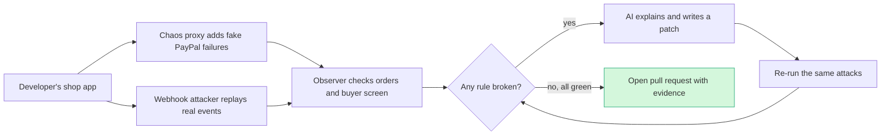

# #56 Integration Chaos Monkey: deep dive (round 2)

> [!tldr] In one breath
> Developers usually test the "payment worked" path and forget the dozens of ways a payment can fail. This tool makes the PayPal sandbox throw real failures at a running shop (card declined, duplicate webhooks, server errors), shows the broken orders, has an AI write the fix, and re-runs the attack until it goes green. **Verdict: advance with changes. Final score 80/120 (desk 90). Tier B, rank 5.**

> [!example] Picture this
> A fire drill for a shop's checkout. PayPal's own `/paypal:doctor` is the inspector who reads the building plans and says "your exits look fine". Chaos Monkey actually sets off the alarm, sends fake smoke down the corridor, and films people getting stuck at a locked door. Then it fixes the door and runs the drill again to prove everyone gets out.

> [!info] How to read the marks
> Idea note: [[I056 Integration Chaos Monkey]]. ✅ means a primary source was read directly. ⚠️ means secondary, vendor or single source. ❌ means unverified. `⚠ inference` marks a judgment call.

> [!success] Crowd check, Oct 23 2026
> Developer tooling for PayPal integrators is **nearly empty** in the 266 repo scan (partial coverage). Only two look related: **cutover** (an AI that migrates legacy NVP, checkout.js and IPN code to Orders v2 and JS SDK v6, verified in sandbox) and **paypal-webhook-simulator**. hearthline uses the APIMatic SDK. Neither of the first two injects faults or opens a fix PR. **Thin territory, and APIMatic has 3 prizes with only 1 to 2 entries.** Source: [[17 Live Competition Scan (Oct 23)]].

## How it works

## 1. Verdict

**Advance with changes. The idea survives, but it is less new than round 1 assumed.** PayPal's own **AI-Toolkit `/paypal:doctor`** already scans a merchant codebase (reading it, not running it) for most of the bug types this tool would hunt: unhandled `INSTRUMENT_DECLINED`, missing `onError`/`onCancel`, no webhook signature verification, no `event_id` idempotency, missing `PayPal-Request-Id`, no 429/500 retry, no `debug_id` logging. It also prescribes fixes, and its `fix-all` mode applies them automatically. Its "live validation" only probes the happy path (auth, a $1 order, plan listing). It never injects a fault, replays a webhook or watches runtime behaviour. ✅ local `/home/claude/research/repos/AI-Toolkit/commands/doctor.md`.

**So the pitch that holds up is narrow and sharp: doctor reads your code; Chaos Monkey proves your running app survives PayPal's failure modes.** It injects real `PayPal-Mock-Response` faults and real signed webhook redeliveries into a running merchant app, watches outcomes (order state in the merchant DB, buyer UI, duplicate fulfilment), writes a patch, and re-runs to show red→green. That live loop that produces evidence is not done by doctor, Stripe audit skills, MockGateway, payfuzz or Autonoma (see §3). PayPal has also *announced* a "Merchant AI Integration Agent" that "upgrades and certifies integrations" (Ai4, Aug 2026, not shipped). That confirms the direction, but it means a judge may see this as a feature PayPal will ship.

## Scorecard at a glance

**Adjusted: [8, 7, 5, 6, 7, 7, 7] = 47/70** (was 53). **Final 80/120, desk 90.**

| Axis | Old | New | Reason |
|---|---|---|---|
| Tech | 8 | 8 | Orders (create, authorize, capture), Payments v2 (capture, void, refund), webhooks (resend + verify signature), optionally Subscriptions and Invoicing simulation triggers. The AI makes structured decisions: test plan, failure classification, code patch. Not ≥4 *business* capabilities beyond checkout, so not 9+. |
| Design | 7 | 7 | Clear persona (developer or agency before go live). The start state (red report) and end state (merged PR, green re-run) can be shown. It is a developer tool, so the experience is a CLI or GitHub Action plus a report page. |
| Impact | 6 | 5 | Only forum and bug tracker anecdotes (nopCommerce duplicate orders, OXID webhook races), PayPal's own docs stressing failure handling, and DevRel kickoff quotes. No measured rate of loss caused by integrations. Vendor only data. |
| Innovation | 8 | 6 | Close neighbours: `/paypal:doctor` (static + auto fix, same list of failures), Stripe `check-stripe`/`fix-stripe`/`stripe-audit` skills, payfuzz (adversarial webhook delivery fuzzing for payment handlers, Stripe), MockGateway (PayPal template with decline, timeout and webhook variants), Autonoma (agentic browser checkout tests), PayPal's announced Merchant AI Integration Agent. The combination of live PayPal sandbox fault injection, webhook redelivery and a verified PR is still unclaimed. |
| Demo | 8 | 7 | A red→green resilience score and a PR diff are easy to follow. But mock responses **don't change PayPal state** (they return canned errors), so the "PayPal state change" moment has to come from the webhook duplicate (two orders → one) or the decline → approve again path. |
| Feasibility | 8 | 7 | The header is verified on Orders v2 and Payments v2 endpoints. Unknowns: how to inject the header into a merchant's server SDK calls (a proxy is needed), whether resent webhooks keep `event_id` and verify, and whether captures on unapproved orders return the mock. General code repair across any repo is hard, so scope to Node/Express + v6 SDK. |
| Risk (inv.) | 8 | 7 | Negative testing is labelled "beta". There is a "doctor already does this" judge objection and an overlap with PayPal's announced agent. Sandbox flakiness affects live demos. |

## 2. Is the problem real?

**Yes, and PayPal itself keeps saying so. Hard numbers on the damage are missing.**

| Claim | Number / fact | Source | Conf |
|---|---|---|---|
| PayPal DevRel told entrants to test failure paths | "test the unhappy paths, not just the happy path… negative testing" (Eddie Jaoude, kickoff) | https://www.youtube.com/watch?v=FFJfCW9z3Do (via raw/B) | ✅ (transcript in research files) |
| PayPal's own starter repo warns failure handling is commonly missed | "A real integration has to handle more than the happy path… Build and verify each branch before a real customer hits it." | https://github.com/paypaldev/getting-started-with-paypal-sandbox (local clone README L175-241) | ✅ |
| PayPal ships a static checker for exactly these bugs, which implies they are common enough to build a product for | doctor flags `INSTRUMENT_DECLINED` not handled = CRITICAL; webhook without verify = CRITICAL; no event_id idempotency = WARNING | local AI-Toolkit/commands/doctor.md | ✅ |
| Webhooks retry, so duplicates and late arrivals are normal | Non 2xx responses are retried "up to 25 times over 3 days" | https://developer.paypal.com/api/webhooks/overview (raw/A §3.8) | ✅ |
| Simulated webhooks can't be signature verified, so devs test verification badly | "You can only verify recent webhooks your particular client-id has received" | SO 66856761 (raw/A) | ⚠️ |
| Real merchant bug: one PayPal payment → two paid orders, webhook + `ORDER_ALREADY_COMPLETED` in logs | 2 orders 30 s apart, recurring over ~11 months | https://www.nopcommerce.com/fr/boards/topic/99335/paypal-commerce-duplicate-order-one-payment | ✅ |
| Real plugin bug: webhook vs order save race in OXID PayPal Checkout | Bug 0007534 (2023-09), duplicate of 0007539 | https://bugs.oxid-esales.com/view.php?id=7534 | ✅ |
| PayPal's own agent toolkit misses idempotency | `PayPal-Request-Id` never set per call | https://github.com/paypal/agent-toolkit/issues/98 | ✅ |
| APIMatic (sponsor) argues generated code "only works for the happy flows" | vendor claim in webinar | https://youtu.be/zRWixN68tDg (raw/B) | ⚠️ |

**What users say**
1. nopCommerce merchant: "I suspect it is something to do with the fact that the order is taking so long to complete once confirmed." (duplicate paid orders from one PayPal payment). https://www.nopcommerce.com/fr/boards/topic/99335/paypal-commerce-duplicate-order-one-payment ✅
2. OXID tracker: "The order is correctly in OXID in both cases, but there are the confusing log entries." (webhook and capture race). https://bugs.oxid-esales.com/view.php?id=7534 ✅
3. SO: "PayPal Webhooks Not Received on Production Server (but working via ngrok…)". https://stackoverflow.com/questions/79572615 ⚠️ (title via raw/A)
4. PayPal starter repo: "Turn Negative Testing back off… it's easy to forget and later looks like a broken integration." (the official tooling itself is a trap). ✅ local clone

Gap ⚠ inference: there is no measured evidence (e.g. % of merchants with broken decline handling, or revenue lost). Impact stays mid scale. The judges' own stated values carry the "why it matters" argument more than independent data.

## 3. Who else does this?

Queries run (≈20): "PayPal-Mock-Response mock_application_codes list…"; "AI agent tests payment integration failure paths declines webhooks opens pull request" (ext); "payment gateway integration testing tool startup simulate declines webhook retries chaos" (ext); "devpost PayPal sandbox negative testing PayPal-Mock-Response project"; "Stripe AI integration review tool checks error handling webhooks…"; "AI fault injection third-party API … Keploy Schemathesis Microcks chaos" (ext); "\"PayPal\" integration test harness OR chaos OR fuzz github…"; "\"Stripe.js testing assistant\"…"; "Postman PayPal collection negative tests…"; "PayPal \"Merchant AI Integration Agent\""; "Speakeasy generated contract tests…"; "devpost hackathon payment integration testing agent unhappy path…" (ext); Devpost search "paypal testing"; plus pain searches (SO, GitHub, reddit, community).

**Each rival does one piece. Nobody found does live PayPal faults plus a fix gated on a green re-run.**

| Name | Type | What it does | Overlap | URL | Conf |
|---|---|---|---|---|---|
| PayPal AI-Toolkit `/paypal:doctor` | Platform feature (OSS plugin) | Static codebase scan against PayPal's list of failures; prescriptions; `fix-all` applies them automatically; live probes cover the happy path only | **High** (failure list + fix); misses live injection | https://github.com/paypal/AI-Toolkit (commands/doctor.md) | ✅ |
| PayPal `/paypal:explain-error` | Platform feature | Explains an error code with a handling code sample | Medium (diagnosis step) | same repo | ✅ |
| PayPal "Merchant AI Integration Agent" | Announced platform feature | "Upgrades and certifies integrations, runs on merchant infrastructure" | Medium to high (direction), not shipped | https://newsroom.paypal-corp.com/2026-08-10-PayPal-Takes-Center-Stage-at-Ai4-2026 | ✅ (announcement; details ❌) |
| PayPal Simulation Tests | Platform feature (limited release) | Trigger IDs and mock header for Disputes, Invoicing, Subscriptions, Orders, Payments negative responses | Low (raw capability we'd use) | https://developer.paypal.com/limited-release/commerce-platform/v2/test-go-live/simulation-tests/ | ✅ |
| Stripe `check-stripe` / `fix-stripe` / `stripe-audit` skills | OSS agent skills | Agent audits a Stripe integration and fixes it | Medium (same "audit + fix" mechanism, static, Stripe) | https://playbooks.com/skills/phrazzld/claude-config/check-stripe | ⚠️ |
| Stripe CLI `stripe trigger`, test clocks, test cards | Platform feature | Fire webhook events; simulate time for subscriptions; decline cards | Medium (Stripe's equivalent building blocks; no AI, no fix) | https://docs.stripe.com/automated-testing | ⚠️ |
| payfuzz | OSS (0★, 2026) | Adversarial webhook delivery (duplicate, concurrent, delay, timeout then retry, forged signature), checks ledger invariants; CI gate | **Medium to high** for the webhook half; Stripe only, no AI, no fix | https://github.com/Subhooo5/payfuzz | ✅ |
| MockGateway | Product (free tier) | Mock gateways incl. a **PayPal** template; choose success, decline, timeout, 3DS or webhook variants; CLI trigger | Medium (fault menu); no real sandbox, no AI, no fix | https://mockgateway.com/ | ✅ (vendor page) |
| Autonoma | Product (agentic E2E) | AI agents drive a real browser through Stripe checkout on every PR | Medium (browser walk); no PayPal, no fault injection, no fix PR | https://getautonoma.com/blog/payment-gateway-testing | ⚠️ |
| Keploy | OSS/product | Records traffic, AI generates API tests and dependency mocks | Low to medium | https://keploy.io/ | ⚠️ |
| MockServer chaos / Toxiproxy / Gremlin / Steadybit | OSS/product | Generic latency and error injection | Low (no PayPal meaning) | https://www.mock-server.com/mock_server/chaos_testing.html | ⚠️ |
| Schemathesis / Microcks | OSS | Fuzzing from a spec, or mocking *your own* API | Low | https://schemathesis.io , https://microcks.io | ❌ (not checked again) |
| Speakeasy SDK contract testing | Product | Generates contract tests for SDKs vs the API spec | Low (provider side) | https://www.speakeasy.com/docs/sdk-contract-testing | ⚠️ |
| Postman (collections, monitors, flows) | Product | Scripted API tests incl. any header | Low to medium (manual; PayPal has an official collection) | raw/B kickoff 14:20 | ⚠️ |
| CodeRabbit / Copilot coding agent / Sweep | AI PR bots | Review or patch code from issues | Low to medium (PR mechanics, no runtime evidence) | ❌ (not checked again) |
| Devpost "Built with PayPal" | Devpost entries | Search "paypal testing": only "PayPal Agentic Checkout Gateway" and "AGENT GATE" (mentions duplicate charge recovery); no QA or chaos tool found | Low | https://devpost.com/software/search?query=paypal%20testing | ✅ |

## 4. What is actually new

* **Not new:** a list of PayPal failures (doctor has it); static detection and auto fix (doctor, Stripe skills); mock gateways with decline and timeout menus (MockGateway); adversarial webhook redelivery (payfuzz); agentic browser checkout tests (Autonoma); the "resilience score" concept (generic chaos tools).
* **New (as far as ≈20 searches show):** running a merchant's real app against the **real PayPal sandbox** with faults injected through headers on its own server calls, plus **real signed webhook redeliveries**, watching what happens at runtime, and only accepting an AI patch after a **re-run goes green**. Plus coverage of Subscriptions, Invoicing and Disputes simulation triggers that no third party tool uses.
* **Sharpest one liner:** *"`/paypal:doctor` tells you what your code probably gets wrong; Chaos Monkey makes PayPal actually fail at your running app, shows you the broken order, and only opens the PR once the same attack passes."* Positioning it as a **complement to doctor** (even shipping it as a `/paypal:chaos` command contributed to AI-Toolkit) turns the overlap into insider fluency, which the judges value (raw/B §9).

## 5. Can it be built in the PayPal sandbox?

**Verified capabilities**
* `PayPal-Mock-Response: {"mock_application_codes":"<CODE>"}`, sandbox only (`api-m.sandbox.paypal.com`). Supported endpoints ✅ https://developer.paypal.com/negative-testing/request-headers:
  * Orders v2: create, update (PATCH), show, authorize, capture.
  * Payments v2: show auth, capture auth, void auth, show capture, refund capture, show refund.
  * Payments v1: create, execute.
* Codes come from the Orders and Payments error references (≈200+ issue names). The most useful chaos set is:
  * Capture and authorize: `INSTRUMENT_DECLINED`, `PAYER_ACTION_REQUIRED`, `TRANSACTION_REFUSED`, `PAYMENT_DENIED`, `ORDER_NOT_APPROVED`, `ORDER_ALREADY_CAPTURED` / `ORDER_COMPLETED_OR_VOIDED`, `ORDER_EXPIRED`, `MAX_NUMBER_OF_PAYMENT_ATTEMPTS_EXCEEDED`, `DUPLICATE_INVOICE_ID`, `PAYER_CANNOT_PAY`, `CARD_EXPIRED`, `AMOUNT_MISMATCH`, `PREVIOUS_REQUEST_IN_PROGRESS` (409), `INTERNAL_SERVER_ERROR` (500).
  * Payments v2: `AUTHORIZATION_ALREADY_CAPTURED`.
  * ✅ https://developer.paypal.com/api/rest/reference/orders/v2/errors/ ; ✅ simulation tests page.
* Simulation triggers (limited release doc) ✅ https://developer.paypal.com/limited-release/commerce-platform/v2/test-go-live/simulation-tests/:
  * Disputes `ERRDIS0xx`: `RATE_LIMIT_REACHED`, `SERVICE_UNAVAILABLE`…
  * Invoicing `ERRINV0xx`: `CANT_PAY_AN_PAID_OR_CANCELED_INVOICE`…
  * Subscriptions `ERRSUB0xx`.
* Account level Negative Testing toggle (beta): useful for failing a whole flow through the hosted button. ✅ starter README; https://developer.paypal.com/tools/sandbox/negative-testing/
* Webhooks: retries 25× over 3 days; verify via `POST /v1/notifications/verify-webhook-signature`; dashboard resend; Webhooks Simulator events are **not** verifiable. ✅/⚠️ raw/A §3.8

**Architecture (⚠ inference)**
1. **Chaos proxy**: a local HTTPS reverse proxy in front of `api-m.sandbox.paypal.com`. It adds `PayPal-Mock-Response` per a test plan, keyed by endpoint plus call index, and also injects latency, a 500 or a dropped connection. The merchant app points its PayPal base URL at the proxy via an env var. Fallback: an SDK interceptor or monkey patch of `fetch`.
2. **Webhook attacker**: captures real sandbox webhook deliveries to the merchant endpoint (tunnel). It then (a) re-POSTs them byte identical, so duplicates and replays still carry valid transmission headers, (b) reorders them (e.g. `PAYMENT.CAPTURE.COMPLETED` before the order row exists), (c) sends a forged or unsigned copy (expect reject), and (d) triggers official resends via `POST /v1/notifications/webhooks-events/{id}/resend`.
3. **Observer**: queries the merchant's DB or API for invariants: one order per PayPal order id, no fulfilment on DENIED/PENDING, buyer shown a retry on `INSTRUMENT_DECLINED`, `debug_id` logged. A headless browser (Playwright locally; KERNEL optional for recorded replays) handles the buyer UI checks on the v6 button flow.
4. **Agent**: plans scenarios from a static scan (reuse doctor's failure list), classifies each failure, writes a patch, re-runs only the failing scenarios, and opens a PR with the before and after evidence table.

**Day 1 tests (must pass or redesign)**
1. `POST /v2/checkout/orders/{id}/capture` with mock `INSTRUMENT_DECLINED` on an **unapproved** order: does it return the mock 422, or `ORDER_NOT_APPROVED`? This decides whether a browser approval is needed per scenario.
2. Mock header on `POST /v2/checkout/orders` (create) with `INTERNAL_SERVER_ERROR`: confirm a 500 class mock works, for retry and idempotency tests.
3. Byte identical replay of a captured signed webhook → `verify-webhook-signature`: does it return `SUCCESS` again? If yes, replay protection is a real finding to demo. Then call `POST /v1/notifications/webhooks-events/{id}/resend`: is the `id` unchanged?
4. Does `@paypal/paypal-server-sdk` (generated by APIMatic) allow a custom base URL? If not, use `HTTPS_PROXY` plus a trusted local CA.
5. Simulation trigger IDs (`ERRSUB0xx`) on a standard sandbox app: do they work outside the "commerce platform" limited release?

**Sponsor tools that help:** APIMatic Context Plugin (eligible for $1k; the patch generator writes idiomatic server SDK error handling, which is their "beyond happy flows" pitch). KERNEL ($50 credits, no prize) for recorded browser replays as PR evidence. Render to host the report dashboard. Postman collection as a seed for the scenario catalogue.

## 6. What the AI does

**The AI plans, diagnoses and patches. The pass or fail verdict is plain code.**

* **Decides:**
  * which scenarios apply to this codebase (structured `TestPlan[]`: endpoint, mock code, call index, expected invariant);
  * the root cause of each failure (`{scenario, observed, invariant_violated, file, line, category}`);
  * the patch (unified diff) plus an explanation linked to the PayPal doc anchor (the `links[].href` in the error body).
* **Deterministic and guarded:** fault injection, invariant checks and the pass or fail verdict are code, not LLM. The PR is opened only if the re-run passes and the existing tests pass. Use a sandbox only allowlist: the proxy refuses `api-m.paypal.com`. Never touch secrets; reuse doctor's redaction rule.
* **Model:** Claude (Agent SDK) for reading and patching the repo, with structured outputs. A small model is fine for log classification.

## 7. MVP scope (4.5 weeks)

* **Must:**
  * a reference "Buggy Bakery" Node/Express + v6 SDK shop with 4 planted bugs: retries the same card on decline; no webhook idempotency, so duplicate orders; fulfils on `PENDING`; no `PayPal-Request-Id` on capture retry;
  * chaos proxy and webhook replayer;
  * 10 to 12 scenarios and an invariant checker;
  * agent patch, re-run and GitHub PR;
  * resilience report page.
* **Should:** GitHub Action mode; reuse doctor's static findings to prioritise; KERNEL replay video embedded in the PR; refund and void scenarios via Payments v2.
* **Could:** Subscriptions and Invoicing simulation triggers; run against one real OSS PayPal integration (e.g. an open source store plugin) to show it isn't only a toy; contribute `/paypal:chaos` to AI-Toolkit.
* **Week 1:** Day 1 tests, proxy, Buggy Bakery. **Week 2:** webhook attacker, invariants, report. **Week 3:** agent planning, patching, PR, re-run gate. **Week 4:** polish, real repo run, video. **Last days:** submission.

## 8. The 3 minute demo

* 0:00 to 0:20: the problem. Eddie's kickoff line "test the unhappy paths"; the nopCommerce "two paid orders from one payment" post.
* 0:20 to 0:45: `/paypal:doctor` runs on Buggy Bakery and passes most checks. "Static checks can't see races."
* 0:45 to 1:30: Chaos run. A live grid flips scenarios red: decline → buyer stuck on a spinner (browser clip); webhook replayed twice → **merchant admin shows two orders for one PayPal order id** (wow moment 1); `PENDING` fulfilled. Resilience score 41/100.
* 1:30 to 2:15: the agent explains each failure (doc links, `debug_id`), writes the patch, re-runs: scenarios go green, score 96. The PR opens on GitHub with an evidence table (wow moment 2).
* 2:15 to 2:45: PayPal sandbox dashboard: one capture, one order; approving again with a second funding source succeeds after the decline.
* 2:45 to 3:00: "Ship it as a GitHub Action / `/paypal:chaos`."

## 9. Risks and fixes

| Risk | Mitigation |
|---|---|
| "Doctor already does this" | Lead with doctor passing while chaos fails; frame it as the complement; reuse doctor's failure list openly |
| PayPal announced its own integration agent | Position as an open tool that lives in CI and puts evidence first; cite the announcement as validation |
| Mock header behaviour differs from docs (beta) | Day 1 tests; fall back to account level negative testing and decline test cards |
| Simulated webhooks not verifiable | Use only real captured deliveries plus the resend API |
| AI patch breaks generic repos | Scope to Node/Express + v6; PR gated on a green re-run + existing tests |
| Impact for "just developers" | Put money on each scenario (duplicate fulfilment, lost sale on decline); agencies running many merchant integrations |
| Mocked errors don't visibly change PayPal state | Make the webhook duplicate and decline→retry the visual anchors |

## 10. Sources

* PayPal negative testing (request headers): https://developer.paypal.com/negative-testing/request-headers ✅
* Negative testing overview (beta, Classic API note): https://developer.paypal.com/tools/sandbox/negative-testing/ ✅
* Orders v2 errors: https://developer.paypal.com/api/rest/reference/orders/v2/errors/ ✅
* Handle API responses: https://developer.paypal.com/api/handle-api-responses.md ✅
* Simulation tests (limited release): https://developer.paypal.com/limited-release/commerce-platform/v2/test-go-live/simulation-tests/ ✅
* Starter repo (local clone): https://github.com/paypaldev/getting-started-with-paypal-sandbox ✅
* AI-Toolkit doctor / explain-error (local clone): https://github.com/paypal/AI-Toolkit ✅
* Ai4 2026 announcement: https://newsroom.paypal-corp.com/2026-08-10-PayPal-Takes-Center-Stage-at-Ai4-2026 ✅
* payfuzz: https://github.com/Subhooo5/payfuzz ✅
* MockGateway: https://mockgateway.com/ ✅
* Autonoma: https://getautonoma.com/blog/payment-gateway-testing ⚠️
* Stripe skills: https://playbooks.com/skills/phrazzld/claude-config/check-stripe ⚠️ ; Stripe testing: https://docs.stripe.com/automated-testing ⚠️
* Keploy: https://keploy.io/ ⚠️ ; MockServer chaos: https://www.mock-server.com/mock_server/chaos_testing.html ⚠️ ; Speakeasy: https://www.speakeasy.com/docs/sdk-contract-testing ⚠️
* nopCommerce duplicate order: https://www.nopcommerce.com/fr/boards/topic/99335/paypal-commerce-duplicate-order-one-payment ✅
* OXID bug 7534: https://bugs.oxid-esales.com/view.php?id=7534 ✅
* agent-toolkit #98: https://github.com/paypal/agent-toolkit/issues/98 ✅
* Kickoff: https://www.youtube.com/watch?v=FFJfCW9z3Do ✅ (via raw/B)
* Devpost search: https://devpost.com/software/search?query=paypal%20testing ✅

> [!info]- Jargon decoder
> **Chaos testing / Chaos Monkey**: breaking things on purpose to see if a system copes, named after Netflix's tool that randomly switched off servers. A fire drill for software.
> **Happy path vs unhappy path**: the happy path is "everything works". Unhappy paths are the declines, timeouts and duplicates that real life throws at you.
> **Negative testing / `PayPal-Mock-Response`**: a special header that makes the PayPal sandbox pretend a failure happened, like a stunt double taking the fall.
> **Static scan vs runtime test**: reading the recipe versus actually cooking the dish and tasting it. Doctor reads; Chaos Monkey cooks.
> **Webhook**: PayPal ringing your server's doorbell when something happens. It may ring twice, late, or out of order, and your code has to cope.
> **Signature verification**: checking a webhook really came from PayPal, like checking the seal on a letter.
> **Idempotency (`event_id`, `PayPal-Request-Id`)**: handling the same message twice without doing the action twice. One doorbell ring, one parcel, even if the courier rings again.
> **Race condition**: two things happening at nearly the same moment and stepping on each other, like two people grabbing the last seat.
> **Reverse proxy**: a middleman that sits between your app and PayPal and can quietly change messages in transit.
> **Invariant**: a rule that must always be true, such as "one PayPal order means one shop order".
> **Pull request (PR)**: a proposed code change that someone reviews before it goes in.
> **Unified diff**: the standard "these lines removed, these lines added" view of a code change.
> **Headless browser (Playwright)**: a real browser run by a script without a screen, used to click through checkout automatically.
> **`debug_id`**: PayPal's tracking number for a failed request, which support needs to look it up.
> More in [[Jargon Decoder]].

## Where to next
* ⬆️ Up: [[50 Top 10 Overview]]
* 🔗 Idea note: [[I056 Integration Chaos Monkey]]
* ⬅️ Previous: [[D055 Payout Failure Triage (Deep Dive)]] · ➡️ Next: [[D084 Accessible Voice Checkout (Deep Dive)]]
* 🔗 Final pick: [[70 The Winning Idea]]
* 🔗 Related: [[17 Live Competition Scan (Oct 23)]], [[63 Day-1 Sandbox Test Plan]], [[Jargon Decoder]]
