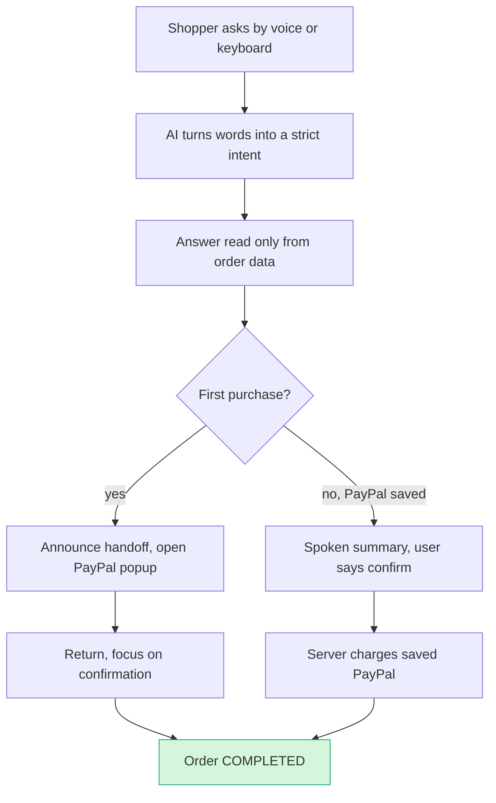

# #84 Accessible Voice Checkout: deep dive (round 2)

> [!tldr] In one breath
> Blind and low vision shoppers struggle with checkout pages, and every AI shopping study so far stops right before the payment step. This idea designs that payment step for voice and screen readers on top of PayPal. **Verdict: demote as a standalone. Final score 75/120 (desk 88).** Keep it as the accessibility pillar of a shopping or agent checkout build.

> [!example] Picture this
> Ana is blind and uses a screen reader. She asks, "what's in my cart and what's the total with shipping?" and hears an answer read straight from the order, not guessed. When she pays, the app tells her "Opening PayPal in a new window; you'll return here" before the popup appears, and when she comes back it lands her on "Payment approved, order captured." Next time she buys, she just says "confirm" to a clear spoken summary, and no popup appears at all.

> [!info] How to read the marks
> Idea note: [[I084 Accessible Voice Checkout]]. ✅ means a primary source was read directly. ⚠️ means secondary, vendor or single source. ❌ means unverified. `⚠ inference` marks a judgment call.

> [!success] Crowd check, Oct 23 2026
> Accessibility first payments had **ZERO hits** in the 266 repo scan (partial coverage), even though "accessible donations" is on PayPal's own Inspiration list. That makes it the emptiest relevant area found. A few voice shopping repos exist in the chat to checkout cluster (sahaya, shopvoice-pay) and kincart targets elderly relatives with family approval, but none are built for screen reader users. **Wide open lane. That does not undo the demotion reasons below, but it makes this pillar more valuable inside another build.** Source: [[17 Live Competition Scan (Oct 23)]].

Analyst pass: 2026-10-12. Budget used: about 22 searches and 12 fetches.

## How it works

## 1. Verdict

**Demote as a standalone entry. Salvage it as the accessibility pillar of a shopping or agent checkout finalist.**

**The social case is real and well evidenced.** 95.9% of top home pages fail WCAG. Shopping pages are the second worst of 31 categories. The EAA has put e-commerce services in scope since 28 Jun 2025. About 70% of more than 5,000 US digital accessibility suits filed in 2025 targeted e-commerce. The idea fails on the two axes that decide this hackathon, and on one structural fact.

1. **The PayPal approval window is a hard wall.** In JS SDK v6, approval runs in a PayPal hosted, cross origin popup, modal or redirect. A third party layer cannot read it, re-label it, drive it or voice it, and it should not try (that is overlay behaviour, and the FTC fined accessiBe $1M for overlay claims). The layer can make everything *around* approval accessible: cart, totals, Pay Later, shipping and confirmation. It can manage focus and announcements across the handoff. It cannot make the approval step itself accessible. PayPal says its own pages support VoiceOver, JAWS and NVDA with logical focus order (⚠️ PayPal help article). So the honest pitch is "we make the merchant side accessible and hand off cleanly". That is a design quality story, not a new mechanism.
2. **Tech depth is thin.** The core loop is Orders create and capture plus a v6 PayPal session plus, optionally, Pay Later messaging. On the brief's anchor that is about 5. Tech is the first tie breaker. The one lever that adds depth and removes the popup on repeat purchases is **vaulting**: save PayPal once via `createPayPalSavePaymentSession`, then purchases confirmed by voice charge the vault token on the server. That is a real design idea, but it adds a consent burden for stored credentials and still needs one popup.
3. **Novelty has worn away.**
   * PayU launched an accessible checkout for blind users with voice command navigation (India, Aug 2026; no AI).
   * Be My Eyes and InnoSearch ship an AI accessible shopping portal over 500k retailers (May 2025).
   * CHI '26 published a study of a voice computer using agent for blind shoppers. It *excluded payment*: a gap, but also proof the space is being studied.
   * Kalon on Devpost (2023) built an AI voice shopping assistant for visually impaired users "from searching to checking out".
   * Agentic browsers (Comet, Atlas) are being evaluated as assistive technology.
4. **Judge risk cuts both ways.** Jo Franchetti ("teaching good use of the web") and Sylwia Vargas (web accessibility is a listed topic; she is a sponsor judge for AG Grid) will reward genuine a11y. They will also spot any WCAG defect, overlay smell or demo that only works with a mouse. Only Jo is on the Grand prize path for PayPal. Sylwia's lens matters only if AG Grid is used meaningfully, and it does not fit this idea naturally.

## Scorecard at a glance

**Adjusted scores** `[tech, design, impact, innovation, demo, feasibility, risk]`: **[5, 8, 6, 5, 7, 7, 6]** (was [7, 9, 6, 7, 8, 7, 7]). The sum falls from 51 to 44. **Final 75/120, desk 88.**

| Axis | Old | New | Reason |
|---|---|---|---|
| Tech | 7 | **5** | Checkout + Orders (+ Messages, + optional Vault). The AI parses intent and answers grounded questions, but makes no structured payment decision that matters. Matches the "checkout + one API" anchor. It reaches 6 only if vault and reconfirm plus a voice refund or return (Refunds API) are in the core loop. |
| Design | 9 | **8** | The persona and full flow are excellent. The demo must cross a PayPal surface the team does not control, and the screen reader experience there is PayPal's, not theirs. |
| Impact | 6 | 6 | Evidence of how common the problem is is strong: WebAIM ✅, EAA ✅, FTC ✅. Lawsuit counts are vendor data ⚠️. Harm data specific to payments is still missing; the last measured loss figure is the 2019 Click-Away Pound ❌. |
| Innovation | 7 | **5** | PayU accessible checkout (2026), Be My Eyes/InnoSearch (2025), Kalon (Devpost 2023), CHI '26 voice CUA shopping, agentic browsers as assistive technology. The new part is narrow: an accessible conversational layer *plus* PayPal v6 handoff plus voice reconfirmation using the vault. |
| Demo | 8 | **7** | Screen reader audio is memorable. The PayPal state change happens in a popup that is visual and styled by PayPal. 3 minutes of TTS is slow, so it needs captions and speed up. |
| Feasibility | 7 | 7 | Everything except vault is standard. Vault in v6 needs a `clientToken`, so test on Day 1. Real a11y engineering (NVDA + VoiceOver testing) takes time but is doable. |
| Risk | 7 | **6** | PayPal popup a11y is outside the team's control. "Overlay" association. Expert judges will expose any defect. Thin PayPal usage risks Jo's "PayPal button on an unrelated app" critique. |

## 2. Is the problem real?

**Yes. Inaccessible shopping is widespread and now a legal issue. Payment specific loss data is the gap.**

| Claim | Number | Source | Conf |
|---|---|---|---|
| Home pages with detected WCAG failures | 95.9% (2026), up from 94.8% | https://webaim.org/projects/million/ | ✅ (via D_problem_evidence.md) |
| Shopping category average errors per page | 71.0 (2nd worst of 31) | same | ✅ |
| Pages with missing form input labels | 51% | same | ✅ |
| Platform averages | Shopify 75.1, Magento 75.8, PrestaShop 143.2 errors per page | same | ✅ |
| People with significant disability worldwide | ~1.3B (16%) | WHO Global report on health equity for persons with disabilities (2022), https://www.paho.org/en/documents/global-report-health-equity-persons-disabilities-executive-summary | ⚠️ (search snippets only; the WHO fact sheet was not opened) |
| EAA scope | "E-commerce services (buying and selling products and services online via a website or mobile application)"; enforceable from 28 Jun 2025; microenterprises (<10 staff, <€2M) partly exempt; penalties set by Member States | https://www.traverssmith.com/knowledge/knowledge-container/a-new-milestone-for-accessibility-the-european-accessibility-act-now-applies/ | ✅ (law firm, read directly) |
| US digital accessibility suits in 2025 | ">5,000"; e-commerce "nearly 70%"; purchasing and ordering workflows draw litigation | https://blog.usablenet.com/ada-web-lawsuit-trends-2026 | ⚠️ (vendor) |
| Widget or overlay sites still sued in 2025 | Monthly chart sums to ~1,416 suits against widget users (analyst's sum; <~28%) | same | ⚠️ / `⚠ inference` |
| FTC v. accessiBe | $1M; barred from claiming an automated tool makes any site WCAG compliant; deceptive undisclosed reviews. Proposed Jan 2025, final order approved 3-0 | https://www.ftc.gov/node/88115 | ✅ |
| India RBI accessibility mandate for payments | Oct 2024 RBI mandate, BIS IS 17802; PayU's response | https://ibsintelligence.com/ibsi-news/payu-launches-accessible-checkout-for-digital-payments/ | ⚠️ |
| Lost sales among disabled users, specific to payments | **No recent figure.** Click-Away Pound £17.1B is from 2019 | D_problem_evidence.md | ❌ gap |

**What users say**
1. AppleVis, "Chris", 9 Aug 2018, on the PayPal iOS app: options in the account list are "not spoken when you flick to the choices"; "VoiceOver does not speak that this item is selected"; "the back button is not labeled." https://applevis.com/forum/ios-ipados/paypal-accessibility-issues ✅ This is old and about the PayPal app, not v6 web, so it is weak evidence.
2. CHI '26 participants (12 blind or severe low vision Korean adults) repeatedly asked for double checks before cart additions because "voice interaction leaves no visual trace". They raised trust and privacy concerns about handing payment stage decisions to an agent, and wanted at most 3 options with key details first. Shin et al., DOI 10.1145/3772318.3791681, review page https://a11y-paradise.onrender.com/reviews/69e63e5f5570d11947cedf8f ⚠️ (secondary summary; paper not opened)
3. Low vision expert using Perplexity Comet (Politecnico di Milano, May 2026): the agent "inserted fabricated data into the fields without asking for confirmation" and "chose one [option] on his behalf". https://arxiv.org/html/2606.24870v1 ✅ This directly supports the "confirm as statements, never act silently" design.
4. Double Tap (AT podcast), 23 Oct 2025: ChatGPT Atlas rated 1/10 for screen reader access ("unlabelled buttons, inaccessible onboarding"). https://doubletaponair.com/chatgpt-atlas-accessibility-why-blind-users-should-wait/ ✅ This shows AI shopping tools are themselves often inaccessible.
5. paypal-js #1028: "[Bug] Web SDK v6 Card Fields have incorrect Tab order in Safari". Pressing Tab after the card number moves focus out of order. https://github.com/paypal/paypal-js/issues/1028 ✅ (title and passage via developer index; state not checked because the GitHub API was blocked in this session)

## 3. Who else does this?

Queries run (selection):
* "PayPal checkout accessibility screen reader popup VoiceOver problems"
* "AI agent assistive technology blind shoppers online shopping 2025 study" (extended)
* "Toward Independent Online Shopping…" arxiv
* "Be My Eyes Be My AI online shopping checkout partnership 2025"
* "devpost accessible checkout voice screen reader payment hackathon blind"
* site:devpost.com accessible shopping voice assistant blind…
* "blind users agentic browser AI agent buy online checkout accessibility Comet OR Atlas OR Operator" (extended)
* "Aira OR Envision Ally online shopping…"
* "Shopify checkout accessibility WCAG 2.2 AA…"
* "Amazon Alexa+ voice shopping blind accessibility…"
* "paypal-js Web SDK v6 accessibility screen reader focus tab order" (developer index)
* FTC accessiBe
* ADA lawsuit 2025 counts (extended)
* EAA e-commerce
* WebAIM Million 2026 shopping

**Outside the hackathon, PayU and Be My Eyes are close. Inside it, nobody.**

| Name | Type | What it does | Overlap | URL | Conf |
|---|---|---|---|---|---|
| PayU Accessible Checkout | Product (India, Aug 2026) | Payment gateway checkout tuned for screen readers, voice command navigation, adaptive profiles, contrast modes, 200% text; no merchant integration change; no AI | **High** (accessible checkout as a gateway feature) | https://ibsintelligence.com/ibsi-news/payu-launches-accessible-checkout-for-digital-payments/ | ⚠️ |
| Be My Eyes × InnoSearch.ai | Product (May 2025) | AI accessible shopping portal inside Be My Eyes; 500k+ retailers, flights; US/CA/UK/AU; checkout location unclear | **High** (conversational accessible shopping) | https://www.bemyeyes.com/?p=21193302 | ✅ |
| Shin et al., CHI '26 | Paper | Voice based computer using agent (Operator) for blind shoppers; Wizard of Oz; **payment excluded**; design implications | Medium (confirms need; leaves the payment gap open) | DOI 10.1145/3772318.3791681 | ⚠️ |
| Colazzo & Anzillotti 2026 | Paper (arXiv 2606.24870) | Comet agentic browser as assistive technology, low vision expert case study | Medium | https://arxiv.org/html/2606.24870v1 | ✅ |
| arXiv 2509.01246 | Paper | AI shopping assistant system for the visually impaired | Low to medium (not read) | https://arxiv.org/abs/2509.01246 | ❌ |
| Salous et al., IJCAI-26 demo | Paper | Multimodal haptic + voice online shop for blind users; no checkout | Low | https://www.ijcai.org/proceedings/2026/0991.pdf | ✅ |
| Kalon | Devpost entry (2023) | AI voice shopping assistant for visually impaired users, "from searching to checking out"; Whisper; no PayPal | Medium | https://devpost.com/software/kalon | ✅ |
| Shopify Checkout | Platform feature | Publishes a WCAG conformance report (VPAT) for checkout | Medium (checkout a11y is already a platform responsibility) | https://www.shopify.com/accessibility/vpat-checkout | ⚠️ (not opened) |
| PayPal's own a11y | Platform | Claims logical focus order and VoiceOver/JAWS/NVDA support; v6 card fields docs include a "check your site for accessibility by keyboard and screen reader" production checklist | Medium (PayPal owns the approval step a11y) | https://www.paypal.com/li/cshelp/article/how-does-paypal-provide-accessible-services-to-people-with-access-needs-help415 ; https://docs.paypal.ai/payments/methods/cards/js-sdk-v6-card-fields-one-time | ⚠️ |
| accessiBe / UserWay | Overlay products | Auto fix widgets; FTC $1M order vs accessiBe | Low as mechanism, **high as reputational trap** | https://www.ftc.gov/node/88115 | ✅ |
| Aira (Target, Wegmans, Meijer) | Human visual interpreters | Remote sighted assistance paid for by retailers | Low | https://aira.io/target | ⚠️ |
| Alexa voice shopping | Platform | Voice reorder and purchase with confirmation (Amazon only) | Medium (voice purchase exists, but closed) | (no fresh primary read) | ❌ |
| Early "Built with PayPal" entries (~72) | Devpost | No accessibility first entry seen in the clusters in B_event_sponsors_judges.md | none | https://devpost.com/software/built-with/paypal | ⚠️ (from earlier sweep) |

## 4. What is actually new

* **Not new:** accessible checkout (PayU, Shopify VPAT, PayPal's own claims); AI conversational shopping for blind users (Be My Eyes/InnoSearch, Kalon, CHI '26); voice purchase with confirmation (Alexa).
* **Narrowly new:**
  * (a) An accessible conversational layer on **PayPal JS SDK v6** with a designed **focus and announcement contract across the approval handoff**. Before opening, the layer speaks: "Opening PayPal in a new window; you'll return here." On return it moves focus to an `aria-live` summary.
  * (b) **Vault, then voice reconfirm.** After a one time save, repeat purchases need no third party UI at all; they are confirmed by a spoken summary, phrased as statements and grounded in the server side order.
  * (c) The **payment step gap** the CHI '26 paper explicitly left open.
* **Sharpest one liner:** "Blind shoppers can now get AI help finding products, and every study stops at the payment step. We designed the payment step: grounded read-back, statement-form confirmation, and a returning-buyer PayPal vault so no inaccessible page stands between intent and purchase."

## 5. Can it be built in the PayPal sandbox?

**Mostly standard parts. The vault step is the one to prove on Day 1.**

Sequence:
1. Server: `POST /v1/oauth2/token`. Client token for v6 (needed for vault).
2. Client: load `https://www.sandbox.paypal.com/web-sdk/v6/core`, then `createInstance({clientToken, components:["paypal-payments","paypal-messages"]})`, then `findEligibleMethods()`.
3. Cart Q&A: the server is the single source of truth (cart JSON → `POST /v2/checkout/orders` with itemised `purchase_units.items`, `amount.breakdown`). The LLM only reads from it.
4. First purchase: `createPayPalOneTimePaymentSession({onApprove,onCancel,onError})`, then `session.start({presentationMode:"popup"}, createOrderPromise)` (it must get a **Promise**). Before opening, announce via `aria-live="assertive"` and keep a visible, focusable "Return to checkout" status. On `onApprove`, `POST /v2/checkout/orders/{id}/capture` and move focus to the confirmation heading. Handle `onCancel` and popup blocked paths (the unhappy paths Jo asked for).
5. Returning buyer (the differentiator): `createPayPalSavePaymentSession` (vault with or without purchase), then `POST /v3/vault/payment-tokens`. Later orders use `payment_source.paypal.vault_id` with capture on the server after voice reconfirmation. No popup.
6. Pay Later: render `<paypal-message>`. Its text sits inside the PayPal component and may not be readable to the layer, so speak a Pay in 4 amount computed on the server. Do not paraphrase PayPal's regulated copy.
7. Optional depth: refund started by voice (`POST /v2/payments/captures/{id}/refund`), shipping change via `PATCH /v2/checkout/orders/{id}`.

**Day 1 tests**
* (i) Can v6 `createPayPalSavePaymentSession` run in sandbox with `clientToken`, and can a vaulted order then capture with no buyer interaction?
* (ii) In NVDA+Firefox, NVDA+Chrome and VoiceOver+Safari: where does focus land when the v6 popup opens and closes, and does `onApprove` fire reliably in sandbox (there is an unanswered SO report)?
* (iii) Does `presentationMode:"modal"` (an in page iframe?) trap focus correctly, or is popup better for screen readers?
* (iv) Is `<paypal-message>` text exposed to the accessibility tree?

**Sponsor tools:** none fit naturally. AG Grid would be decoration here, and Sylwia's a11y lens only counts if AG Grid is used.

## 6. What the AI does

**Moderate. It understands requests and phrases answers; it never computes money or acts silently.**

* **Speech to text → intent parsing** into a strict schema: `{intent: add|remove|query|change_qty|checkout|confirm|cancel, sku?, qty?}`. Validate with zod and ask again on low confidence.
* **Grounded cart Q&A.** Answers come only from order JSON (totals, tax, shipping, Pay Later instalment), with deterministic number formatting. The LLM never computes money.
* **Confirmations** written as plain statements ("You are buying 2 items for $54.20 total, paid with PayPal"), following the CHI '26 finding. Show and speak at most 3 options.
* **Guardrails:** the purchase itself is deterministic code, gated by an explicit "confirm" utterance plus a key press. No made up form data (the Comet failure).
* **Model:** a small, fast model for intent; speech in the device or browser (Web Speech) for STT and TTS is preferable, to respect the user's own screen reader rather than override it. `⚠ inference`: the honest AI contribution is moderate.

## 7. MVP scope (4.5 weeks), if pursued

* **Must:** accessible cart + conversational layer (keyboard first, works *with* NVDA/VoiceOver, not replacing them); v6 one time PayPal with announced handoff; capture; confirmation; cancel and popup blocked paths; tested with real screen readers; WCAG 2.2 AA audit report in the repo.
* **Should:** vault then voice reconfirm for repeat purchases; Pay Later amount read back; a session with at least 1 blind tester, quoted in the video.
* **Could:** voice refund; shipping change; EAA conformance statement generator.
* **Weeks:**
  * W1: Day 1 tests, a11y skeleton.
  * W2: intent schema + grounded Q&A.
  * W3: vault flow + unhappy paths.
  * W4: user test + audit.
  * W4.5: video.

## 8. The 3 minute demo

* **0:00 to 0:20:** Problem: WebAIM 95.9%, shopping pages 71 errors; "every AI shopping study stops at payment."
* **0:20 to 1:10:** NVDA audio with on screen captions: user asks "what's in my cart and what's the total with shipping?", and the read back comes from the order.
* **1:10 to 1:50:** Checkout: announced handoff to the PayPal popup; return; focus lands on "Payment approved, order captured."
* **1:50 to 2:30 (wow moment):** Returning purchase by voice with a vaulted PayPal: confirmation phrased as a statement. Split screen shows the sandbox order going `COMPLETED` with no third party UI.
* **2:30 to 3:00:** Tester quote, WCAG audit, EAA framing.

**PayPal state visible:** order `CREATED → APPROVED → COMPLETED`, vault token created.

## 9. Risks and fixes

| Risk | Mitigation |
|---|---|
| The approval window is outside the team's control | Say so explicitly. Design the handoff contract. Use vault to remove repeat popups. |
| Seen as an "overlay" | Never inject into third party DOM. Build the merchant's own UI accessibly. Cite the FTC order as what not to do. |
| Expert judges find WCAG defects | Run axe + manual NVDA/VoiceOver passes and publish the audit. |
| Thin PayPal usage | Add Vault + Refunds + PATCH to the core loop. |
| No harm data | Lead with WebAIM, EAA, the CHI '26 payment gap and a real tester. |
| Video heavy on TTS drags | Captions, 1.25× audio, tight script. |
| Vault in v6 sandbox fails | Fall back to Orders API `payment_source.paypal` with `attributes.vault.store_in_vault=ON_SUCCESS` (test on Day 1). |

> [!tip] Recommendation
> Fold this into a shopping or agent checkout finalist as its accessibility pillar (confirmation phrased as statements, announced PayPal handoff, vaulted reconfirm). It would strengthen that entry's Design and Impact scores and appeal to Jo Franchetti. It is not strong enough to lead.

## 10. Sources

* WebAIM Million 2026: https://webaim.org/projects/million/ ✅ (via D file)
* FTC accessiBe final order: https://www.ftc.gov/node/88115 ✅
* UsableNet 2025 lawsuit trends: https://blog.usablenet.com/ada-web-lawsuit-trends-2026 ⚠️
* EAA (Travers Smith): https://www.traverssmith.com/knowledge/knowledge-container/a-new-milestone-for-accessibility-the-european-accessibility-act-now-applies/ ✅
* WHO/PAHO disability report: https://www.paho.org/en/documents/global-report-health-equity-persons-disabilities-executive-summary ⚠️
* PayU accessible checkout: https://ibsintelligence.com/ibsi-news/payu-launches-accessible-checkout-for-digital-payments/ ⚠️
* Be My Eyes × InnoSearch: https://www.bemyeyes.com/?p=21193302 ✅
* CHI '26 voice CUA shopping (review): https://a11y-paradise.onrender.com/reviews/69e63e5f5570d11947cedf8f ⚠️
* Agentic browsers as assistive technology: https://arxiv.org/html/2606.24870v1 ✅
* IJCAI-26 demo: https://www.ijcai.org/proceedings/2026/0991.pdf ✅
* Kalon (Devpost): https://devpost.com/software/kalon ✅
* Atlas a11y (Double Tap): https://doubletaponair.com/chatgpt-atlas-accessibility-why-blind-users-should-wait/ ✅
* AppleVis PayPal thread: https://applevis.com/forum/ios-ipados/paypal-accessibility-issues ✅
* paypal-js #1028: https://github.com/paypal/paypal-js/issues/1028 ⚠️
* PayPal accessibility help: https://www.paypal.com/li/cshelp/article/how-does-paypal-provide-accessible-services-to-people-with-access-needs-help415 ⚠️
* v6 card fields docs: https://docs.paypal.ai/payments/methods/cards/js-sdk-v6-card-fields-one-time ⚠️
* Shopify checkout VPAT: https://www.shopify.com/accessibility/vpat-checkout ⚠️
* Judges: /home/claude/research/raw/B_event_sponsors_judges.md (Jo Franchetti, Sylwia Vargas)

> [!info]- Jargon decoder
> **a11y**: short for "accessibility" (a, then 11 letters, then y). Making things usable for people with disabilities.
> **Screen reader (NVDA, JAWS, VoiceOver)**: software that reads the screen aloud and lets blind users move around with the keyboard. Like a narrator for the web page.
> **WCAG**: the official checklist for accessible websites (labels on buttons, enough contrast, keyboard use). WCAG 2.2 AA is the level most laws point to.
> **EAA (European Accessibility Act)**: an EU law that since 28 Jun 2025 requires online shops to be accessible.
> **Overlay**: a widget that claims to make a site accessible by adding a toolbar on top. Like painting a ramp on stairs. The FTC fined one maker $1M.
> **Cross origin popup**: a window from a different website (PayPal) that your page is not allowed to read or control, for security. Like a bank teller window you can talk through but not reach into.
> **Focus**: where the keyboard "cursor" currently is on the page. If it jumps to the wrong place, a blind user gets lost.
> **`aria-live`**: a page region whose updates the screen reader announces automatically, like a PA system in a station.
> **Vaulting**: saving the buyer's PayPal once (with consent) so later purchases don't need the popup. Like a coffee shop keeping your card on file.
> **STT and TTS**: speech to text (hearing) and text to speech (talking).
> **Grounded answer**: the AI only repeats facts from the real order data, never invents a number.
> **Computer using agent (CUA)**: an AI that operates a web browser like a person would, clicking and typing.
> **Wizard of Oz study**: a research trick where a hidden human pretends to be the AI, to test a design before it is built.
> **VPAT**: a formal report a company publishes saying how well its product meets accessibility rules.
> **Pay Later / Pay in 4**: splitting a purchase into 4 smaller payments.
> More in [[Jargon Decoder]].

## Where to next
* ⬆️ Up: [[50 Top 10 Overview]]
* 🔗 Idea note: [[I084 Accessible Voice Checkout]]
* ⬅️ Previous: [[D056 Integration Chaos Monkey (Deep Dive)]] · ➡️ Next: [[Wrong Box Combined Concept]]
* 🔗 Final pick: [[70 The Winning Idea]]
* 🔗 Related: [[17 Live Competition Scan (Oct 23)]], [[Jargon Decoder]]
