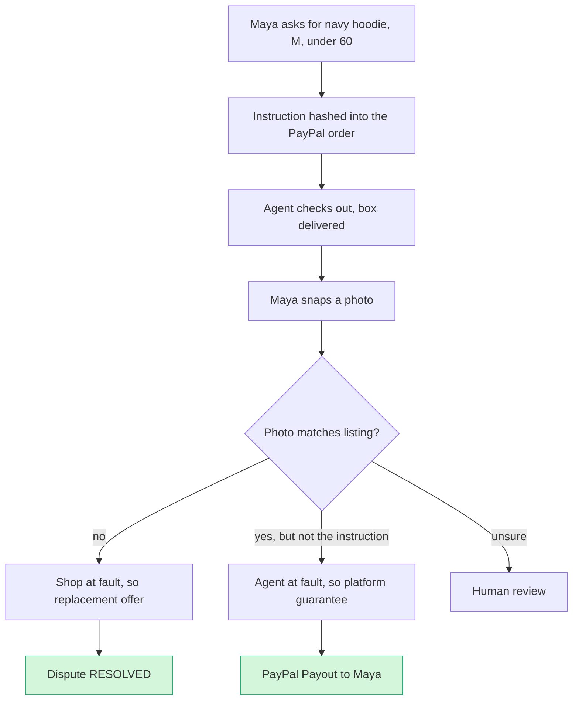

# Wrong Box: combining #1, #2 and #3 into one product (2026-10-12)

> [!tldr] In one breath
> Three agent liability ideas become one product. You photograph what arrived; the AI compares it with what you asked for and what the shop listed; then PayPal fixes it, either a replacement from the shop or a payout from the agent's platform. **Combined score 88/120 (spine #3 = 87). Verdict: advance with changes. Tier A, rank 2.**

> [!example] Picture this
> Maya tells her shopping agent "navy hoodie, size M, under $60". A royal blue L turns up. She snaps the box. The screen splits: *Asked navy/M · Listed navy/M · Got royal/L*. The shop listed the right thing and shipped the wrong one, so the shop sends a replacement and the dispute flips to RESOLVED. A week later a second order arrives wrong, but this time the listing *was* royal; the agent picked it anyway. Same photo trick, different payer: the agent platform pays Maya $54 and the shop never sees a dispute.

> [!info] What this note combines
> [[I001 Intent Black Box|#1 Intent Black Box]] (the instruction record) and [[I002 Three-Party Agent Error Settlement|#2 Three-Party Agent Error Settlement]] (the payout fork when the agent is at fault), built on the [[I003 Mismatch-to-Replacement|#3 Mismatch-to-Replacement]] spine. Full reports: [[D001 Intent Black Box (Deep Dive)]], [[D002 Three-Party Agent Error Settlement (Deep Dive)]], [[D003 Mismatch-to-Replacement (Deep Dive)]].

> [!warning] Crowd check, Oct 23 2026
> Two busy neighbours. **Dispute and chargeback copilots** have about 16 live repos: witness, dispute-defender, dispute-copilot (AG Grid), rebuttal, dispute-radar (LightGBM), dispute-autopilot, two "disputedesk", dispute-steward, Docket and two "payguard-ai", with close cousins returngate and clippay (partial refunds). **AI verified escrow** (about 28 repos) includes handback, which compares rental deposit photos. Plus Provenant and AgentProof on Devpost (below). **Nobody found does the "photo vs instruction vs listing decides who pays" move. Lead with the photo, never with "dispute" or "liability".** Source: [[17 Live Competition Scan (Oct 23)]].

## How it works

## Bottom line

**Yes, build one product. But flip the original order of importance.** The spine is **#3 (the check after delivery)**. **#1** shrinks to a module: an instruction record tied to the order. **#2** shrinks to one fork: the agent platform pays the buyer back via Payouts.

Shipping #1 or #2 as the headline would put us head to head with **Provenant**, a Devpost entry in this hackathon (sponsor tags ag-grid and render). Provenant already binds `custom_id` to a hash of the agent's decision trace and splits fault across user, merchant and agent with Shapley values. It then pays the agent's share through Payouts from a liability pool, or builds a dispute evidence pack ([Devpost](https://devpost.com/software/provenant-safe-checkout-and-recourse-for-ai-agents) ✅). **AgentProof** separately builds PayPal provide evidence requests for agent disputes ([Devpost](https://devpost.com/software/agentproof-gwkxv6) ✅). Amex's ACE kit and Agent Purchase Protection (Apr 14 2026) take the "intent for disputes" and "someone covers agent error" stories at network level.

**What no one shows is the physical fact:** a photo of what arrived, checked against what the human asked for *and* what the shop listed. That photo answers who pays. If the listing doesn't match, the merchant pays. If the listing matches but the instruction doesn't, the agent pays. It then carries out the answer on PayPal before a chargeback exists.

## Working name and single pitch

**"Wrong Box" (working name): when your AI agent buys the wrong thing, snap the box. We work out whether the shop or the agent got it wrong, and fix it on PayPal before anyone files a chargeback.**

Pitch (≈60 words): *Shopping agents will get orders wrong, and today nobody owns those mistakes. Card rules make the merchant eat them, even when the agent misread the instruction. Wrong Box compares the delivered item with the human's original instruction and the listing. If the shop erred, it runs a PayPal replacement offer. If the agent erred, the agent platform's guarantee pays the buyer through PayPal Payouts. Either way, no chargeback.*

## Spine and modules

**One spine, three forks, five PayPal capabilities beyond checkout.**

| Layer | From | What it does | PayPal capability | Build effort |
|---|---|---|---|---|
| Module A: Instruction record | #1 (slimmed) | Turns "navy hoodie, M, < $60" into attributes; buyer confirms; `custom_id = "wb:v1:<sha256>"` (≤255 chars ✅) | Orders v2 (custom_id), read back via `disputed_transactions[].custom` (≤2000 ✅) | ~4 days |
| **Spine: Delivery check** | #3 | Photo upload → vision verdict per attribute vs instruction **and** listing; shows crops; confidence below threshold → human review | Shipment Tracking (delivery and label match) | ~1.5 weeks |
| Fork M: Merchant at fault | #3 + #2 | Partial refund before any dispute, or a replacement through the dispute: `make-offer REPLACEMENT_WITHOUT_REFUND` → `accept-offer` | Refunds, Disputes (create [sandbox], make-offer, accept-offer, provide-evidence on refusal), webhooks | ~1 week |
| Fork A: Agent at fault | #2 (slimmed) | Agent platform's opt in "make it right" guarantee pays the buyer; merchant never sees a dispute | Payouts (EMAIL / VENMO_HANDLE, `sender_batch_id` = case ID) + payouts webhooks | ~3 days |
| Fork B: Ambiguous instruction (could) | #2 | Split: partial merchant refund + partial payout | Refunds + Payouts | ~2 days |
| Not built | #1/#2 | Full transcript capture SDK, Merkle trees, Shapley splits, rulebook publishing | none | dropped (commodity or duplicate) |

That's 5 PayPal capabilities beyond checkout in the core loop (Orders metadata binding, Tracking, Refunds, Disputes, Payouts), plus webhooks. The AI makes the decision that matters (the fault class), and deterministic code moves the money. Per the anchors this is Tech 8. It reaches 9 if the unhappy paths are shown: merchant declines → evidence → adjudicate, and payout DENIED via the `ERRPYO` test values.

## Scorecard at a glance

**Combined scores:** [8,8,6,6,9,7,7] → weighted **88**. The originals were #2 95 / #3 93 / #1 92, all inflated by the "no one does this" assumption that Provenant breaks.

| Axis | Score |
|---|---|
| Tech | 8 |
| Design | 8 |
| Impact | 6 |
| Innovation | 6 |
| Demo | 9 |
| Feasibility | 7 |
| Risk | 7 |
| **Weighted /120** | **88** (spine #3 alone = 87) |

## Why one product beats three

* **Each alone is weak.** #1 alone has no visible end state (hash + JSON). #2 alone needs three personas and duplicates Provenant. #3 alone (scored 87) is a returns feature that isn't specific to agents.
* **Combined, each module fixes another's weakness.** #1 supplies the reference that makes #3 *specific to agents*. #3 supplies the *fact* that makes #2's split of blame believable without replaying what the agent "would have" done. #2 supplies the second PayPal money movement, which creates the "same photo, different payer" moment.
* **Sponsor and prize fit:** **Best Use of Agentic Commerce** (recourse for agent errors), **Best Demo Delivery** (photo → split screen → PayPal state flips). AG Grid case queue (sponsor prize; look different from Provenant's grid). Render hosting. Channel3 product lookup as the official "listing".

## The 3 minute demo

| Time | Scene | PayPal state change on screen |
|---|---|---|
| 0:00 to 0:20 | Hook: 58% fear wrong item agent buys (NMI); "No liability shift exists yet" (Worldpay); merchants eat it | none |
| 0:20 to 0:50 | Maya: "navy hoodie, size M, under $60." Instruction card confirmed; agent checks out | Order CREATED → COMPLETED; inset shows `custom_id wb:v1:3f9a…` |
| 0:50 to 1:30 | **Wow 1:** box arrives; photo; split screen *Asked navy/M · Listed navy/M · Got royal/L* with crops → "Shop shipped the wrong item" | Tracker DELIVERED |
| 1:30 to 2:05 | Merchant queue (AG Grid) → one click → replacement offer → Maya accepts | Dispute PP-D-… `make-offer REPLACEMENT_WITHOUT_REFUND` → `accept-offer` → **RESOLVED** (webhook toast) |
| 2:05 to 2:40 | **Wow 2:** second order, listing *was* royal; agent chose it anyway → "Agent error" → agent platform's guarantee pays | **Payout** batch SUCCESS; Maya's sandbox balance +$54 in the same frame; merchant dispute count stays 0 |
| 2:40 to 3:00 | Unhappy paths montage (merchant declines → evidence PDF → adjudicate; low confidence → human; payout DENIED → retry); API strip; close | none |

**Production notes:** pre record the sandbox UI dispute in case API creation is blocked. Make every state change a live API response or webhook toast, not a mock. Keep the hash inset small: it's support, not the story.

## Day 1 test list (gating)

1. `POST /v1/customer/disputes` with buyer `PayPal-Auth-Assertion` on an Orders v2 capture: which transaction ID works? (The public OpenAPI lacks this endpoint, and the reference page calls create "limited-release"; test-go-live documents it ✅.) Fallback: sandbox buyer UI.
2. `allowed_response_options` includes `REPLACEMENT_WITHOUT_REFUND` for a NOT_AS_DESCRIBED inquiry, and `accept-offer` closes it.
3. Payouts from a second sandbox business app to the buyer's personal sandbox email; balance visible.
4. `GET dispute` → `disputed_transactions[0].custom` equals the order custom_id.
5. `provide-evidence` multipart with a PDF (<10 MB) succeeds (avoid `INVALID_EVIDENCE_FILE`).

## Risks

* **Judges comparing it with Provenant:** lead with the buyer and the photo, never with "liability engine" or "flight recorder". State the position plainly in the README: it acts before any dispute and is driven by facts.
* **Impact is about the future:** no published agent dispute volume. Anchor on NMI 58%, Payments Association 24%, chargeback growth (Mastercard/Datos), and the VAMP 1.5% threshold.
* **Agent platforms paying is voluntary:** frame it as an opt in guarantee, with the Amex precedent that guarantees are competitive.
* **Vision reliability:** read size labels and model labels with OCR, check colour against the reference image, and set a confidence floor.

## Sources

See 1_intent-black-box.md, 2_three-party-settlement.md, 3_mismatch-to-replacement.md (all claims carry URLs and confidence tags there).

> [!info]- Jargon decoder
> **Chargeback**: the buyer asks their card company to force a refund. The merchant loses the money plus a fee, and too many chargebacks get a shop in trouble. Like a referee overturning a goal.
> **Liability shift**: a rule that moves the blame (and the bill) from one party to another. For agent purchases, none exists yet.
> **`custom_id`**: a free text label stuck to a PayPal order. Here it carries a fingerprint (hash) of Maya's instruction, so it can be read back later in a dispute.
> **Hash (sha256)**: a fixed fingerprint of some text. Change one letter and the fingerprint changes completely, so nobody can quietly edit the instruction.
> **Dispute, make-offer, accept-offer**: PayPal's formal complaint process. The shop can offer a fix ("replacement without refund"); if the buyer accepts, the case closes.
> **Payouts**: PayPal sending money from one business account to a person, here from the agent platform to Maya.
> **Shapley values**: a maths method for splitting blame or credit fairly among several players. Provenant uses it; Wrong Box drops it in favour of a photo.
> **Vision model / OCR**: AI that looks at a photo; OCR reads the text in it, like the size tag.
> **Confidence floor**: if the AI is less sure than this level, a human decides.
> **VAMP 1.5% threshold**: Visa's monitoring programme; shops with too many disputes or fraud cases (around 1.5%) face penalties.
> **Webhook toast**: a little pop up in the demo that appears the moment PayPal confirms a change.
> **Unhappy path**: what happens when things go wrong (shop declines, AI unsure, payout denied).
> More in [[Jargon Decoder]].

## Where to next
* ⬆️ Up: [[50 Top 10 Overview]]
* 🔗 Idea notes: [[I003 Mismatch-to-Replacement]] (spine), [[I001 Intent Black Box]], [[I002 Three-Party Agent Error Settlement]]
* ⬅️ Previous: [[D084 Accessible Voice Checkout (Deep Dive)]] · ➡️ Next: [[D001 Intent Black Box (Deep Dive)]] (back to the start of the deep dives)
* 🔗 Final pick: [[70 The Winning Idea]]
* 🔗 Related: [[D003 Mismatch-to-Replacement (Deep Dive)]], [[D002 Three-Party Agent Error Settlement (Deep Dive)]], [[17 Live Competition Scan (Oct 23)]], [[63 Day-1 Sandbox Test Plan]]
