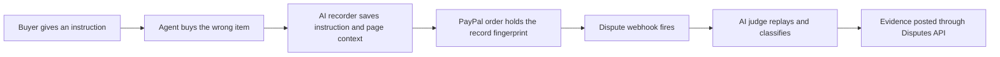

# #1 Intent Black Box

> [!tldr] In one breath
> A flight recorder for shopping agents. It saves "what the agent saw and was told" and ties that record to the PayPal order, so a fight over a wrong purchase can be judged instead of argued. It scored 92 on the desk and fell to 71 after the deep dive, because someone already built it. Verdict: **demote**.

> [!example] Picture this
> Maya tells her shopping agent, "Get me a blue yoga mat under $30." The agent buys a purple one for $29. Maya says "that is not what I asked." The store says "your agent approved it." Nobody can prove who is right, because nobody kept the conversation. Now picture a plane crash: investigators open the black box and replay the last hour. This idea gives every agent purchase its own black box.

> [!warning] Crowd check, Oct 23 2026
> This sits next to the busiest area in the scan: about 30 repos that put guardrails or receipts between an AI agent and PayPal (for example permit, which keeps hash chained receipts, plus sentinel-prooflayer and trust-engine-v2). The dispute copilot area is also busy, with about 16 repos (witness, dispute-defender, dispute-copilot and others). The deep dive had already found Provenant and AgentProof doing the same job. Expect judges to see similar entries.

**Theme:** E1 Agent purchase liability & integrity · **Group:** Agent purchase liability · **Crowding on Devpost:** Adjacent to about 13 spend gate and receipt entries

## The problem
**When an AI agent buys the wrong thing, nobody can rebuild why.** Signed mandates (AP2, Verifiable Intent) prove what was signed. They do not prove the cart matched the human's goal, or that the agent was tricked before signing. Worldpay says no liability shift exists for "authorized but wrong" agent purchases, and UK merchants show no agreement on who pays.

## The idea
An SDK (a toolkit developers drop into their code) wraps any agent's checkout step. It:
* records the instruction, the candidate products, tool outputs, page snippets and the agent's reasoning
* turns the whole transcript into one fingerprint (a Merkle root) and stores it in the PayPal order's custom_id / invoice_id field
* keeps the full record off chain (in normal storage)
* when a dispute webhook fires, lets an AI adjudicator replay the record and sort the case into one of four boxes: agent went out of scope, merchant sent something Significantly Not As Described (SNAD), the buyer's instruction was unclear, or friendly fraud
* drafts the reply through the Disputes API

**Who it is for:** agent builders who let agents pay, merchants who receive agent orders, and later PayPal's own Resolution Center.

**What the AI does:** captures reasoning, summarises transcripts, compares scope with instruction (an LLM acting as judge with a rubric), classifies the dispute and drafts evidence.

## How PayPal is used
Orders v2 with custom_id / invoice_id binding. The Disputes API (get, provide evidence, make offer) is driven end to end with the sandbox dispute factory. CUSTOMER.DISPUTE.CREATED webhooks. Refunds.

**Building blocks used** (see [[30 Primitives Legend]]):
* `P01` Orders v2 (create, capture, get)
* `P31` custom_id / invoice_id metadata binding
* `P14` Disputes API (get, messages, make offer, accept offer, provide evidence)
* `P15` Disputes sandbox factory (create, adjudicate)
* `P20` Webhooks (events, retries, verification)
* `P16` Refunds (full or partial)
* `A13` Vision verification and evidence narrative
* `A05` Structured decision and classification (most common)
* `A03` Intent and rationale reasoning (LLM as judge)

## Who else is doing this
Mastercard Verifiable Intent, Google AP2, Catena Labs ACK, Skyfire KYAPay.

Those standards sign the permission but stop before the evidence and judging step. Devpost already shows "evidence gate" and agent receipt entries (VELQIRIS Evidence Gate, XReceipt). So the difference must be the context captured before signing plus the dispute judging, not receipts alone.

**Verification status:** adversarially deep dived (6 or more differently phrased searches). Full competitor table: [[D001 Intent Black Box (Deep Dive)]].

## What makes it different
It captures context from before the signature (the documented hole in AP2 v0.2) and closes the loop into a live PayPal dispute, instead of making a receipt nobody reads.

## Can we build it?
All needed APIs work in the sandbox, so the demo can run a full dispute life cycle the same way every time. The hardest part is a clean capture SDK that works with any agent framework.

## Demo plan (MVP)
One shopping agent (OpenAI Agents SDK plus PayPal agent toolkit), recorder middleware, order binding, a dispute triggered through a sandbox endpoint, an adjudicator verdict with evidence posted, and a viewer that shows instruction versus purchase side by side.

## Risks
Judges may lump it with the crowded "agent receipts and gates" cluster. Recorded context raises privacy questions. There is no agent dispute volume data yet, so the impact is forward looking.

## Sources
* [Worldpay: no liability shift exists yet for agent disputes (Jul 2026)](https://worldpay.com/insights/articles/agentic-commerce-liability-is-still-being-written) ✅
* [Beyond the Mandate: 48 threats vs AP2 v0.2 (arXiv 2608.23858)](https://www.emergentmind.com/papers/2608.23858) ✅
* [Mastercard Verifiable Intent (Mar 2026)](https://www.mastercard.com/au/en/news-and-trends/stories/2026/verifiable-intent.html) ✅
* [The Payments Association: UK merchants have no consensus on agent liability (May 2026)](https://thepaymentsassociation.org/article/agentic-commerce-uk-retail-an-unresolved-liability-question/) ✅
* [NMI Aug 2026: 76% uncomfortable with AI completing purchases; 58% fear the wrong item](https://www.nmi.com/about-us/news/nmi-research-consumers-want-ai-to-help-them-shop-not-control-their-spending/) ✅
* [PayPal Disputes test and go live: sandbox create, chargeback and adjudicate endpoints](https://developer.paypal.com/disputes/test-go-live.md) ✅
* [Chargeflow: agent disputes do not fit reason codes; VAMP thresholds](https://www.chargeflow.io/blog/agentic-commerce-regulation-what-merchants-need-to-know) ⚠️

## Scores
Higher is better on every row. "Risk⁻¹" means a higher number is a safer idea.

| Axis | Weight | Desk score | Post deep dive |
|---|---|---|---|
| Tech | ×2 | 9 | 8 |
| Design | ×2 | 7 | 6 |
| Impact | ×2 | 7 | 6 |
| Innovation | ×2 | 7 | 3 |
| Demo | ×2 | 8 | 6 |
| Feasibility | ×1 | 8 | 7 |
| Risk⁻¹ | ×1 | 8 | 6 |
| **Total /120** | | **92** | **71** |

_Why (desk):_ Deep PayPal use and a documented research gap. Innovation docked for being close to the receipt cluster.

**Kill codes:** none triggered.

## Deep dive verdict: demote
**The mechanism already shipped elsewhere.** Keep only the normalized instruction record as the evidence spine for #3.

_What changed the score:_ Provenant (on Devpost, same hackathon, sponsor tags ag-grid and render) already binds custom_id to a hash of the agent's decision trace, with replay and a dispute evidence pack. AgentProof builds PayPal provide evidence for agent disputes. Amex ACE (Apr 2026) captures intent plus cart context for disputes. Chargebacks911 UDMS records agent consent. Hash binding is invisible on video. Sandbox dispute creation is absent from the public OpenAPI, so it needs a day 1 test.

> [!info]- Jargon decoder
> **Agent**: an AI that acts for you, like a personal assistant who can use your card.
> **Mandate**: a signed permission slip saying what an agent may buy.
> **Liability**: who has to pay when something goes wrong.
> **SDK**: a ready made toolkit that developers plug into their app, like a Lego pack.
> **Merkle root**: one short fingerprint that stands for a whole stack of pages. Change one page and the fingerprint changes.
> **custom_id / invoice_id**: free text fields on a PayPal order, like a sticky note you can write on.
> **Off chain**: stored in a normal database, not on a blockchain.
> **Webhook**: a doorbell. PayPal rings your server when something happens, such as a new dispute.
> **Dispute**: a buyer telling PayPal "I want my money back" and PayPal asking both sides for proof.
> **SNAD**: Significantly Not As Described. The item arrived but is not what the listing promised.
> **Friendly fraud**: a real buyer who got the goods and still claims they did not.
> **LLM as judge**: using an AI to grade or decide a case against a checklist.
> **Sandbox**: PayPal's practice playground with fake money.
> **Adjudicate**: act as the referee and decide who wins.

## Where to next
* ⬆️ Up: [[Idea Index]]
* ⬅️ Previous: none, this is the first idea · ➡️ Next: [[I002 Three-Party Agent Error Settlement]]
* 🧭 Theme: [[Theme E1 Agent purchase liability & integrity]]
* 🔬 Deep dive: [[D001 Intent Black Box (Deep Dive)]]
* 🔗 Related: [[00 PayPal AI Hackathon Hub]]
