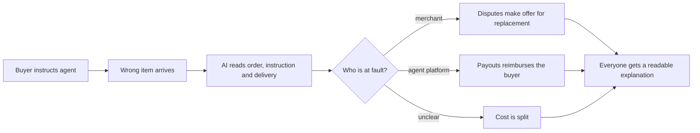

# #2 Three-Party Agent Error Settlement

> [!tldr] In one breath
> When an agent's purchase goes wrong, this decides who should pay (merchant, agent platform or buyer) and moves each share of the money on PayPal automatically. Desk score 95, post deep dive 72. Verdict: **demote**, because Provenant already splits fault three ways.

> [!example] Picture this
> Three friends share a taxi and the driver takes a wrong turn that adds $12. Was it the driver's fault, the map app's fault, or did a friend give a vague address? Today everyone argues. Now imagine a referee who reads the trip log, applies a printed rulebook and sends each person their exact share, with a note explaining why. That is this idea, for agent purchases.

> [!success] Crowd check, Oct 23 2026
> Nothing in the 266 repo scan (partial coverage) settles fault three ways. The nearest areas are the dispute copilots (about 16 repos) and the agent guardrail pile (about 30 repos), which both focus on blocking or fighting, not on splitting the bill. Be careful though: the earlier deep dive found Provenant on Devpost doing this, so the area is not truly empty.

**Theme:** E1 Agent purchase liability & integrity · **Group:** Agent purchase liability · **Crowding on Devpost:** none observed

## The problem
**Agent mistakes create a three party blame problem** (buyer, merchant, agent provider), while card reason codes and dispute flows only handle two parties. Payments Association data shows no answer above 24% among UK merchants. NMI finds consumers would blame the AI provider (62%) before the retailer (34%).

## The idea
A settlement engine takes in the agent order, the human's instruction and the delivery result. It applies a published liability matrix (a simple table of "who pays in which case"):
* **Merchant at fault:** merchant refunds or replaces, through a Disputes make offer.
* **Agent at fault:** the agent platform repays the buyer through Payouts.
* **Instruction was unclear:** split the cost.

Each leg runs automatically with an explanation every party can read.

**Who it is for:** agent platforms that want to offer a "we will make it right" promise, merchants selling to agents, and buyers.

**What the AI does:** works out who is at fault from the order, instruction and delivery evidence (vision on a photo of the delivered item), reasons through the matrix with cited rules, and writes plain explanations.

## How PayPal is used
Disputes (make offer, accept claim) for merchant legs. Payouts, including Venmo handles, for the agent platform's repayment. Refunds, webhooks and Orders metadata.

**Building blocks used** (see [[30 Primitives Legend]]):
* `P14` Disputes API (get, messages, make offer, accept offer, provide evidence)
* `P11` Payouts (batch)
* `P12` Payouts to Venmo handles
* `P16` Refunds (full or partial)
* `P20` Webhooks (events, retries, verification)
* `P31` custom_id / invoice_id metadata binding
* `A02` Classification with explanation and vision estimation
* `A05` Structured decision and classification (most common)
* `A16` Policy and rule reasoning with cited clauses

## Who else is doing this
Chargeflow, Justt, Rye.

Dispute vendors fight two party card chargebacks for merchants. Agent checkout APIs (Rye) do not own liability for wrong orders. The desk claim was that no product settles three way.

**Verification status:** adversarially deep dived. Full competitor table: [[D002 Three-Party Agent Error Settlement (Deep Dive)]].

## What makes it different
First to treat the agent provider as a liable, payable party, using Payouts as the repayment rail.

## Can we build it?
The sandbox supports every leg (dispute factory, payouts test values). The liability matrix is a design document, not research.

## Demo plan (MVP)
Three scripted cases (wrong size, merchant shipped the wrong item, unclear instruction), each producing different settlement legs live in the sandbox, plus a settlement ledger screen.

## Risks
The legal framing must be "proposed rulebook", not legal advice. Agent platforms may not want liability. Demand is forward looking.

## Sources
* [Worldpay: no liability shift exists yet for agent disputes (Jul 2026)](https://worldpay.com/insights/articles/agentic-commerce-liability-is-still-being-written) ✅
* [The Payments Association: UK merchants have no consensus on agent liability (May 2026)](https://thepaymentsassociation.org/article/agentic-commerce-uk-retail-an-unresolved-liability-question/) ✅
* [NMI Aug 2026: 76% uncomfortable with AI completing purchases; 58% fear the wrong item](https://www.nmi.com/about-us/news/nmi-research-consumers-want-ai-to-help-them-shop-not-control-their-spending/) ✅
* [PayPal Disputes test and go live: sandbox create, chargeback and adjudicate endpoints](https://developer.paypal.com/disputes/test-go-live.md) ✅
* [PayPal Payouts sandbox test values (ERRPYO0xx)](https://developer.paypal.com/api/payouts/test-go-live.md) ✅
* [Chargeflow: agent disputes do not fit reason codes; VAMP thresholds](https://www.chargeflow.io/blog/agentic-commerce-regulation-what-merchants-need-to-know) ⚠️

## Scores
"Risk⁻¹" means a higher number is a safer idea.

| Axis | Weight | Desk score | Post deep dive |
|---|---|---|---|
| Tech | ×2 | 9 | 8 |
| Design | ×2 | 7 | 6 |
| Impact | ×2 | 7 | 6 |
| Innovation | ×2 | 9 | 3 |
| Demo | ×2 | 8 | 7 |
| Feasibility | ×1 | 8 | 7 |
| Risk⁻¹ | ×1 | 7 | 5 |
| **Total /120** | | **95** | **72** |

_Why (desk):_ A genuinely new mechanism with depth across several APIs. The impact is forward looking.

**Kill codes:** none triggered.

## Deep dive verdict: demote
**The mechanism is already on Devpost.** Keep it only as the agent fault Payouts fork that #3's delivery check triggers.

_What changed the score:_ "No product settles three way" is false. Provenant (Devpost, same hackathon, by sponsor tags) splits fault between user, merchant and agent with Shapley values, pays the agent's share through Payouts from a liability pool, and adds dispute evidence. Amex Agent Purchase Protection (Apr 2026) covers buyers for AI agent error. No network rule makes agent platforms liable, so demand for the Payouts leg is speculative. The matrix is a lookup table, and three personas hurt design and demo.

> [!info]- Jargon decoder
> **Liability matrix**: a rulebook table that says who pays for each kind of mistake, like a school rule chart for broken windows.
> **Disputes make offer**: the merchant proposes a fix (a replacement or part refund) inside a PayPal dispute, like offering a swap at the shop counter.
> **Payouts**: PayPal sending money out to someone, like a company paying a reimbursement.
> **Venmo handle**: a person's Venmo username, which Payouts can pay directly.
> **Shapley values**: a fair way from game theory to split blame or credit between several players based on what each added.
> **Vision model**: AI that can look at photos.
> **Webhook**: a doorbell. PayPal rings your server when something happens.
> **Sandbox**: PayPal's practice playground with fake money.
> **Liability pool**: a pot of money set aside to cover mistakes, like a shared insurance jar.

## Where to next
* ⬆️ Up: [[Idea Index]]
* ⬅️ Previous: [[I001 Intent Black Box]] · ➡️ Next: [[I003 Mismatch-to-Replacement]]
* 🧭 Theme: [[Theme E1 Agent purchase liability & integrity]]
* 🔬 Deep dive: [[D002 Three-Party Agent Error Settlement (Deep Dive)]]
* 🔗 Related: [[00 PayPal AI Hackathon Hub]]
