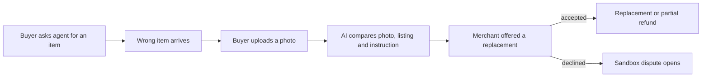

# #3 Mismatch-to-Replacement

> [!tldr] In one breath
> The buyer snaps a photo of what arrived. AI compares it with what the human asked for. If it is wrong, the system opens a replacement offer with the merchant before any PayPal dispute is filed. Desk 93, post deep dive 87. Verdict: **advance with changes**, and it is meant to be the spine of the combined build.

> [!example] Picture this
> You send a friend to buy "the red hoodie, size M." They come back with a red hoodie in size L. You do not call the shop's manager and demand a chargeback. You say "wrong size, can I swap it?" and the shop says "sure." This idea is that quick, friendly swap, done by AI from one photo, before it turns into a formal fight.

> [!warning] Crowd check, Oct 23 2026
> Partly crowded. The scan found handback (rental deposit photo compare), returngate (a close cousin about returns) and about 16 dispute copilots (witness, dispute-defender, dispute-copilot and more). The conversational shopping agent pile is also big (about 25, with at least 10 called "PayPilot"). None of them were seen checking an agent's instruction against a delivered photo and then offering a replacement, but the deep dive did find similar photo check tools (Loop AI Image Recognition, PixelProof).

**Theme:** E1 Agent purchase liability & integrity · **Group:** Agent purchase liability · **Crowding on Devpost:** Disputes and refunds cluster (about 7) nearby

## The problem
**"Not what I wanted" becomes a chargeback when a replacement would have made everyone happy.** 58% of US adults fear an AI will buy the wrong item, size or colour (NMI). A chargeback also hurts the merchant's dispute ratio.

## The idea
A check in after delivery. The buyer snaps the item. A vision model compares the photo with the instruction and the product listing. If they do not match, the system opens a structured talk with the merchant (replacement or partial refund). It only escalates to a PayPal dispute if the merchant says no.

**Who it is for:** shoppers who use shopping agents, and merchants who want agent orders kept out of their dispute numbers.

**What the AI does:** compares the delivered item with the listing and the instruction, explains the mismatch, and negotiates the fix.

## How PayPal is used
Orders metadata. Partial Refunds. Disputes make offer (replacement) and send message when escalated. The Tracking API confirms delivery. Webhooks.

**Building blocks used** (see [[30 Primitives Legend]]):
* `P16` Refunds (full or partial)
* `P14` Disputes API (get, messages, make offer, accept offer, provide evidence)
* `P17` Shipment Tracking API (add tracking, releases holds)
* `P20` Webhooks (events, retries, verification)
* `A02` Classification with explanation and vision estimation
* `A07` Multi agent negotiation

## Who else is doing this
Loop Returns, Narvar, AfterShip Returns.

Returns platforms handle returns that the merchant starts. None compare against the agent's instruction or sit before a PayPal dispute.

**Verification status:** adversarially deep dived. Full competitor table: [[D003 Mismatch-to-Replacement (Deep Dive)]].

## What makes it different
It deflects disputes before they start, specifically for agent errors, and it checks against the instruction, not just the listing.

## Can we build it?
High. Vision models handle colour, size and model mismatches well enough for a demo.

## Demo plan (MVP)
Upload photo, get a mismatch verdict, run the merchant offer flow, execute a partial refund in the sandbox. The escalation path opens a sandbox dispute.

## Risks
Vision can give false alarms. In the real world a buyer side app needs merchants to cooperate.

## Sources
* [NMI Aug 2026: 76% uncomfortable with AI completing purchases; 58% fear the wrong item](https://www.nmi.com/about-us/news/nmi-research-consumers-want-ai-to-help-them-shop-not-control-their-spending/) ✅
* [Worldpay: no liability shift exists yet for agent disputes (Jul 2026)](https://worldpay.com/insights/articles/agentic-commerce-liability-is-still-being-written) ✅
* [Mastercard and Datos 2025 State of Chargebacks: 261M to 324M by 2028; 45% fraudulent](https://www.mastercard.com/us/en/news-and-trends/Insights/2025/2025-global-chargebacks-outlook.html) ✅
* [PayPal Disputes test and go live: sandbox create, chargeback and adjudicate endpoints](https://developer.paypal.com/disputes/test-go-live.md) ✅

## Scores
"Risk⁻¹" means a higher number is a safer idea.

| Axis | Weight | Desk score | Post deep dive |
|---|---|---|---|
| Tech | ×2 | 7 | 7 |
| Design | ×2 | 8 | 8 |
| Impact | ×2 | 7 | 6 |
| Innovation | ×2 | 7 | 6 |
| Demo | ×2 | 9 | 9 |
| Feasibility | ×1 | 9 | 8 |
| Risk⁻¹ | ×1 | 8 | 7 |
| **Total /120** | | **93** | **87** |

_Why (desk):_ An excellent demo moment with moderate PayPal depth.

**Kill codes:** none triggered.

## Deep dive verdict: advance with changes
**Make this the spine.** A photo of what arrived versus what the human asked for decides between a merchant replacement (Disputes) and an agent platform payout (Payouts), before any chargeback.

_What changed the score:_ This is the only mechanism in the cluster not found on Devpost: instruction, listing and delivered photo compared, feeding a PayPal make offer (REPLACEMENT_WITHOUT_REFUND) before a claim, or a Payouts repayment when the agent erred. Innovation was docked for Loop AI Image Recognition and PixelProof photo checks, XReceipt "did the two match", and Provenant's fault split. Impact was docked (NMI is a vendor survey, and there is no agent dispute volume). Feasibility was docked for vision reliability and a day 1 sandbox dispute create test. Combined with the #1 binding and the #2 payout fork the scores are [8,8,6,6,9,7,7].

> [!info]- Jargon decoder
> **Chargeback**: the buyer's bank forcibly takes the money back from the merchant, like a shop being made to return cash.
> **Dispute ratio**: the share of a merchant's orders that end in disputes. Too high and payment companies get nervous.
> **Vision model**: AI that can look at photos.
> **Make offer**: inside a dispute, the merchant proposes a fix such as a replacement or part refund.
> **Escalate**: take a problem up to a higher level, here from a friendly swap to a formal PayPal dispute.
> **Webhook**: a doorbell. PayPal rings your server when something happens.
> **Tracking API**: lets a seller tell PayPal where a parcel is.
> **Sandbox**: PayPal's practice playground with fake money.
> **Payouts**: PayPal sending money out to someone.

## Where to next
* ⬆️ Up: [[Idea Index]]
* ⬅️ Previous: [[I002 Three-Party Agent Error Settlement]] · ➡️ Next: [[I004 Rogue-Agent Claim Verifier]]
* 🧭 Theme: [[Theme E1 Agent purchase liability & integrity]]
* 🔬 Deep dive: [[D003 Mismatch-to-Replacement (Deep Dive)]]
* 🔗 Related: [[00 PayPal AI Hackathon Hub]]
