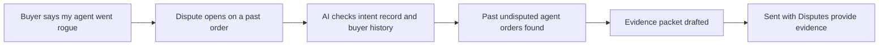

# #4 Rogue-Agent Claim Verifier

> [!tldr] In one breath
> A merchant side defence against a brand new excuse for friendly fraud: "my agent went rogue." It checks the claim against records and builds an evidence packet for the PayPal dispute. Score 76 (desk only). It is valid but narrow and leans on #1's capture layer.

> [!example] Picture this
> A customer buys a $120 gadget through their AI assistant, uses it for two weeks, then tells the bank "my assistant bought that without my permission." The shop owner remembers that the same customer's assistant bought from them six times before with no complaints. This idea is the clerk who pulls out all six old receipts and shows the pattern in one tidy page.

> [!warning] Crowd check, Oct 23 2026
> The dispute copilot area is busy: about 16 repos in the scan (witness, dispute-defender, dispute-copilot, rebuttal, dispute-radar, dispute-autopilot, two disputedesk, dispute-steward, Docket, two payguard-ai). None were seen aimed specifically at agent attribution claims, but any judge who has seen a few of them will think "dispute helper" first.

**Theme:** E1 Agent purchase liability & integrity · **Group:** Agent purchase liability · **Crowding on Devpost:** Disputes cluster

## The problem
**"My agent did it" is a claim nobody can verify.** Worldpay names it as a new friendly fraud route. Merchants already lose most disputes (they win 8.1% outright across all US disputes), and each $1 of fraud costs US retailers $5.13.

## The idea
Check a claimant's agent order against any captured intent record, the same buyer's earlier undisputed agent orders, and agent identity signals. Then produce an evidence packet suited to the dispute reason and send it to PayPal.

**Who it is for:** merchants whose agent referred traffic is growing.

**What the AI does:** finds the evidence, drafts the story, and spots patterns across the buyer's history.

## How PayPal is used
Disputes provide evidence. Transaction Search for the buyer's history. Orders metadata.

**Building blocks used** (see [[30 Primitives Legend]]):
* `P14` Disputes API (get, messages, make offer, accept offer, provide evidence)
* `P18` Transaction Search and Reporting
* `P31` custom_id / invoice_id metadata binding
* `A06` Entity matching and narrative drafting
* `A05` Structured decision and classification (most common)

## Who else is doing this
Chargeflow, Justt, Chargebacks911.

Fraud and dispute vendors go after card chargebacks broadly. None specialise in agent attribution claims.

**Verification status:** ⚠️ desk research only. The competitor names come from landscape and Devpost scans, not from a per idea novelty hunt. Treat "no competitor found" as unproven.

## What makes it different
A narrow but sharp angle on a newly named fraud route.

## Can we build it?
It needs made up agent order history. Otherwise it is straightforward.

## Demo plan (MVP)
Seeded history, a sandbox dispute and a generated evidence packet.

## Risks
The problem is forward looking with no volume data. It overlaps idea 1.

## Sources
* [Worldpay: no liability shift exists yet for agent disputes (Jul 2026)](https://worldpay.com/insights/articles/agentic-commerce-liability-is-still-being-written) ✅
* [chargeback.io: merchants win 8.1% of all US disputes (Mastercard funnel)](https://www.chargeback.io/blog/chargeback-statistics) ⚠️
* [LexisNexis True Cost of Fraud 2026: $5.13 per $1 (US retail)](https://risk.lexisnexis.com/about-us/press-room/press-release/20260624-tcof-retail-and-commerce) ✅
* [PayPal Disputes test and go live: sandbox create, chargeback and adjudicate endpoints](https://developer.paypal.com/disputes/test-go-live.md) ✅

## Scores
"Risk⁻¹" means a higher number is a safer idea.

| Axis | Weight | Desk score |
|---|---|---|
| Tech | ×2 | 7 |
| Design | ×2 | 6 |
| Impact | ×2 | 5 |
| Innovation | ×2 | 6 |
| Demo | ×2 | 6 |
| Feasibility | ×1 | 8 |
| Risk⁻¹ | ×1 | 8 |
| **Total /120** | | **76** |

_Why (desk):_ Valid but narrow, and it depends on idea 1's capture layer.

**Kill codes:** none triggered.

> [!info]- Jargon decoder
> **Friendly fraud**: a real customer who got the goods and still claims they did not authorise the payment.
> **Agent**: an AI that acts for you, like a personal assistant who can use your card.
> **Dispute**: a buyer asking PayPal to take the money back, with both sides sending proof.
> **Provide evidence**: the merchant uploading proof to a dispute, like handing the judge your receipts.
> **Transaction Search**: PayPal's lookup for past payments, like scrolling through an old bank statement.
> **Entity matching**: working out that two records belong to the same person, even if the spelling differs.
> **Sandbox**: PayPal's practice playground with fake money.

## Where to next
* ⬆️ Up: [[Idea Index]]
* ⬅️ Previous: [[I003 Mismatch-to-Replacement]] · ➡️ Next: [[I005 Regret Window]]
* 🧭 Theme: [[Theme E1 Agent purchase liability & integrity]]
* 🔗 Related: [[00 PayPal AI Hackathon Hub]]
