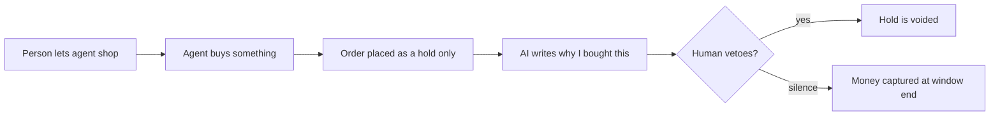

# #5 Regret Window

> [!tldr] In one breath
> Agent purchases are put on hold, not charged, for a cooling off window. The human can veto from a phone notification and the hold is cancelled. If they say nothing, the money is taken at the end. Score 87 (desk only), but it lives in the most crowded area.

> [!example] Picture this
> Think of the "undo send" button in Gmail. Your agent buys a $60 jacket. For the next hour the money is only reserved, like a hotel holding $200 on your card at check in. Your phone buzzes: "I bought this jacket because your old one has a torn zip. Veto?" You ignore it, and at the end of the hour the charge goes through. You tap veto, and the hold simply disappears.

> [!warning] Crowd check, Oct 23 2026
> This is the most crowded area in the scan: about 30 repos build spending guardrails between an AI agent and PayPal. Examples: permit (caps, allowlist, emergency stop, hash chained receipts), mandate ("OAuth for AI spending"), Warden, paypal-agent-firewall (Z3 formal verification), four repos named leash, three named allowance, two named countersign, payguard x3, mandateguard, aegismandate, SafePayAI, allowagent-mcp. A post decision veto on a hold is a twist, but judges will have seen many "approve my agent's spending" entries.

**Theme:** E1 Agent purchase liability & integrity · **Group:** Agent purchase liability · **Crowding on Devpost:** Spend gate cluster (about 13)

## The problem
**Asking approval for every purchase kills the point of delegating.** Only 9% of consumers would let an agent pay (Accenture), and 35% want approval before completion (RTB House).

## The idea
Agents create AUTHORIZE intent orders (a hold, not a charge). The user gets a digest with an AI written "why I bought this". Silence means the money is captured when the window ends. A veto voids the hold. Reauthorisation (renewing the hold) handles longer windows inside PayPal's 29 day period.

**Who it is for:** shoppers who hand routine buying to an agent, and families.

**What the AI does:** writes the "why I bought this" summary, and scores risk so the window gets shorter or longer for each purchase.

## How PayPal is used
Orders with AUTHORIZE. Capture, void and reauthorize. Webhooks. Vault for charges when the payer is not present.

**Building blocks used** (see [[30 Primitives Legend]]):
* `P02` AUTHORIZE intent (hold funds)
* `P03` Authorization lifecycle: partial capture, void, reauthorize
* `P06` Vault v3 (saved payment tokens, payer not present charges)
* `P20` Webhooks (events, retries, verification)
* `A05` Structured decision and classification (most common)
* `A12` Eligibility reasoning and messaging

## Who else is doing this
Stripe agent guardrails, Ramp Agent Cards, Link agent wallet.

Spend limit and approval layers exist (Stripe preview, Ramp), and about 13 Devpost entries are spend gates. The regret window (a veto after the decision, on a native hold) is a twist, not a new category.

**Verification status:** ⚠️ desk research only. The competitor names come from landscape and Devpost scans, not from a per idea novelty hunt. Treat "no competitor found" as unproven.

## What makes it different
It uses PayPal's built in hold behaviour as the consent mechanism, instead of a gate before purchase.

## Can we build it?
High. Everything works in the sandbox.

## Demo plan (MVP)
The agent places 3 orders. A dashboard shows countdowns. A veto voids the hold in the sandbox. Expiry captures the money.

## Risks
The area is crowded. Merchants dislike uncaptured holds on perishable goods.

## Sources
* [Accenture 2026: only 9% would let an agent pay](https://www.thediplomat.ro/2026/06/09/accenture-study-74-of-consumers-are-ready-to-let-an-ai-agent-shop-on-their-behalf/) ⚠️
* [RTB House survey: 35% want approval before an agent completes a purchase](https://www.digitaltransactions.net/consumers-like-ai-for-product-discovery-but-dont-fully-trust-it-for-purchases/) ⚠️
* [PayPal: authorization 29 day period, 3 day honor, reauth, capture up to 115% or +$75](https://developer.paypal.com/payment-methods/auth-honor.md) ✅
* [Stripe Sessions 2026 announcements (agent guardrails, Issuing for agents)](https://stripe.com/au/blog/everything-we-announced-at-sessions-2026) ✅
* [Devpost "Built with PayPal" listing (early entry clustering, about 72 reviewed)](https://devpost.com/software/built-with/paypal) ⚠️

## Scores
"Risk⁻¹" means a higher number is a safer idea.

| Axis | Weight | Desk score |
|---|---|---|
| Tech | ×2 | 8 |
| Design | ×2 | 8 |
| Impact | ×2 | 6 |
| Innovation | ×2 | 5 |
| Demo | ×2 | 8 |
| Feasibility | ×1 | 9 |
| Risk⁻¹ | ×1 | 8 |
| **Total /120** | | **87** |

_Why (desk):_ Clean and buildable, but it lives in the most crowded cluster.

**Kill codes:** none triggered.

> [!info]- Jargon decoder
> **Authorize, then capture**: like a hotel holding $200 on your card at check in, then charging only what you used at check out. Authorize reserves the money. Capture takes it.
> **Void**: cancel the hold so the money is released, like the hotel dropping the $200 hold.
> **Reauthorize**: renew a hold that is about to expire.
> **29 day period, 3 day honor**: PayPal keeps an authorisation alive for 29 days, but only promises the funds for the first 3.
> **Vault**: PayPal's safe for saved payment methods, so an agent can charge when you are not there.
> **Webhook**: a doorbell. PayPal rings your server when something happens.
> **Spend gate**: a checkpoint that blocks or approves an agent's spending.
> **Sandbox**: PayPal's practice playground with fake money.

## Where to next
* ⬆️ Up: [[Idea Index]]
* ⬅️ Previous: [[I004 Rogue-Agent Claim Verifier]] · ➡️ Next: [[I006 Agent Evidence Bundle Spec & Validator]]
* 🧭 Theme: [[Theme E1 Agent purchase liability & integrity]]
* 🔗 Related: [[00 PayPal AI Hackathon Hub]]
