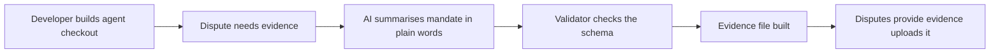

# #6 Agent Evidence Bundle Spec & Validator

> [!tldr] In one breath
> An open specification and a checker that maps agent permission records (AP2 and Verifiable Intent mandates) into the evidence types PayPal disputes accept. Score 71. **Eliminated** with kill code K6: useful plumbing, but nothing to watch in a 3 minute video.

> [!example] Picture this
> Imagine two countries that each use a different power plug. Travellers keep arriving with perfectly good chargers that do not fit the wall. This idea is the travel adapter: it does not charge anything itself, it just makes a record from one system fit the socket of another. Useful, but a video of an adapter is dull.

> [!success] Crowd check, Oct 23 2026
> Thin in the 266 repo scan (partial coverage). Nothing was seen that converts agent mandates into PayPal dispute evidence. The nearest repos are guardrail tools like permit and paypal-agent-firewall and dispute copilots like witness, which do different jobs.

**Theme:** E1 Agent purchase liability & integrity · **Group:** Agent purchase liability · **Crowding on Devpost:** none

## What the kill code means
**K6 means "infrastructure with no watchable demo."** The idea works as plumbing, but a judge watching a short video sees nothing exciting. See [[41 Brutal Elimination]].

## The problem
Verifiable Intent allows selective disclosure "for dispute resolution", but no rule says what evidence wins an agent dispute. Formats differ by card network.

## The idea
A JSON schema, a validator and a converter that produce PROOF_OF_FULFILLMENT or OTHER evidence files from mandates, context hashes and delivery data. A test suite runs against sandbox disputes.

**Who it is for:** developers building agent checkout, and payment operations teams.

**What the AI does:** an LLM turns mandates into readable evidence stories. The output is checked against the schema, with a repair loop that fixes mistakes.

## How PayPal is used
Disputes provide evidence (multipart upload). The sandbox dispute factory runs the conformance tests.

**Building blocks used** (see [[30 Primitives Legend]]):
* `P14` Disputes API (get, messages, make offer, accept offer, provide evidence)
* `P15` Disputes sandbox factory (create, adjudicate)
* `A01` Document and image extraction (OCR, validation)
* `A13` Vision verification and evidence narrative

## Who else is doing this
Mastercard Verifiable Intent, Google AP2. The standards define the mandate, not the mapping into dispute evidence.

**Verification status:** ⚠️ desk research only. The competitor names come from landscape and Devpost scans, not from a per idea novelty hunt. Treat "no competitor found" as unproven.

## What makes it different
The missing translation layer, in open source.

## Can we build it?
High, but the product experience is thin.

## Demo plan (MVP)
The spec, a command line validator and three sandbox dispute conformance runs.

## Risks
A weak Design score because there is no end user experience. Judges may find it dry.

## Sources
* [Mastercard Verifiable Intent (Mar 2026)](https://www.mastercard.com/au/en/news-and-trends/stories/2026/verifiable-intent.html) ✅
* [Beyond the Mandate: 48 threats vs AP2 v0.2 (arXiv 2608.23858)](https://www.emergentmind.com/papers/2608.23858) ✅
* [PayPal Disputes test and go live: sandbox create, chargeback and adjudicate endpoints](https://developer.paypal.com/disputes/test-go-live.md) ✅

## Scores
"Risk⁻¹" means a higher number is a safer idea.

| Axis | Weight | Desk score |
|---|---|---|
| Tech | ×2 | 7 |
| Design | ×2 | 4 |
| Impact | ×2 | 5 |
| Innovation | ×2 | 7 |
| Demo | ×2 | 4 |
| Feasibility | ×1 | 9 |
| Risk⁻¹ | ×1 | 8 |
| **Total /120** | | **71** |

_Why (desk):_ Useful infrastructure, poor video.

**Kill codes triggered:** `K6` Infrastructure with no watchable demo. See [[41 Brutal Elimination]].

> [!info]- Jargon decoder
> **Mandate**: a signed permission slip saying what an agent may buy.
> **AP2 and Verifiable Intent**: two competing standards (from Google and Mastercard) for proving an agent was allowed to buy something.
> **Selective disclosure**: showing only the part of a record that is needed, like showing your age on an ID while covering your address.
> **Schema**: a strict template for how data must look, like a form with fixed boxes.
> **Validator**: a checker that tells you whether your data fits the template.
> **Conformance test**: a test that proves something follows the rules exactly.
> **Multipart upload**: sending files and text together in one package.
> **Sandbox dispute factory**: PayPal's tool for creating fake disputes to practise on.
> **LLM**: a large language model, the kind of AI that writes text.

## Where to next
* ⬆️ Up: [[Idea Index]]
* ⬅️ Previous: [[I005 Regret Window]] · ➡️ Next: [[I007 Proof-of-Intent Checkout Button]]
* 🧭 Theme: [[Theme E1 Agent purchase liability & integrity]]
* 🔗 Related: [[41 Brutal Elimination]], [[00 PayPal AI Hackathon Hub]]
