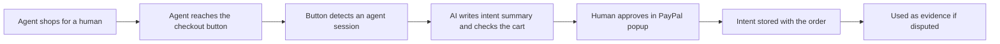

# #7 Proof-of-Intent Checkout Button

> [!tldr] In one breath
> A drop in checkout button (built on PayPal's JS SDK v6). When the buyer is an AI agent, it asks the agent to state its intent, has the human approve that statement in the PayPal popup, and stores it with the order. That gives merchants dispute evidence by default. Score 78 (desk only). Best as a module inside #1 or #47.

> [!example] Picture this
> At a gym, you sign the waiver before you use the treadmill, not after you fall off. This button makes the agent "sign the waiver" at the till: "I am buying hiking boots, size 9, under $120, for Sam." Sam taps approve. If a dispute shows up later, the shop has Sam's own approved sentence on file.

> [!warning] Crowd check, Oct 23 2026
> Moderately crowded neighbours. The scan found about 11 agent ready storefront repos (suede-shelf, paypal-webmcp-shop, leafline-agent-store, shopfront-agent and others) and the busy agent guardrail pile (about 30 repos). No repo was seen that stores a human approved intent statement inside the checkout button itself.

**Theme:** E1 Agent purchase liability & integrity · **Group:** Agent purchase liability · **Crowding on Devpost:** none

## The problem
**Merchants who receive agent orders have "no signed record of what the shopper authorized"** (Worldpay), and card issuers side with cardholders.

## The idea
A drop in wrapper around the v6 PayPal button. It:
* detects agent sessions (using Web Bot Auth or WebMCP context)
* asks the agent for a structured intent statement
* has the human approve it in the PayPal popup
* stores it with the order

**Who it is for:** merchants on any tech stack.

**What the AI does:** summarises the intent and checks that the intent and the cart agree.

## How PayPal is used
JS SDK v6 sessions. Orders custom_id. Disputes evidence when needed.

**Building blocks used** (see [[30 Primitives Legend]]):
* `P24` JS SDK v6
* `P31` custom_id / invoice_id metadata binding
* `P14` Disputes API (get, messages, make offer, accept offer, provide evidence)
* `A13` Vision verification and evidence narrative

## Who else is doing this
Visa Trusted Agent Protocol, Cloudflare Web Bot Auth. Those verify who the agent is, not what the human intended.

**Verification status:** ⚠️ desk research only. The competitor names come from landscape and Devpost scans, not from a per idea novelty hunt. Treat "no competitor found" as unproven.

## What makes it different
Merchant side, drop in, and built into PayPal.

## Can we build it?
Medium. Agent detection can be simulated in the demo.

## Demo plan (MVP)
A demo store, an agent, the button, a stored intent and a dispute evidence export.

## Risks
Overlaps ideas 1 and 47. Agent detection is mostly simulated.

## Sources
* [Worldpay: no liability shift exists yet for agent disputes (Jul 2026)](https://worldpay.com/insights/articles/agentic-commerce-liability-is-still-being-written) ✅
* [Cloudflare: signed agents, Visa TAP, Web Bot Auth](https://blog.cloudflare.com/secure-agentic-commerce/) ✅
* [PayPal JS SDK v6 announcement](https://developer.paypal.com/community/blog/paypal-js-sdk-v6/) ✅

## Scores
"Risk⁻¹" means a higher number is a safer idea.

| Axis | Weight | Desk score |
|---|---|---|
| Tech | ×2 | 7 |
| Design | ×2 | 7 |
| Impact | ×2 | 5 |
| Innovation | ×2 | 7 |
| Demo | ×2 | 6 |
| Feasibility | ×1 | 7 |
| Risk⁻¹ | ×1 | 7 |
| **Total /120** | | **78** |

_Why (desk):_ A good merchant angle, best as a module of idea 1 or 47.

**Kill codes:** none triggered.

> [!info]- Jargon decoder
> **JS SDK v6**: PayPal's latest toolkit for putting a PayPal button on a web page, like a ready made light switch you screw onto the wall.
> **Web Bot Auth**: a way for a bot to show a signed ID badge to a website, so the site knows which bot it is.
> **WebMCP**: a way for a website to tell AI agents what they can do on it, like a menu card for robots.
> **Visa Trusted Agent Protocol**: Visa's version of an ID badge for shopping agents.
> **Intent statement**: one clear sentence saying what is being bought and why.
> **custom_id**: a free text field on a PayPal order, like a sticky note.
> **Dispute evidence**: proof a merchant uploads when a buyer challenges a payment.

## Where to next
* ⬆️ Up: [[Idea Index]]
* ⬅️ Previous: [[I006 Agent Evidence Bundle Spec & Validator]] · ➡️ Next: [[I008 Final-Price Agent (Overcapture)]]
* 🧭 Theme: [[Theme E1 Agent purchase liability & integrity]]
* 🔗 Related: [[I001 Intent Black Box]], [[I047 WebMCP Storefront Kit]], [[00 PayPal AI Hackathon Hub]]
