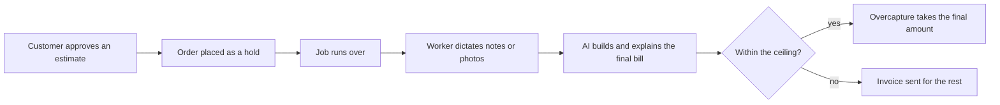

# #8 Final-Price Agent (Overcapture)

> [!tldr] In one breath
> For service businesses that cannot know the final price up front, the customer approves an estimate as a hold. When the job is done, AI works out and explains the final amount and takes up to PayPal's overcapture ceiling (115% or an extra $75). Desk 90, post deep dive 78. Verdict: **demote**, keep as a branch of a holds based build.

> [!example] Picture this
> You take your car to a repair shop. They quote $400 and you approve it. Halfway through, they find a worn belt and the bill becomes $440. Today the shop has to chase you for a second payment. Here, your approval already reserved room for a small overrun, and the AI writes "belt replaced, plus $40, here is the photo." The shop takes $440 from the hold and nobody chases anybody.

> [!success] Crowd check, Oct 23 2026
> Thin for this exact trick. In the 266 repo scan (partial coverage) no repo was seen using PayPal's overcapture rule. The invoicing area next door is busy (about 25 repos such as ledgerbird, invoicepilot, chaser, owed), which matters because over ceiling bills fall back to an invoice.

**Theme:** E2 Programmable holds · **Group:** Programmable holds · **Crowding on Devpost:** none

## The problem
**Trades, salons, repair shops and couriers quote an estimate and then chase a second payment when the job runs over.** That feeds late payment: 59% of US small businesses have invoices 30 or more days overdue.

## The idea
The customer approves an estimate as an AUTHORIZE order. When the job finishes, the worker dictates notes or uploads photos. The AI:
* computes the final amount
* explains each change from the estimate
* captures up to 115% or +$75 of the hold
* issues an invoice for anything beyond that

**Who it is for:** service small businesses (auto repair, cleaning, handyman, salons, couriers).

**What the AI does:** turns notes and photos into line items, explains the difference, and checks the bill against the customer's pre approved ceiling.

## How PayPal is used
Orders AUTHORIZE. Capture with an amount (overcapture). Partial capture. Invoicing as a fallback. Webhooks.

**Building blocks used** (see [[30 Primitives Legend]]):
* `P02` AUTHORIZE intent (hold funds)
* `P04` Overcapture (capture above the authorized amount, within 115% or +$75)
* `P03` Authorization lifecycle: partial capture, void, reauthorize
* `P08` Invoicing v2 (create, send, partial payment)
* `A01` Document and image extraction (OCR, validation)
* `A02` Classification with explanation and vision estimation
* `A08` Speech and voice

## Who else is doing this
Square tip adjustment, Jobber, Housecall Pro.

Field service suites take deposits and send final invoices. Restaurant tip adjust uses card auth adjustments. Nobody was found using an AI justified overcapture inside the consented ceiling.

**Verification status:** adversarially deep dived. Full competitor table: [[D008 Final-Price Agent (Overcapture) (Deep Dive)]].

## What makes it different
It turns PayPal's 115% overcapture rule, which almost nobody uses, into a "no second payment request" experience.

## Can we build it?
High, since overcapture is documented. We must test early whether the sandbox actually enforces the ceiling.

## Demo plan (MVP)
Quote, authorise, job notes by voice, AI final bill, capture. The over ceiling case falls back to an invoice.

## Risks
Overcapture can depend on account eligibility. The customer trust screen must be explicit.

## Sources
* [PayPal: authorization 29 day period, 3 day honor, reauth, capture up to 115% or +$75](https://developer.paypal.com/payment-methods/auth-honor.md) ✅
* [QuickBooks 2026 Late Payments Report: 59% have 30+ day overdue; $17.7K owed](https://quickbooks.intuit.com/r/small-business-data/small-business-late-payments-report-2026/) ✅

## Scores
"Risk⁻¹" means a higher number is a safer idea.

| Axis | Weight | Desk score | Post deep dive |
|---|---|---|---|
| Tech | ×2 | 8 | 7 |
| Design | ×2 | 8 | 8 |
| Impact | ×2 | 6 | 5 |
| Innovation | ×2 | 8 | 6 |
| Demo | ×2 | 8 | 7 |
| Feasibility | ×1 | 7 | 6 |
| Risk⁻¹ | ×1 | 7 | 6 |
| **Total /120** | | **90** | **78** |

_Why (desk):_ Uses an underused PayPal feature in a fresh way. The evidence of pain is indirect.

**Kill codes:** none triggered.

## Deep dive verdict: demote
**Keep it as a branch, not a standalone finalist.** Use it inside a holds based build: a consented +15% buffer, and anything over the ceiling goes to an invoice.

_What changed the score:_ The overcapture limit is documented (115% or +$75, and "defaults to 115%" in the MAX_CAPTURE_AMOUNT_EXCEEDED error) but there is no published eligibility rule and sandbox enforcement is unknown. State auto repair laws (FL 559.905 disclosure; CA 9884.9) require customer consent to exceed estimates, so AI set final prices need a pre consented ceiling. Incumbents (Tekmetric and Shopmonkey digital authorization, Housecall Pro and Pepper card on file and pre auth) already cover that workflow. The demo moment is just a JSON number.

> [!info]- Jargon decoder
> **Authorize, then capture**: like a hotel holding $200 on your card at check in, then charging only what you used at check out.
> **Overcapture**: taking slightly more than the held amount, like the hotel charging $215 on a $200 hold because you ordered room service. PayPal allows up to 115% or an extra $75.
> **Partial capture**: taking less than the hold.
> **Invoice**: a bill sent after the work, for any amount the hold could not cover.
> **Line items**: the separate rows on a bill, such as "labour" and "belt".
> **OCR**: software that reads text from photos, like a scanner that can read.
> **Sandbox**: PayPal's practice playground with fake money.
> **Pre consented ceiling**: a maximum the customer agreed to in advance.

## Where to next
* ⬆️ Up: [[Idea Index]]
* ⬅️ Previous: [[I007 Proof-of-Intent Checkout Button]] · ➡️ Next: [[I009 Rental Deposit Inspector]]
* 🧭 Theme: [[Theme E2 Programmable holds]]
* 🔬 Deep dive: [[D008 Final-Price Agent (Overcapture) (Deep Dive)]]
* 🔗 Related: [[00 PayPal AI Hackathon Hub]]
