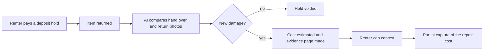

# #9 Rental Deposit Inspector

> [!tldr] In one breath
> The damage deposit is a PayPal hold. AI compares photos from hand over and return, and takes only the part of the deposit that the evidence supports. Desk 92, post deep dive 81. Verdict: **demote**, because AI damage diffing and hold based deposits both already exist.

> [!example] Picture this
> You rent a camera for the weekend and leave a $300 deposit. On return, the shop owner squints at the lens and says "that scratch is new." You say "it was there." With this idea, a photo from hand over and a photo from return get compared by AI, which circles the new scratch and says "repair estimate $45." Only $45 is taken. The other $255 hold just disappears. Both sides can see the same evidence page.

> [!warning] Crowd check, Oct 23 2026
> Crowded, and one entry is very close. The scan found handback (ZNLong2203/handback, rental deposit photo compare), plus rentabot and PropLock in the escrow and rental area (about 28 repos in total, such as holdfast, tidehold, TrustLock). The deep dive also found the public repo RentProof doing the AI half almost identically.

**Theme:** E2 Programmable holds · **Group:** Programmable holds · **Crowding on Devpost:** Light (sponsor suggested rental scheduling)

## The problem
**Small rental businesses (equipment, cameras, bikes, costumes) either skip deposits or argue about damage,** and deposit fights turn into PayPal disputes.

## The idea
The deposit is an AUTHORIZE hold. Staff photograph the item at hand over and at return. A vision model highlights new damage, estimates the cost from a price table, and proposes a partial capture with an annotated evidence page that the renter can contest before any money is taken.

**Who it is for:** rental small businesses and peer to peer rental platforms.

**What the AI does:** before and after damage detection from photos, cost estimates, and an evidence report.

## How PayPal is used
Orders AUTHORIZE, partial capture, void, reauthorize for longer rentals. Disputes evidence prepared in advance. Webhooks.

**Building blocks used** (see [[30 Primitives Legend]]):
* `P02` AUTHORIZE intent (hold funds)
* `P03` Authorization lifecycle: partial capture, void, reauthorize
* `A02` Classification with explanation and vision estimation
* `A12` Eligibility reasoning and messaging
* `P14` Disputes API (get, messages, make offer, accept offer, provide evidence)

## Who else is doing this
Booqable, Rentle, Airbnb AirCover.

Rental software handles bookings and deposits. Host protection programmes are tied to one platform. AI damage diffing linked to a partial capture is not standard.

**Verification status:** adversarially deep dived. Full competitor table: [[D009 Rental Deposit Inspector (Deep Dive)]].

## What makes it different
Evidence first deposit capture that is fair to both sides and ready for a dispute.

## Can we build it?
High for a demo with picked photo pairs. Real world accuracy is harder.

## Demo plan (MVP)
Two rentals: a clean return (void) and a scratched lens (partial capture with annotated evidence).

## Risks
Bryntum's page suggests "equipment rental locked on payment", so there is some duplication. Vision accuracy.

## Sources
* [PayPal: authorization 29 day period, 3 day honor, reauth, capture up to 115% or +$75](https://developer.paypal.com/payment-methods/auth-honor.md) ✅
* [Devpost Bryntum sponsor page (suggested ideas)](https://paypalaihackathon.devpost.com/details/bryntum) ✅
* [Mastercard and Datos 2025 State of Chargebacks: 261M to 324M by 2028; 45% fraudulent](https://www.mastercard.com/us/en/news-and-trends/Insights/2025/2025-global-chargebacks-outlook.html) ✅

## Scores
"Risk⁻¹" means a higher number is a safer idea.

| Axis | Weight | Desk score | Post deep dive |
|---|---|---|---|
| Tech | ×2 | 8 | 8 |
| Design | ×2 | 8 | 8 |
| Impact | ×2 | 6 | 6 |
| Innovation | ×2 | 7 | 4 |
| Demo | ×2 | 9 | 8 |
| Feasibility | ×1 | 8 | 7 |
| Risk⁻¹ | ×1 | 8 | 6 |
| **Total /120** | | **92** | **81** |

_Why (desk):_ A very strong demo. The impact evidence is indirect.

**Kill codes:** none triggered.

## Deep dive verdict: demote
**The PayPal mechanics work for short rentals, but the novelty collapsed.** AI damage diffing and partial hold capture both already exist. Keep it only as a component.

_What changed the score:_ AI before and after rental damage detection is a crowded category (Texada, CloudRent, switchlabs Verify, Roboflow, Hertz/UVeye), and the public repo RentProof (Claude plus Render) does the AI half nearly identically. TWICE, Booqable and ChargeAutomation already do hold deposits with partial capture. The Payments v2 reference says reauth is allowed only once (day 4 to 29), which contradicts the guide's "multiple". PayPal partial capture needs account enablement. The Hertz AI billing backlash raises framing risk.

> [!info]- Jargon decoder
> **Authorize hold**: PayPal reserves money on the card without taking it, like a hotel holding $200 at check in.
> **Partial capture**: taking only part of the held amount, like charging $45 of a $300 hold.
> **Void**: cancel the hold and release all the money.
> **Reauthorize**: renew a hold before it expires, so a longer rental stays covered.
> **Vision model**: AI that looks at photos and spots differences, like a spot the difference puzzle solver.
> **Diffing**: comparing two versions to find exactly what changed.
> **Dispute evidence**: proof a merchant gives PayPal when a buyer challenges a charge.
> **Webhook**: a doorbell. PayPal rings your server when something happens.

## Where to next
* ⬆️ Up: [[Idea Index]]
* ⬅️ Previous: [[I008 Final-Price Agent (Overcapture)]] · ➡️ Next: [[I010 Backorder Reauth Manager]]
* 🧭 Theme: [[Theme E2 Programmable holds]]
* 🔬 Deep dive: [[D009 Rental Deposit Inspector (Deep Dive)]]
* 🔗 Related: [[00 PayPal AI Hackathon Hub]]
