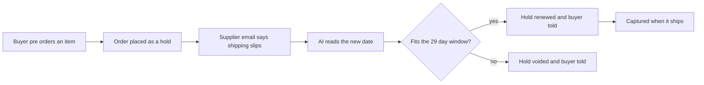

# #10 Backorder Reauth Manager

> [!tldr] In one breath
> AI manages when to hold, renew and capture money for pre orders and backorders. Merchants never ship without funds and never charge too early. Score 70 (desk only). Clever but narrow.

> [!example] Picture this
> A small maker sells a handmade chair that takes 10 weeks to build. Charging today feels rude. Holding the card for 10 weeks does not work, because PayPal holds expire. Think of a library book you keep renewing: this idea is a helper that reads the supplier's emails ("shipping delayed by two weeks"), renews the hold at the right moment, tells the buyer, and cancels politely if the chair will never make it in time.

> [!success] Crowd check, Oct 23 2026
> Looked empty or thin in the 266 repo scan (partial coverage). No repo was seen managing pre order or backorder hold renewals. The nearest cluster is AI verified escrow (about 28 repos, such as holdfast and trustrail-hold), which holds money for a different reason.

**Theme:** E2 Programmable holds · **Group:** Programmable holds · **Crowding on Devpost:** none

## The problem
**Merchants selling long lead items either capture early (refund headaches, disputes) or authorise and lose the hold after the honour period.**

## The idea
Predict ship dates from supplier messages, schedule reauthorisations inside the 29 day window, talk to buyers, and void the hold if the item will miss the window.

**Who it is for:** makers and pre order merchants.

**What the AI does:** pulls the expected date out of supplier emails, decides when to act, and writes the buyer messages.

## How PayPal is used
AUTHORIZE, reauthorize, capture, void. Webhooks.

**Building blocks used** (see [[30 Primitives Legend]]):
* `P02` AUTHORIZE intent (hold funds)
* `P03` Authorization lifecycle: partial capture, void, reauthorize
* `A01` Document and image extraction (OCR, validation)
* `A04` Forecasting and pricing suggestion
* `A12` Eligibility reasoning and messaging

## Who else is doing this
PreProduct, Shopify pre order apps. Pre order apps exist but usually capture upfront or use deposits.

**Verification status:** ⚠️ desk research only. The competitor names come from landscape and Devpost scans, not from a per idea novelty hunt. Treat "no competitor found" as unproven.

## What makes it different
Smart handling of the hold window. It is a niche.

## Can we build it?
Renewal timing is hard to show in a 3 minute video without time travel, so we would simulate it.

## Demo plan (MVP)
A simulated timeline with three orders and the decisions made on each.

## Risks
Niche. The demo needs simulated time.

## Sources
* [PayPal: authorization 29 day period, 3 day honor, reauth, capture up to 115% or +$75](https://developer.paypal.com/payment-methods/auth-honor.md) ✅

## Scores
"Risk⁻¹" means a higher number is a safer idea.

| Axis | Weight | Desk score |
|---|---|---|
| Tech | ×2 | 7 |
| Design | ×2 | 6 |
| Impact | ×2 | 4 |
| Innovation | ×2 | 6 |
| Demo | ×2 | 5 |
| Feasibility | ×1 | 7 |
| Risk⁻¹ | ×1 | 7 |
| **Total /120** | | **70** |

_Why (desk):_ Clever but narrow.

**Kill codes:** none triggered.

> [!info]- Jargon decoder
> **Authorize**: PayPal reserves money on the card without taking it, like a hotel hold at check in.
> **Reauthorize**: renew a hold that is about to expire, like renewing a library book.
> **Capture**: actually take the held money.
> **Void**: cancel the hold and release the money.
> **29 day window, honour period**: a PayPal hold lasts up to 29 days, and the funds are only promised for the first 3.
> **Backorder and pre order**: selling something before it exists or is back in stock.
> **OCR**: software that reads text from images and documents.
> **Webhook**: a doorbell. PayPal rings your server when something happens.

## Where to next
* ⬆️ Up: [[Idea Index]]
* ⬅️ Previous: [[I009 Rental Deposit Inspector]] · ➡️ Next: [[I011 Tipping-Point Group Buy]]
* 🧭 Theme: [[Theme E2 Programmable holds]]
* 🔗 Related: [[00 PayPal AI Hackathon Hub]]
