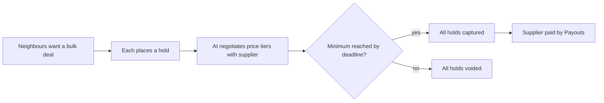

# #11 Tipping-Point Group Buy

> [!tldr] In one breath
> Many buyers place a hold. Money is taken only if the group reaches the supplier's minimum order by the deadline, and an AI negotiates the bulk price. If the goal is missed, every hold is cancelled. Score 74 (desk only). Fine, but unremarkable.

> [!example] Picture this
> Twelve neighbours want the same bulk order of olive oil, but the farm only ships if 10 people join. Everyone says "I am in" and the money is only reserved, like a hotel hold. If 10 or more join by Friday, everyone is charged. If not, all the reserved money goes back untouched. Nobody gets stuck with a refund chase.

> [!warning] Crowd check, Oct 23 2026
> A smaller crowd. The scan found a group pooling and splitting cluster of 3 to 6 repos (caresplit, potluck, purser, sarafupay, WePay, homeward). The hold until threshold twist was not seen, but the AI verified escrow area (about 28 repos) uses the same hold then release trick for other goals.

**Theme:** E2 Programmable holds · **Group:** Programmable holds · **Crowding on Devpost:** Group pay cluster (about 6)

## The problem
**Small buyers cannot reach wholesale minimums, and crowdfunding takes money early and refunds messily.**

## The idea
Each participant authorises a hold. An AI agent negotiates price tiers with the supplier. At the deadline, either all captures run or all holds are voided.

**Who it is for:** community buying groups, and makers testing demand.

**What the AI does:** negotiates with the supplier, forecasts demand, and messages the group.

## How PayPal is used
AUTHORIZE holds. Batch capture and void. Payouts to the supplier. Webhooks.

**Building blocks used** (see [[30 Primitives Legend]]):
* `P02` AUTHORIZE intent (hold funds)
* `P03` Authorization lifecycle: partial capture, void, reauthorize
* `P11` Payouts (batch)
* `A07` Multi agent negotiation
* `A04` Forecasting and pricing suggestion

## Who else is doing this
Kickstarter, BackerKit, Pinduoduo. Crowdfunding and social commerce exist, and holding until a threshold is a known pattern.

**Verification status:** ⚠️ desk research only. The competitor names come from landscape and Devpost scans, not from a per idea novelty hunt. Treat "no competitor found" as unproven.

## What makes it different
Mostly the hold mechanism. Group pay is crowded.

## Can we build it?
Medium.

## Demo plan (MVP)
5 sandbox buyers. If the threshold is met, captures run. If missed, voids run.

## Risks
The group pay cluster (about 6) on Devpost.

## Sources
* [PayPal: authorization 29 day period, 3 day honor, reauth, capture up to 115% or +$75](https://developer.paypal.com/payment-methods/auth-honor.md) ✅
* [Devpost "Built with PayPal" listing (early entry clustering, about 72 reviewed)](https://devpost.com/software/built-with/paypal) ⚠️

## Scores
"Risk⁻¹" means a higher number is a safer idea.

| Axis | Weight | Desk score |
|---|---|---|
| Tech | ×2 | 7 |
| Design | ×2 | 7 |
| Impact | ×2 | 4 |
| Innovation | ×2 | 5 |
| Demo | ×2 | 7 |
| Feasibility | ×1 | 7 |
| Risk⁻¹ | ×1 | 7 |
| **Total /120** | | **74** |

_Why (desk):_ Fine, unremarkable.

**Kill codes:** none triggered.

> [!info]- Jargon decoder
> **Authorize hold**: PayPal reserves money without taking it, like a hotel hold at check in.
> **Capture**: actually take the held money.
> **Void**: cancel the hold and release the money.
> **Batch**: doing many of the same action in one go, like sending 50 letters in one trip.
> **Payouts**: PayPal sending money out to someone, here the supplier.
> **Multi agent negotiation**: AI agents bargaining with each other, like two traders haggling.
> **Wholesale minimum**: the smallest order a supplier will accept.
> **Webhook**: a doorbell. PayPal rings your server when something happens.

## Where to next
* ⬆️ Up: [[Idea Index]]
* ⬅️ Previous: [[I010 Backorder Reauth Manager]] · ➡️ Next: [[I012 No-Show Deposit Sizer]]
* 🧭 Theme: [[Theme E2 Programmable holds]]
* 🔗 Related: [[00 PayPal AI Hackathon Hub]]
