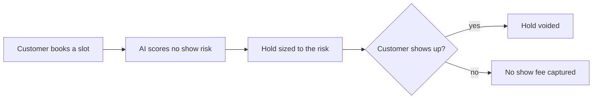

# #12 No-Show Deposit Sizer

> [!tldr] In one breath
> AI predicts how likely each booking is to be a no show and sizes the PayPal hold to fit. Reliable customers barely notice anything. Risky slots get real protection. Score 72 (desk only). Weak evidence and a fairness risk.

> [!example] Picture this
> A salon gets burned by no shows every Saturday. A flat $30 deposit scares away the loyal regulars who always turn up. Picture a friendly bouncer who knows that Priya has come 14 times in a row (hold: $0 or tiny) and that a first time booking made at 2 a.m. for tomorrow's busiest slot is riskier (hold: bigger). The hold is released when the customer shows up.

> [!success] Crowd check, Oct 23 2026
> Looked thin in the 266 repo scan (partial coverage). No repo was seen sizing deposits by predicted no show risk. The deep dive notes booking agents on Devpost (about 4), and the AI escrow area (about 28 repos) uses holds for other reasons.

**Theme:** E2 Programmable holds · **Group:** Programmable holds · **Crowding on Devpost:** Booking cluster (about 4)

## The problem
**Flat deposits scare off good customers, and no deposit invites no shows.**

## The idea
A risk model reads booking signals and sets the hold size. If the customer does not show, the no show fee is captured. If they attend, the hold is voided.

**Who it is for:** salons, clinics (non medical), restaurants and tutors.

**What the AI does:** scores the risk and explains the deposit size.

## How PayPal is used
AUTHORIZE, partial capture, void. Vault.

**Building blocks used** (see [[30 Primitives Legend]]):
* `P02` AUTHORIZE intent (hold funds)
* `P03` Authorization lifecycle: partial capture, void, reauthorize
* `P06` Vault v3 (saved payment tokens, payer not present charges)
* `A05` Structured decision and classification (most common)

## Who else is doing this
OpenTable, Booksy, Tock. Booking platforms offer flat no show fees and card holds.

**Verification status:** ⚠️ desk research only. The competitor names come from landscape and Devpost scans, not from a per idea novelty hunt. Treat "no competitor found" as unproven.

## What makes it different
Dynamic sizing. Booking agent entries are already on Devpost (about 4).

## Can we build it?
High.

## Demo plan (MVP)
A booking page, a risk model and holds.

## Risks
Fairness and discrimination worries in risk scoring. The booking cluster is crowded.

## Sources
* [PayPal: authorization 29 day period, 3 day honor, reauth, capture up to 115% or +$75](https://developer.paypal.com/payment-methods/auth-honor.md) ✅
* [Devpost "Built with PayPal" listing (early entry clustering, about 72 reviewed)](https://devpost.com/software/built-with/paypal) ⚠️

## Scores
"Risk⁻¹" means a higher number is a safer idea.

| Axis | Weight | Desk score |
|---|---|---|
| Tech | ×2 | 7 |
| Design | ×2 | 7 |
| Impact | ×2 | 4 |
| Innovation | ×2 | 5 |
| Demo | ×2 | 6 |
| Feasibility | ×1 | 8 |
| Risk⁻¹ | ×1 | 6 |
| **Total /120** | | **72** |

_Why (desk):_ Weak evidence and a fairness risk.

**Kill codes:** none triggered.

> [!info]- Jargon decoder
> **Authorize hold**: PayPal reserves money on the card without taking it, like a hotel hold at check in.
> **Partial capture**: take only part of the held money.
> **Void**: cancel the hold and release the money.
> **Vault**: PayPal's safe for saved payment methods, so a shop can charge a fee later with permission.
> **No show**: a customer who books and never turns up.
> **Risk model**: a scoring formula that guesses how likely something bad is.

## Where to next
* ⬆️ Up: [[Idea Index]]
* ⬅️ Previous: [[I011 Tipping-Point Group Buy]] · ➡️ Next: [[I013 Pricing-Error Shield]]
* 🧭 Theme: [[Theme E2 Programmable holds]]
* 🔗 Related: [[00 PayPal AI Hackathon Hub]]
