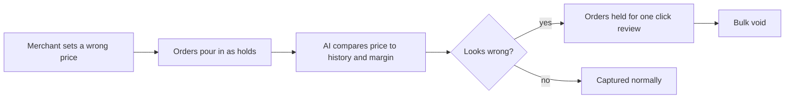

# #13 Pricing-Error Shield

> [!tldr] In one breath
> Hold the payment first, then take it only after an AI sanity check. A $1 typo on a $100 product then cannot ship 400 orders. Score 83 (desk only). A fun demo, but the evidence is anecdotal.

> [!example] Picture this
> A shop owner types $1 instead of $100 for a pair of headphones, goes to bed, and the product goes viral on a deals forum. By morning 400 people have ordered. Normally the money is already taken, and cancelling means refunds and angry disputes. With this shield the money is only reserved. A watchful AI sees "400 orders at 1% of normal price" and freezes them. The owner wakes up to one message and one button: "void all."

> [!success] Crowd check, Oct 23 2026
> Looked empty in the 266 repo scan (partial coverage). No repo was seen protecting merchants from their own pricing mistakes. Fraud and spend guardrail tools are common, but they watch buyers and agents, not the merchant's price list.

**Theme:** E2 Programmable holds · **Group:** Programmable holds · **Crowding on Devpost:** none

## The problem
**Mispricing incidents can wipe out a small merchant overnight.** Once the money is captured, cancelling triggers refunds and disputes.

## The idea
The merchant switches to AUTHORIZE. An anomaly agent compares each order with catalog history, competitor prices and margin. It holds suspicious orders for one click review and voids or captures them in bulk.

**Who it is for:** small e-commerce merchants.

**What the AI does:** detects odd prices and groups orders to spot viral mispricing spikes.

## How PayPal is used
AUTHORIZE, capture and void. Catalog products. Webhooks.

**Building blocks used** (see [[30 Primitives Legend]]):
* `P02` AUTHORIZE intent (hold funds)
* `P03` Authorization lifecycle: partial capture, void, reauthorize
* `P30` Catalog products and billing plans
* `A15` Anomaly detection

## Who else is doing this
Shopify Flow, Signifyd. Fraud tools score buyers, not merchant side pricing mistakes.

**Verification status:** ⚠️ desk research only. The competitor names come from landscape and Devpost scans, not from a per idea novelty hunt. Treat "no competitor found" as unproven.

## What makes it different
Protecting the merchant from their own errors is unusual.

## Can we build it?
High.

## Demo plan (MVP)
Seed a catalog, trigger a spike of $1 orders, watch the shield hold them, then bulk void.

## Risks
The evidence is anecdotal. There is no dataset on pricing error losses.

## Sources
* [PayPal: authorization 29 day period, 3 day honor, reauth, capture up to 115% or +$75](https://developer.paypal.com/payment-methods/auth-honor.md) ✅

## Scores
"Risk⁻¹" means a higher number is a safer idea.

| Axis | Weight | Desk score |
|---|---|---|
| Tech | ×2 | 7 |
| Design | ×2 | 7 |
| Impact | ×2 | 4 |
| Innovation | ×2 | 7 |
| Demo | ×2 | 8 |
| Feasibility | ×1 | 9 |
| Risk⁻¹ | ×1 | 8 |
| **Total /120** | | **83** |

_Why (desk):_ A fun demo with weak evidence.

**Kill codes:** none triggered.

> [!info]- Jargon decoder
> **Authorize, then capture**: like a hotel holding $200 on your card, then charging only when you check out. Authorize reserves the money. Capture takes it.
> **Void**: cancel the hold and release the money.
> **Anomaly detection**: AI spotting something that looks very different from normal, like a smoke alarm for odd numbers.
> **Catalog products**: PayPal's list of items and prices a merchant sells.
> **Margin**: the profit left after costs.
> **Webhook**: a doorbell. PayPal rings your server when something happens.

## Where to next
* ⬆️ Up: [[Idea Index]]
* ⬅️ Previous: [[I012 No-Show Deposit Sizer]] · ➡️ Next: [[I014 Delivery-Confirmed Capture]]
* 🧭 Theme: [[Theme E2 Programmable holds]]
* 🔗 Related: [[00 PayPal AI Hackathon Hub]]
