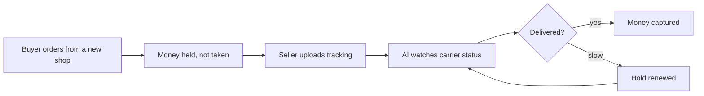

# #14 Delivery-Confirmed Capture

> [!tldr] In one breath
> New sellers place a hold at order time and take the money when the carrier confirms delivery. Buyers trust unknown shops more, and sellers avoid new account holds. Score 72. **Eliminated** with kill code K2: it reads as escrow in a very crowded field.

> [!example] Picture this
> You want to buy a handmade ceramic mug from a shop you have never heard of. You hesitate. Now imagine your money sits in a see through jar and only moves to the seller when the courier scans "delivered." You would click buy. The seller is happier too, because PayPal does not freeze their money for 21 days.

> [!warning] Crowd check, Oct 23 2026
> Very crowded. AI verified escrow with release or void is the second most crowded area in the scan, about 28 repos: handback, milestone-ai-escrow, mergepay, three named ProofPay, fairshake, holdfast, TrustLock, ArbiterPay, specpay, judgepay, PayGrade, stood, escrowease, trustrail-hold, wasl, rentabot, sudhaar, PropLock, tidehold, outcomepay, scopepay, fairdeal. Judges will see this pattern again and again.

**Theme:** E2 Programmable holds · **Group:** Programmable holds · **Crowding on Devpost:** Escrow cluster (about 11)

## What the kill code means
**K2 means "too crowded, or sounds like something already out there, so we cannot defend that it is new."** Here the idea works, but it looks like escrow, and escrow is everywhere. See [[41 Brutal Elimination]].

## The problem
New sellers face holds of up to 21 days, and buyers distrust unknown shops (19% of cart abandoners do not trust the site with card details).

## The idea
Authorise at order. Upload tracking through the Tracking API. AI watches the carrier status and captures on delivery. It reauthorises if transit runs long.

**Who it is for:** new marketplace and social sellers.

**What the AI does:** reads carrier events and writes messages when something goes wrong.

## How PayPal is used
AUTHORIZE, capture, reauthorize. Tracking API.

**Building blocks used** (see [[30 Primitives Legend]]):
* `P02` AUTHORIZE intent (hold funds)
* `P03` Authorization lifecycle: partial capture, void, reauthorize
* `P17` Shipment Tracking API (add tracking, releases holds)
* `A01` Document and image extraction (OCR, validation)

## Who else is doing this
Escrow.com, Trustap. Escrow services exist, and AI judged escrow is the second most crowded Devpost cluster (about 11).

**Verification status:** ⚠️ desk research only. The competitor names come from landscape and Devpost scans, not from a per idea novelty hunt. Treat "no competitor found" as unproven.

## What makes it different
It uses a native hold rather than escrow, but it reads as escrow.

## Can we build it?
Medium, because tracking must be simulated.

## Demo plan (MVP)
Order, tracking, simulated delivery, capture.

## Risks
The escrow cluster. Hold windows can be shorter than slow shipping.

## Sources
* [PayPal: funds availability, holds up to 21 days](https://www.paypal.com/us/brc/article/funds-availability) ✅
* [Baymard: 70.22% cart abandonment, and the reasons](https://baymard.com/lists/cart-abandonment-rate) ✅
* [PayPal Add Tracking API: "fastest way to access on hold funds"](https://developer.paypal.com/api/tracking/track-orders/integrate.md) ✅
* [Devpost "Built with PayPal" listing (early entry clustering, about 72 reviewed)](https://devpost.com/software/built-with/paypal) ⚠️

## Scores
"Risk⁻¹" means a higher number is a safer idea.

| Axis | Weight | Desk score |
|---|---|---|
| Tech | ×2 | 7 |
| Design | ×2 | 6 |
| Impact | ×2 | 6 |
| Innovation | ×2 | 4 |
| Demo | ×2 | 6 |
| Feasibility | ×1 | 7 |
| Risk⁻¹ | ×1 | 7 |
| **Total /120** | | **72** |

_Why (desk):_ Reads as escrow in a crowded field.

**Kill codes triggered:** `K2` Crowded cluster or derivative headline; innovation cannot be defended. See [[41 Brutal Elimination]].

> [!info]- Jargon decoder
> **Authorize, then capture**: like a hotel holding $200 on your card at check in, then charging only at check out.
> **Reauthorize**: renew a hold that is about to run out.
> **Escrow**: a neutral third party holds the money until both sides keep their promise, like a friend holding the bet money.
> **Tracking API**: lets a seller tell PayPal where a parcel is. PayPal says this is the fastest way to free held funds.
> **Cart abandonment**: shoppers who fill a basket and leave without paying.
> **OCR**: software that reads text from photos and documents.

## Where to next
* ⬆️ Up: [[Idea Index]]
* ⬅️ Previous: [[I013 Pricing-Error Shield]] · ➡️ Next: [[I015 Commitment Contract to Charity]]
* 🧭 Theme: [[Theme E2 Programmable holds]]
* 🔗 Related: [[41 Brutal Elimination]], [[00 PayPal AI Hackathon Hub]]
