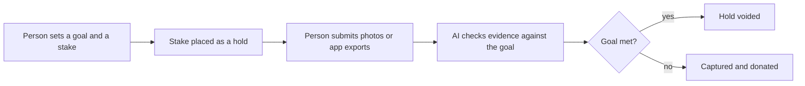

# #15 Commitment Contract to Charity

> [!tldr] In one breath
> You put money on a goal. If AI checked evidence says you missed it, the held money is taken and donated to charity. If you hit the goal, the hold is released. Score 71. **Eliminated** with kill code K4: charming, but low impact and weak evidence.

> [!example] Picture this
> Sam says "I will run three times a week for a month" and puts $50 on the line. If Sam runs, nothing happens and the $50 hold disappears. If Sam skips, the $50 goes to a charity Sam picked. It is a bet against your own laziness, with a good cause as the penalty.

> [!success] Crowd check, Oct 23 2026
> Thin in the 266 repo scan (partial coverage). Nonprofit and donations projects are rare (only amanah and a classroom repo), and no commitment contract repo was seen. Note that existing apps already do this (Beeminder, stickK, Forfeit), and the AI verified escrow area (about 28 repos) uses the same hold then release pattern for other goals.

**Theme:** E2 Programmable holds · **Group:** Programmable holds · **Crowding on Devpost:** none

## What the kill code means
**K4 means "weak evidence or low impact."** Judges could not be shown a big, proven need. See [[41 Brutal Elimination]].

## The problem
Commitment devices work, but you must trust the app with your money upfront.

## The idea
AUTHORIZE a stake. AI checks evidence (photos, app exports) against the goal. Void the hold on success. Capture it and donate on failure.

**Who it is for:** individuals, and workplace wellness challenges.

**What the AI does:** checks evidence against a rubric (a scoring checklist).

## How PayPal is used
AUTHORIZE, void, capture. Donate SDK or Payouts to a charity.

**Building blocks used** (see [[30 Primitives Legend]]):
* `P02` AUTHORIZE intent (hold funds)
* `P03` Authorization lifecycle: partial capture, void, reauthorize
* `P29` Donate SDK and charity flows
* `A02` Classification with explanation and vision estimation
* `A13` Vision verification and evidence narrative

## Who else is doing this
Beeminder, stickK, Forfeit. Established commitment apps exist.

**Verification status:** ⚠️ desk research only. The competitor names come from landscape and Devpost scans, not from a per idea novelty hunt. Treat "no competitor found" as unproven.

## What makes it different
A hold based stake with charity routing.

## Can we build it?
High, but the 29 day hold limit caps how long a goal can be.

## Demo plan (MVP)
One 7 day goal, simulated.

## Risks
Low impact evidence. Gamification framing.

## Sources
* [PayPal: authorization 29 day period, 3 day honor, reauth, capture up to 115% or +$75](https://developer.paypal.com/payment-methods/auth-honor.md) ✅

## Scores
"Risk⁻¹" means a higher number is a safer idea.

| Axis | Weight | Desk score |
|---|---|---|
| Tech | ×2 | 6 |
| Design | ×2 | 7 |
| Impact | ×2 | 3 |
| Innovation | ×2 | 5 |
| Demo | ×2 | 7 |
| Feasibility | ×1 | 8 |
| Risk⁻¹ | ×1 | 7 |
| **Total /120** | | **71** |

_Why (desk):_ Charming, low impact.

**Kill codes triggered:** `K4` Weak evidence or low impact. See [[41 Brutal Elimination]].

> [!info]- Jargon decoder
> **Commitment device**: a trick that makes it costly to break a promise to yourself, like giving a friend your snacks to hide.
> **Authorize hold**: PayPal reserves money without taking it, like a hotel hold at check in.
> **Void**: cancel the hold and release the money.
> **Capture**: actually take the held money.
> **Donate SDK**: PayPal's ready made toolkit for giving to charities.
> **Payouts**: PayPal sending money out to someone.
> **Rubric**: a checklist used to grade something.
> **29 day limit**: PayPal holds expire after 29 days, so no goal can run longer without renewing.

## Where to next
* ⬆️ Up: [[Idea Index]]
* ⬅️ Previous: [[I014 Delivery-Confirmed Capture]] · ➡️ Next: [[I016 Dispute EV Triage]]
* 🧭 Theme: [[Theme E2 Programmable holds]]
* 🔗 Related: [[41 Brutal Elimination]], [[00 PayPal AI Hackathon Hub]]
